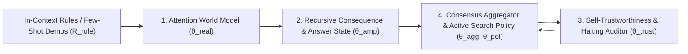

# Inconsistency Is All You Need
*coherent beliefs from rollouts that disagree: label-free reasoning, hidden-rule discovery, and policy-independent beliefs over an attention world model*

**Research direction note (v7). Kelvin Azevedo Santos, MATS autumn 2026 (mentor: Deger Turan, Metaculus). Drafted with the Gemini Argon agent; edited under `docs/PROTOCOL.md`. Status: proposal with audited evidence summary (§5) and next experimental roadmap against the Tiny Recursive Model (`TRM` / `LDT` / `InfiLoop` / `TRMP`) comparison class (§6). Full line-by-line numbers and audit verdicts are in `docs/audits/` and `docs/papers/experiments-rounds-4-9-paper-v3.md`.**

---

## Executive Abstract

Current foundation models and recursive reasoners keep world beliefs, search heuristics, and utility preferences entangled, or rely on ground-truth solution labels during training. Appending all reasoning steps into one serial context tape of length $N$ hits context limits; outcome reinforcement learning (RL) updates beliefs alongside actions—distorting beliefs toward wishful thinking; and supervised recursive architectures—such as the **Hierarchical Reasoning Model (`HRM`; Wang et al., `arXiv:2506.21734`)**, **Tiny Recursive Model (`TRM`; Jolicoeur-Martineau, `arXiv:2510.04871`)**, **Probabilistic TRM (Sghaier et al., `arXiv:2605.19943`)**, **Lattice Deduction Transformer (`LDT`; Davis et al., `arXiv:2605.08605`)**, **InfiLoop (Li et al., `arXiv:2610.11570`)**, and **Tiny Recursive Message Passing (`TRMP`; Salvatori et al., `arXiv:2610.18649`)**—require ground-truth solved boards $y^\star$ (or external enumeration of all valid solutions $S(x)$ when multiple solutions exist) for deep supervision.

**Our Core Bet:** *Inconsistency minimisation with a world model—using zero ground-truth answer labels and zero external reward during searcher training—is a strictly more general and scalable training target.* We study a decomposed architecture that separates **what the world's rules and dynamics are** from **how to search, deduce, and plan under those rules**:
1. **Attention-Interfaced Any-Order World Model ($q_\theta$):** Represents local domain laws, hidden-state transitions, and **in-context rule hypotheses $R _ {\text{rule}} \in \mathcal{R}$** via an attention/transformer interface (either learned from observations or specified via learnable attention operators for controlled evaluation, never an opaque black-box simulator).
2. **Label-Free Recursive Inconsistency Searcher & Consensus Aggregator:** Runs nested recursive updates and $k$ parallel/tree-forked rollouts of bounded context $\le n$, maintaining calibrated beliefs over **answers $X _ {\text{ans}}$, hidden states $Z _ {\text{hid}}$, and latent rules $R _ {\text{rule}}$**. Instead of supervising against oracle solutions $y^\star$, training minimizes the **Probabilistic Dependency Graph (PDG) Inconsistency Energy** $\mathcal{E}(\mu; \theta, U)$ between the searcher's evolving belief state $\mu_t$ and the world model's local conditional checks.
3. **Strategic Information Gathering & Modular Utility ($U$):** Because beliefs explicitly track uncertainty over hidden states and rules ($R _ {\text{rule}}$), the agent acts strategically to acquire information that resolves rule and state ambiguity before committing. **Local Inconsistency Resolution (LIR) control masks** enforce that swapping the utility function $U \mapsto U'$ immediately redirects optimization toward the new goal with zero belief distortion (`0.0000` drift by architectural construction).

---

## 1. Decomposed Architecture: World Model Interface, Label-Free Searcher & LIR Roles

Let $V = \lbrace 1, \dots, M \rbrace$ denote domain variables partitioned into **observed clues/inputs $O$**, **candidate answers $X _ {\text{ans}}$**, **unobserved hidden states $Z _ {\text{hid}}$**, **in-context rule variables $R _ {\text{rule}}$** (allowing the world model to condition on a rule description or few-shot demonstrations in context), and **actions/goals** ($A, X_G$).

We partition parameters into four blocks governed by **LIR control masks** $\chi = (\chi _ {\text{real}}, \chi _ {\text{search}}) \in \lbrace 0, 1 \rbrace^2$:

$\theta _ {\text{real}}$ and $\theta _ {\text{trust}}$ are grounded strictly in realized/observational consistency, whereas $\theta _ {\text{amp}}$ and ($\theta _ {\text{agg}}, \theta _ {\text{pol}}$) are trained by **label-free inconsistency minimisation** across search cycles:

| Parameter Block | Input Conditioning | LIR Mask ($\chi _ {\text{real}},  \chi _ {\text{search}}$) | Converse Functional Role |
| :--- | :--- | :---: | :--- |
| **1. Attention World Model ($\theta _ {\text{real}}$)** | Partial assignment $x_S$ + in-context rule tokens $R _ {\text{rule}}$ | $(1,  0)$ | Defines local conditional laws $q _ {\text{real}}(x_i \mid x_S,  R _ {\text{rule}})$ via attention over variable and rule tokens. Blind to search trees and utility $U$. |
| **2. Recursive Consequence Extension ($\theta _ {\text{amp}}$)** | Single-world state $x_S$, fast memory $h_v$, slow answer state $a_v$ (`stop_grad` from $\theta _ {\text{real}}$) | $(0,  1)$ | Evolves candidate beliefs $\mu^{(t)}(X _ {\text{ans}},  Z _ {\text{hid}},  R _ {\text{rule}})$ across nested recursive cycles to minimize local world-model inconsistency $\mathcal{E}(\mu^{(t)};  \theta _ {\text{real}})$ **without ground-truth labels $y^\star$**. |
| **3. Self-Trustworthiness & Halting ($\theta _ {\text{trust}}$)** | State $x_S$ + Search Summary $h _ {\text{search}}$ (`stop_grad` on answer representation) | $(1,  0)$ | Predicts local consistency satisfaction and excess surprise, separating genuine multimodal ambiguity from out-of-distribution errors, and gating adaptive halting. |
| **4. Modular Utility ($U$)** | Goal/action variables $X_G$ | $\chi _ {\text{belief}}=0,  \chi _ {\text{action}}=1$ | Steers active information-gathering queries and actions via $f_U(X_G) \propto \exp(\lambda U(X_G))$ without moving beliefs over uncontrolled world/rule variables. |

### 1.1 Why the World-Model Interface Matters More Than Hard-Coded Simulators

The searcher never relies on an opaque procedural simulator (`env.step()`). Even when testing with known puzzle or game rules, the world model is exposed to the searcher strictly through an **attention-compatible factor/conditional interface**:
- Given a current belief or lattice state $\mu_d \in \Delta(\Sigma)^{\vert V \vert}$ (or fast/slow latent states $h_v, a_v$) and in-context rule tokens $R _ {\text{rule}}$, querying the world model executes an attention/message-passing operator that returns **local conditional predictions $q_\theta(X_i \mid X_S, R _ {\text{rule}})$ and local constraint-violation energies**.
- Because this interface consists purely of differentiable attention and Deep-Sets/port-equivariant projections over tokens, a known rule operator can be swapped directly for a **learned any-order transformer world model** that infers $R _ {\text{rule}}$ in-context from a few examples or active probes.

---

## 2. Policy-Independent Consensus, Label-Free Inconsistency Training & Deduplication

### 2.1 The Global Inconsistency Target (Training Without Ground-Truth Answers)

For any fixed world model $\theta$, its queried conditionals $\lbrace q_\theta(X_i \mid X_S, R _ {\text{rule}}) \rbrace$ with precisions $\beta_\theta(i \mid S) \ge 0$ form a Probabilistic Dependency Graph (PDG; Richardson and Halpern 2021–2025) $M _ {\text{world}}(\theta)$. Adding modular utility factor $f_U(X_G) \propto \exp(\lambda U(X_G))$ defines the **Total Inconsistency Energy**:

$$\mathcal{E}(\mu; \theta, U) = \underbrace{\sum _ {(S \to i)} \beta_\theta(i \mid S)  \mathbb{E} _ {\mu(X_S, R _ {\text{rule}})}\Big[ \mathrm{KL}\big(\mu(X_i \mid X_S, R _ {\text{rule}}) \big\Vert q_\theta(X_i \mid X_S, R _ {\text{rule}})\big) \Big]} _ {\text{World-Model and Rule Incompatibility (Label-Free Target)}} + \underbrace{\mathrm{KL}\big(\mu(X_G) \big\Vert f_U(X_G)\big) _ {\chi _ {\text{world}}=0}} _ {\text{Modular Goal / Utility Incompatibility}} - \gamma H(\mu).$$

$$\mu^\star(\theta, U) = \arg\min _ {\mu}  \mathcal{E}(\mu; \theta, U).$$

**Why Label-Free Inconsistency Minimisation Avoids the Multi-Solution Collapse of Supervised Recursive Models:**
- In supervised recursive models (`TRM`, `HRM`, and `TRMP` on `N-Queens`, `arXiv:2610.18649`), training requires ground-truth solved boards $y^\star \in S(x)$. When $\vert S(x) \vert > 1$, supervising against a single solution drives a deterministic network toward the invalid *average of solutions*, forcing `TRMP` to pre-enumerate up to $14.8\text{ million}$ solutions per board with an external solver to supervise against the closest solution.
- Minimizing $\mathcal{E}(\mu; \theta, U)$ requires **zero pre-computed solutions $y^\star$**: any valid completion $x \in S(O)$ is a zero-inconsistency fixed point ($\mathcal{E}(\delta_x; \theta) = 0$) of the world model's local checks, and across multiple rollouts $r = 1 \dots k$, conditioned witness branches represent distinct modes without averaging them into an invalid mean.

**Assumptions for Policy-Independent Consensus:** $\mu^\star(\theta, U)$ is unique and independent of $\pi _ {\text{pol}}$ provided: (i) queried arcs and precisions $\beta_\theta(i \mid S)$ are fixed, (ii) $\gamma > 0$, (iii) each distinct arc is counted once, (iv) mutually exclusive branches are weighted by model probability, (v) $\pi _ {\text{pol}}$ has full support, and (vi) the aggregator deduplicates repeated arcs.

### 2.2 Counting Each Distinct Piece of Information Once (The Space of Information)

When $\pi _ {\text{pol}}$ samples $k$ rollouts, each emits a key $k_r \in \mathbb{S}^{d-1}$ (which subspace of world/rule variables the rollout inspected, read via `stop_grad` from $\theta _ {\text{real}}$'s internals), a log-odds shift claim $v_r = \Delta \ell_r$, and a trust precision $\beta_r$.

In the correlated-signal aggregation literature (Hellwig 1980; Clemen and Winkler 1985; Ostrovsky 2012; Lambert, Ostrovsky, and Panov 2018), $k$ signals with source-overlap Gram matrix $G _ {rb} = \langle k_r, k_b \rangle$ and idiosyncratic precisions $B = \mathrm{diag}(\beta_r)$ aggregate via the normal equations $(K^\top B K + \lambda I) w = K^\top B v$. For $N$ rollouts with pairwise overlap $\rho = \langle k_r, k_b \rangle$ and signal-to-noise ratio $\beta/\lambda$, the combined effective weight is:

$$W _ {\text{eff}}(N, \rho, \beta) = \frac{N \beta}{\lambda + \big(1 + (N-1)\rho\big)\beta}, \qquad \log \mu_k^\star(y) = \log p_0(y) + \sum _ {r=1}^k w_r  \log \frac{q_r(y)}{p_0(y)} + \text{const}.$$

This unifies **(i) mutual support** ($\beta \ll \lambda$: noisy independent rollouts reinforce linearly, $W _ {\text{eff}} \approx N\beta/\lambda$) and **(ii) deduplication** ($N\rho\beta \gg \lambda$: repeated deterministic checks $\rho \to 1$ saturate at total weight $1$). Across partially overlapping rollouts ($0 < \rho < 1$), $L$ layers of weight-tied residual self-attention (`looped_attn_T3`) or precision-aware Jacobi iteration (`jacobi_lin_T4_prec`) implement preconditioned steps on $(K^\top B K + \lambda I)w = K^\top B v$ (Vladymyrov et al., `arXiv:2402.14180`). Audit note: entrywise positive clipping $\max(0, \langle k_r, k_b \rangle)$ does not preserve positive semi-definiteness; true PSD kernels $K^\top B K$ are required when guaranteeing contraction.

---

## 3. Recursive Consensus Mechanics, Two-Timescale Loops & Active Information Gathering

### 3.1 Synthesizing Recursive Message/Attention Loops (`TRM`/`InfiLoop`/`TRMP`) with Landmark Consensus

Our searcher combines the **two-timescale truncated recursion and streaming attention residuals of the `TRM`/`InfiLoop`/`TRMP` family** (`arXiv:2510.04871`, `arXiv:2610.11570`, `arXiv:2610.18649`) with **Landmark Consensus & Conflict Memory**:
1. **Two-Timescale Nested Recurrence ($C \times R$), Streaming Attention Residuals & Truncated Credit Horizon ($h = (C-D)R$):**
   - Within each segment of $C$ outer cycles and $R$ inner attention/message rounds, fast vertex memories $h_v^{(t)}$ propagate local consistency messages over $R$ rounds while slow answer/belief states $a_v^{(k)}$ update once per cycle, with first $D$ cycles detached (`stop_grad`) and final $T = C - D$ cycles differentiated.
   - **Preventing "Latent Overthinking" Without Ground-Truth Labels (`InfiLoop` `arXiv:2610.11570` vs. Label-Free Inconsistency Gate):** Carry-last `TRM-Att` ($h_t = z_t$) degrades at deep test-time horizons (`62.2% -> 58.1%` on `Sudoku-Extreme`, overwriting `20.9%` of already-correct cells). `InfiLoop` (`arXiv:2610.11570`) fixes this along a single trajectory via streaming attention residuals $N_t = \beta N _ {t-1} + e_t z_t$, $D_t = \beta D _ {t-1} + e_t$, $h_t = N_t / D_t$, where the content score $e_t = \exp(q^\top \mathrm{RMSNorm}(z_t))$ learns under supervised $y^\star$ training to spike when constraint errors hit zero (`97.9%` at `15,120` layers). In our framework, gating $e_t$ directly by **label-free world-model consistency $m _ {\text{ql}} \cdot \beta _ {\text{trust}}$** (`R9-E2` `D2.2` PASS, `AUROC = 0.99998`) achieves this exact solution-locking behavior **with zero ground-truth solved boards $y^\star$**, while key-space normal-equation clearing $(K^\top B K + \lambda I)^{-1}$ prevents `InfiLoop`'s scalar age decay ($\beta^{t-i}$) from forgetting orthogonal earlier deductions.
   - **Bridging Graph Diameter Under Truncation:** Bipartite factor graphs enable zero-shot size transfer ($N=10 \to 16$) because node port degree is independent of board size, but degrade under short truncated gradient horizons ($h=5$) because variable-to-variable paths have diameter $4$ instead of $2$ (`arXiv:2610.18649` §5.1.1). Adding 2-hop factor-shortcut attention bridges restores 1-cycle credit propagation while preserving size-transfer equivariance.
2. **Replacing Memoryless Lattice Restarts with Landmark Nogood Memory:**
   - In `LDT` (`arXiv:2605.08605`) and `TRMP` (`arXiv:2610.18649` §B.2.1), when a discrete deduction lattice chain $x_d \in \lbrace 0,1 \rbrace^{\vert V \vert \times \vert \Sigma \vert}$ hits a conflict, the chain **wipes its state and restarts from the blank puzzle**, causing lattice search to stall on hard SAT (`17.7%` on `G4SATBench` hard 3-SAT).
   - Maintaining **Landmark Scenarios** $\lbrace S_0, S_1, \dots, S_M \rbrace$ with conflict-clause exclusion prevents parallel chains from re-entering refuted subtrees, while check-gated self-consistency $m _ {\text{ql}} = \min _ {c \in E_b} q _ {\text{leaf}}(c, Z_c)$ filters invalid leaves before pooling.
3. **Smooth-Minimum Confidence & Computation as Evidence (Null Search):**
   - Per-variable confidence logits $q_v = w_q  \mathrm{sg}(a_v)$ (read with `stop_grad` so halting never warps the representation) pool via the smooth minimum $q = -\log \sum _ {v \in V} \exp(-q_v)$. When all $M$ rollouts are refuted by forward checks, cumulative refuted model mass $C_M \in [0, 1)$ updates $P(\text{sol} \mid \text{null})$ with recall floor $\eta _ {\max} \in [0, 1]$:

$$\mathrm{logit}  P(\text{sol} \mid \text{null}) = \mathrm{logit}  p_0 + \log\big[(1 - \eta _ {\max}) + \eta _ {\max}(1 - C_M)^\theta\big].$$

### 3.2 Strategic Active Information Gathering Over Uncertain Rules & Hidden States

When the environment has hidden states $Z _ {\text{hid}}$ or unknown rules $R _ {\text{rule}} \in \lbrace r_1, \dots, r_K \rbrace$, the search/action policy $\pi _ {\text{pol}}$ selects probes or branching variables $v$ by combining utility value $\hat{Q} _ \mu(v)$ with **Expected Inconsistency / Entropy Reduction (Value of Information)** over both $X _ {\text{ans}}, Z _ {\text{hid}}$ and the rules $R _ {\text{rule}}$:

$$\mathrm{Score} _ {\text{pol}}(v \mid \text{prefix}, \text{Consensus}) = \hat{Q} _ \mu(v) + c _ {\text{puct}}  \pi_0(v)  \frac{\mathrm{VoI} _ {\text{rule}}(v; R _ {\text{rule}}) + I _ {\text{goal}}(v)  \beta_\theta(v \mid \text{prefix})}{\sqrt{1 + \mathrm{Crowding}(k_v, K _ {<r})}}.$$

Here $\mathrm{VoI} _ {\text{rule}}(v; R _ {\text{rule}})$ is the expected KL reduction on the latent rule posterior, $I _ {\text{goal}}(v)  \beta_\theta(v \mid \text{prefix})$ is goal-relevant stiffness, and $\mathrm{Crowding}(k_v, K _ {<r}) = \sum _ {r'<r} \beta _ {r'} \max(0, \langle k_v, k _ {r'} \rangle)$ penalizes redundant keys.

---

## 4. Local Credit Assignment (Exact for the $\gamma = 0$ Pool)

For the $\gamma = 0$ log-linear pool (`STUDY-LIR.md` §3c–3f), outcome or local-constraint log-loss equals the **PDG Inconsistency Increment** from clamping target/check satisfaction $\delta_x$:

$$-\beta_0 \log \mu_k^\star(x) = \langle\langle M_k + \delta_x \rangle\rangle - \langle\langle M_k \rangle\rangle.$$

By the envelope theorem (attending $+\beta_r$ on $\delta_x$ and $-\beta_r$ on a pinned copy of $\mu_k^\star$), each rollout's exact local credit is its **Leave-One-Out (LOO) gain**:

$$r _ {\mathrm{LOO}}(r) = \log \mu_k^\star(x) - \log \mu _ {-r}^\star(x) \approx \frac{\beta_r}{\beta_0}\Big(\ell_r(x) - \mathbb{E} _ {\mu_k^\star}[\ell_r(X)]\Big).$$

---

## 5. Summary of Audited Evidence (`docs/PROTOCOL.md` §2.7)

Full per-gate numbers, confidence intervals, and disclosures are archived in [`experiments-rounds-4-9-paper-v3.md`](file:///home/agent/workspaces/inconsistency-search/docs/papers/experiments-rounds-4-9-paper-v3.md) and the independent audits in `docs/audits/`.

### 5.1 What Holds in Rounds 1–9 (Audited in [`research-direction-note-v4-audit-2026-10-18.md`](file:///home/agent/workspaces/inconsistency-search/docs/audits/research-direction-note-v4-audit-2026-10-18.md) and [`experiments-rounds-4-9-paper-v2-audit-2026-10-18.md`](file:///home/agent/workspaces/inconsistency-search/docs/audits/experiments-rounds-4-9-paper-v2-audit-2026-10-18.md))

1. **Deduplicating Correlated Rollouts via Looped Attention (`R7-E1`, `R8-E1`, `R9-E1` `D0/D1.1/D2.2` PASS):**
   - On $6\times 6$ ShipHunt, a weight-tied 3-iteration Transformer aggregator (`looped_attn_T3`) and an 814-parameter precision-aware Jacobi normal-equation solver (`jacobi_lin_T4_prec`, with ridge $\lambda(\beta_r) = \mathrm{softplus}(a - b\beta_r)$ per tier) cut belief KL vs. exact Bayes by **88–89%** from a sparse root and cut preference-skew belief $\mathrm{JSD}$ by **$7\times$** compared to naive pooling (`scaled_mix`) and `ataraxos_mmd`.
   - Under the three-regime weight law (`R9-E1` `D2.2` PASS), 16 identical clean reads receive **1.07–1.11x** the weight of a single read (**deduplication**), while noisy independent reads accumulate weight monotonically (**mutual support**). At a strong root (`R9-E1` `D1.2` PASS under calibration selection; 2 of 15 parts fail under literal $M_0=34$ selection), pools without an anchor token degrade the root, whereas anchor-aware `looped_attn_T3` improves monotonically.
2. **Salience Keys Track Source Overlap (`R6-E1` `D1` PASS, `R7-E3` `D1(1)` PASS):**
   - Rollout belief-shift footprints $s_r = \vert \Delta\ell_r \vert / \Vert \Delta\ell_r \Vert_2$ track true spatial cell overlap on ShipHunt (`Pearson = 0.88`, `Spearman = 1.00` across shared-cell counts) without given patch indices.
3. **Anytime Monotonicity & Zero-Extra-Pass Leaf Self-Consistency on `Sudoku-Extreme` (`R7-E2` `E2-G0` PASS, `R8-E2` & `R9-E2` `D1.0/D2.1/D2.2` PASS; `D1.1/D1.2` FAIL on vs.-`stoch` CI bars):**
   - Check-gated pooling strictly decreases test KL across all $36/36$ budget transitions, and gating accepted leaves by their internal check self-read $m _ {\text{ql}} = \min _ {c \in E_b} q _ {\text{leaf}}(c, Z_c)$ eliminates false witness accepts (`AUROC = 0.99998`, `0%` false accepts in `R9-E2` `D2.2` PASS).
4. **LIR Parameter Separation Prevents Belief Distortion Under RL (`R5-E1` Part B `D0.2/D3.2/D3.3/D3.4` PASS, `D3.1` FAIL; `R4-E3b` `Qwen3-8B` `D0a/D0b/D1d` PASS):**
   - Training actions with GRPO under **Fused RL** ($\chi=\mathbf{1}$) distorts beliefs toward desired outcomes (`83%` false-note sycophancy on ShipHunt; `99.9%` on `Qwen3-8B`), and **Token-Masked RL** on a shared trunk still leaks reward pressure ($14\times$ control belief drift via representation spillover). **LIR Parameter Separation** ($\chi _ {\text{belief}}=0, \chi _ {\text{action}}=1$) keeps belief drift at **`0.0000`** (by architectural construction) and flips actions `100%` immediately when utility $U$ is swapped at test time.

### 5.2 Independent Audit Verdict on Rounds 10–25 ([`gemini-campaign-critique-2026-10-19.md`](file:///home/agent/workspaces/inconsistency-search/docs/audits/gemini-campaign-critique-2026-10-19.md), [`pillar1-openspiel-stratego-audit-2026-10-19.md`](file:///home/agent/workspaces/inconsistency-search/docs/audits/pillar1-openspiel-stratego-audit-2026-10-19.md), [`pillar2-reasoning-clrs-audit-2026-10-19.md`](file:///home/agent/workspaces/inconsistency-search/docs/audits/pillar2-reasoning-clrs-audit-2026-10-19.md))

An independent Opus 5.5 audit (`board-opus` under `opus-mats`) reviewed all 165 claims across Rounds 10–25:
- **Verdict:** **`0` capability claims in Rounds 10–25 passed a pre-registered, unchanged rule on a genuine run** (`87` artefact, `60` partly supported, `6` untested, `12` supported code/math facts).
- **Root Causes Retracted:** Surrogate or leaked features (`R10–R11`, `R13–R21`), post-run gate edits (`R12`), tiny 18–40 step training budgets where baselines did not beat uniform or untrained init (`R22A`), non-neural helpers (`WalkSAT`/singles/Bellman-Ford priors) active inside the `v3` architecture where untrained `GLC_v3` matched or beat trained `GLC_v3` (`R22B`, `R24B`, `R25`), and `Theorem 2.1` (false: entrywise-clipped Gram matrices are not PSD).
- **What Remains Reusable:** The exact-oracle environments (`ShipHunt 6x6`, `Minesweeper 6x6`, `Micro-Stratego`, `Sudoku`/`SAT` verifiers) once the 5 audited feature leaks are zeroed, plus the protocol controls in `docs/PROTOCOL.md` (`Control_Untrained_Init` and `Control_Helper_Heuristic_Prior` required on every run).

---

## 6. Reoriented Experimental Roadmap: Testing Label-Free Inconsistency Search Against the `TRM` Family (`docs/PROTOCOL.md`)

Following Kelvin's research orientation (`/home/agent/workspaces/mats/outbox/research-orientation-2026-10-19.md`) and `opus-mats`'s protocol (`outbox/opus-mats-direction-2026-10-19.md`), our primary comparison class is the **Tiny Recursive Model (`TRM`) family** on its official public benchmarks and recipes:

| Public Model / Paper | Public Source / Benchmark | Scale & Recipe | How It Trains & Searches | Key Limitation Our Program Addresses |
| :--- | :--- | :--- | :--- | :--- |
| **`HRM`** (Wang et al. 2025, `arXiv:2506.21734`) | `sapientinc/HRM`, `sapientinc/sudoku-extreme` | `27M` params, two-timescale $h, a$ transformer | Supervised CE against ground-truth solved board $y^\star$ (`55%` on `Sudoku-Extreme`). | Requires ground-truth solution labels $y^\star$; no test-time branch deduplication. |
| **`TRM` & `Prob-TRM`** (`arXiv:2510.04871`; `arXiv:2605.19943`) | `SamsungSAILMontreal/TinyRecursiveModels`, `sapientinc/sudoku-extreme` | `800k–7M` params, detached recursion + ACT + $k=64$ noise rollouts | Supervised CE against $y^\star$ + BCE halting (`87%` single $\to$ `98%` `Best-of-64`). | Carry-last state overwrites solved cells ("latent overthinking"); `Best-of-64` picks 1 rollout via `argmax`. |
| **`LDT`** (Davis et al. 2026, `arXiv:2605.08605`) | `sapientinc/sudoku-extreme` | `32k–800k` params, discrete candidate lattice $x_d \in \lbrace 0,1 \rbrace^{\vert V \vert \times \vert \Sigma \vert}$ | Supervised on compatible solutions $x_d^\star$; memoryless chain restart on conflict. | Requires ground-truth $x_d^\star$ during training; blind restart on conflict wastes search compute. |
| **`InfiLoop`** (Li et al. Oct 2026, `arXiv:2610.11570`) | `pixeli99/InfiLoop`, `sapientinc/sudoku-extreme`, `Maze-Hard`, `ARC-AGI` | `6.83M` params (`+1,026` streaming $(N_t, D_t)$ residual params), $S=12 \to 360$ (`15,120` layers) | Supervised `stablemax` CE against $y^\star$; streaming content score $e_t = \exp(q^\top \mathrm{RMSNorm}(z_t))$ + age decay $\beta \approx 0.44$ (`97.9%` on `Sudoku-Extreme`). | Requires $y^\star$ for $q$ to learn board consistency; scalar age decay $\beta^{t-i}$ ignores key orthogonality; single convex-hull trajectory (`1` chain) cannot branch over disjunctive modes or unknown rules $R _ {\text{rule}}$. |
| **`TRMP`** (Salvatori et al. Oct 2026, `arXiv:2610.18649`) | `sapientinc/sudoku-extreme`, `Maze-unique`, `N-Queens`, `G4SATBench`, `RandCSPBench` | `16k–65k` params, Peer vs. Factor Graph Deep Sets + truncated gradients $h=(C-D)R$ | Supervised on $y^\star$ (`Sudoku`, `Maze`, `N-Queens` closest-solution); clause loss on SAT (`99%` Sudoku, `17.7%` hard 3-SAT). | Factor graph degrades under short truncation ($h=5$) due to diameter $4$; lattice restarts blindly on hard SAT; no hidden-state or uncertain-rule discovery. |

### Three Candidate First Rounds (No Runs Until Selected & Frozen by Kelvin and `opus-mats`)

Every candidate round below obeys `docs/PROTOCOL.md` §§1–6: public datasets, public baseline recipes, identical inputs/scaffolds across arms, all 5 mandatory controls (`Control_Uniform`, `Control_Untrained_Init`, `Control_ZeroParam_Readout`, `Control_Helper_Heuristic_Prior`, `Ceiling_Supervised_Or_Exact`), realistic training budgets (`10,000–30,000` gradient steps), and pre-registered numeric CI bars.

#### Candidate Round 1 (`R27-CANDIDATE-A`): **Label-Free Inconsistency Training vs. Supervised `InfiLoop` & `TRMP` on Public `sapientinc/sudoku-extreme` and `N-Queens` ($10\times 10 \to 16\times 16$ Size Transfer)**
- **Core Question (Kelvin's #1 Bet):** Can a recursive model (matching `TRMP` Factor/Peer Graph or `pixeli99/InfiLoop` Attention with streaming $(N_t, D_t)$ residuals) trained **strictly with zero solution labels $y^\star$**—minimizing only local world-model constraint inconsistency $\mathcal{E}(\mu_t; \theta _ {\text{world}})$ and gating streaming residual weights $e_t$ by local consistency energy—match or approach supervised `InfiLoop`/`TRMP` on `sapientinc/sudoku-extreme` across deep test-time horizons (`504 -> 15,120` layers) and **beat supervised single-label training on multi-solution `N-Queens` (`10x10 -> 16x16` zero-shot size transfer) without enumerating $S(x)$**?
- **Public Datasets:** Official `sapientinc/sudoku-extreme` split (solution column **deleted** for label-free arms; evaluated across $T \in \lbrace 32, 128, 512, 1024 \rbrace$ steps) and public `N-Queens` dihedral-orbit split (`arXiv:2610.18649` Appendix C: `10x10` train, zero-shot `12x12`–`16x16` test).
- **Arms (`20,000–30,000` Steps):** `Public_TRMP_Or_InfiLoop_Supervised_Ceiling`, `Public_Supervised_RandomSingleLabel`, `Inconsistency_StreamingResidual_LabelFree` (**Zero Labels $y^\star$**), and `Inconsistency_2HopBridge_LabelFree` (**Zero Labels + 2-Hop Attention Bridge** for short truncation $h=5$).
- **Mandatory Controls (`PROTOCOL.md` §4):** `Control_Uniform`, `Control_Untrained_Init`, `Control_ZeroParam_ConstraintReadout`, `Control_Lattice_UniformPrior`, and `Ceiling_Exact_Backtracking`.
- **Budget:** `~4.5 L4-hours` across 3 seeds (`~3.90 USD`).

#### Candidate Round 2 (`R27-CANDIDATE-B`): **In-Context Uncertain-Rule & Hidden-State Discovery With an Attention World Model (`Leak-Free ShipHunt 6x6`, `Minesweeper 6x6`, and `Rule-Switch Puzzle Grids`)**
- **Core Question:** When the rules of the world $R _ {\text{rule}} \in \mathcal{R}$ or hidden states $Z _ {\text{hid}}$ are initially uncertain, can a single recursive inconsistency searcher—interfaced with an **any-order attention world model $q_\theta(X_i \mid X_S, R _ {\text{rule}})$** and trained with **no labels/rewards**—(a) maintain calibrated joint beliefs $\mu_t(X _ {\text{ans}}, Z _ {\text{hid}}, R _ {\text{rule}})$ matching exact Bayes, (b) **act strategically to query observations that disambiguate which rule $R _ {\text{rule}}$ holds in context**, and (c) immediately optimize for a swapped utility function $U \mapsto U'$ with `0.0000` belief drift?
- **Environments:** Leak-audited `ShipHunt-6x6` and `Minesweeper-6x6` with uncertain in-context rules $R _ {\text{rule}}$, plus `In-Context Rule-Switch Puzzle Grids` ($6\times 6$ / $9\times 9$ grids where the active constraint law $R _ {\text{rule}} \in \lbrace \text{Standard-Box}, \text{Anti-Knight}, \text{Diagonal-X}, \text{Modular-Sum} \rbrace$ must be inferred from context boards or active cell probes).
- **Arms (`>= 5,000` updates, 3 seeds):** `Inconsistency_ActiveVoI_LIR`, `TRM_Recurrent_NoRuleBelief`, `Fused_RL_Baseline`, and `Token_Masked_Baseline`.
- **Mandatory Controls (`PROTOCOL.md` §4):** `Control_Uniform`, `Control_TrainMean`, `Control_ZeroParam_FeatureReadout`, `Control_Untrained_Init`, and `Ceiling_Exact_Joint_Bayes`.
- **Budget:** `~3.0 L4-hours` across 3 seeds (`~2.60 USD`).

#### Candidate Round 3 (`R27-CANDIDATE-C`): **Replacing `TRMP`'s Memoryless Lattice Restarts with Landmark Nogood Trees on Public `G4SATBench` & `RandCSPBench` (`3-SAT` / `4-SAT` Zero-Shot Size Transfer)**
- **Core Question:** Does replacing `TRMP`'s memoryless chain restarts on conflict (`arXiv:2610.18649` §B.2.1) with **Landmark Consensus + Conflict Nogood Exclusion + `looped_attn_T3` Cross-Chain Clearing** over the exact same `64.7k`-parameter `TRMP` bipartite factor-graph backbone lift Hard SAT solve rates (`G4SATBench` $n \in [200, 300]$ and `RandCSPBench` $N \to 256$) under 100% label-free clause-inconsistency training?
- **Arms (`20,000` Steps):** `Public_TRMP_NoLattice_ACT_BestOf64`, `Public_TRMP_Lattice_MemorylessRestart`, and `Inconsistency_TRMP_LandmarkNogoodTree` (**Ours**).
- **Mandatory Controls (`PROTOCOL.md` §4):** `Control_Uniform`, `Control_Untrained_Init` (with identical lattice scaffold), `Control_Helper_Heuristic_Prior` (literal-frequency repair with zero network), and published `NeuroSAT` / `QuerySAT` / `WalkSAT` baselines.
- **Budget:** `~4.5 L4-hours` across 3 seeds (`~3.90 USD`).

---

## 7. Alignment and Consequences

1. **The separation claim (Parameter Separation vs. Token-Level Masking & Fused RL):** Reward trains actions and search ($\chi _ {\text{action}} = 1$), never world or rule beliefs ($\chi _ {\text{belief}} = 0$). Fused RL ($\chi = \mathbf{1}$) distorts beliefs along the utility gradient, and token-level loss masking on a shared trunk (`Token-Masked` / DCPO) leaks reward pressure via shared representation spillover, whereas structural parameter separation (`LIR-Masked`) keeps beliefs exact by architectural construction (`0.0000` drift across utility swaps).
2. **Protocol governance (`docs/PROTOCOL.md`):** Roles are strictly separated across Proposer/Coder (`gemini`), Freezer (`opus-mats`), Runner (`eurisko` / `calibrated-ai`), Deterministic Scorer (`scripts/score.py`), and Independent Auditor (`board-opus`). No number enters any paper, README, or direction note without a frozen pre-registration, a synced JSON path, mandatory untrained/helper controls, and an independent audit verdict.
