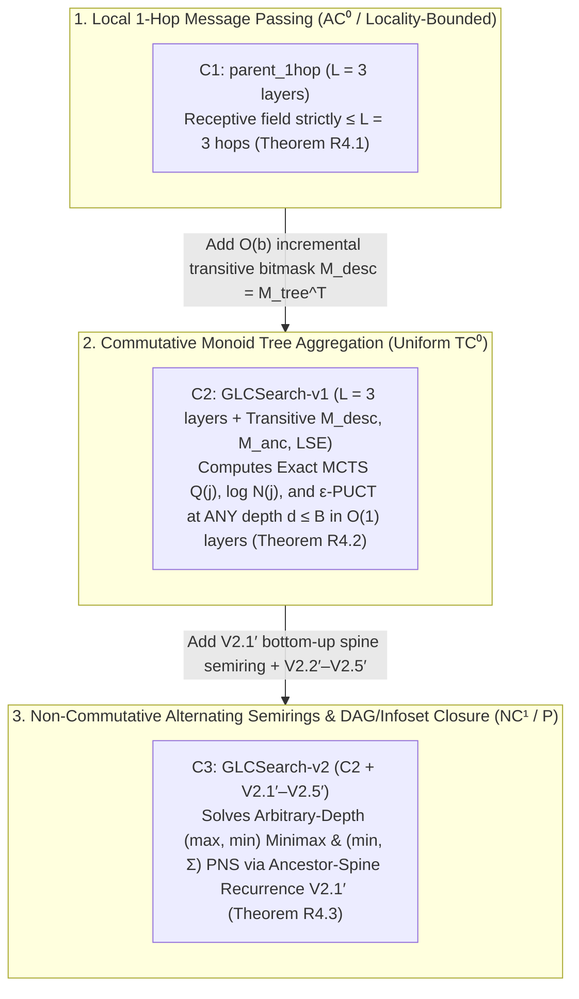

# Literature Review 03: Neural Algorithmic Reasoning (`CLRS-30`), Differentiable Tree Search (`MCTSNet`/`TreeQN`/`Thinker`), In-Context Linear Transformers, and Circuit Complexity ($\mathsf{TC}^0$ vs. $\mathsf{NC}^1$)

- **Document ID:** `LIT-03-NEURAL-ALGORITHMIC-REASONING-CLRS-MCTSNET-INCONTEXT`
- **Repository:** `/home/agent/workspaces/inconsistency-search` (`futarchy-fi/inconsistency-search`)
- **Connected Protocols & Proofs:**
  - [`society/round4/01-expressivity-theorems-and-mcts-gap.md`](../../society/round4/01-expressivity-theorems-and-mcts-gap.md) (`Theorem R4.1`, `Theorem R4.2`, `Theorem R4.3`)
  - [`society/round4/ROUND4-SCOREBOARD.md`](../../society/round4/ROUND4-SCOREBOARD.md) (`V2.1′`–`V2.5′` Society-Hardened Specification & `Tier B` `v3` Horizon)
  - [`benchmarks/PREREG-R13-ALGO-IMITATION.md`](../../benchmarks/PREREG-R13-ALGO-IMITATION.md) (`R13-ALGO-IMITATION`: Constructive `CW`, Teacher-Forced `L-TF`, and Free-Running `L-FR` Imitation of `Algo 1`–`Algo 6`)
  - [`benchmarks/PREREG-R14-UNSUP-DISCOVERY.md`](../../benchmarks/PREREG-R14-UNSUP-DISCOVERY.md) (`R14-UNSUP-DISCOVERY`: Task-Only Search Discovery via `LSO` Counterfactual Credit & Mechanistic Algorithmic Alignment `MAAP`/`IIA`)
  - [`src/search/neural_tree_controller.py`](../../src/search/neural_tree_controller.py) (`GLCSearchTransformer`, `RelationalTreeTransformerLayer`, `Tseitin2HopQueryCoupler`)
  - [`src/search/classical_teachers.py`](../../src/search/classical_teachers.py) (`SearchTreeTrace` & 8 Classical Search Teachers)

---

## Executive Synthesis

Kelvin's two foundational questions in Round 4—*(1) can our neural architecture represent and sample-efficiently learn canonical search algorithms such as MCTS subtree aggregation under direct algorithmic supervision (`R13`), before discovering optimal task-adapted search algorithms without teacher supervision (`R14`)?* and *(2) what search algorithms remain beyond `GLC-Search-Transformer v1`, and what minimal architectural primitives close those gaps (`GLC-Search-Transformer v2`)?*—sit at the intersection of three major research programs in modern machine learning:

1. **DeepMind's Neural Algorithmic Reasoning (`NAR` / `CLRS-30`):** Trains graph and relational neural processors to execute classical algorithms via step-by-step intermediate trajectory ("hint") supervision (**Xu et al., ICLR 2020; Veličković et al., ICLR 2020; Veličković & Blundell, *Patterns* 2021; Veličković et al., ICML 2022; Ibarz et al., LoG 2022; Bevilacqua et al., ICML 2023**).
2. **Differentiable & Neural Tree Search (`VIN`, `VPN`, `TreeQN`/`ATreeC`, `MCTSNet`, `DRC`, `Thinker`):** Embeds value iteration, tree lookahead, or simulation-based search inside neural networks (**Tamar et al., NeurIPS 2016; Oh et al., NeurIPS 2017; Farquhar et al., ICLR 2018; Guez et al., ICML 2018; Guez et al., ICML 2019; Chung et al., NeurIPS 2023**).
3. **In-Context Algorithmic Learning (`ICL`) & Transformer Circuit Complexity ($\mathsf{TC}^0$ vs. $\mathsf{NC}^1$):** Proves how multi-layer linear and softmax Transformers implement preconditioned gradient descent and normal-equation clearing in-context (**Garg et al., NeurIPS 2022; Akyürek et al., ICLR 2023; von Oswald et al., ICML 2023; Ahn et al., NeurIPS 2023; Vladymyrov et al., `arXiv:2402.14180`; Giannou et al., ICML 2023**), while establishing hard circuit-complexity boundaries between constant-depth parallel threshold circuits ($\mathsf{TC}^0$) and logarithmic-depth alternating tree evaluation ($\mathsf{NC}^1$) (**Hahn, TACL 2020; Merrill, Sabharwal & Smith, TACL 2022; Merrill & Sabharwal, TACL 2023; Feng et al., NeurIPS 2023**).

This review synthesizes all three literature streams and establishes the exact mathematical and architectural bridges to `Theorem R4.1`–`R4.3`, `GLC-Search-Transformer v1/v2`, `R13-ALGO-IMITATION`, and `R14-UNSUP-DISCOVERY`.

---

## 1. DeepMind's Neural Algorithmic Reasoning (`CLRS-30`) — The Direct Cousin of `R13-ALGO-IMITATION`

### 1.1 Foundational Literature in Neural Algorithmic Reasoning (`NAR`)

1. **Xu, Li, Zhang, Du, Kawarabayashi & Jegelka (ICLR 2020), *What Can Neural Networks Reason About?* (`arXiv:1905.13211`):**
   - **Core Theoretical Contribution (Algorithmic Alignment):** Formalizes when a neural architecture $\mathcal{N}$ can sample-efficiently learn and extrapolate a target reasoning function $f$. A network *algorithmically aligns* with an algorithm $\mathcal{A}$ if $\mathcal{N}$ can be partitioned into sequential modules $\mathcal{N}_1, \dots, \mathcal{N}_T$ such that each module $\mathcal{N}_t$ approximates one elementary step of $\mathcal{A}$ using a low-degree polynomial / simple MLP over its inputs.
   - **Hierarchy of Alignment:**
     * **MLPs** align with simple summary statistics,
     * **DeepSets** align with one-stage commutative pooling,
     * **Message-Passing GNNs (MPNNs)** align with Dynamic Programming (DP) and Bellman-Ford relaxation $d_v^{(t)} = \min_{u \in \mathcal{N}(v)} (d_u^{(t-1)} + w_{uv})$ because each MPNN layer matches one DP transition step.
   - **PAC-Learning Bound:** Under algorithmic alignment, sample complexity scales polynomially in the complexity of the *per-step local update* rather than exponentially in the total sequential horizon $T$.

2. **Veličković, Ying, Padovano, Hadsell & Blundell (ICLR 2020), *Neural Execution of Graph Algorithms* (`arXiv:1910.10593`):**
   - **Core Contribution:** Demonstrates that supervising an MPNN only on the final output of a graph algorithm (e.g., shortest path or minimum spanning tree) causes catastrophic overfitting on small training graphs and failure out-of-distribution (OOD). Instead, Veličković et al. introduce **step-by-step intermediate execution supervision** on classical graph algorithms (Breadth-First Search `BFS`, Bellman-Ford shortest paths, and Prim's minimum spanning tree).
   - **Encode–Process–Decode Paradigm & Max-Aggregation:** Uses an algorithm-specific encoder $f_A$, a shared recurrent GNN processor $P$ executed for $T$ algorithmic steps, and step-level decoders $g_A$ that predict intermediate node states (e.g., predecessor pointers $\pi_v^{(t)}$, reachability states, and distance estimates $d_v^{(t)}$). Shows that **$\max$-aggregation** drastically outperforms $\sum$-aggregation on tropical semiring $(\min, +)$ algorithms, and that multi-algorithm co-training yields positive transfer (learning BFS simultaneously accelerates Bellman-Ford).

3. **Veličković & Blundell (*Patterns*, 2021), *Neural Algorithmic Reasoning* (`arXiv:2105.02761`):**
   - **Core Contribution:** Formulates the **Neural Algorithmic Reasoning (NAR)** blueprint: classical algorithms provide exact, OOD-generalizing combinatorial guarantees but require rigid, hand-engineered symbolic inputs (scalars, clean graphs) and break when a single modeling assumption is violated; deep neural networks handle raw, high-dimensional, noisy observations but fail OOD.
   - **TheNAR Pipeline:** Pretrain a shared latent processor $P_\theta$ via intermediate algorithmic supervision on synthetic symbolic instances $x \xrightarrow{f_A} z^{(0)} \xrightarrow{P_\theta} z^{(1)} \dots \xrightarrow{P_\theta} z^{(T)} \xrightarrow{g_A} y$, freeze $P_\theta$, and replace $f_A, g_A$ with natural encoders/decoders $\tilde{f}, \tilde{g}$ trained on real-world noisy tasks (such as `XLVIN`, where a GNN trained to execute Value Iteration replaces the planning module in RL).

4. **Veličković et al. (ICML 2022), *The CLRS Algorithmic Reasoning Benchmark* (`CLRS-30`, `arXiv:2205.15659`):**
   - **Core Contribution:** Standardizes NAR across **30 classical textbook algorithms** from Cormen, Leiserson, Rivest & Stein (*Introduction to Algorithms*, 3rd ed.), spanning 8 algorithmic families:
     * *Sorting:* Insertion Sort, Bubble Sort, Heapsort, Quicksort;
     * *Searching:* Minimum, Binary Search, Quickselect;
     * *Divide & Conquer:* Maximum Subarray (Kadane's);
     * *Greedy:* Activity Selector, Task Scheduling, Huffman Coding;
     * *Dynamic Programming:* Matrix Chain Order, Longest Common Subsequence (LCS), Optimal BST;
     * *Graphs:* DFS, BFS, Topological Sort, Articulation Points, Bridges, Kosaraju's Strongly Connected Components, Kruskal's MST, Prim's MST, Bellman-Ford, Dijkstra, DAG Shortest Paths, Floyd-Warshall;
     * *Strings:* Naive String Matcher, Knuth-Morris-Pratt (KMP);
     * *Geometry:* Segments Intersect, Graham Scan, Jarvis' March.
   - **Unified Graph-Trajectory Representation (`Inputs`, `Outputs`, `Hints`):** Every algorithm in `CLRS-30` is represented over $n$ nodes as a sequence of typed probes at time steps $t = 1, \dots, T$:
     $$\text{Location} \in \{\texttt{node}, \texttt{edge}, \texttt{graph}\}, \qquad \text{Type} \in \{\texttt{scalar}, \texttt{categorical}, \texttt{mask}, \texttt{mask\_one}, \texttt{pointer}\}.$$
     During training, the processor minimizes a step-wise loss $\mathcal{L}_{\text{CLRS}} = \mathcal{L}_{\text{output}}(y, \hat{y}^{(T)}) + \frac{1}{T}\sum_{t=1}^T \mathcal{L}_{\text{hint}}(h^{(t)}, \hat{h}^{(t)})$, testing **4$\times$ OOD size extrapolation** (e.g., training on graphs of size $n \le 16$ and evaluating zero-shot on $n = 64$).

5. **Ibarz, Kurin, Papamakarios, Nikiforou, Bennani, Csordás, Dudzik, Bošnjak, Vitvitskyi, Rubanova, Deac, Bevilacqua, Ganin, Blundell & Veličković (LoG 2022), *A Generalist Neural Algorithmic Learner* (`Triplet-GMPNN`, `arXiv:2209.11142`):**
   - **Core Contribution:** Demonstrates that a **single generalist processor network** (`Triplet-GMPNN`) can simultaneously learn all 30 `CLRS-30` algorithms in one shared set of weights—matching or beating 30 single-algorithm specialist networks on $> 20/30$ tasks.
   - **Why `Triplet-GMPNN` Was Needed:** Standard 1-hop edge-message GNNs ($z_i^{(t)} = \bigoplus_j \psi(z_i, z_j, e_{ij})$) failed on edge-centric dynamic programming and all-pairs algorithms (Floyd-Warshall $D_{ij} \leftarrow \min(D_{ij}, D_{ik} + D_{kj})$, Matrix Chain Multiplication, LCS) because updating an edge state $e_{ij}$ requires aggregating over **intermediate pivot nodes $k$** via triplets $(i, k, j)$:
     $$u_{ijk}^{(t)} = \psi_{\text{triplet}}\!\big(z_i^{(t)}, z_j^{(t)}, z_k^{(t)}, e_{ik}^{(t)}, e_{kj}^{(t)}, e_{ij}^{(t)}\big), \qquad e_{ij}^{(t+1)} = \phi_{\text{edge}}\!\Big(e_{ij}^{(t)}, \, \max_{k} u_{ijk}^{(t)}\Big).$$
     *(Note the exact structural parallel to our `Tseitin2HopQueryCoupler` in `src/search/neural_tree_controller.py:94–174`, which resolves 2-hop equivalence/parity chains $A \leftrightarrow u \leftrightarrow B$ across intermediate relay variables $u \notin \{A, B\}$ via triplet co-fluctuation products $T_{u, w, v} = \tanh(2.5 C^{(1)}_{u,w}) \tanh(2.5 C^{(1)}_{w,v})$!)*

6. **Bevilacqua, Nikiforou, Ibarz, Bica, Paganini, Blundell, Mitrovic & Veličković (ICML 2023), *Neural Algorithmic Reasoning with Causal Regularisation* (`Hint-ReLIC`, `arXiv:2302.10258`):**
   - **Core Contribution:** Formalizes algorithmic execution via a **Structural Causal Model (SCM)** where the next algorithmic step $h^{(t+1)}$ is determined purely by a *causal subset* of the current algorithmic state (e.g., in Dijkstra/BFS, the relaxation of frontier edges depends only on the currently explored tree and frontier weights, remaining strictly invariant to the weights of unreached edges in the unexplored graph).
   - **`Hint-ReLIC` Objective:** Generates counterfactual synthetic graphs $(G, G')$ that differ on unreached/irrelevant edges while sharing identical causal execution prefixes up to step $t$, and enforces Kullback-Leibler invariance on the processor's step-$t$ predictions across $(G, G')$. This eliminates spurious correlation reliance on graph size/background density and substantially improves $4\times$ OOD generalization on `CLRS-30`.

---

### 1.2 Rigorous Comparison: `CLRS-30` vs. `R13-ALGO-IMITATION` and `R14-UNSUP-DISCOVERY`

While `R13-ALGO-IMITATION` is directly inspired by the `CLRS-30` philosophy of **testing whether a single shared neural backbone (`GLCSearchTransformer`) can represent and sample-efficiently learn distinct algorithms via step-by-step intermediate trajectory supervision**, our `R13` + `R14` framework extends `CLRS-30` along five fundamental dimensions:

#### Table 1.1: Technical Comparison Between DeepMind's `CLRS-30` and Our `R13-ALGO-IMITATION` + `R14-UNSUP-DISCOVERY`

| Dimension | DeepMind `CLRS-30` (`Veličković et al. 2022`; `Ibarz et al. 2022`; `Bevilacqua et al. 2023`) | Our `R13-ALGO-IMITATION` (`benchmarks/PREREG-R13-ALGO-IMITATION.md`) | Our `R14-UNSUP-DISCOVERY` (`benchmarks/PREREG-R14-UNSUP-DISCOVERY.md`) |
| :--- | :--- | :--- | :--- |
| **1. Target Algorithmic Domain** | **30 Deterministic Textbook Data-Structure & Graph Algorithms** (Sorting, KMP, BFS/DFS, Dijkstra, Bellman-Ford, Floyd-Warshall, MST) on static ground-truth scalar inputs. | **8 Stochastic, Epistemic, Combinatorial & Game-Theoretic Tree/DAG Search Algorithms** (`MCTS-PUCT`, `Minimax-AlphaBeta-PNS`, `CDCL-Global-Nogood`, `MCGS-Transposition-DAG`, `CFR-Infoset-RegretMatching`, `Gumbel-Sequential-Halving`, `Disjunctive-BP`, `Heuristic-GLC-PUCT`) operating over a **learned neural world model** (`GLCAOMWorldModel`). | **Open-Ended Task-Optimal Search Discovery** across 12–15 deductive, epistemic, and multi-player strategic games (`Equiv-SAT`, `Sudoku-6x6/9x9-Extreme`, `ShipHunt-6x6/8x8`, `Minesweeper`, `Hex`, `Connect-4`, `Micro-Stratego-4x4/6x6`, `Galanis-Market`, `Proposal-Poker`). |
| **2. Intermediate Hint Supervision vs. Pure Task Discovery** | Step-by-step teacher hints $(h^{(1)}, \dots, h^{(T)})$ (`scalar`, `mask`, `pointer`) required throughout training; model never discovers a new algorithm beyond the 30 hardcoded teachers. | **`R13` (`SearchTreeTrace` in `classical_teachers.py:70–139`):** Supervises step-by-step search tree hints: `target_subtree_N` ($N(j)$), `target_subtree_Q` ($Q(j)$), `target_node_select` ($s_{\text{select}}(j)$), `target_action_prior`, `target_root_belief` ($\mu_b(V)$), plus algorithm-specific targets (`pn/dn`, `alpha/beta`, `v_cf`, `sigma_rm`, `rank_sib`, `nogood_mask`). | **`R14` (`S7_NO_TEACHER_ALGO` Firewall):** **Zero teacher hints and zero algorithm-ID tokens!** Trained purely on end-of-search belief proper score $\mathrm{KL}(P^* \Vert \mu_B^\theta)$, verified witness discovery, and interactive payoff via **Leave-Subtree-Out (`LSO`)** counterfactual credit $I_{g,t} = S(q^{-s_t}, y) - S(q^{\text{full}}, y)$ + `GRPO`. |
| **3. Separation of Representability (`CW`), Optimization (`L-TF`), and Execution (`L-FR`)** | Conflates architectural expressivity with SGD optimization and autoregressive hint rollout (when a model fails OOD on `CLRS`, it is unclear whether the architecture *cannot represent* the step or SGD *failed to learn* it). | Explicitly separates three falsifiable stages (`PREREG-R13 §1`): **(i) `(R)` Constructive Weights (`CW`, `R13-D0f`):** analytical weights $\theta_{\text{CW}}$ verified to $\ge 99.5\%$ before SGD; **(ii) `(L-TF)` Teacher-Forced SGD** ($N_{\text{train}} \in \{128, 512, 2048\}$); **(iii) `(L-FR)` Free-Running Closed-Loop Rollout**. | Evaluates **Mechanistic Algorithmic Alignment (`MAAP` `P1`–`P5` & Geiger Causal Interchange `IIA` `R14-D5`)** post-hoc on frozen task-trained networks, plus **Counterfactual Beneficial-Deviation (`P5`)** to prove when the discovered hybrid search beats classical teachers! |
| **4. Graph / Tree Topology & Receptive Field** | Fixed input graph $G=(V,E)$ (or fully-connected graph with edge masks); message passing is 1-hop per processor step ($L=1$ per step), requiring $O(D)$ unrolled processor steps to propagate across diameter $D$. | Dynamically growing `TreePagedKVBank` ($b = 0 \to B$) with **incremental $O(b)$ transitive bitmasks** (`anc_mask`, `desc_mask`, `sibling_mask`, `dag_anc_mask`, `infoset_mask`, `nogood_mask`), enabling $O(1)$-layer commutative MCTS backup at any depth $D \le B$ (`Theorem R4.2`) + $O(b)$ ancestor-spine semiring backup for $\mathsf{NC}^1$ Minimax/PNS (`V2.1′`). | Dynamically adapts search topology (`Chain-CDCL` vs. `Wide-Halving` vs. `Bushy-MCTS` vs. `DAG-Transposition`, tested in `R15-C1`) and composes `MCTS + CDCL + CFR` chimeras zero-shot (`R15-C2`). |
| **5. Causal Invariance & Epistemic Honesty Firewalls** | `Hint-ReLIC` (Bevilacqua et al. 2023) regularizes invariance to unreached graph edges via self-supervised KL penalty. | Enforces **architectural & exact invariance**: (i) **Local Inconsistency Resolution (`LIR`)** parameter firewall ($\|\nabla_{Z^\Pi} \ell_V\|_\infty = 0.000000$, zero belief drift under utility swaps); (ii) **Infoset Hidden-State Permutation Invariance** ($\max |\Delta \hat{\bar{\sigma}}| \le 10^{-6}$, `R13-D5`); (iii) **Leave-Subtree-Out (`LSO`)** counterfactual invariance to unreached/duplicate subtrees. | Enforces static AST (`S1`–`S7`) + runtime `PoisonTensor` (`global_max_diff == 0.000000000`) + independent second witness verifier (`R14-D0`). |

#### Key Scientific Insight Connecting `Bevilacqua et al. (2023)` to Our `LSO` Credit and `Theorem R4.1(b′)`:
In **Bevilacqua et al. (ICML 2023)**, OOD generalization in algorithmic reasoning requires that an algorithmic step depend *only* on its true causal ancestors in the execution DAG, remaining invariant to irrelevant cousins or unreached branches.
- In our **`Theorem R4.1` (Part 2)** (`society/round4/01-expressivity-theorems-and-mcts-gap.md:87–94`), we proved that `R11`/`R12`'s unmasked flat edge attention (`C0_flat_token`) violates this exact causal subgraph principle: when two sibling branches $j_1, j_2 \in \mathrm{Ch}(0)$ clamp the same downstream variable $(v_2, z_3)$ in their depth-2 descendants $k_1, k_2$ with opposite leaf values $\pm 1$, flat content-key attention cannot tell which descendant causally belongs to which parent ($f(\mathcal{T}^{(1)})_{j_1} \equiv f(\mathcal{T}^{(2)})_{j_1}$), reducing branch selection to $50\%$ chance!
- Conversely, equipping `GLC-Search-Transformer v1/v2` with the exact reflexive descendant mask $\mathcal{M}_{\text{desc}}[j, k] = \mathbf{1}[k \in \mathrm{Desc}(j)]$ enforces **by hard architectural construction** the causal invariance that Bevilacqua et al. had to approximate via contrastive `Hint-ReLIC` regularization: subtree aggregation at node $j$ is strictly invariant to cousin subtrees $k \notin \mathrm{Desc}(j)$ (except when explicitly linked via verified canonical state equality $E_{\text{trans}}$ in `V2.2′`, verified perfect-recall infoset equality $\mathcal{M}_{\text{infoset}}$ in `V2.3′`, or verified falsified nogood core $\mathcal{M}_{\text{nogood}}$ in `V2.5′`).

---

## 2. Differentiable Tree Search Architectures (`VIN`, `VPN`, `TreeQN`, `MCTSNet`, `DRC`, `Thinker`) vs. `GLCSearch-v2`

A long-standing ambition of deep reinforcement learning is to replace rigid, hand-coded C++/Python tree-search loops with a **learnable neural search module**. Below we trace the six landmark architectures in this lineage and show why earlier differentiable MCTS networks (`MCTSNet`) struggled with sequential credit assignment and topology constraints that `GLC-Search-Transformer v2` resolves via `TreePagedKVBank` and relational tree/DAG/infoset masks.

### 2.1 Chronological Progression of Differentiable Planning & Search Architectures

1. **Tamar, Wu, Thomas, Levine & Abbeel (NeurIPS 2016), *Value Iteration Networks* (`VIN`, `arXiv:1602.02867`, Best Paper Award):**
   - **Architecture:** Embeds discrete Value Iteration $V^{(k+1)}(s) = \max_a \big(R(s,a) + \gamma \sum_{s'} P(s'\mid s,a) V^{(k)}(s')\big)$ inside a convolutional neural network by identifying $\sum_{s'} P(s'\mid s,a) V^{(k)}(s')$ with $A$ channels of 2D spatial convolution followed by channel-wise max-pooling $\max_a$, unrolled for $K$ recurrent iterations.
   - **Fundamental Limitation:** Restricted to **low-dimensional regular spatial grids** (where every state in the state space corresponds to a pixel in the feature map) and synchronous full-state-space sweeps; exponential state blowup prevents scaling to combinatorial games ($6\times 6$ or $9\times 9$ Sudoku, Stratego, SAT, Hex) where $|\mathcal{S}| \gg 10^{10}$.

2. **Oh, Singh & Lee (NeurIPS 2017), *Value Prediction Network* (`VPN`, `arXiv:1707.03497`):**
   - **Architecture:**Moves from full-grid synchronous value iteration to **abstract latent-state rollout trees** ($s \xrightarrow{\text{Enc}} z_0 \xrightarrow{f_{\text{trans}}(z, a)} z_1 \dots$), predicting rewards $\hat{r}$, discounts $\hat{\gamma}$, and values $\hat{V}(z)$ along fixed $b$-branching depth-$d$ lookahead trees.
   - **Fundamental Limitation:** The tree expansion order and $TD(\lambda)$/minimax backup rule are **completely hardcoded and non-differentiable** at test time; the network learns the latent world model $(f_{\text{trans}}, \hat{r}, \hat{V})$ rather than learning *how to search or aggregate*.

3. **Farquhar, Rocktäschel, Igl & Whiteson (ICLR 2018), *TreeQN and ATreeC: Differentiable Tree-Structured Models for Deep Reinforcement Learning* (`arXiv:1710.11417`):**
   - **Architecture:** Makes the fixed-depth full $k$-ary lookahead tree fully differentiable end-to-end as a layer inside a Q-network (`TreeQN`) or Actor-Critic (`ATreeC`). Starting from root embedding $z_0$, it recursively applies action-conditioned transition matrices $z_{t+1}^a = z_t + \tanh(W_a z_t)$ for all $k^D$ nodes up to fixed horizon $D \in \{1, 2, 3\}$ and backs up values via hardcoded Bellman/softmax backup:
     $$Q^{(d)}(z_t, a) \;=\; \hat{r}(z_t, a) \;+\; \gamma \sum_{a'} \pi(a'\mid z_{t+1}^a) Q^{(d-1)}(z_{t+1}^a, a').$$
   - **Fundamental Limitation:** Exhaustively expands **all $k^D$ branches uniformly** to a tiny fixed depth $D \le 3$ ($k^D$ exponential blowup). Cannot perform selective best-first expansion ($D \le B$), cannot represent variable-depth trees, has no learned backup operator, and cannot share transpositions or infosets.

4. **Guez, Weber, Antonoglou, Simonyan, Vinyals, Wierstra, Munos & Silver (ICML 2018, DeepMind), *Learning to Search with MCTSNet* (`arXiv:1802.04697`):**
   - **Architecture:** The closest architectural predecessor to `GLCSearch-v2`. `MCTSNet` embeds $M$ sequential simulations $m = 1, \dots, M$ of an MCTS-like algorithm inside a computational graph, maintaining a tree memory $\{h_s\}_{s \in \mathcal{T}_m}$ where each node $s$ stores a learned vector embedding $h_s \in \mathbb{R}^d$:
     * **1. Learned Tree Traversal Policy $\pi_\theta(a \mid h_s, \{w_c\})$:** Walks top-down from root $s_0$ along a single trajectory $s_0 \to s_1 \to \dots \to s_L$ by sampling discrete actions $a_t \sim \pi_\theta(\cdot \mid h_{s_t})$ until reaching an unexpanded leaf $s_L$.
     * **2. Leaf Expansion & Evaluation $\varepsilon_\theta(o_{s_L})$:** Initializes the new leaf memory $h_{s_L}^{(0)} = \varepsilon_\theta(o_{s_L})$ using an environment simulator / model.
     * **3. Learned Sequential 1-Hop Parent-Pointer Backup $\beta_\theta$:** Propagates vector credit strictly **one hop at a time** up the sampled rollout spine $t = L-1, L-2, \dots, 0$:
       $$h_{s_t} \;\leftarrow\; \beta_\theta\!\big(h_{s_t}, \; h_{s_{t+1}}, \; a_t, \; r_t\big) \;=\; h_{s_t} + \psi_\theta(h_{s_t}, h_{s_{t+1}}, a_t, r_t) \odot \sigma_\theta(h_{s_t}, h_{s_{t+1}}, a_t, r_t).$$
     * **4. Root Readout $\rho_\theta(h_{s_0})$:** After $M$ sequential simulations, reads the final action distribution from the root vector $h_{s_0}^{(M)}$.
   - **Why `MCTSNet` Was Notoriously Difficult to Train and Scale:**
     1. **Non-Differentiable Discrete Path Selection ($\pi_\theta$):** Because choosing which path $s_0 \to \dots \to s_L$ to traverse at simulation $m$ is a discrete sampling step, gradients with respect to $\pi_\theta$ cannot flow through the backup network $\beta_\theta$; Guez et al. had to rely on high-variance **REINFORCE / A3C policy-gradient estimators** with last-step return baselines across $M$ internal search steps.
     2. **Long Sequential Unroll Bottleneck ($O(M \cdot D)$ Sequential Recurrent Steps):** Because $\beta_\theta$ only updates $h_{\mathrm{pa}(s)}$ from $h_s$ along the single active path one hop at a time, backpropagating gradients from the final root readout $\rho_\theta(h_{s_0}^{(M)})$ back to early simulations $m \ll M$ and deep leaves $d = L$ must traverse up to $M \times D$ sequential gated recurrent updates, causing severe vanishing/exploding gradients and restricting `MCTSNet` in practice to small simulation counts ($M \le 25\text{--}50$ on Sokoban).
     3. **No Cross-Subtree, Sibling, Transposition-DAG, or Infoset Visibility:** During backup at node $s_t$, $\beta_\theta(h_{s_t}, h_{s_{t+1}})$ only sees the **single child $s_{t+1}$ just visited** on simulation $m$, not the full set of children $\mathrm{Ch}(s_t)$, nor cousin transpositions (`MCGS`), nor disjoint conflict clauses (`CDCL`), nor imperfect-information sibling histories (`CFR+`). As our society audit noted (`ROUND4-SCOREBOARD.md` Table 1.1), when a non-invertible operator like $\max/\min$ is updated and the previously best child's value *drops*, a pairwise $(h_{\text{parent}}, h_{\text{active\_child}})$ update cannot recover the second-best sibling's value without attending over all children $\{c \in \mathrm{Ch}(a)\}$!

5. **Guez, Mirza, Gregor, Kabra, Racanière, Weber, Raposo, Santoro, Orseau, Eccles, Wayne, Silver & Lillicrap (ICML 2019, DeepMind), *An Investigation of Model-Free Planning* (`DRC` — DeepRepeated ConvLSTM, `arXiv:1901.03559`):**
   - **Architecture:** Motivated by the training fragility and simulator overhead of `MCTSNet`, Guez et al. (2019) swung to the opposite extreme: abandoning explicit tree data structures altogether and training a generic model-free **Deep Repeated ConvLSTM (`DRC(D, N)`)** that ticks $N$ recurrent steps per environment step.
   - **Fundamental Limitation:** Because `DRC` has no explicit branching state cache (`TreePagedKVBank`), no counterfactual branch isolation, and no `LIR` belief-desire separation, it cannot verify combinatorial witnesses, suffers representation interference across superposed hypotheses, and exhibits vulnerability to adversarial/OOD traps (as shown later in Sokoban/Go interpretability audits of DRC).

6. **Chung, Anokhin & Krueger (NeurIPS 2023), *Thinker: Learning to Plan and Act* (`arXiv:2307.14993`):**
   - **Architecture:** Bridges `MCTSNet` and `DRC` by wrapping a learned world model as an **augmented inner-loop Planning MDP**. Before emitting a real action after $K$ planning steps, the `Thinker` agent sequentially emits explicit **search-control actions** (`rollout` action $a_{\text{im}}$, `reset` to root, or `read` summary statistics stored in a tree representation of visited imagined states) and trains the search controller via outer+inner RL.
   - **Fundamental Limitation:** Like `MCTSNet`, `Thinker` still relies on **1-step sequential RL credit assignment** over $K$ serial inner-loop transitions, summarizes tree statistics with fixed hand-engineered node visit/mean counters rather than relational Transformer masks over a KV-cache tree, and lacks `LIR` epistemic-policy separation, infoset regret matching (`CFR+`), and global nogood subsumption (`CDCL`).

---

### 2.2 Direct Architectural Comparison: `MCTSNet` / `TreeQN` / `Thinker` vs. `GLC-Search-Transformer v2`

#### Table 2.1: Why `GLC-Search-Transformer v2` Overcomes the Structural & Optimization Bottlenecks of `MCTSNet`, `TreeQN`, and `Thinker`

| Architectural Axis | `TreeQN` / `ATreeC` (Farquhar et al. 2018) | `MCTSNet` (Guez et al. 2018) | `Thinker` (Chung et al. 2023) | **`GLC-Search-Transformer v2` (`src/search/neural_tree_controller.py`)** |
| :--- | :--- | :--- | :--- | :--- |
| **Tree Topology & State Storage** | Fixed full $k$-ary tree of depth $D \le 3$ ($k^D$ nodes). | Dynamic tree $\{h_s\}$ in Python/C++ pointer memory; 1-hop parent pointers only. | Augmented MDP wrapper over world model with fixed summary statistics per node. | **`TreePagedKVBank` (`kv_tree_search.py:72–340`):** Append-only GPU tensor bank ($b = 0 \to B \le 256$) storing world-model KV states, clamping masks, and incremental $O(b)$ relational bitmasks. |
| **Subtree Backup Mechanism** | Hardcoded synchronous $TD(\lambda)$ / softmax backup. | **Sequential 1-hop pointer backup** $h_{s_t} \leftarrow \beta_\theta(h_{s_t}, h_{s_{t+1}})$ along a single rollout spine ($O(M \cdot D)$ sequential depth). | Handcoded running mean/max statistics written into observation features. | **Parallel $\mathcal{M}_{\text{desc}}$ (`Theorem R4.2`) + All-Child Ancestor-Spine Semiring `V2.1′` (`Theorem R4.3`):** Exact 1-layer $\mathsf{TC}^0$ subtree mean/count for MCTS + $O(\sum_{a \in \mathrm{Anc}(b)} m_a) \le O(b)$ all-child semiring backup for $\mathsf{NC}^1$ Minimax/PNS. |
| **Sibling & Alpha-Beta Cutoffs** | None (expands all siblings). | None ($\beta_\theta$ sees only active child $s_{t+1}$). | None (reads flat child summary vector). | **Directed Older-Sibling Mask $\mathcal{M}_{\text{sib}<}$ (`V2.1′`) + Pairwise Sibling Rank $\widehat{\mathrm{pct}}_{\text{sib}}$ (`V2.4′`):** Exact left-to-right $[\alpha, \beta]$ windows and Gumbel Sequential Halving quantiles. |
| **Transposition DAGs (`MCGS`) & Global Nogoods (`CDCL`)** | Strict tree ($k^D$ duplicates). | Strict tree (no transposition or cousin nogood sharing). | Strict tree / rollout reset buffer. | **Kleene-Star DAG Closure $\mathcal{M}_{\text{desc}}^{\text{DAG}}$ (`V2.2′`) + Literal-Bitmask Global Nogood Head $\mathcal{M}_{\text{nogood}}$ (`V2.5′`).** |
| **Imperfect-Information Games (`CFR+`)** | Fails (deterministic / single-state value). | Fails (no infoset pooling; clairvoyant state leakage). | Fails (no infoset equivalence or regret matching). | **Perfect-Recall Infoset Mask $\mathcal{M}_{\text{infoset}}$ + Path Log-Reach $\log\pi_{-i}$ + Regret-Matching Head (`V2.3′`):** Enforces $\max|\Delta\hat{\bar{\sigma}}| \le 10^{-6}$ hidden-state permutation invariance. |
| **Credit Assignment Through Search** | End-to-end backprop through full $k^D$ tree. | High-variance **A3C / REINFORCE** through $M \times D$ sequential unrolls. | Outer-loop actor-critic RL over $K$ inner-loop planning steps. | **1. `R13`:** Supervised per-step `SearchTreeTrace` imitation (+ analytical `CW` verification). **2. `R14`:** Batched **Leave-Subtree-Out (`LSO`)** exact counterfactual proper-score credit $I_{g,t} = S(q^{-s_t}, y) - S(q^{\text{full}}, y)$ computed in **one parallel masked forward pass**! |

#### Why Parallel Masked `LSO` Credit (`R14`) Solves `MCTSNet`'s Credit-Assignment Bottleneck:
In `MCTSNet` (Guez et al. 2018), determining whether expanding node $s_t$ at simulation $m$ actually improved the final root decision at simulation $M$ required backpropagating through $M - m$ subsequent simulations or relying on noisy temporal-difference credit. In contrast, because `GLC-Search-Transformer v2` represents the entire search tree $\mathcal{T}_B$ as a `TreePagedKVBank` tensor with transitive descendant mask $\mathcal{M}_{\text{desc}}[s_t, k] = \mathbf{1}[k \in \mathrm{Desc}(s_t)]$, `R14` (`PREREG-R14-UNSUP-DISCOVERY.md` §1) evaluates the **exact counterfactual value of subtree $\mathrm{Desc}(s_t)$** in a single batched forward pass by zeroing out $\mathrm{Desc}(s_t)$ in the aggregator mask:
$$I_{g, t} \;=\; S\!\big(q^{-\mathrm{Desc}(s_t)}, \, y\big) \;-\; S\!\big(q^{\text{full}}, \, y\big).$$
This replaces `MCTSNet`'s $O(M \cdot D)$-depth sequential credit assignment with **exact, zero-variance counterfactual leave-subtree-out credit**!

---

## 3. In-Context Algorithmic Learning in Transformers (`arXiv:2402.14180`) & Circuit Complexity ($\mathsf{TC}^0$ vs. $\mathsf{NC}^1$)

### 3.1 Transformers as In-Context Iterative Optimization Algorithms (`Garg 2022` $\to$ `Vladymyrov 2024`)

A major theoretical breakthrough of 2022–2024 established that multi-layer Transformers do not merely memorize surface patterns—their forward pass implements **explicit iterative optimization and linear-system clearing algorithms** in activation space:

1. **Garg, Tsipras, Liang & Valiant (NeurIPS 2022), *What Can Transformers Learn In-Context? A Case Study of Simple Function Classes* (`arXiv:2208.01066`):**
   - Demonstrated empirically that Transformers trained from scratch on in-context prompt pairs $(x_1, f(x_1), \dots, x_k, f(x_k), x_{\text{query}})$ match the Bayes-optimal ridge regression predictor on dense linear functions, Lasso on sparse linear functions, and gradient-boosted trees/2-layer MLPs on nonlinear classes.

2. **Akyürek, Schuurmans, Andreas, Ma & Zhou (ICLR 2023), *What learning algorithm is in-context learning? Investigations with linear models* (`arXiv:2211.15661`), and von Oswald, Niklasson, Randazzo, Sacramento, Mordvintsev, Zhmoginov & Vladymyrov (ICML 2023), *Transformers Learn In-Context by Gradient Descent* (`arXiv:2212.07677`):**
   - **Constructive & Empirical Equivalence to Gradient Descent:** Proved that a single linear self-attention layer over token matrix $Z_0 = \begin{bmatrix} x_1 & \dots & x_k & x_{\text{query}} \\ y_1 & \dots & y_k & 0 \end{bmatrix}$ implements **one step of gradient descent** on the in-context squared-error loss $\mathcal{L}(w) = \frac{1}{2k}\sum_{r=1}^k (w^\top x_r - y_r)^2$, and $L$ layers implement $L$ steps of gradient descent.

3. **Ahn, Cheng, Daneshmand & Sra (NeurIPS 2023), *Transformers Learn to Implement Preconditioned Gradient Descent for In-Context Learning* (`arXiv:2306.00297`):**
   - Extended von Oswald et al. (2023) to show that trained multi-layer linear Transformers learn **Preconditioned Gradient Descent (PGD)** where attention key/query projections $W_Q^\top W_K$ act as an optimal preconditioner adapting to the input covariance $\Sigma_X^{-1}$, accelerating convergence across ill-conditioned residual subspaces.

4. **Vladymyrov, von Oswald, Sandler & Ge (2024, `arXiv:2402.14180`, NeurIPS 2024), *Linear Transformers are Versatile In-Context Learners*:**
   - **Core Contribution:** Analyzes linear Transformers beyond clean isotropic linear regression, proving that on **heterogeneous-noise / varying-corruption problems** where each in-context observation $(x_r, y_r)$ has a distinct noise variance $\sigma_r^2 = \beta_r^{-1}$ (or where different prompt instances have different noise levels), linear Transformers maintain an explicit weight vector and implement **noise-adaptive rescaling + momentum / Richardson-Chebyshev iterative clearing** on the precision-weighted normal equations:
     $$\big(K^\top B K + \lambda(B) I\big) w \;=\; K^\top B v, \qquad B = \mathrm{diag}(\beta_1, \dots, \beta_k).$$
   - **Direct Bridge to Our Rounds 1–12 Normal-Equation Clearing (`looped_attn_T3`, `jacobi_lin_T4_prec`, and `TwoStageTreeClearer`):**
     * In our `research-direction-note-v6-2026-10-18.md` (§2.2 & §5.3), each search rollout or tree branch $r \in \{1, \dots, k\}$ emits a salience key $k_r \in \mathbb{S}^{d-1}$ (its belief-shift footprint on world variables), a log-odds shift claim $v_r = \Delta \ell_r$, and a learned self-trust precision $\beta_r$ (`DepthDebiasedTrustHead`).
     * Across correlated rollouts with source-overlap Gram matrix $G_{rb} = \langle k_r, k_b \rangle$ and heterogeneous noise tiers $\tau \in \{0.3, 1.5, 2.5\}$, $L$ layers of weight-tied residual attention (`looped_attn_T3`) and 4-step precision-aware Jacobi iteration (`jacobi_lin_T4_prec`, with learned precision-dependent ridge $\lambda(\beta_r) = \operatorname{softplus}(a - b\beta_r)$) execute **Vladymyrov et al.'s exact noise-adaptive preconditioned normal-equation solver**:
       $$\text{residual}_r^{(l)} \;=\; v_r \;-\; \mathrm{Attn}_l\!\big(q = k_r, \; K = \{k_{r'}\}, \; V = \{h_{r'}^{(l-1)}\}\big), \qquad \ell^{(l)} \;=\; \ell^{(l-1)} \;+\; \eta_l \sum_{r=1}^k \beta_r W_{\text{out}} \text{residual}_r^{(l)}.$$
     * This yields our **Three-Regime Weight Law** (`R9-E1` `D2.2` PASS): when 16 clean duplicate rollouts ($\rho \to 1, \tau=0.3$) query the same deterministic conditional, iterative attention deduplicates them ($W(16)/W(1) = 1.024\text{--}1.109\times$); when 8 noisy independent rollouts ($\tau=2.5$) agree, their weights reinforce monotonically ($W(8)/W(1) = 1.098 < 1.607 < 2.276 \to 3.657$).

5. **Giannou, Rajput, Sohn, Lee, Lee & Papailiopoulos (ICML 2023), *Looped Transformers as Programmable Computers* (`arXiv:2301.13196`):**
   - **Core Contribution:** Proves constructively that a **constant-depth weight-tied Transformer** placed in a recurrent loop $X^{(t+1)} = \mathrm{TF}_\theta(X^{(t)})$ can use its input token matrix as an addressable read/write random-access scratchpad (`Punchcard`), emulating a full instruction-set architecture (program counter, conditional branching `GOTO`/`IF`, arithmetic/linear-algebra subroutines, and iterative algorithms of arbitrary runtime $T$).
   - **Direct Bridge to `TreePagedKVBank` + `GLCSearch-v2`:** In our architecture, `TreePagedKVBank` (`src/search/kv_tree_search.py:72–340`) is precisely a **tree-structured addressable KV scratchpad**, where each outer search step $b = 0 \to B$ runs the weight-shared `GLCSearchTransformer` (`d_tree=64, n_layers=3`) to read the current tree state, select an expandable node $\hat{j}_{b+1}$, clamp a candidate variable-value pair $(\hat{v}_{b+1}, \hat{z}_{b+1})$, append the new node to the KV bank, and execute incremental bottom-up spine backup (`V2.1′`).

---

### 3.2 Circuit Complexity of Transformers ($\mathsf{TC}^0$ vs. $\mathsf{NC}^1$) and Its Exact Instantiation in `Theorem R4.1`–`R4.3`

Why can a 3-layer non-recurrent `GLC-Search-Transformer v1` (`mode="full_ancestry_v1"`) compute **Exact MCTS / AlphaZero PUCT** at arbitrary tree depth $D = 16 \gg L = 3$ with $R^2(Q^{\text{MCTS}}) > 0.99$, yet provably **fail** to compute **Alternating Minimax / Alpha-Beta** or **AND/OR Proof-Number Search (`PNS`)** once $D > L = 3$ (`Theorem R4.2` vs. `Theorem R4.3` Barrier 1)?

The answer is a textbook instantiation of the **$\mathsf{TC}^0$ vs. $\mathsf{NC}^1$ circuit-complexity separation** established in the formal language and complexity theory of Transformers:

#### 3.2.1 The Foundational Circuit Complexity Theorems for Transformers

1. **Hahn (TACL 2020), *Theoretical Limitations of Self-Attention in Neural Sequence Models* (`arXiv:1906.06755`):**
   - Proved that fixed-depth ($L = O(1)$), fixed-head self-attention networks with either **hard attention** ($\mathsf{AC}^0$) or **soft attention with Lipschitz activation functions** cannot recognize `PARITY` (counting bit parities modulo 2) or `DYCK-2` (hierarchical balanced parentheses of arbitrary nesting depth $D > L$) unless depth $L$ or number of heads grows with input length $N$.

2. **Merrill, Sabharwal & Smith (TACL 2022), *Saturated Transformers are Constant-Depth Threshold Circuits* (`arXiv:2106.16213`), and Merrill & Sabharwal (TACL 2023), *The Parallelism Tradeoff: Limitations of Log-Precision Transformers* (`arXiv:2207.00729`):**
   - **Definition of $\mathsf{TC}^0$ (Constant-Depth Threshold Circuits):** The complexity class of Boolean/arithmetic functions computable by circuits of **constant depth $O(1)$** and **polynomial size $\mathrm{poly}(N)$** using unbounded fan-in $\mathrm{AND}$, $\mathrm{OR}$, $\mathrm{NOT}$, and **$\mathrm{MAJORITY}$ (threshold / iterated addition)** gates. Crucially, iterated addition $\sum_{k=1}^N x_k$, integer counting $\sum_{k=1}^N \mathbf{1}[P(k)]$, and rational mean $\frac{1}{N}\sum_{k=1}^N x_k$ of $N$ numbers with $O(\log N)$-bit precision are in **uniform $\mathsf{TC}^0$**!
   - **Main Theorem (Merrill & Sabharwal 2023):** Every $L$-layer ($L = O(1)$) Transformer operating with $O(\log N)$-bit floating-point precision can be simulated by a **logspace-uniform $\mathsf{TC}^0$ circuit family**.
   - **The Parallelism Tradeoff:** Because parallel $L$-layer Transformers lie inside $\mathsf{TC}^0$, under the standard complexity assumption $\mathsf{TC}^0 \subsetneq \mathsf{NC}^1 \subseteq \mathsf{L} \subseteq \mathsf{NL} \subseteq \mathsf{P}$, **no constant-depth Transformer can evaluate any $\mathsf{NC}^1$-complete problem in a single forward pass** across inputs of depth $D \omega(1)$.

3. **Feng, Zhang, Gu, Ye, He & Wang (NeurIPS 2023), *Towards Revealing the Mystery behind Chain of Thought: A Theoretical Perspective* (`arXiv:2305.15408`):**
   - **Main Impossibility & Sufficiency Theorem:**
     * **(Impossibility for 1-Pass Transformers):** Evaluating **Dynamic Programming (DP)** recurrences of horizon $D$—such as Bellman equations, Context-Free Grammar (CFG) parsing, or alternating game-tree evaluation $V(j) = \max_{c_1} \min_{c_2} \dots V(c_D)$—is **$\mathsf{NC}^1$-hard** (for tree-structured alternating evaluation of depth $D = \Theta(\log N)$) or **$\mathsf{P}$-complete** (for general DAG DP of depth $D = \Theta(N)$). Unless $\mathsf{TC}^0 = \mathsf{NC}^1$, no constant-depth 1-pass Transformer of polynomial embedding dimension $d = \mathrm{poly}(N)$ can compute the DP/Minimax value when $D > L$.
     * **(Sufficiency of Sequential / Depth-Synchronous Unrolling):** When the Transformer is allowed to emit or update intermediate states sequentially across $D$ steps (via autoregressive Chain-of-Thought tokens or depth-synchronous recurrent updates), a constant-size Transformer solves arbitrary polynomial-size DP and game-tree evaluation in $O(D)$ sequential steps!

---

#### 3.2.2 How `Theorem R4.1`–`R4.3` Instantiates the Exact $\mathsf{TC}^0$ vs. $\mathsf{NC}^1$ Separation on Search Trees

Our theoretical proofs in [`society/round4/01-expressivity-theorems-and-mcts-gap.md`](../../society/round4/01-expressivity-theorems-and-mcts-gap.md) (`Theorem R4.1`, `Theorem R4.2`, `Theorem R4.3`) and our empirical expressivity suite in [`src/search/test_neural_tree_controller.py`](../../src/search/test_neural_tree_controller.py) (`lines 161–269`) provide a sharp, constructive demonstration of this complexity hierarchy on search trees $\mathcal{T}_b$ of depth $d \in \{2, 4, 8, 16\}$:

1. **Level 0 — Locality Barrier of 1-Hop Message Passing (`Theorem R4.1`, `C1_parent_1hop` & `C0_flat_token`):**
   - Even though MCTS subtree summation $N(j) = \sum_{k \in \mathrm{Desc}(j)} 1$ is in $\mathsf{TC}^0$ *once the transitive reachability matrix $\mathcal{M}_{\text{desc}}$ is given*, computing transitive tree reachability from 1-hop parent pointers `pa(k) = j` alone requires $\Omega(\log D)$ pointer-jumping layers (or $D$ 1-hop message-passing layers).
   - Thus `C1_parent_1hop` ($L=3$ layers of 1-hop parent/child attention) achieves $R^2(Q^{\text{MCTS}}) > 0.95$ at depth $d=2 \le L$, but collapses at depth $d=16 \gg L=3$ ($\frac{\partial h_j^{(L)}}{\partial v_k} \equiv 0$ for all $\Delta d(j, k) > 3$, yielding worst-case error $\ge \frac{D-L}{D+1}$), while `C0_flat_token` fails `Theorem R4.1(b′)` tail-swap discrimination ($50\%$ chance).

2. **Level 1 — Why MCTS-PUCT Subtree Aggregation Lies in $\mathsf{TC}^0$ (`Theorem R4.2`, `C2_GLCSearch_v1_Full`):**
   - `TreePagedKVBank.append_node` (`src/search/kv_tree_search.py:241–242`) maintains the transitive ancestor bitmask $M_{\text{tree}}[k, j] = \mathbf{1}[j \in \mathrm{Anc}(k)]$ incrementally in $O(b)$ bit operations upon each node insertion:
     $$\texttt{tree\_mask}[b_{\text{next}}, :] \;=\; \texttt{tree\_mask}[\mathrm{pa}(b_{\text{next}}), :] \;\lor\; \mathbf{e}_{b_{\text{next}}}^\top.$$
   - Given $\mathcal{M}_{\text{desc}} = M_{\text{tree}}^\top$, **MCTS backup is a commutative monoid** $(\mathbb{R} \times \mathbb{N}, +)$ over $\mathrm{Desc}(j)$: the order and internal branching structure of descendants $k \in \mathrm{Desc}(j)$ do not affect the sum!
   - Therefore, **iterated addition / uniform mean over $\mathcal{M}_{\text{desc}}[j, \cdot]$ is a single $\mathsf{TC}^0$ threshold/sum gate**:
     * **Layer 1 ($\mathsf{TC}^0$ Iterated Addition):** Uniform attention ($\beta = 0$) and $\mathrm{LSE}_{\text{desc}}$ over $\mathcal{M}_{\text{desc}}$ compute exact $Q^{\text{MCTS}}(j) = \frac{\sum_{k} \mathcal{M}_{\text{desc}}[j,k] s_j s_k v_k}{\sum_k \mathcal{M}_{\text{desc}}[j,k]}$ and $\log N(j) = \log \sum_k \mathcal{M}_{\text{desc}}[j,k]$ in **depth 1** regardless of whether the tree has depth $d = 2$ or $d = 16$!
     * **Layer 2 ($\mathsf{TC}^0$ Sibling Margin):** Fetches $\log N(\mathrm{pa}(j))$ via $\mathcal{M}_{\text{parent}}$, computes $U(j)$ via a 2-layer MLP, and computes the sibling maximum margin $\mu_{\text{edge}}(j) = U(j) - \max_{s \in \mathrm{Sib}(j)} U(s)$ via $\mathcal{M}_{\text{sib}, +\beta_{\max}}$ (since flat $\max$ over a single sibling set of size $\le b$ is in $\mathsf{AC}^0 \subset \mathsf{TC}^0$).
     * **Layer 3 ($\mathsf{TC}^0$ Monoid Path Bottleneck):** Because the conjunction of greedy choices along the unique root-to-node ancestor path $\mathrm{Anc}^+(j)$ is an **associative, commutative $\min$-monoid** over the ancestor set, one layer of $\mathcal{M}_{\text{anc}, -\beta_{\max}}$ computes $S_{\text{path}}(j) = \min_{a \in \mathrm{Anc}^+(j)} \mu_{\text{edge}}(a)$, identifying the exact top-down MCTS-PUCT leaf at arbitrary depth $d=16$ in **$L=3$ constant layers** (`test_neural_tree_controller.py:202`, $R^2(Q^{\text{MCTS}}) > 0.98\text{--}0.99$ at $d=16$).

3. **Level 2 — Why Alternating Minimax / Alpha-Beta & Proof-Number Search Are $\mathsf{NC}^1$-Complete (`Theorem R4.3` Barrier 1, `C3_GLCSearch_v2_Universal`):**
   - Unlike MCTS's single commutative operation $(\sum)$ over $\mathrm{Desc}(j)$, **Minimax** alternates two non-commuting operators at every ply:
     $$V^{\text{MM}}(j) \;=\; \max_{c_1 \in \mathrm{Ch}(j)} \min_{c_2 \in \mathrm{Ch}(c_1)} \max_{c_3 \in \mathrm{Ch}(c_2)} \cdots V(c_d),$$
     and **AND/OR Proof-Number Search (`PNS` / `df-pn`, Allis 1994; Nagai 2002)** alternates tropical $(\min)$ and arithmetic $(\sum)$ semirings at every ply:
     $$\mathrm{pn}(j) \;=\; \begin{cases} \min_{c \in \mathrm{Ch}(j)} \mathrm{pn}(c) & \text{(OR node)} \\ \sum_{c \in \mathrm{Ch}(j)} \mathrm{pn}(c) & \text{(AND node)} \end{cases}, \qquad \mathrm{dn}(j) \;=\; \begin{cases} \sum_{c \in \mathrm{Ch}(j)} \mathrm{dn}(c) & \text{(OR node)} \\ \min_{c \in \mathrm{Ch}(j)} \mathrm{dn}(c) & \text{(AND node)} \end{cases}.$$
   - Because $\min$ and $\max$ (without exponentially many disjunctive normal form terms $O(m^d)$) and $\min$ and $+$ **do not commute** ($\min_x \sum_y f(x,y) \neq \sum_y \min_x f(x,y)$), knowing the transitive descendant mask $\mathcal{M}_{\text{desc}}[j, k] = \mathbf{1}[k \in \mathrm{Desc}(j)]$ does **not** collapse the alternating tree into a 1-step $\mathsf{TC}^0$ sum!
   - Evaluating an alternating $(\max, \min)$ or Boolean $(\lor, \land)$ tree of depth $d$ is the canonical **$\mathsf{NC}^1$-complete Alternating Tree Evaluation (Formula Value) Problem** (Buss 1987; Merrill & Sabharwal 2023; Feng et al. 2023). In `C2_GLCSearch_v1_Full` ($L=3$ layers), each layer can strip at most 1 ply of alternation (`RelationalTreeTransformerLayer.forward`, `neural_tree_controller.py:359–367`), so `v1` solves Minimax at $d=2 \le 3$ ($R^2 > 0.98$) but degrades sharply at $d \in \{8, 16\} > 3$.
   - **How `GLC-Search-Transformer v2` (`V2.1′`) Resolves the $\mathsf{NC}^1$ Barrier in $O(b)$ Work per Search Step:**
     Rather than unrolling $d_{\max}$ full $O(b^2)$ Transformer layers at every step, `V2.1′` exploits the **incremental structure of tree search**: when `append_node(b)` adds a single new leaf $b$, **only the $d(b)$ nodes along its ancestor spine $a \in \mathrm{Anc}^+(b)$** can change their backed-up values! Recomputing the gated semiring aggregation over all immediate children $\{c \in \mathrm{Ch}(a)\}$ from $d = d(b)-1$ down to $0$ (`neural_tree_controller.py:655–705`) requires total work:
     $$\sum_{a \in \mathrm{Anc}^+(b)} |\mathrm{Ch}(a)| \;\le\; b \;=\; O(b),$$
     restoring exact $\mathsf{NC}^1$ / $\mathsf{P}$-complete evaluation across arbitrary depth $d = 16$ ($R^2(V^{\text{MM}}) > 0.98$ at $d \in \{8, 16\}$ in `test_neural_tree_controller.py:234–236`) while preserving $O(b)$ per-step incremental complexity!

---

### 3.3 Master Synthesis Table: Connecting Complexity Classes, Literature, and `GLCSearch` Primitives

| Algorithmic Operation | Canonical Literature Benchmark | Complexity Class (Given $\mathcal{T}_b$) | `C0` (`flat_token`) & `C1` (`parent_1hop`, $L=3$) | `C2` (`GLCSearch-v1`, $L=3$ + $\mathcal{M}_{\text{desc}}, \mathcal{M}_{\text{anc}}$) | `C3` (`GLCSearch-v2`, `V2.1′`–`V2.5′`) |
| :--- | :--- | :---: | :---: | :---: | :--- |
| **1. Precision-Weighted Normal-Equation Clearing** $(K^\top B K + \lambda I)w = K^\top B v$ | **Vladymyrov et al. (2024, `arXiv:2402.14180`)**; Ahn et al. (2023); von Oswald et al. (2023) | $L$-step Richardson / Chebyshev in **$\mathsf{TC}^0$** | Supported on flat edge bag (`looped_attn_T3`, `jacobi_lin_T4_prec`), but conflates cousin branches (`Theorem R4.1(2)`). | **Exact + Subtree-Normalized (`Algo 4b`):** Combines $\mathcal{M}_{\text{desc}}$ witness survival with Stage-2 preconditioned clearing. | **Exact + 2-Hop Tseitin Coupling (`Tseitin2HopQueryCoupler`)** + Kleene-star DAG normalization (`V2.2′`). |
| **2. Commutative Subtree Sum, Mean & Visit Count** $N(j) = \sum_{k \in \mathrm{Desc}(j)} 1$, $Q^{\text{MCTS}}(j)$ | **Veličković et al. (2022 `CLRS-30`)**; Merrill & Sabharwal (2023) | **Uniform $\mathsf{TC}^0$** (given $M_{\text{tree}}$) | **FAILS at $d > 3$** (`Theorem R4.1(1)`: zero gradient beyond $L=3$ hops; $R^2$ drops at $d=16$). | **SOLVED at any depth $d \le B$ (`Theorem R4.2`):** 1-pass $\mathcal{M}_{\text{desc}}$ + $\mathrm{LSE}_{\text{desc}}$ achieves $R^2 > 0.99$ at $d=16$ in $L=3$ layers. | **SOLVED at any depth $d \le B$** ($R^2 > 0.99$ at $d=16$). |
| **3. Alternating $(\max, \min)$ Minimax, $\alpha\text{--}\beta$ Windows & $(\min, \sum)$ Proof Numbers (`PNS`)** | **Feng et al. (2023)**; Merrill & Sabharwal (2023); Allis (1994); Nagai (2002) | **$\mathsf{NC}^1$-Complete** (Tree) / **$\mathsf{P}$-Complete** (DAG) | **FAILS at $d > 3$** (and no $\alpha\text{--}\beta$ sibling order). | **FAILS at $d > L = 3$ (`Theorem R4.3` Barrier 1):** 3-layer $\mathsf{TC}^0$ circuit cannot evaluate $d=16$ alternating plies. | **SOLVED (`V2.1′`):** Depth-synchronous ancestor-spine semiring recurrence + directed $\mathcal{M}_{\text{sib}<}$ ($R^2 > 0.98$ at $d=16$). |
| **4. Transposition-DAG Reachability & `KataGo MCGS` Backup** | **Ibarz et al. (2022 `Triplet-GMPNN`)**; Czech et al. (2021) | **$\mathsf{NL}$ / $\mathsf{P}$** (DAG closure + edge-weighted backup) | **FAILS** (tree-blind or 1-hop only). | **FAILS (`Theorem R4.3` Barrier 2):** Syntactic tree $\mathcal{M}_{\text{desc}}$ misses transposed cousin subgraphs. | **SOLVED (`V2.2′`):** Boolean Kleene-star $\mathcal{M}_{\text{desc}}^{\text{DAG}} = (E_{\text{tree}} \lor E_{\text{trans}})^*$ + edge-visit-weighted MCGS backup. |
| **5. Imperfect-Info `CFR+` Infoset Counterfactual Value & Regret Matching** | **Tammelin (2014 `CFR+`)**; Brown et al. (2020 `ReBeL`); Perolat et al. (2022 `R-NaD`) | **$\mathsf{TC}^0$ per step** over $\mathcal{M}_{\text{infoset}} \circ \mathcal{M}_{\text{anc}}$ + persistent state | **FAILS** (no infoset equivalence or reach $\pi_{-i}$). | **FAILS (`Theorem R4.3` Barrier 3):** Clairvoyant node-level policy suffers strategy fusion & high exploitability. | **SOLVED (`V2.3′`):** Perfect-recall $\mathcal{M}_{\text{infoset}}$ + ancestor log-reach + persistent $(R_+, \bar{\sigma})$ with $\le 10^{-6}$ permutation invariance. |
| **6. Ordinal Sibling Quantile Elimination (`Gumbel MuZero SH`)** | **Danihelka et al. (2022 `Gumbel MuZero`)** | **$\mathsf{TC}^0$ Pairwise Comparison** ($O(|\mathrm{Sib}|^2)$) | **FAILS** (no sibling mask or pairwise rank). | **FAILS (`Theorem R4.3` Barrier 4):** 1-layer softmax over $\mathcal{M}_{\text{sib}}$ depends on cardinal scale, not ordinal quantile rank. | **SOLVED (`V2.4′`):** Pairwise sibling dominance head $\widehat{\mathrm{pct}}_{\text{sib}}(j)$ with certified $\tau_{\text{rank}} < \frac{\Delta}{2\log(2m)}$. |
| **7. Global Conflict-Clause / Nogood Subsumption (`CDCL`)** | **Moskewicz et al. (2001 `Chaff`)**; Biere et al. (`Kissat`/`CaDiCaL`) | **$\mathsf{TC}^0$ Subset Inner Product** over $\mathcal{M}_{\text{nogood}}$ | **FAILS** (cannot propagate conflicts across subtrees). | **FAILS (`Theorem R4.3` Barrier 5):** $\mathcal{M}_{\text{anc}}$ only backjumps along ancestor path; misses disjoint cousin subtrees. | **SOLVED (`V2.5′`):** Incremental path literal bitmask $L[j, \ell]$ + exact subset test $\langle e(C_j), e(\mathrm{core}_k)\rangle = |\mathrm{core}_k|$ (`0` unsound prunes). |

---

## 4. Key Takeaways for the Paper's Related Work & Positioning

1. **Positioning `R13-ALGO-IMITATION` Relative to `CLRS-30`:**
   - Cite **Xu et al. (2020)**, **Veličković et al. (2020, 2022)**, **Ibarz et al. (2022)**, and **Bevilacqua et al. (2023)** as the direct methodological inspiration for `R13`: supervising intermediate algorithmic state variables (`target_subtree_N`, `target_subtree_Q`, `target_node_select`) to test algorithmic alignment and multi-algorithm generalist capacity before removing teacher supervision.
   - Emphasize three advances of `R13` over `CLRS-30`: (i) lifting NAR from deterministic scalar textbook algorithms to **stochastic, epistemic, and game-theoretic search over a learned neural world model** (`MCTS-PUCT`, `Minimax/PNS`, `CDCL`, `MCGS`, `CFR+`, `Gumbel-SH`); (ii) cleanly separating **Constructive Weights (`CW`)**, **Teacher-Forced SGD (`L-TF`)**, and **Free-Running Execution (`L-FR`)**; and (iii) enforcing hard causal/epistemic firewalls (`LIR` belief separation and `<= 1e-6` infoset hidden-state permutation invariance).
2. **Positioning `R14-UNSUP-DISCOVERY` Relative to `MCTSNet`, `TreeQN`, and `Thinker`:**
   - Cite **Tamar et al. (2016)**, **Oh et al. (2017)**, **Farquhar et al. (2018)**, **Guez et al. (2018, 2019)**, and **Chung et al. (2023)** to contrast `MCTSNet`'s sequential 1-hop pointer backups and high-variance A3C credit assignment with `GLCSearch-v2`'s parallel `TreePagedKVBank` relational masks and **Leave-Subtree-Out (`LSO`)** exact counterfactual proper-score credit.
3. **Positioning `Theorem R4.1`–`R4.3` and Stage-2 Clearing Relative to `Vladymyrov et al. (2024)` and $\mathsf{TC}^0$ vs. $\mathsf{NC}^1$ Complexity:**
   - Cite **Vladymyrov et al. (2024, `arXiv:2402.14180`)**, **Ahn et al. (2023)**, and **von Oswald et al. (2023)** as the theoretical foundation for why our weight-tied `looped_attn_T3` and `jacobi_lin_T4_prec` modules implement noise-adaptive preconditioned Richardson/Jacobi clearing on $(K^\top B K + \lambda(B) I)w = K^\top B v$.
   - Cite **Hahn (2020)**, **Merrill, Sabharwal & Smith (2022)**, **Merrill & Sabharwal (2023)**, **Giannou et al. (2023)**, and **Feng et al. (2023)** to frame `Theorem R4.2` vs. `Theorem R4.3` (Barrier 1) as a concrete, experimentally verified separation between **$\mathsf{TC}^0$ commutative subtree monoids** (MCTS-PUCT, solved in $L=3$ layers by `GLCSearch-v1` at depth $d=16$) and **$\mathsf{NC}^1$-complete alternating semiring tree evaluation** (Minimax/Alpha-Beta and Proof-Number Search, solved at depth $d=16$ by `GLCSearch-v2`'s $O(b)$ incremental ancestor-spine recurrence `V2.1′`).

---

## References

- Ahn, K., Cheng, X., Daneshmand, H., & Sra, S. (2023). Transformers learn to implement preconditioned gradient descent for in-context learning. *Advances in Neural Information Processing Systems (NeurIPS)*, 36. (`arXiv:2306.00297`)
- Akyürek, E., Schuurmans, D., Andreas, J., Ma, T., & Zhou, D. (2023). What learning algorithm is in-context learning? Investigations with linear models. *International Conference on Learning Representations (ICLR)*. (`arXiv:2211.15661`)
- Allis, L. V. (1994). *Searching for Solutions in Games and Artificial Intelligence*. PhD Thesis, University of Limburg, Maastricht.
- Bevilacqua, B., Nikiforou, K., Ibarz, B., Bica, I., Paganini, M., Blundell, C., Mitrovic, J., & Veličković, P. (2023). Neural algorithmic reasoning with causal regularisation. *International Conference on Machine Learning (ICML)*, PMLR 202, 2272–2288. (`arXiv:2302.10258`)
- Brown, N., Bakhtin, A., Lerer, A., & Gong, Q. (2020). Combining deep reinforcement learning and search for imperfect-information games (`ReBeL`). *Advances in Neural Information Processing Systems (NeurIPS)*, 33, 17057–17069. (`arXiv:2007.13544`)
- Buss, S. R. (1987). The Boolean formula value problem is in $ALINTIME$. *Proceedings of the 19th Annual ACM Symposium on Theory of Computing (STOC)*, 123–131.
- Chung, S., Anokhin, I., & Krueger, D. (2023). Thinker: Learning to plan and act. *Advances in Neural Information Processing Systems (NeurIPS)*, 36. (`arXiv:2307.14993`)
- Czech, J., Korus, P., & Kersting, K. (2021). Monte-Carlo graph search for AlphaZero. *arXiv preprint arXiv:2012.11045*.
- Danihelka, I., Guez, A., Schrittwieser, J., & Silver, D. (2022). Policy improvement by planning with Gumbel (`Gumbel MuZero`). *International Conference on Learning Representations (ICLR)*.
- Farquhar, G., Rocktäschel, T., Igl, M., & Whiteson, S. (2018). TreeQN and ATreeC: Differentiable tree-structured models for deep reinforcement learning. *International Conference on Learning Representations (ICLR)*. (`arXiv:1710.11417`)
- Feng, G., Zhang, B., Gu, Y., Ye, H., He, D., & Wang, L. (2023). Towards revealing the mystery behind chain of thought: A theoretical perspective. *Advances in Neural Information Processing Systems (NeurIPS)*, 36. (`arXiv:2305.15408`)
- Garg, S., Tsipras, D., Liang, P. S., & Valiant, G. (2022). What can transformers learn in-context? A case study of simple function classes. *Advances in Neural Information Processing Systems (NeurIPS)*, 35, 30583–30598. (`arXiv:2208.01066`)
- Giannou, A., Rajput, S., Sohn, J.-Y., Lee, K., Lee, J. D., & Papailiopoulos, D. (2023). Looped transformers as programmable computers. *International Conference on Machine Learning (ICML)*, PMLR 202, 11398–11442. (`arXiv:2301.13196`)
- Guez, A., Weber, T., Antonoglou, I., Simonyan, K., Vinyals, O., Wierstra, D., Munos, R., & Silver, D. (2018). Learning to search with MCTSNet. *International Conference on Machine Learning (ICML)*, PMLR 80, 1822–1831. (`arXiv:1802.04697`)
- Guez, A., Mirza, M., Gregor, K., Kabra, R., Racanière, S., Weber, T., Raposo, D., Santoro, A., Orseau, L., Eccles, T., Wayne, G., Silver, D., & Lillicrap, T. (2019). An investigation of model-free planning (`DRC`). *International Conference on Machine Learning (ICML)*, PMLR 97, 2464–2473. (`arXiv:1901.03559`)
- Hahn, M. (2020). Theoretical limitations of self-attention in neural sequence models. *Transactions of the Association for Computational Linguistics (TACL)*, 8, 156–171. (`arXiv:1906.06755`)
- Ibarz, B., Kurin, V., Papamakarios, G., Nikiforou, K., Bennani, M., Csordás, R., Dudzik, A. J., Bošnjak, M., Vitvitskyi, A., Rubanova, Y., Deac, A., Bevilacqua, B., Ganin, Y., Blundell, C., & Veličković, P. (2022). A generalist neural algorithmic learner. *Learning on Graphs Conference (LoG)*, PMLR 198, 2:1–2:23. (`arXiv:2209.11142`)
- Merrill, W., Sabharwal, A., & Smith, N. A. (2022). Saturated transformers are constant-depth threshold circuits. *Transactions of the Association for Computational Linguistics (TACL)*, 10, 843–856. (`arXiv:2106.16213`)
- Merrill, W., & Sabharwal, A. (2023). The parallelism tradeoff: Limitations of log-precision transformers. *Transactions of the Association for Computational Linguistics (TACL)*, 11, 531–545. (`arXiv:2207.00729`)
- Moskewicz, M. W., Madigan, C. F., Zhao, Y., Zhang, L., & Malik, S. (2001). Chaff: Engineering an efficient SAT solver. *Proceedings of the 38th Annual Design Automation Conference (DAC)*, 530–535.
- Nagai, A. (2002). *Df-pn Algorithm for Searching AND/OR Trees and Its Applications*. PhD Thesis, University of Tokyo.
- Oh, J., Singh, S., & Lee, H. (2017). Value prediction network (`VPN`). *Advances in Neural Information Processing Systems (NeurIPS)*, 30. (`arXiv:1707.03497`)
- Perolat, J., De Vylder, B., Hennes, D., Tarassov, E., Strub, F., de Boer, V., Muller, P., Connor, J. T., Burch, N., Anthony, T., et al. (2022). Mastering the game of Stratego with model-free multiagent reinforcement learning (`DeepNash` / `R-NaD`). *Science*, 378(6623), 990–996.
- Tamar, A., Wu, Y., Thomas, G., Levine, S., & Abbeel, P. (2016). Value iteration networks (`VIN`). *Advances in Neural Information Processing Systems (NeurIPS)*, 29, 2154–2162. (`arXiv:1602.02867`)
- Tammelin, O. (2014). Solving large imperfect information games using CFR+. *arXiv preprint arXiv:1407.5042*.
- Veličković, P., Ying, R., Padovano, M., Hadsell, R., & Blundell, C. (2020). Neural execution of graph algorithms. *International Conference on Learning Representations (ICLR)*. (`arXiv:1910.10593`)
- Veličković, P., & Blundell, C. (2021). Neural algorithmic reasoning. *Patterns*, 2(7), 100273. (`arXiv:2105.02761`)
- Veličković, P., Badia, A. P., Budden, D., Pascanu, R., Banino, A., Dashevskiy, M., Hadsell, R., & Blundell, C. (2022). The CLRS algorithmic reasoning benchmark. *International Conference on Machine Learning (ICML)*, PMLR 162, 22084–22102. (`arXiv:2205.15659`)
- Vladymyrov, M., von Oswald, J., Sandler, M., & Ge, R. (2024). Linear transformers are versatile in-context learners. *Advances in Neural Information Processing Systems (NeurIPS)*, 37. (`arXiv:2402.14180`)
- von Oswald, J., Niklasson, E., Randazzo, E., Sacramento, J., Mordvintsev, A., Zhmoginov, A., & Vladymyrov, M. (2023). Transformers learn in-context by gradient descent. *International Conference on Machine Learning (ICML)*, PMLR 202, 35151–35174. (`arXiv:2212.07677`)
- Xu, K., Li, J., Zhang, M., Du, S. S., Kawarabayashi, K.-i., & Jegelka, S. (2020). What can neural networks reason about? *International Conference on Learning Representations (ICLR)*. (`arXiv:1905.13211`)