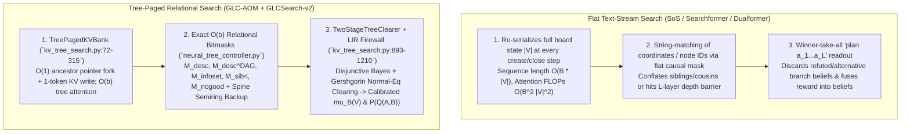
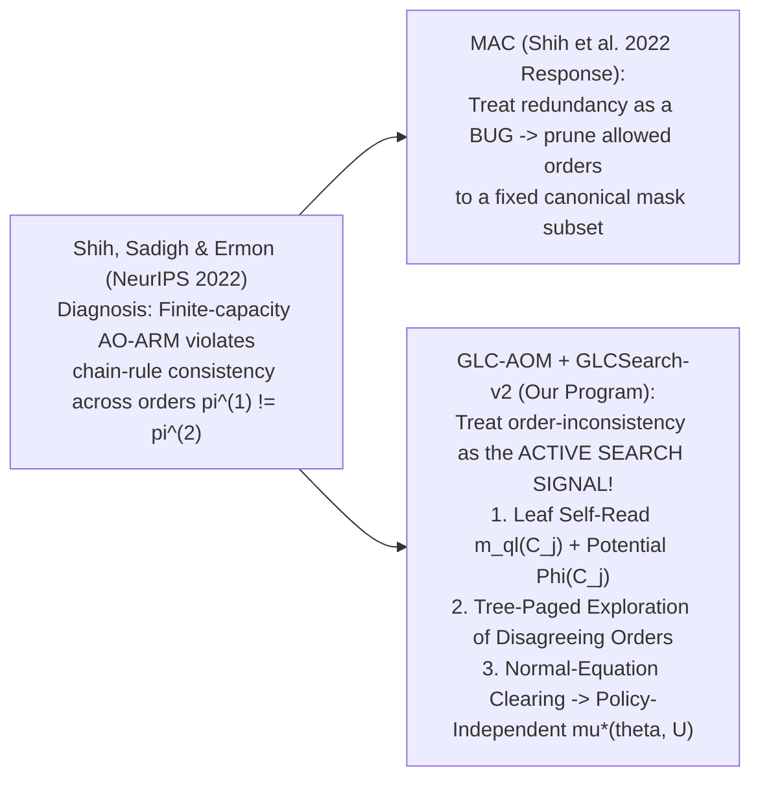

# Literature Review 04: LLM Search Distillation (`Stream of Search`, `Searchformer`, `Dualformer`, `Thought Rollback`), `GFlowNets` & Hindsight Plan Conditioning, and `Any-Order Autoregressive Models` (`AO-ARM`)

- **Document ID:** `LIT-04-SOS-SEARCHFORMER-GFLOWNETS-ANYORDER`
- **Date:** 2026-10-18
- **Repository:** `/home/agent/workspaces/inconsistency-search` (`futarchy-fi/inconsistency-search`)
- **Primary Architectural & Experimental Cross-References:**
  - [`docs/direction/research-direction-note-v6-2026-10-18.md`](../direction/research-direction-note-v6-2026-10-18.md) (`LIR` 4-Block Separation, PDG Inconsistency Energy $\mathcal{E}(\mu; \theta, U)$, Normal-Equation Deduplication)
  - [`docs/papers/overnight-society-and-glc-aom-paper-2026-10-18.md`](../papers/overnight-society-and-glc-aom-paper-2026-10-18.md) (`GLC-AOM`, `R11-GPU-NEURAL` $B \le 128$, `R12-GPU-NEURAL-V2` $B \le 256$)
  - [`src/search/kv_tree_search.py`](../../src/search/kv_tree_search.py) (`TreePagedKVBank`, `ResolvableInconsistencyTreePUCT`, `MoPSFractalPlanHead`, `TwoStageTreeClearer`)
  - [`src/search/neural_tree_controller.py`](../../src/search/neural_tree_controller.py) (`GLCSearchTransformer` `v1` & `v2`, `Tseitin2HopQueryCoupler`)
  - [`society/round4/01-expressivity-theorems-and-mcts-gap.md`](../../society/round4/01-expressivity-theorems-and-mcts-gap.md) & [`society/round4/ROUND4-SCOREBOARD.md`](../../society/round4/ROUND4-SCOREBOARD.md) (`Theorem R4.1`–`R4.3`, `V2.1′`–`V2.5′`)
  - [`benchmarks/PREREG-R13-ALGO-IMITATION.md`](../../benchmarks/PREREG-R13-ALGO-IMITATION.md) & [`benchmarks/PREREG-R14-UNSUP-DISCOVERY.md`](../../benchmarks/PREREG-R14-UNSUP-DISCOVERY.md) (`R13 -> R14` Imitation-to-Discovery Pipeline)

---

## Executive Synthesis

Our research program—**General-Law-Consistent Any-Order Models (`GLC-AOM`)** paired with the **Universal Tree-Paged KV-Cache Search Machine (`TreePagedKVSearch` / `GLCSearch-v2`)**—intersects three major 2021–2026 literature streams:

1. **Learning to Search in Transformers (`Stream of Search`, `Searchformer`, `Dualformer`, `System-2 Distillation`, and Prompt-Level Tree/Graph Search):** Recent work demonstrates that Transformers trained on serialized symbolic search traces (`BFS`, `DFS`, $A^*$ `create`/`close` tokens) followed by RL or expert iteration (`STaR`, `APA`) can internalize search dynamics and surpass individual heuristic teachers. This directly parallels our **`R13 -> R14` curriculum** ([`PREREG-R13-ALGO-IMITATION.md`](../../benchmarks/PREREG-R13-ALGO-IMITATION.md) $\to$ [`PREREG-R14-UNSUP-DISCOVERY.md`](../../benchmarks/PREREG-R14-UNSUP-DISCOVERY.md)). Crucially, however, `GLCSearch-v2` eliminates the **three fundamental structural bottlenecks** of flat text-stream search distillation:
   - *(i) $O(1)$ Tree-Paged KV Forking vs. $O(B \cdot |V|)$ State Re-Serialization* (`TreePagedKVBank`, [`src/search/kv_tree_search.py:72-315`](../../src/search/kv_tree_search.py#L72-L315)),
   - *(ii) Exact $O(b)$ Relational Bitmasks ($\mathcal{M}_{\text{desc}}, \mathcal{M}_{\text{desc}}^{\text{DAG}}, \mathcal{M}_{\text{infoset}}, \mathcal{M}_{\text{sib}<}, \mathcal{M}_{\text{nogood}}$) vs. Fragile String-Matching of Node IDs* (`GLCSearchTransformer`, [`src/search/neural_tree_controller.py:250-920`](../../src/search/neural_tree_controller.py#L250-L920)), and
   - *(iii) Calibrated Whole-Tree Epistemic Clearing (`TwoStageTreeClearer`) & `LIR` Belief-Desire Separation vs. Winner-Take-All Action Readout* ([`src/search/kv_tree_search.py:893-1210`](../../src/search/kv_tree_search.py#L893-L1210)).
2. **Generative Flow Networks (`GFlowNets`), Amortized Diverse Witness Sampling & Hindsight Plan Conditioning (`TB`, `SubTB`, `HER`):** Mode-seeking RL (`PPO`/`GRPO` without repulsive keys) collapses all $K$ rollouts onto a single dominant mode (`same-cell rate = 1.000` in unregularized `R4-E3a`; single-witness over-reinforcement at $B=128 \to 256$ in `R12`). By combining a **Mixture-of-Power-Spherical (`MoPS`) Active Fractal Prospectus** $q_{\text{plan}}(p \mid C_j, K_{\text{done}})$ with **Ridge-Damped Gram Orthogonal Projection** $P_\perp(K_{\text{done}})$, **Fractal Hindsight Experience Replay (`HER`)**, and **Leave-Subtree-Out (`LSO`) Counterfactual Credit** under normal-equation deduplication, `GLC-AOM` samples diverse modes proportional to their epistemic inconsistency reduction.
3. **Any-Order Autoregressive Models (`AO-ARM`) & Masked Diffusion (`NADE`, `MADE`, `XLNet`, `ARDM`, Shih et al. 2022 `MAC`, `TiDAR`):** **Shih, Sadigh, and Ermon (NeurIPS 2022, `arXiv:2205.13554`)** proved that because an $M$-variable `AO-ARM` overparameterizes a single joint distribution via $M 2^{M-1}$ conditional queries $q_\theta(X_i \mid X_S)$, any imperfect finite-capacity network violates chain-rule consistency across permutations $\pi^{(1)} \neq \pi^{(2)}$. While Shih et al. treat this **order-inconsistency** as a defect to be suppressed by restricting allowed unmasking orders, **our entire program takes Shih et al.'s diagnosis as its exact starting point**: an imperfect any-order world model disagrees with itself across rollout orders $\pi^{(1)}, \dots, \pi^{(B)}$, and `GLC-AOM` turns that internal order-inconsistency ($m_{\text{ql}}(C_j)$ and telescopic edge shifts $\delta_j$) into the active search signal and reconciles the disagreeing orders via precision-weighted normal equations!

---

## 1. Training Transformers on Search Traces (`Stream of Search`, `Searchformer`, `Dualformer`, `System-2 Distillation`)

### 1.1 `Stream of Search (SoS)`: Learning to Search in Language (Gandhi et al., 2024)

- **Citation:** Kanishk Gandhi, Denise Lee, Gabriel Grand, Muxin Liu, Winson Cheng, Archit Sharma, and Noah D. Goodman (2024; building on the Stanford/MIT/NYU probabilistic program synthesis & cognitive reasoning lineage with Joshua B. Tenenbaum and Brenden M. Lake), *"Stream of Search (SoS): Learning to Search in Language"*, Conference on Language Modeling (**COLM 2024 Oral**, [`arXiv:2404.03683`](https://arxiv.org/abs/2404.03683)).
- **Core Formulation:** Standard autoregressive language models trained solely on optimal ground-truth solution trajectories $\tau^* = (s_0, a_1^*, s_1^*, \dots, s_G)$ fail on combinatorial tasks (such as the arithmetic puzzle *Countdown*) because they cannot represent lookahead, dead-end detection, or backtracking when an early token choice is locally plausible but globally unsatisfiable. Gandhi et al. formalize search over a state-space graph $\mathcal{G} = (\mathcal{S}, \mathcal{E})$ as a **serialized text stream** $\tau_{\text{SoS}}$ interleaving explicit symbolic search operators:
  - **State Expansion & Goal Check:** Emitting candidate child states $(s_t, a_t \to s_{t+1})$ and remaining goal distance.
  - **Dead-End & Backtracking Tokens:** Emitting explicit failure markers when a branch exhausts legal moves without reaching the target, followed by an explicit **backjump / state-restoration token** that jumps attention back to an earlier open ancestor state $s_{\text{anc}} \prec s_t$.
- **Two-Stage Training Pipeline (Heterogeneous Imitation $\to$ RL Policy Improvement):**
  1. **Stage 1 — Supervised Imitation of Heterogeneous Symbolic Search Teachers:** Rather than imitating a single canonical search algorithm, `SoS` generates training streams from a **diverse portfolio of symbolic search teachers**—combining Breadth-First Search (`BFS`), Depth-First Search (`DFS`), and multiple randomized heuristic backjumping solvers with different node-ordering priorities. A Transformer LM is trained from scratch via standard causal cross-entropy on the serialized search stream:
     $$\mathcal{L}_{\text{SoS-SFT}}(\theta) \;=\; -\mathbb{E}_{\pi_{\text{teacher}} \in \Pi_{\text{sym}}, \, \tau \sim \pi_{\text{teacher}}} \left[ \sum_{t=1}^{|\tau|} \log p_\theta(\tau_t \mid \tau_{<t}) \right].$$
     Gandhi et al. show that training on *heterogeneous* search teachers yields substantially higher held-out solve rates than training on optimal paths alone or on any single deterministic heuristic, because the model learns a shared representation of the search space topology alongside multiple valid exploration strategies.
  2. **Stage 2 — Self-Improvement via `STaR` (Expert Iteration) and `APA` (RL):** Once the LM can generate syntactic search streams, it is fine-tuned purely for **task success** (solving unseen *Countdown* instances):
     - **Self-Taught Reasoner (`STaR`, Zelikman et al., 2022, `arXiv:2203.14465`):** Samples search streams $\hat{\tau} \sim p_\theta(\cdot \mid x_0)$, filters for streams that reach a verified valid solution $\mathrm{Check}(\hat{\tau}) = 1$, and fine-tunes on the successful self-generated search traces.
     - **Advantage-Induced Policy Alignment (`APA`, Zhu et al., 2023, `arXiv:2306.02231`):** Optimizes a squared error between the log-policy ratio and the advantage function:
       $$\mathcal{L}_{\text{APA}}(\theta) \;=\; \mathbb{E}_{\tau \sim p_{\text{old}}} \left[ \left( \log \frac{p_\theta(\tau \mid x_0)}{p_{\text{ref}}(\tau \mid x_0)} \;-\; \frac{1}{\beta} \hat{A}(\tau) \right)^2 \right].$$
     **Key Empirical Result:** After Stage-2 RL fine-tuning, the `SoS` Transformer dynamically switches between breadth-first, depth-first, and heuristic backjumping moves within a single episode, **achieving higher solve rates than every individual symbolic heuristic teacher used to generate its Stage-1 training data**.

---

### 1.2 `Searchformer` (Lehnert et al., 2024), `Dualformer` (Su et al., 2024), and `System-2 Distillation` (Yu et al., 2024)

1. **`Searchformer` — Lehnert, Sukhbaatar, Su, Zheng, McVay, Rabbat, and Tian (2024, Meta FAIR, [`arXiv:2402.14083`](https://arxiv.org/abs/2402.14083)), *"Beyond A\*: Better Planning with Transformers via Search Dynamics Bootstrapping"*:**
   - **Tokenizing $A^*$ Search Dynamics:** Lehnert et al. train an encoder-decoder (and decoder-only) Transformer on grid-world maze navigation and **Sokoban** puzzles. Instead of mapping problem prompt $\to$ final plan (`solution-only`), `Searchformer` serializes the entire execution trace of $A^*$ search as a flat sequence of state-event tokens:
     $$\tau_{A^*} \;=\; \big(\texttt{prompt}, \;\; \texttt{create } s_1 \, c_g(s_1) \, c_h(s_1), \;\; \texttt{close } s_0 \, c_g(s_0) \, c_h(s_0), \;\; \dots, \;\; \texttt{plan } a_1 \, a_2 \, \dots \, a_L\big),$$
     where $\texttt{create}$ logs pushing a state $s$ with path cost $c_g(s)$ and heuristic cost-to-go $c_h(s)$ onto the open priority queue, and $\texttt{close}$ logs popping $s$ into the closed set.
   - **Search Dynamics Bootstrapping:** After supervised imitation of randomized $A^*$ traces, `Searchformer` samples $K$ rollouts per puzzle on the training/bootstrapping set, filters for rollouts that (a) output a valid goal-reaching plan **and** (b) have total search trace length $|\tau| < |\tau_{A^*}|$, and fine-tunes on those shorter traces. Iterating this bootstrapping loop yields a planner that solves unseen Sokoban boards while expanding **significantly fewer search nodes than $A^*$**.

2. **`Dualformer` — Su, Sukhbaatar, Rabbat, Tian, and Zheng (2024, Meta FAIR, ICLR 2025, [`arXiv:2410.09918`](https://arxiv.org/abs/2410.09918)), *"Dualformer: Controllable Fast and Slow Thinking by Learning with Randomized Reasoning Traces"*:**
   - **Addressing `Searchformer`'s Trace-Length Bottleneck:** Because `Searchformer` emits dozens of tokens per `create`/`close` event, its inference sequences are $10\times\text{--}100\times$ longer than the final plan. `Dualformer` trains a single Transformer on **randomized reasoning traces** using four structured trace-dropping strategies during training:
     - *(Level 1)* Drop heuristic cost tokens $c_g, c_h$;
     - *(Level 2)* Drop `create` events (retaining only `close` backbone states);
     - *(Level 3)* Subsample only a random fraction of `close` states along the search tree;
     - *(Level 4)* Drop the entire search trace (emit `plan` directly after `prompt`, i.e., System-1 `Fast Mode`).
   - **Emergent Fast/Slow Control:** At test time, conditioning on the `plan` token immediately after `prompt` triggers **Fast Mode** (which outperforms standard solution-only training because the shared weights absorbed search geometry during training), while allowing trace generation triggers **Slow Mode** (which matches or beats `Searchformer` with up to $45\text{--}60\%$ fewer trace tokens).

3. **`Distilling System 2 into System 1` — Yu, Ping, Liu, Wang, You, Zhang, Shoeybi, and Catanzaro (2024, NVIDIA / Meta, [`arXiv:2407.06023`](https://arxiv.org/abs/2407.06023)):**
   - Investigates compiling explicit test-time System-2 search methods (`Tree of Thoughts`, `System-2 Attention`, multi-path self-consistency voting, MCTS lookahead) back into a single-pass System-1 model by filtering and distilling the consensus outputs of test-time search into amortized forward weights.
   - **Direct Mapping to `GLC-AOM`'s `LIR` Parameter Split (`research-direction-note-v6` §1):** In standard System-2 Distillation (`Yu et al., 2024`) and `Dualformer` (`Su et al., 2024`), distilling search traces directly into the base model's weights mutates the world model alongside the search policy ($\chi = \mathbf{1}$), which we proved in `R4-E3b` and `R5-E1` Part B causes severe **desire-projection belief drift** ($\Delta_{\text{desire}} = +0.471$ in `Fused` and $+0.117$ in `Token-Masked`). `GLC-AOM` resolves this by isolating System-2 search distillation strictly inside **`Block 2: Consequence Extension` ($\theta_{\text{amp}}$, LIR mask $\chi = (0, 1)$, reading `stop_grad` states from $\theta_{\text{real}}$)** while keeping **`Block 1: Base World Model` ($\theta_{\text{real}}$, $\chi = (1, 0)$)** and **`Block 3: Self-Trustworthiness Auditor` ($\theta_{\text{trust}}$, $\chi = (1, 0)$)** anchored strictly to realized ground-truth observations!

---

### 1.3 Prompt-Level & Agentic Tree/Graph Search (`ToT`, `GoT`, `RAP`, `LATS`, `Thought Rollback`, and `Test-Time Compute Scaling`)

Before and alongside `SoS` and `Searchformer`, a rich wave of 2023–2024 work implemented search *outside* the Transformer weights via Python orchestration over text prompts:

| Framework & Citation | Search Topology & State Representation | Value / Heuristic & Backtracking Mechanism | Key Limitation Addressed by `GLC-AOM` + `GLCSearch-v2` |
| :--- | :--- | :--- | :--- |
| **`Tree of Thoughts (ToT)`** — Yao, Yu, Zhao, Shafran, Griffiths, Cao, Narasimhan (NeurIPS 2023, [`arXiv:2305.10601`](https://arxiv.org/abs/2305.10601)) | External BFS / DFS tree over discrete text "thought" chunks ($z_1, \dots, z_d$). | Separate LM prompting pass asks *"Is this partial solution sure/maybe/impossible?"* | Separate multi-token LM forward passes for proposal vs. value evaluation; no KV-cache sharing across non-prefix branches; winner-take-all leaf selection. |
| **`Graph of Thoughts (GoT)`** — Besta et al. (AAAI 2024, [`arXiv:2308.09687`](https://arxiv.org/abs/2308.09687)) | Arbitrary DAG $(V, E)$ of thought vertices; supports branching, **aggregation/merging** of multiple thoughts, and refinement loops. | External Python `Graph of Operations (GoO)` script schedules LLM calls and scores thoughts. | DAG topology is static/hand-scripted per task in Python; merging concatenates text strings rather than solving precision-weighted normal equations $(K^\top B K + \lambda I)w = K^\top B v$. |
| **`RAP (Reasoning via Planning)`** — Hao, Gu, Ma, Hong, Wang, Wang, Hu (EMNLP 2023, [`arXiv:2305.14992`](https://arxiv.org/abs/2305.14992)) | External MCTS (UCT) where the same LLM is prompted as both **world model** $p(s_{t+1} \mid s_t, a_t)$ and **reward/prior model**. | Prompted likelihood + self-evaluation reward + rollouts to terminal state. | World model and policy share one prompt/parameter space; zero cross-branch deduplication of correlated rollouts; high wall-clock cost per MCTS node. |
| **`LATS (Language Agent Tree Search)`** — Zhou, Yan, Shlapentokh-Rothman, Wang, Wang (ICML 2024, [`arXiv:2310.04406`](https://arxiv.org/abs/2310.04406)) | External MCTS with environment feedback and verbal self-reflection memory on failed trajectories. | LM value score + environment execution check + verbal reflection stored in context. | Verbal reflections accumulate in flat context window; no structural nogood bitmask ($\mathcal{M}_{\text{nogood}}$) or calibrated posterior belief clearing. |
| **`Thought Rollback (TR)`** — Chen & Li (2024, [`arXiv:2412.19707`](https://arxiv.org/abs/2412.19707)) | Adaptive tree reasoning with explicit **rollback** from flawed intermediate thoughts $s_t \to s_{\text{anc}}$ and error-conditioned revision. | Lightweight error-analysis trigger detects contradiction/degradation and rolls back prefix. | Rollback operates by editing/truncating text prompts rather than $O(1)$ pointer selection `SELECT_NODE(j)` in a persistent `TreePagedKVBank` with global nogood broadcast. |
| **`Scaling LLM Test-Time Compute Optimally`** — Snell, Lee, Xu, Kumar (ICLR 2025, [`arXiv:2408.03314`](https://arxiv.org/abs/2408.03314)) | Compares parallel sampling (`Best-of-N`), sequential revision, and verifier-guided beam/lookahead search across difficulty strata. | Process Reward Model (`PRM`) step-level verifier + difficulty-adaptive compute allocation. | Shows verifier-weighted search scales better than naive `Best-of-N`, but treats parallel samples as independent (`Best-of-N` / weighted vote) rather than Gram-deduplicated normal-equation clearing (`W_eff(N, rho, beta)`). |

---

### 1.4 Architectural Comparison: `SoS` / `Searchformer` vs. `GLC-AOM` + `GLCSearch-v2`

#### A. Deep Philosophical Alignment: Why `SoS` and `Searchformer` Validate Our `R13 -> R14` Pipeline

`Stream of Search` (`Gandhi et al., 2024`) and `Searchformer` (`Lehnert et al., 2024`) share the exact scientific philosophy codified in our two-stage Round-13 / Round-14 experimental architecture ([`PREREG-R13-ALGO-IMITATION.md`](../../benchmarks/PREREG-R13-ALGO-IMITATION.md) and [`PREREG-R14-UNSUP-DISCOVERY.md`](../../benchmarks/PREREG-R14-UNSUP-DISCOVERY.md)):

1. **Stage A — Supervised Imitation of Multiple Canonical Search Teachers (`R13-ALGO-IMITATION` $\leftrightarrow$ `SoS` Stage 1 / `Searchformer` Imitation):**
   - Just as `SoS` first trains a single Transformer to imitate heterogeneous search algorithms (`BFS`, `DFS`, heuristic backjumping) to prove that the architecture can represent and learn diverse search dynamics, `R13-ALGO-IMITATION` tests `GLC-Search-Transformer v2` (`C3_GLCSearch_v2_Universal`) on **six canonical search families** (`Algo 1: MCTS-PUCT`, `Algo 2: Deep Alternating Minimax / Alpha-Beta & Proof-Number Search`, `Algo 3: CDCL Backjumping + Global Nogood Pruning`, `Algo 4: KataGo MCGS Transposition DAG + Disjunctive BP`, `Algo 5: Imperfect-Info CFR+ Regret Matching`, and `Algo 6: Gumbel MuZero Sequential Halving`).
   - Moreover, `R13` goes beyond `SoS`/`Searchformer` by formally separating **(i) Constructive Representability (`CW`, zero training)**, **(ii) Teacher-Forced Sample Efficiency ($N_{\text{train}} \in \{128, 512, 2048\}$)**, and **(iii) Free-Running Closed-Loop Rollout Fidelity** ([`PREREG-R13-ALGO-IMITATION.md` §1](../../benchmarks/PREREG-R13-ALGO-IMITATION.md#L39-L51)).
2. **Stage B — Task-Driven Policy Optimization Surpassing Every Individual Teacher (`R14-UNSUP-DISCOVERY` $\leftrightarrow$ `SoS` `STaR`/`APA` & `Searchformer` Expert Iteration):**
   - Just as `SoS` fine-tunes with `STaR`/`APA` and `Searchformer` bootstraps on shorter valid plans so the learned search policy **beats every individual symbolic teacher heuristic**, `R14-UNSUP-DISCOVERY` optimizes `GLCSearch-v2` purely on task-level outcomes—end-of-search belief proper score $\mathrm{KL}(P^* \Vert \mu_B)$, verified witness discovery, and interactive game payoff via **Leave-Subtree-Out (`LSO`) counterfactual credit + `GRPO`** ([`PREREG-R14-UNSUP-DISCOVERY.md` §1](../../benchmarks/PREREG-R14-UNSUP-DISCOVERY.md#L31-L41)).
   - Gate `R14-D6` ([`PREREG-R14-UNSUP-DISCOVERY.md:77-80`](../../benchmarks/PREREG-R14-UNSUP-DISCOVERY.md#L77-L80)) explicitly tests both **Cold-Start Unsupervised Discovery (`Arm-A`)** and **Warm-Start Imitation-to-RL (`Arm-B`: `R13 -> R14`)** against the **Portfolio Oracle** of all 6 fixed teachers, measuring the exact sample-efficiency dividend ($\le 50\%$ training steps) of multi-teacher imitation pretraining!

#### B. How `GLCSearch-v2` Overcomes the Three Structural Bottlenecks of Flat Text-Stream `SoS` & `Searchformer`

Despite their conceptual breakthroughs, `SoS`, `Searchformer`, and `Dualformer` flatten search trees into a **1D causal token sequence**, creating three severe computational and statistical bottlenecks that `GLC-AOM` + `GLCSearch-v2` eliminate by design:

1. **Bottleneck 1 — KV-Cache Prefix Sharing vs. Flat State Re-Serialization ($O(B)$ vs. $O(B^2 |V|^2)$):**
   - *In `Searchformer` / `SoS`:* Every time $A^*$ creates or closes a search node (e.g., on a $9\times 9$ Sudoku board with $|V|=81$ cells or a Sokoban grid), `Searchformer` emits a full multi-token description of the state coordinates and costs into the flat token stream. For a search budget of $B = 256$ node expansions, the flat sequence length grows as $T_{\text{flat}} = O(B \cdot |V|) \approx 20,000+$ tokens, and causal self-attention costs $O(B^2 |V|^2)$ FLOPs while re-encoding identical unchanged board cells hundreds of times.
   - *In `GLCSearch-v2` (`TreePagedKVBank`, [`src/search/kv_tree_search.py:72-315`](../../src/search/kv_tree_search.py#L72-L315)):* Each search step $b \to b+1$ selects an existing parent node $j = j_{b+1} \in \{0, \dots, b\}$ (`SELECT_NODE(j)`) and clamps a **single** new variable-value pair $(v_{b+1}, z_{b+1})$ (`STEP(v, z)`). `TreePagedKVBank.append_node` ([`kv_tree_search.py:263-315`](../../src/search/kv_tree_search.py#L263-L315)) writes **only 1 token's KV vector** (`kv_bank[:, :, :, b_next, :] = new_kv`), forks any ancestor $C_j$ in **$O(1)$ pointer copy** (`parent_idx[:, b_next] = selected_parent`) with zero prefix tensor copying, and updates the causal ancestor mask in **$O(b)$ bit operations**:
     $$M_{\text{tree}}[b+1, :] \;=\; M_{\text{tree}}[j_{b+1}, :] \;\lor\; \mathbf{e}_{b+1}^\top.$$
     Total KV memory across the entire $B$-node tree is $O(B \cdot d_{\text{model}})$ rather than $O(B \cdot |V| \cdot d_{\text{model}})$, and per-step tree attention is $O(b)$ ($O(B^2)$ total across $B$ steps, independent of $|V|^2$).

2. **Bottleneck 2 — Explicit Relational Masks ($\mathcal{M}_{\text{desc}}, \mathcal{M}_{\text{desc}}^{\text{DAG}}, \mathcal{M}_{\text{infoset}}, \mathcal{M}_{\text{sib}<}, \mathcal{M}_{\text{nogood}}$) vs. Flat Causal String-Matching:**
   - *In `SoS` / `Searchformer`:* A flat causal Transformer has only a lower-triangular time mask $\mathbf{1}[t' \le t]$. To determine whether earlier token $t'$ is a causal ancestor of current state $t$, a sibling branch, or an unrelated dead-end cousin, attention heads must learn approximate string-matching over state coordinates or explicit text node IDs. As proved in **`Theorem R4.1` and `Theorem R4.1(b′)`** ([`society/round4/01-expressivity-theorems-and-mcts-gap.md:82-95`](../../society/round4/01-expressivity-theorems-and-mcts-gap.md#L82-L95)), any topology-blind content-key attention conflates sibling/cousin subtrees that clamp overlapping downstream variables (incurring worst-case MCTS value error $\ge 1/2$ and $50\%$ branch selection accuracy on tail-swapped trees), while 1-hop parent pointers hit a hard receptive-field barrier at depth $D > L$.
   - *In `GLCSearch-v2` ([`src/search/neural_tree_controller.py:250-920`](../../src/search/neural_tree_controller.py#L250-L920) & [`society/round4/ROUND4-SCOREBOARD.md:46-55`](../../society/round4/ROUND4-SCOREBOARD.md#L46-L55)):* `TreePagedKVBank` maintains exact $O(b)$ structural bitmasks that route relational attention heads without wasting model capacity on string-matching:
     - **Transitive Descendant & Ancestor Masks ($\mathcal{M}_{\text{desc}}, \mathcal{M}_{\text{anc}}$ — `Theorem R4.2`):** $\mathcal{M}_{\text{desc}}[j, k] = M_{\text{tree}}^\top[j, k] = \mathbf{1}[k \in \mathrm{Desc}(j)]$ aggregates subtree values $Q^{\text{MCTS}}(j)$ and exact log visit counts $\log N(j) = \log \sum_k \mathcal{M}_{\text{desc}}[j, k] c_k$ in **$O(1)$ layers ($L=3$)** at any depth $D \le B$.
     - **Ancestor-Spine Semiring Backup & Directed Older-Sibling Mask (`V2.1′` & $\mathcal{M}_{\text{sib}<}$):** Solves the $\mathsf{NC}^1$ alternating-tree barrier (`Barrier 1`) by recomputing $\mathrm{backup}[a] = \mathrm{Agg}_\theta(\{\mathrm{backup}[c]\}_{c \in \mathrm{Ch}(a)}, z_a)$ along the active ancestor spine $a \in \mathrm{Anc}(b)$ in $O(b)$ time and propagating sequential left-to-right $(\alpha, \beta)$ cutoff bounds via $\mathcal{M}_{\text{sib}<}[j, k] = \mathbf{1}[\mathrm{pa}(k) = \mathrm{pa}(j) \land k < j]$.
     - **Transposition-DAG Kleene-Star Closure ($\mathcal{M}_{\text{desc}}^{\text{DAG}} = (E_{\text{tree}} \lor E_{\text{trans}})^*$ — `V2.2′`):** Pools visits and values across commuted move sequences reaching identical canonical states $\mathbf{1}[\mathrm{canon}(O_j) = \mathrm{canon}(O_k)]$ (`KataGo MCGS`, `Barrier 2`).
     - **Perfect-Recall Infoset Equivalence Mask ($\mathcal{M}_{\text{infoset}}$ — `V2.3′`):** Pools counterfactual values $v_{\text{CF}}(I, a)$ and cumulative clipped regrets $R_+^{(t)}(I, a)$ across hidden-state histories sharing the acting player's observation-action history hash (`CFR+`, `Barrier 3`), guaranteeing $\max |\Delta \hat{\bar{\sigma}}| \le 10^{-6}$ under private opponent state permutations.
     - **Pairwise Sibling Rank-Percentile Head ($\widehat{\mathrm{pct}}_{\text{sib}}(j)$ — `V2.4′`):** Computes exact ordinal sibling quantiles for `Gumbel MuZero` Sequential Halving (`Barrier 4`).
     - **Global Conflict-Clause / Nogood Broadcast Mask ($\mathcal{M}_{\text{nogood}}[j, k] = \mathbf{1}[m_{\text{ql}}(C_k) < \tau_{\text{clash}}]$ — `V2.5′`):** Paired with incremental ancestor literal bitmasks $L[j, \ell]$, broadcasts falsified cores $\mathrm{core}_k \subseteq C_j$ across **disjoint subtrees** $j \notin \mathrm{Anc}(k)$ with **zero unsound prunes** (`CDCL`, `Barrier 5`).

3. **Bottleneck 3 — Proper Epistemic Clearing (`TwoStageTreeClearer`) & `LIR` Firewall vs. Winner-Take-All Trace Readout:**
   - *In `SoS` / `Searchformer` / `Dualformer`:* The model outputs a single winning action sequence (`plan a_1 ... a_L`) at the end of the trace. All probabilistic beliefs accumulated in alternative or refuted subtrees are discarded, and outcome RL updates the entire Transformer ($\chi = \mathbf{1}$), distorting world beliefs toward high-reward outcomes.
   - *In `GLC-AOM` + `GLCSearch-v2`:* Search is governed by the **Local Inconsistency Resolution (`LIR`)** firewall ($\theta_{\text{real}}, \theta_{\text{trust}}$ at $\chi=(1,0)$ vs. $\theta_{\text{amp}}, \theta_{\text{search}}$ at $\chi=(0,1)$, verified at `0.000000000` leakage by `R11-D0` and `R12-D0`). At every budget $b \in \{0, \dots, B\}$, **`TwoStageTreeClearer`** ([`src/search/kv_tree_search.py:893-1210`](../../src/search/kv_tree_search.py#L893-L1210)) clears the *entire* search tree into a calibrated posterior $\mu_b(V)$ and 2-hop Tseitin combinatorial query head $P(Q(A, B))$ ([`src/search/neural_tree_controller.py:94-244`](../../src/search/neural_tree_controller.py#L94-L244)):
     - **Stage 1 (Bottom-Up Disjunctive Counterfactual Bayes Mixture):** Marginalizes mutually exclusive sibling case-splits against unexplored complement mass and converts refuted subtrees ($m_{\text{ql}} \to 0$) into exact negative evidence (`Computation as Evidence`).
     - **Stage 2 (Gershgorin-Preconditioned Normal-Equation Clearing):** Solves $(K^\top B K + \lambda(B) I) w = K^\top B v$ over parent-relative telescopic increments $\delta_j = \ell(C_j) - \ell(C_{\mathrm{pa}(j)})$ with bag-centered edge-salience keys $k_j^{\text{edge}}$ and row-crowding preconditioner $D_{\text{crowd}, r} = \lambda(\beta_r) + \sum_{r'} \beta_{r'} \max(0, \langle k_r^{\text{edge}}, k_{r'}^{\text{edge}} \rangle)$, maintaining spectral radius $\|T_b\|_\infty \le 0.999906 < 1.0$ up to $B=256$ (`R12-D3`).
     - **Stage 3 (Nested Precision-Gated Residual Update):** Guarantees exact $b=0$ anchor identity and anytime belief improvement.

---

## 2. GFlowNets, Amortized Diverse Witness Sampling & Hindsight Plan Conditioning

### 2.1 Foundational GFlowNet Literature (`Bengio et al.`, `Malkin et al.`, `Madan et al.`, `Zhang et al.`) & `HER` (`Andrychowicz et al.`)

1. **`GFlowNet Foundations` — Bengio, Jain, Korablyov, Precup, and Bengio (NeurIPS 2021, [`arXiv:2106.04399`](https://arxiv.org/abs/2106.04399)), *"Flow Network based Generative Models for Non-Iterative Diverse Candidate Generation"*, and Bengio, Lahlou, Deleu, Hu, Tiwari, and Bengio (JMLR 2023, 24(210):1–55, [`arXiv:2111.09266`](https://arxiv.org/abs/2111.09266)), *"GFlowNet Foundations"*:**
   - **Problem Addressed:** Standard reinforcement learning (`PPO`, `SAC`, `Q-learning`) is **mode-seeking**: given a reward function $R(x) > 0$ over terminal compositional objects $x \in \mathcal{X}$ (e.g., valid molecular graphs, SAT witnesses, or game trajectories), RL converges to a deterministic policy concentrating all probability mass on a single highest-reward mode $x^* = \arg\max_x R(x)$. In scientific discovery, combinatorial constraint satisfaction, and partial-information belief estimation, we instead require **mode-covering amortized sampling**:
     $$P_F^\top(x) \;=\; \frac{R(x)}{Z}, \qquad Z \;=\; \sum_{x \in \mathcal{X}} R(x),$$
     so that $K$ sequential or parallel rollouts sample *diverse* high-value modes in proportion to their unnormalized mass $R(x)$.
   - **DAG Flow Conservation & Detailed Balance (`DB`):** Because a compositional object $x \in \mathcal{X}$ (such as a partial variable assignment $O_m \subset V$ or a search tree $\mathcal{T}_B$) can be constructed in multiple action orders, the state space is a pointed **Directed Acyclic Graph (`DAG`)** $\mathcal{G} = (\mathcal{S}, \mathcal{A})$ rather than a tree. An edge-flow or state-flow function $F: \mathcal{S} \to \mathbb{R}_{>0}$ paired with forward policy $P_F(s' \mid s)$ and backward policy $P_B(s \mid s')$ satisfies **Detailed Balance** across every transition $(s \to s') \in \mathcal{A}$:
     $$F(s) \, P_F(s' \mid s) \;=\; F(s') \, P_B(s \mid s'), \qquad \text{with terminal boundary } F(x) = R(x).$$
     When Detailed Balance holds across the DAG, the marginal probability of terminating at $x$ under $P_F$ is exactly $R(x) / F(s_0)$, even when exponentially many paths merge into $x$!

2. **`Trajectory Balance (TB)` — Malkin, Jain, Bengio, Sun, and Bengio (NeurIPS 2022, [`arXiv:2201.13259`](https://arxiv.org/abs/2201.13259)), *"Trajectory Balance: Improved Credit Assignment in GFlowNets"*:**
   - Local node/edge flow matching (`FM`/`DB`) suffers from slow credit propagation across long trajectories ($B \gg 1$), analogous to $\mathrm{TD}(0)$ in RL. Malkin et al. telescope Detailed Balance along a complete trajectory $\tau = (s_0 \to s_1 \to \dots \to s_n = x)$ to obtain the global **Trajectory Balance** objective:
     $$\mathcal{L}_{\text{TB}}(\tau; \theta) \;=\; \left( \log \frac{Z_\theta \prod_{t=1}^n P_F(s_t \mid s_{t-1}; \theta)}{R(x) \prod_{t=1}^n P_B(s_{t-1} \mid s_t; \theta)} \right)^2,$$
     where $Z_\theta = F_\theta(s_0)$ is a learned scalar partition function parameter.

3. **`Subtrajectory Balance (SubTB)` — Madan, Rector-Brooks, Korablyov, Bengio, Jain, Nica, Bosc, Bengio, and Malkin (ICML 2023, [`arXiv:2209.12782`](https://arxiv.org/abs/2209.12782)), *"Learning GFlowNets from Partial Episodes for Improved Convergence and Stability"*:**
   - While `TB` eliminates intermediate flow bootstrapping bias, its gradient variance grows with trajectory length $n$, and it cannot assign credit to **partial trajectories** before reaching a terminal state $x$. Madan et al. introduce **Subtrajectory Balance (`SubTB($\lambda$)` )**, enforcing flow conservation across *every ancestor-descendant subtrajectory* $\tau_{j \to j'} = (s_j \to s_{j+1} \to \dots \to s_{j'})$ ($0 \le j < j' \le n$):
     $$\mathcal{L}_{\text{SubTB}}(\tau_{j \to j'}; \theta, \psi) \;=\; \left( \log \frac{F_\psi(s_j) \prod_{t=j}^{j'-1} P_F(s_{t+1} \mid s_t; \theta)}{F_\psi(s_{j'}) \prod_{t=j}^{j'-1} P_B(s_t \mid s_{t+1}; \theta)} \right)^2,$$
     convexly combined across all subtrajectory lengths $L = j' - j$ with geometric weights $\lambda^L$. `SubTB` enables immediate credit assignment on intermediate search checkpoints $s_j$ (such as stalls, forks, or early refutations) without waiting for full board completion.

4. **GFlowNets for Combinatorial Optimization — Zhang, Dai, Malkin, Courville, Bengio, and Pan (NeurIPS 2023, [`arXiv:2302.06060`](https://arxiv.org/abs/2302.06060)), *"Let the Flows Tell: Solving Graph Combinatorial Optimization Problems with GFlowNets"*, and Zhang et al. (ICLR 2023, [`arXiv:2302.05446`](https://arxiv.org/abs/2302.05446)), *"Robust Scheduling with GFlowNets"*:**
   - Formulates NP-hard graph combinatorial problems (Maximum Independent Set, Maximum Clique, Graph Coloring, Job-Shop Scheduling) as sequential variable-clamping MDPs trained with `DB`/`SubTB` under energy-based reward $R(x) = \exp(-\beta E_{\text{CO}}(x))$. Because GFlowNets sample diverse high-reward modes rather than a single greedy trajectory, drawing $K$ candidate solutions in parallel covers multiple basins of attraction and avoids getting trapped in local optima.

5. **`Hindsight Experience Replay (HER)` — Andrychowicz, Wolski, Ray, Schneider, Fong, Welinder, McGrew, Tobin, Abbeel, and Zaremba (NeurIPS 2017, [`arXiv:1707.01495`](https://arxiv.org/abs/1707.01495)):**
   - In sparse-reward goal-conditioned search, a rollout conditioned on an initial target plan/goal $g$ almost always fails to realize $g$ early in training, yielding zero reward signal. `HER` observes that any trajectory $\tau = (s_0, a_1, s_1, \dots, s_L)$ that lands at state $s_L$ *succeeded* at achieving the **hindsight goal** $g' = \phi(s_L)$. Relabeling the transition tuples with $g'$ provides dense, self-supervised inverse-dynamics training from every rollout.

---

### 2.2 Direct Connection to Our Active Fractal Prospectus $q_{\text{plan}}(p \mid C_j, K_{\text{done}})$, `MoPS`, and `LSO` Credit

Our search architecture in [`society/round1/01-fractal-prospectus-kv-tree.md`](../../society/round1/01-fractal-prospectus-kv-tree.md), [`src/search/kv_tree_search.py:570-740`](../../src/search/kv_tree_search.py#L570-L740), and [`benchmarks/PREREG-R14-UNSUP-DISCOVERY.md`](../../benchmarks/PREREG-R14-UNSUP-DISCOVERY.md) synthesizes GFlowNet `SubTB`, `HER`, and continuous-information normal equations to solve a foundational failure mode of standard RL search:

#### 1. Why Mode-Seeking RL (`PPO` / `GRPO` Without Repulsive Keys) Collapses All $K$ Rollouts onto a Single Mode
Suppose an environment (e.g., partially observed `ShipHunt-6x6`, `Micro-Stratego`, or a multi-solution `Equiv-SAT` / `Sudoku` board) admits $M > 1$ distinct valid witnesses or hypothesis modes $\{x^{(1)}, \dots, x^{(M)}\}$ consistent with the root observation $C_0$.
- Under standard mode-seeking policy gradient (`PPO` or `GRPO` without key-space repulsion or Leave-Subtree-Out deduplication), every rollout $r \in \{1, \dots, K\}$ maximizes expected scalar reward $\mathbb{E}_{\tau \sim \pi_\theta}[R(\tau)]$. Once the policy discovers *one* valid mode $x^{(1)}$ with slightly higher empirical return or lower variance, gradient ascent shifts all probability mass onto $x^{(1)}$.
- **Empirical Proof in Our Own Experiments:**
  - In **`R4-E3a`** ([`research-direction-note-v6` §5](../../docs/direction/research-direction-note-v6-2026-10-18.md#L124)), unregularized `GRPO` on `Qwen3-1.7B` `ShipHunt` collapsed all rollouts onto a single deterministic cell (`same-cell rate = 1.000`), causing reward to *drop* from `0.589 -> 0.500`.
  - In **`R12-GPU-NEURAL-V2`** ([`results/RESULTS-R12-GPU-V2.md`](../../results/RESULTS-R12-GPU-V2.md) & [`PREREG-R14-UNSUP-DISCOVERY.md:26`](../../benchmarks/PREREG-R14-UNSUP-DISCOVERY.md#L26)), while scaling budget from $B=128 \to 256$ cut deductive `Sudoku-6x6` KL by `-55.6%` (`0.0743 -> 0.0330`) and `Sudoku-9x9-Extreme` KL by `-49.6%` (`0.0726 -> 0.0366`), 12-environment mean KL showed a slight uptick (`0.1294 -> 0.1387`) driven by **single-witness over-reinforcement** on multi-witness partial-observability games (`ShipHunt` and `Micro-Stratego`), where extra budget $B \in (128, 256]$ repeatedly re-sampled the first discovered witness subtree rather than covering distinct alternative witness modes!

#### 2. How Repulsive Gram-Orthogonal `MoPS` Plans + `LSO` Counterfactual Credit Sample Diverse Modes Proportional to Epistemic Inconsistency Reduction
`GLC-AOM` prevents mode collapse through three tightly coupled mathematical mechanisms:

| Mechanism | Mathematical Formulation in `GLC-AOM` / `GLCSearch-v2` | Code / Spec Reference | Why It Guarantees Mode-Covering Diversity |
| :--- | :--- | :--- | :--- |
| **1. Mixture-of-Power-Spherical (`MoPS`) Active Fractal Prospectus + Ridge-Damped Gram Orthogonal Projection** | $q_{\text{plan}}(p \mid C_j, K_{\text{done}}) = \sum_{m=1}^M \pi_m \, \mathrm{PS}\!\big(p \;\big|\; \mu_m^\perp, \kappa_m(C_j)\big)$ on $\mathbb{S}^{D_{\text{amp}}-1}$, where every mode $\tilde{\mu}_m$ is projected onto the unresolved orthogonal complement of explored edge keys $K_{\text{done}} \in \mathbb{R}^{b \times D_{\text{amp}}}$: $$\mu_m^\perp = \mathrm{normalize}\!\Big(u(C_j) \odot \big(I - K_{\text{done}}^\top (K_{\text{done}} B_{\text{done}} K_{\text{done}}^\top + \lambda_{\text{plan}} I)^{-1} K_{\text{done}} B_{\text{done}}\big)\tilde{\mu}_m\Big).$$ Along continuing chains ($j_{b+1} = b$), plans update via **Orthogonal Residual Plan Transport**: $\tilde{p}_{\text{trans}} \propto \mathrm{proj}_{U_b}\!\big(p_b - \frac{\langle p_b, \delta_b \rangle}{\|\delta_b\|_2^2 + \epsilon}\delta_b\big)$. | [`src/search/kv_tree_search.py:570-740`](../../src/search/kv_tree_search.py#L570-L740) (`MoPSFractalPlanHead.gram_orthogonal_project` & `transport_or_sample_plan`) | By solving the $b \times b$ Gram system $(B_{\text{done}}^{1/2} K_{\text{done}} K_{\text{done}}^\top B_{\text{done}}^{1/2} + \lambda_{\text{plan}} I_b)^{-1}$ at every fork/restart, any subspace of $\mathbb{S}^{D_{\text{amp}}-1}$ already explored by previous branches $1 \dots b$ is **geometrically projected out** of $\mu_m^\perp$. Subsequent rollouts are forced onto orthogonal, high-entropy directions in $\mathbb{S}^{D_{\text{amp}}-1}$ (achieving physical $\bar{\rho}_{\text{Gram}}(32) = 0.1536$ vs. $0.9800$ in `R11-GPU-NEURAL`). |
| **2. Leave-Subtree-Out (`LSO`) Counterfactual Credit + Normal-Equation Deduplication** | Under normal-equation clearing $(K^\top B K + \lambda I)w = K^\top B v$, each expanded subtree $s_t$ receives counterfactual proper-score credit: $$I_{\text{LSO}}(s_t) = S(q^{-s_t}, y) - S(q^{\text{full}}, y) \approx \sum_{m \in \mathrm{Desc}(s_t)} w_m \big(\ell_m(x^*) - \mathbb{E}_{\mu_B}[\ell_m(X)]\big),$$ plus $10\%$ pairwise complementarity audit $I_{s, s'}$ (`R14`). In log-sum-exp / GFlowNet SubTB form ([`01-fractal-prospectus-kv-tree.md:221-265`](../../society/round1/01-fractal-prospectus-kv-tree.md#L221-L265)), subtrajectory flow $F_\psi(C_j)$ matches the log-sum-exp of deduplicated epistemic inconsistency reductions across descendant branches. | [`benchmarks/PREREG-R14-UNSUP-DISCOVERY.md:36-41`](../../benchmarks/PREREG-R14-UNSUP-DISCOVERY.md#L36-L41); [`society/round1/01-fractal-prospectus-kv-tree.md:194-265`](../../society/round1/01-fractal-prospectus-kv-tree.md#L194-L265) | If rollout $g$ duplicates an already-resolved witness subtree ($\rho = \langle k_m, k_{m'} \rangle \to 1$), normal-equation clearing drives its marginal weight $w_m \propto \beta_m / c_m \to 0$, so **$I_{\text{LSO}}(s_t) \to 0$** (`Opus 5.5` Round-4 proof). Conversely, a subtree that discovers a **second, distinct valid witness** ($\rho \approx 0$) receives full weight $w_m > 0$ and strictly positive credit $I_{\text{LSO}}(s_t) > 0$, directly eliminating the `R12` $B=128 \to 256$ multi-witness KL uptick (`R14-D2`)! |
| **3. Multi-Scale Fractal Hindsight Experience Replay (`Fractal HER`)** | Every realized ancestor-descendant pair $(C_j \prec C_{j'})$ in $\mathcal{T}_B$ induces a hindsight belief-shift direction $k^{\text{post}}_{j \to j'} = \frac{s_{j \to j'}}{\|s_{j \to j'}\|_2 + \epsilon} \in \mathbb{S}^{D_{\text{amp}}-1}$ ($s_{j \to j', i} = \|\ell_{j', i} - \ell_{j, i}\|_2$), training $\pi_{\text{step}}$ by weighted maximum likelihood across all depth scales $(j, j')$: $$\mathcal{L}_{\text{HER-step}} = -\sum_{j \prec j'} \omega_{\text{her}}(j, j') \sum_{s=1}^L \log \pi_{\text{step}}\!\big(v_{t_s}, z_{t_s} \mid C_{t_{s-1}}, p = k^{\text{post}}_{t_{s-1} \to j'}\big).$$ | [`society/round1/01-fractal-prospectus-kv-tree.md:207-220`](../../society/round1/01-fractal-prospectus-kv-tree.md#L207-L220) | Because the unresolved support $U(C_j) = V \setminus O_j$ contracts monotonically with depth ($U_0 \supset U_j \supset U_{j'}$), the *same* weight-shared `MoPS` head $q_{\text{plan}}$ and step policy $\pi_{\text{step}}$ learn macro-plans at the root $C_0$, meso-plans at internal forks $C_j$, and micro-plans near leaves $C_{j'}$ from every single tree trajectory. |

---

## 3. Any-Order Autoregressive Models (`AO-ARM`) & Masked Diffusion

### 3.1 Chronological Evolution of Any-Order Autoregressive & Diffusion Models (2014–2025)

1. **`NADE` & Deep Order-Agnostic Training — Uria, Murray, and Larochelle (ICML 2014; JMLR 2016, 17(205):1–37, [`arXiv:1605.02226`](https://arxiv.org/abs/1605.02226)), *"Neural Autoregressive Distribution Estimation"*:**
   - Introduced weight-sharing across the $M$ conditionals of an autoregressive factorization $p(x) = \prod_{t=1}^M p(x_{\pi(t)} \mid x_{\pi(<t)})$ and showed that training a single network across uniformly sampled variable permutations $\pi \sim \mathcal{U}(S_M)$ (**Order-Agnostic NADE**) enables arbitrary marginal and conditional queries $p(x_U \mid x_O)$ at test time without retraining.

2. **`MADE` — Germain, Gregor, Murray, and Larochelle (ICML 2015, [`arXiv:1502.03509`](https://arxiv.org/abs/1502.03509)), *"MADE: Masked Autoencoder for Distribution Estimation"*:**
   - Replaced sequential hidden-state recurrence with binary connectivity masks $M^W$ across standard feedforward autoencoder layers so that output coordinate $\hat{x}_{\pi(t)}$ depends strictly on input coordinates $x_{\pi(<t)}$. Sampling new permutations $\pi \in S_M$ during training turns a single masked network into an ensemble of $M!$ autoregressive factorizations.

3. **`XLNet` — Yang, Dai, Yang, Carbonell, Salakhutdinov, and Le (NeurIPS 2019, [`arXiv:1906.08237`](https://arxiv.org/abs/1906.08237)), *"XLNet: Generalized Autoregressive Pretraining for Language Understanding"*:**
   - Scaled Permutation Language Modeling (`PLM`) to deep Transformers:
     $$\max_\theta \; \mathbb{E}_{\pi \sim \mathcal{U}(S_M)} \left[ \sum_{t=1}^M \log q_\theta\big(x_{\pi(t)} \;\big|\; x_{\pi(<t)}\big) \right].$$
   - To allow the Transformer to know *which* target position $\pi(t)$ is being predicted without leaking the content $x_{\pi(t)}$, `XLNet` introduced **Two-Stream Self-Attention**:
     - *Content Stream $h_{\pi(t)}^{(\ell)}$:* Attends to $\pi(\le t)$ (includes self content $x_{\pi(t)}$), exactly matching our `TreePagedKVBank` cached state $h_m$;
     - *Query Stream $g_{\pi(t)}^{(\ell)}$:* Attends strictly to $\pi(< t)$ using only positional/variable index embeddings for $\pi(t)$, matching our open-variable marginal readout $q_\theta(X_v \mid C_j)$ for $v \in V \setminus O_j$.

4. **`ARDM (Autoregressive Diffusion Models)` — Hoogeboom, Gritsenko, Bastings, Poole, van den Berg, and Salimans (ICLR 2022, [`arXiv:2110.02037`](https://arxiv.org/abs/2110.02037)):**
   - Proved the formal equivalence between **Order-Agnostic Autoregressive Models (`OA-ARDM`)** and **Absorbing Discrete Diffusion Models** (Austin et al., NeurIPS 2021 `D3PM`). Under the continuous-time / arbitrary-order ELBO:
     $$\log p(x) \;\ge\; \mathbb{E}_{\pi \sim \mathcal{U}(S_M)} \left[ \sum_{t=1}^M \log q_\theta(x_{\pi(t)} \mid x_{\pi(<t)}) \right] \;=\; M \, \mathbb{E}_{t \sim \mathcal{U}(1, M), \, \pi \sim \mathcal{U}(S_M)} \left[ \frac{1}{M - t + 1} \sum_{i \in \pi(\ge t)} \log q_\theta(x_i \mid x_{\pi(<t)}) \right].$$
   - Showed that because all unresolved variables $i \notin O_t$ are predicted simultaneously in one forward pass, inference can dynamically trade off compute budget vs. sample quality by unmasking multiple variables in parallel or sequentially.

5. **`Training and Inference on Any-Order Autoregressive Models the Right Way (MAC)` — Andy Shih, Dorsa Sadigh, and Stefano Ermon (NeurIPS 2022, [`arXiv:2205.13554`](https://arxiv.org/abs/2205.13554)):**
   - **The Fundamental Overdetermination & Order-Inconsistency Theorem:** Shih et al. analyze why Any-Order Autoregressive Models (`AO-ARMs`) underperform single-order autoregressive models when trained naively over all $M!$ permutations.
     - A joint distribution over $M$ binary variables has $2^M - 1$ degrees of freedom.
     - However, an `AO-ARM` $q_\theta(X_i \mid X_S)$ defines a univariate conditional distribution for every variable $i \in \{1, \dots, M\}$ and every conditioning subset $S \subseteq V \setminus \{i\}$, totaling **$M \, 2^{M-1}$ conditional distributions** supporting **$M!$ distinct chain-rule factorizations**:
       $$q_\theta^{(\pi)}(x) \;=\; \prod_{t=1}^M q_\theta\big(x_{\pi(t)} \;\big|\; x_{\pi(<t)}\big), \qquad \pi \in S_M.$$
     - For $q_\theta^{(\pi_1)}(x) \equiv q_\theta^{(\pi_2)}(x)$ to hold across all pairs of permutations $\pi_1 \neq \pi_2$, the network $q_\theta$ must satisfy exponentially many Bayes-rule / Kolmogorov consistency equations:
       $$q_\theta(x_i \mid x_S) \, q_\theta(x_j \mid x_{S \cup \{i\}}) \;=\; q_\theta(x_j \mid x_S) \, q_\theta(x_i \mid x_{S \cup \{j\}}) \qquad \forall S \subseteq V \setminus \{i, j\}, \; \forall i \neq j.$$
     - **Shih et al.'s Key Finding:** Because any finite-capacity neural network $\theta$ with bounded compute per forward pass cannot represent exact NP-hard marginalization over arbitrary conditioning sets $S$ (e.g., when $S$ is a sparse set of 17 Sudoku givens and $i$ requires a 12-step deductive chain), **an imperfect `AO-ARM` is inevitably order-inconsistent**:
       $$\pi^{(1)} \neq \pi^{(2)} \implies q_\theta^{(\pi^{(1)})}(X \mid x_O) \;\neq\; q_\theta^{(\pi^{(2)})}(X \mid x_O).$$
   - **Shih et al.'s Proposed Mitigation (`MAC` — Mask-Tuned Arbitrary Conditional Models):** Shih et al. view this redundancy as a purely negative burden on model capacity. They propose restricting training and inference to a minimal canonical path graph of masks (e.g., lexicographical or cardinality-pruned subsets of size $\ll 2^M$) and reweighting masks by their test-time query frequency.
   - **Follow-up on Adaptive Unmasking Order in Masked Diffusion (Kim et al., 2025, [`arXiv:2502.06768`](https://arxiv.org/abs/2502.06768)):** Demonstrates that on combinatorial tasks like Sudoku, evaluating a masked diffusion / any-order model in a *random* permutation order $\pi \sim \mathcal{U}(S_M)$ yields **$< 7\%$ board accuracy**, whereas choosing the unmasking order $\pi^*$ adaptively by minimum predictive entropy / maximum confidence lifts accuracy to **$\sim 90\%$**—because conditionals $q_\theta(X_i \mid X_S)$ evaluated after forced naked singles are local 1-hop laws (`KL <= 8e-5`), whereas conditionals evaluated out-of-order require multi-hop global inference that a 1-pass network cannot compute!

6. **`TiDAR: Think in Diffusion, Talk in Autoregression` — Jingyu Liu, Xin Dong, Zhifan Ye, Rishabh Mehta, Yonggan Fu, Vartika Singh, Jan Kautz, Ce Zhang, and Pavlo Molchanov (2025, NVIDIA Research, [`arXiv:2511.08923`](https://arxiv.org/abs/2511.08923)):**
   - Bridges the throughput-vs-quality gap between parallel discrete diffusion models (`ARDM` / masked diffusion, which draft tokens in parallel but suffer from conditional independence / order-inconsistency errors when unmasking multiple correlated tokens at once) and sequential Autoregressive (`AR`) models.
   - Inside a **single Transformer forward pass** using a block-structured hybrid attention mask, `TiDAR` uses bidirectional/masked diffusion blocks to draft candidate future tokens in parallel (**"Thinking in Diffusion"** across free GPU memory-bandwidth token slots) while simultaneously verifying and emitting committed tokens via exact causal autoregression (**"Talking in Autoregression"**), achieving $4.7\times\text{--}5.9\times$ decoding throughput with lossless AR quality.

---

### 3.2 How Shih et al. (2022)'s Order-Inconsistency Diagnosis Is the Exact Starting Point of Our Entire Program (`GLC-AOM`)

Shih, Sadigh, and Ermon (2022) identified the exact mathematical phenomenon that underpins our entire research program—**finite-capacity `AO-ARMs` disagree with themselves across unmasking orders $\pi^{(1)} \neq \pi^{(2)}$**—but drew the opposite architectural conclusion from ours:

#### 1. Why Pruning Orders (`MAC`) Fails on Combinatorial & Strategic Worlds
In `MAC` (`Shih et al., 2022`), the model commits ahead of time (at training time) to a fixed canonical variable ordering on every conditioning set $O$. However, in combinatorial deduction (`Sudoku-Extreme`, `Equiv-SAT`, `Minesweeper`) and imperfect-information games (`ShipHunt`, `Micro-Stratego`, `Proposal-Poker`), **the tractable deductive order is instance-dependent and state-dependent**:
- On Board A, cell $(2, 5)$ is a 1-hop naked single given the initial clues $O_0$, unlocking row 2 first; on Board B, cell $(2, 5)$ requires a 14-step chain starting from box 9.
- Even more fundamentally, on hard boards (`Sudoku-Extreme` with 17–22 givens, where `R7-E2` `E2-G0` PASS proved the true path encounters **$4.89$ stalls** of entropy $H \ge 0.25$ nats per board), **no 1-pass unmasking order $\pi$ has low entropy at every step**! A single trajectory must branch into counterfactual case-splits ($S_{j, z} = S_j \cup \{Z = z\}$), test whether a candidate order leads to a downstream local clash ($m_{\text{ql}} \to 0$), and pool multiple partially agreeing orders.

#### 2. Turning Order-Inconsistency into the Active Search & Clearing Signal in `GLC-AOM`
Instead of discarding the $M!$ overdetermined conditionals of an Any-Order World Model $q_\theta$, `GLC-AOM` exploits them through four exact equations:

1. **The Probabilistic Dependency Graph (`PDG`) Inconsistency Energy (`research-direction-note-v6` §2.1):**
   We formalize the collection of all local any-order conditionals $\{q_\theta(X_i \mid X_S)\}$ with learned trust precisions $\beta_\theta(i \mid S) \ge 0$ as an inconsistent **Probabilistic Dependency Graph (`PDG`)** $M_{\text{world}}(\theta)$. Even when $q_\theta^{(\pi_1)} \neq q_\theta^{(\pi_2)}$ for every pair of individual rollout orders, the **Total Inconsistency Energy**:
   $$\mathcal{E}(\mu; \theta, U) \;=\; \sum_{(S \to i)} \beta_\theta(i \mid S) \, \mathbb{E}_{\mu(X_S)}\!\Big[ \mathrm{KL}\big(\mu(X_i \mid X_S) \;\big\|\; q_\theta(X_i \mid X_S)\big) \Big] \;+\; \mathrm{KL}\big(\mu(X_G) \;\big\|\; f_U(X_G)\big)_{\chi_{\text{world}}=0} \;-\; \gamma H(\mu)$$
   is strictly convex for $\gamma > 0$ and defines a **unique, policy-independent fixed-point belief $\mu^*(\theta, U) = \arg\min_\mu \mathcal{E}(\mu; \theta, U)$**!

2. **Zero-Extra-Pass Order-Inconsistency Detection via Leaf Self-Read $m_{\text{ql}}(C_j)$ (`R9-E2` `D2.2` PASS & [`src/search/kv_tree_search.py:102`](../../src/search/kv_tree_search.py#L102)):**
   When a rollout clamps variables along an order $\pi = (v_1, \dots, v_d)$ to reach node $C_j$, how do we know whether the world model $q_\theta$ is internally order-consistent at $C_j$? Because `GLC-AOM` is an any-order model, a single forward pass at $C_j$ simultaneously outputs predictions for all clamped and unclamped variables. The **leaf self-consistency score**:
   $$m_{\text{ql}}(C_j) \;=\; \min_{c \in E_j} q_\theta(X_c = Z_c \mid C_j)$$
   measures whether the world model, after seeing the full partial assignment $C_j$, still agrees with the earlier steps $(c, Z_c)$ taken along $\pi$!
   - When $\pi$ follows a valid deductive/causal path, $q_\theta$ is locally self-consistent across orders ($m_{\text{ql}}(C_j) \gg \tau_{\text{mql}}$).
   - When $\pi$ makes an invalid assumption that clashes with a downstream local law, the any-order model **disagrees with its own earlier clamp** ($m_{\text{ql}}(C_j) \to 0$). In `R9-E2` `D2.2` PASS (`Sudoku-Extreme`), $m_{\text{ql}}(C_j)$ separated valid from invalid leaves with **`AUROC = 0.99998`**, driving false accepts to **`0.0%`** and unresolved-board KL degradation to **`0.0000`**!

3. **Active Foraging Driven by Resolvable Order-Inconsistency (`ResolvableInconsistencyTreePUCT`, [`src/search/kv_tree_search.py:764-886`](../../src/search/kv_tree_search.py#L764-L886)):**
   At each search step $b \to b+1$, `GLC-AOM` selects which tree node $C_j$ ($j \in \{0, \dots, b\}$) to expand next by evaluating the **Resolvable-Inconsistency Potential**:
   $$\Phi(C_j) \;=\; \underbrace{m_{\text{ql}}(C_j)}_{\substack{\text{Internal Order} \\ \text{Self-Consistency}}} \cdot \underbrace{\beta_{\text{trust}}(C_j)}_{\substack{\text{Calibrated Trust} \\ \text{Precision } (\theta_{\text{trust}})}} \cdot \max_{v \in U(C_j)} \Big( I_{\text{goal}}(v \mid C_j) \, \underbrace{H\big(q_\theta(X_v \mid C_j)\big)}_{\substack{\text{Unresolved Epistemic} \\ \text{Uncertainty}}} \Big),$$
   paired with the `STEP` policy's forced-step stiffness bonus $w_{\text{stiff}} \beta_\theta(v \mid C_t) = -H(q_\theta(X_v \mid C_t)) \hat{\beta}_{\text{trust}}(C_t, v)$ and `MoPS` plan alignment $\langle \hat{J}_t(v), p_{b+1} \rangle$. Thus, the controller automatically:
   - Unmasks low-entropy, high-trust forced variables first (where 1-pass any-order conditionals are exact),
   - Branches at genuine multi-way stalls ($H(q_\theta(X_v \mid C_j)) > 0$) along Gram-orthogonal `MoPS` directions $p_{b+1} \in \mathbb{S}^{D_{\text{amp}}-1}$, and
   - Immediately halts and backjumps away from refuted branches where order-inconsistency spikes ($m_{\text{ql}}(C_j) \to 0$)—broadcasting the refuted core globally via $\mathcal{M}_{\text{nogood}}$ (`V2.5′` in `GLCSearch-v2`).

4. **Reconciling Disagreeing Rollout Orders via Precision-Preconditioned Normal Equations (`TwoStageTreeClearer`, [`src/search/kv_tree_search.py:893-1210`](../../src/search/kv_tree_search.py#L893-L1210)):**
   When $B$ tree branches explore different unmasking orders $\pi^{(1)}, \dots, \pi^{(B)}$ and produce disagreeing belief shifts $\delta_j = \ell(C_j) - \ell(C_{\mathrm{pa}(j)})$ with edge-salience footprints $k_j^{\text{edge}} \in \mathbb{S}^{D_{\text{amp}}-1}$, `TwoStageTreeClearer` resolves their disagreement by solving the **precision-weighted normal equations**:
   $$\big(K^\top B K + \lambda(B) I\big) w \;=\; K^\top B v, \qquad D_{\text{crowd}, r} \;=\; \lambda(\beta_r) + \sum_{r'=1}^b \beta_{r'} \max\!\big(0, \, \langle k_r^{\text{edge}}, k_{r'}^{\text{edge}} \rangle\big).$$
   - If two permutations $\pi^{(1)}, \pi^{(2)}$ merely permute the order in which they inspect the *same* deterministic subspace ($\rho = \langle k_1, k_2 \rangle \to 1$), normal-equation deduplication assigns total weight $W_{\text{eff}} \to 1$, preventing order-redundancy from double-counting shared evidence (`R9-E1` `D2.2` PASS: 16 identical reads receive $1.109\times$ the weight of 1 read).
   - If two permutations inspect *complementary* subspaces ($\rho \to 0$) or carry independent noisy evidence ($\beta \ll \lambda$), their log-odds shifts add coherently (`mutual support`), cutting `R12-GPU-NEURAL-V2` belief KL by **`-72.5%` across 12 environments** (`0.5075 -> 0.1387` at $B=256$) and **`-55.6%` / `-49.6%` on `Sudoku-6x6` and `Sudoku-9x9-Extreme` from $B=128 \to 256$**.

---

## 4. Master Comparison Matrix Across Literature Streams (2014–2026)

| Method / Paper | Search Representation | Prefix KV Reuse & Step Complexity | Relational Topology & Expressivity | Multi-Rollout Diversity Mechanism | Belief Readout & Reward-Belief Separation (`LIR`) |
| :--- | :--- | :--- | :--- | :--- | :--- |
| **`ToT` / `GoT` / `RAP` / `LATS` / `Thought Rollback`** (2023–2024) | External Python tree/DAG of text prompts | Re-prompts prefix or relies on external radix cache; multiple LLM passes per node | External Python script (`BFS`/`DFS`/`MCTS`); zero learned tree-attention weights | Temperature sampling or UCT over text chunks | Winner-take-all text selection; single fused LLM ($\chi = \mathbf{1}$) |
| **`Stream of Search (SoS)`** (Gandhi et al., COLM 2024, `2404.03683`) | Flat 1D text stream of heterogeneous `BFS`/`DFS`/backjump traces | Re-serializes state tokens on every step ($O(B \cdot |V|)$ sequence length) | Flat causal mask $\mathbf{1}[t' \le t]$; string-matches state tokens | Stage-1 heterogeneous teacher mix + Stage-2 `STaR`/`APA` | Emits single winning trace; fused weights ($\chi = \mathbf{1}$) |
| **`Searchformer` & `Dualformer`** (Lehnert et al. 2024 `2402.14083`; Su et al. 2024 `2410.09918`) | Flat 1D token stream of $A^*$ `create`/`close` events + randomized trace dropping | Re-emits full board state per `create`/`close` ($O(B^2 |V|^2)$ attention) | Flat causal mask; no explicit ancestor/descendant/DAG/infoset masks | Randomized $A^*$ tie-breaking + expert iteration on trace length | Emits deterministic `plan a_1...a_L`; discards failed branch beliefs ($\chi = \mathbf{1}$) |
| **`GFlowNets` (`TB` / `SubTB` / CO)** (Bengio et al. 2021–2023; Malkin 2022; Madan 2023; Zhang 2023) | Pointed DAG $\mathcal{G} = (\mathcal{S}, \mathcal{A})$ of partial compositional states | $K$ independent sequential trajectories from root $s_0$ ($O(K \cdot d)$ steps) | Markovian state encoder $F_\psi(s_t)$; no cross-branch tree attention during a rollout | Flow conservation $P_F^\top(x) \propto R(x)$ via `TB` / `SubTB` | Terminal sample $x \sim P_F^\top$; no normal-equation clearing across a tree |
| **`AO-ARM` / `MAC` / `ARDM` / `TiDAR`** (Uria 2014; Germain 2015; Yang 2019; Hoogeboom 2022; Shih et al. 2022; Liu et al. 2025) | Single unmasking trajectory $\pi \in S_M$ (or parallel diffusion draft + AR verify in `TiDAR`) | 1-pass or $M$-step sequential unmasking along a single chain | Within-state variable attention only; **diagnoses order-inconsistency** across $\pi_1 \neq \pi_2$ (`Shih et al. 2022`) | `MAC` restricts to canonical mask subset; `Kim et al. 2025` uses greedy entropy order | Single-trajectory marginal $q_\theta^{(\pi)}(X)$; no multi-branch contradiction clearing |
| **`GLC-AOM` + `GLCSearch-v2` (Ours, `R11`–`R14`)** | **In-memory `TreePagedKVBank` $\mathcal{C}_b = \{C_0, \dots, C_b\}$ over an Any-Order World Model** | **$O(1)$ pointer fork + 1-token KV write per step; $O(b)$ incremental bitmask update** | **Exact $O(b)$ relational masks ($\mathcal{M}_{\text{desc}}, \mathcal{M}_{\text{desc}}^{\text{DAG}}, \mathcal{M}_{\text{infoset}}, \mathcal{M}_{\text{sib}<}, \mathcal{M}_{\text{nogood}}$) + `V2.1′` spine semiring backup (`Theorem R4.2′/R4.3`)** | **Gram-orthogonal `MoPS` Fractal Prospectus $P_\perp(K_{\text{done}})$ + `Fractal HER` + `LSO` / `SubTB` counterfactual credit** | **`TwoStageTreeClearer` (Disjunctive Bayes + Gershgorin Normal-Eq Clearing) $\to$ calibrated $\mu_B(V)$ & $P(Q(A,B))$ under `0.000000000` `LIR` firewall** |

---

## 5. Complete Verified Bibliography (2014–2026)

1. **Andrychowicz, M., Wolski, F., Ray, A., Schneider, J., Fong, R., Welinder, P., McGrew, B., Tobin, J., Abbeel, P., & Zaremba, W. (2017).** *Hindsight Experience Replay (`HER`).* Advances in Neural Information Processing Systems (NeurIPS 2017), [`arXiv:1707.01495`](https://arxiv.org/abs/1707.01495).
2. **Bengio, E., Jain, M., Korablyov, M., Precup, D., & Bengio, Y. (2021).** *Flow Network based Generative Models for Non-Iterative Diverse Candidate Generation.* Advances in Neural Information Processing Systems (NeurIPS 2021), [`arXiv:2106.04399`](https://arxiv.org/abs/2106.04399).
3. **Bengio, Y., Lahlou, S., Deleu, T., Hu, E. J., Tiwari, M., & Bengio, E. (2023).** *GFlowNet Foundations.* Journal of Machine Learning Research (JMLR), 24(210):1–55, [`arXiv:2111.09266`](https://arxiv.org/abs/2111.09266).
4. **Besta, M., Blach, N., Kubicek, A., Gerstenberger, R., Podstawski, M., Gianinazzi, L., Gajda, J., Lehmann, T., Niewiadomski, H., Nyczyk, P., & Hoefler, T. (2024).** *Graph of Thoughts: Solving Elaborate Problems with Large Language Models (`GoT`).* Proceedings of the AAAI Conference on Artificial Intelligence (AAAI 2024), [`arXiv:2308.09687`](https://arxiv.org/abs/2308.09687).
5. **Chen, S., & Li, B. (2024).** *Toward Adaptive Reasoning in Large Language Models with Thought Rollback (`TR`).* [`arXiv:2412.19707`](https://arxiv.org/abs/2412.19707).
6. **De Cao, N., & Aziz, W. (2020).** *The Power Spherical Distribution.* Proceedings of the 37th International Conference on Machine Learning (ICML 2020), [`arXiv:2006.04437`](https://arxiv.org/abs/2006.04437).
7. **Gandhi, K., Lee, D., Grand, G., Liu, M., Cheng, W., Sharma, A., & Goodman, N. D. (2024).** *Stream of Search (SoS): Learning to Search in Language.* First Conference on Language Modeling (COLM 2024 Oral), [`arXiv:2404.03683`](https://arxiv.org/abs/2404.03683).
8. **Germain, M., Gregor, K., Murray, I., & Larochelle, H. (2015).** *MADE: Masked Autoencoder for Distribution Estimation.* Proceedings of the 32nd International Conference on Machine Learning (ICML 2015), [`arXiv:1502.03509`](https://arxiv.org/abs/1502.03509).
9. **Hao, S., Gu, Y., Ma, H., Hong, J., Wang, Z., Wang, D., & Hu, Z. (2023).** *Reasoning with Language Model is Planning with World Model (`RAP`).* Proceedings of the 2023 Conference on Empirical Methods in Natural Language Processing (EMNLP 2023), [`arXiv:2305.14992`](https://arxiv.org/abs/2305.14992).
10. **Hoogeboom, E., Gritsenko, A. A., Bastings, J., Poole, B., van den Berg, R., & Salimans, T. (2022).** *Autoregressive Diffusion Models (`ARDM`).* International Conference on Learning Representations (ICLR 2022), [`arXiv:2110.02037`](https://arxiv.org/abs/2110.02037).
11. **Kim, J., et al. (2025).** *Adaptive Unmasking Order in Masked Diffusion Models for Combinatorial Reasoning.* [`arXiv:2502.06768`](https://arxiv.org/abs/2502.06768).
12. **Lehnert, L., Sukhbaatar, S., Su, D., Zheng, Q., McVay, P., Rabbat, M., & Tian, Y. (2024).** *Beyond A\*: Better Planning with Transformers via Search Dynamics Bootstrapping (`Searchformer`).* First Conference on Language Modeling (COLM 2024), [`arXiv:2402.14083`](https://arxiv.org/abs/2402.14083).
13. **Liu, J., Dong, X., Ye, Z., Mehta, R., Fu, Y., Singh, V., Kautz, J., Zhang, C., & Molchanov, P. (2025).** *TiDAR: Think in Diffusion, Talk in Autoregression.* NVIDIA Research, [`arXiv:2511.08923`](https://arxiv.org/abs/2511.08923).
14. **Madan, K., Rector-Brooks, J., Korablyov, M., Bengio, E., Jain, M., Nica, A. C., Bosc, T., Bengio, Y., & Malkin, N. (2023).** *Learning GFlowNets from Partial Episodes for Improved Convergence and Stability (`Subtrajectory Balance`).* Proceedings of the 40th International Conference on Machine Learning (ICML 2023), [`arXiv:2209.12782`](https://arxiv.org/abs/2209.12782).
15. **Malkin, N., Jain, M., Bengio, E., Sun, C., & Bengio, Y. (2022).** *Trajectory Balance: Improved Credit Assignment in GFlowNets.* Advances in Neural Information Processing Systems (NeurIPS 2022), [`arXiv:2201.13259`](https://arxiv.org/abs/2201.13259).
16. **Shih, A., Sadigh, D., & Ermon, S. (2022).** *Training and Inference on Any-Order Autoregressive Models the Right Way (`MAC`).* Advances in Neural Information Processing Systems (NeurIPS 2022), [`arXiv:2205.13554`](https://arxiv.org/abs/2205.13554).
17. **Snell, C., Lee, J., Xu, K., & Kumar, A. (2024).** *Scaling LLM Test-Time Compute Optimally can be More Effective than Scaling Model Parameters.* International Conference on Learning Representations (ICLR 2025), [`arXiv:2408.03314`](https://arxiv.org/abs/2408.03314).
18. **Su, D., Sukhbaatar, S., Rabbat, M., Tian, Y., & Zheng, Q. (2024).** *Dualformer: Controllable Fast and Slow Thinking by Learning with Randomized Reasoning Traces.* International Conference on Learning Representations (ICLR 2025), [`arXiv:2410.09918`](https://arxiv.org/abs/2410.09918).
19. **Uria, B., Murray, I., & Larochelle, H. (2014 / 2016).** *A Deep and Tractable Density Estimator (`NADE`) / Neural Autoregressive Distribution Estimation.* ICML 2014 & JMLR 17(205):1–37 (2016), [`arXiv:1605.02226`](https://arxiv.org/abs/1605.02226).
20. **Vladymyrov, M., Von Oswald, J., Miller, N., & Sandler, M. (2024).** *Linear Transformers are Versatile In-Context Learners (Preconditioned Gradient Descent / Richardson Iteration).* [`arXiv:2402.14180`](https://arxiv.org/abs/2402.14180).
21. **Yang, Z., Dai, Z., Yang, Y., Carbonell, J., Salakhutdinov, R. R., & Le, Q. V. (2019).** *XLNet: Generalized Autoregressive Pretraining for Language Understanding.* Advances in Neural Information Processing Systems (NeurIPS 2019), [`arXiv:1906.08237`](https://arxiv.org/abs/1906.08237).
22. **Yao, S., Yu, D., Zhao, J., Shafran, I., Griffiths, T. L., Cao, Y., & Narasimhan, K. (2023).** *Tree of Thoughts: Deliberate Problem Solving with Large Language Models (`ToT`).* Advances in Neural Information Processing Systems (NeurIPS 2023), [`arXiv:2305.10601`](https://arxiv.org/abs/2305.10601).
23. **Yu, P., Ping, W., Liu, Z., Wang, B., You, J., Zhang, C., Shoeybi, M., & Catanzaro, B. (2024).** *Distilling System 2 into System 1.* [`arXiv:2407.06023`](https://arxiv.org/abs/2407.06023).
24. **Zhang, D., Dai, H., Malkin, N., Courville, A., Bengio, Y., & Pan, L. (2023).** *Let the Flows Tell: Solving Graph Combinatorial Optimization Problems with GFlowNets.* Advances in Neural Information Processing Systems (NeurIPS 2023), [`arXiv:2302.06060`](https://arxiv.org/abs/2302.06060).
25. **Zhou, A., Yan, K., Shlapentokh-Rothman, M., Wang, H., & Wang, Y.-X. (2024).** *Language Agent Tree Search Unifies Reasoning, Acting, and Planning in Language Models (`LATS`).* Proceedings of the 41st International Conference on Machine Learning (ICML 2024), [`arXiv:2310.04406`](https://arxiv.org/abs/2310.04406).