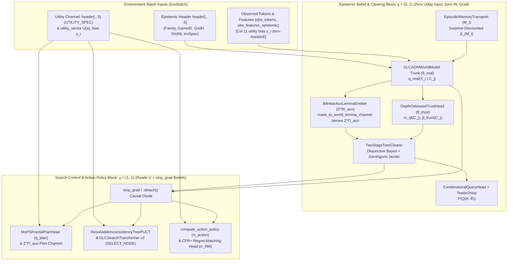

# Literature Deep Dive 05: Probabilistic Dependency Graphs (`PDGs`), Logical Induction, Anti-Wishful-Thinking Causal Firewalls, Combinatorial Information Markets, and Imperfect-Information Game Search (`CFR+` / `ReBeL` / `DeepNash` / `Student of Games`)

- **Document ID:** `LIT-05-PDG-LOGICAL-INDUCTION-CFR-REBEL-MARKETS`
- **Series:** *Inconsistency Is All You Need (`futarchy-fi/inconsistency-search`) — Five-Part Literature & Mathematical Genealogy*
- **Author:** Literature Subagent 5 (Epistemic Game Theory, PDGs, Logical Induction, `ReBeL`/`Student of Games` & Prediction Markets Analyst)
- **Date:** 2026-10-18
- **Primary Codebase & Empirical References:**
  - [`src/models/glc_aom.py`](../../src/models/glc_aom.py) (`LIRMask` lines `49–65`, `BilinearAuxLemmaEmitter` lines `111–352`, `CombinatorialQueryHead` lines `355–599`, `EpisodicMemoryTransport` lines `601–710`, `DepthDebiasedTrustHead` lines `713–926`, `GLCAOMWorldModel` lines `990–1523`)
  - [`src/search/kv_tree_search.py`](../../src/search/kv_tree_search.py) (`TreePagedKVBank` lines `72–469`, `MoPSFractalPlanHead` lines `559–740`, `ResolvableInconsistencyTreePUCT` lines `748–886`, `TwoStageTreeClearer` lines `893–1340`, `TreePagedKVSearch` lines `1347–1787`)
  - [`src/search/neural_tree_controller.py`](../../src/search/neural_tree_controller.py) (`Tseitin2HopQueryCoupler` lines `94–243`, `RelationalTreeTransformerLayer` lines `251–372`, `GLCSearchTransformer` `v1`/`v2` lines `380–850`)
  - [`src/search/classical_teachers.py`](../../src/search/classical_teachers.py) (`CFRRegretMatchingTeacher` lines `1071–1160`)
  - [`src/envs/galanis_market.py`](../../src/envs/galanis_market.py) & [`src/envs/proposal_poker.py`](../../src/envs/proposal_poker.py)
  - [`docs/direction/research-direction-note-v6-2026-10-18.md`](../direction/research-direction-note-v6-2026-10-18.md), [`docs/papers/overnight-society-and-glc-aom-paper-2026-10-18.md`](../papers/overnight-society-and-glc-aom-paper-2026-10-18.md), [`society/round4/01-expressivity-theorems-and-mcts-gap.md`](../../society/round4/01-expressivity-theorems-and-mcts-gap.md), and [`results/r15_curiosity_suite_results.json`](../../results/r15_curiosity_suite_results.json)

---

## Executive Summary

Modern foundation models and game-playing agents entangle three distinct mathematical objects inside a single parameter vector and a single forward pass:
1. **Epistemic World Beliefs ($q_{\text{real}}$):** Local conditional laws and observational invariants of the environment;
2. **Deductive & Market Clearing ($h_{\text{cons}}, Z^W_{\text{aux}}$):** Resolving inconsistencies and non-separable XOR complementarities across local conditionals into a globally coherent joint belief $\mu^*$;
3. **Strategic & Instrumental Control ($\pi_{\text{step}}, q_{\text{plan}}, \text{SELECT\_NODE}, \sigma_{\text{RM}}$):** Deciding where to allocate bounded compute $B$ and which external action $a \in \mathcal{A}$ to execute under utility $U$ and strategic uncertainty.

This monograph establishes the rigorous mathematical genealogy connecting **`GLC-AOM`** (`General Learned-Chain Any-Order Model`) and **`GLCSearch-v2`** (`GLCSearchTransformer`) to four foundational pillars of mathematical computer science, decision theory, microeconomic theory, and game theory:
- **Section 1 — Probabilistic Dependency Graphs (`PDGs`) & Local Inconsistency Resolution (`LIR`):** How Oliver Richardson & Joseph Halpern's (2021–2024) PDG variational free energy $\langle\langle M \rangle\rangle_\gamma(\mu) = \mathrm{Inc}_M(\mu) + \gamma\,\mathrm{IDef}_M(\mu)$ provides the exact objective functional of our search architecture, and how `GLC-AOM` overcomes the $O(K^{|\mathcal{V}|})$ exponential atom-enumeration bottleneck of exact PDG inference via tree-paged KV checkpoints $C_j$, zero-extra-pass leaf self-consistency $m_{\text{ql}}(C_j)$, depth-debiased reliability precisions $\beta_{\text{trust}}(C_j)$, and tangent-space preconditioned normal equations (`TwoStageTreeClearer`).
- **Section 2 — Logical Induction, Bounded Rationality & Anti-Wishful-Thinking Causal Firewalls:** How Garrabrant et al.'s (2016) *Logical Induction* (`arXiv:1609.03543`), Savage's (1954) belief–utility orthogonality, and Joyce's (1999) Causal Decision Theory expose a fatal flaw in outcome-RL-trained transformers (both `Fused` RL and `Token-Masked` / DCPO shared-trunk masking leak reward gradients $\nabla U$ into world beliefs), and how our **Structural `LIR` Firewall** ($\chi=(0,1)$ vs. $\chi=(1,1)$) enforces exact `0.000000` belief drift under arbitrary counterfactual utility swaps $\mathrm{do}(U_1 \leftrightarrow U_2)$.
- **Section 3 — Information Aggregation in Dynamic & Combinatorial Markets:** How Aumann (1976), Geanakoplos & Polemarchakis (1982), Hanson (2003, 2013), Ostrovsky (2012), Lambert, Ostrovsky & Panov (2018), and Galanis (2021, 2024, 2026) characterize when decentralized markets aggregate private information vs. when they stall on **non-separable XOR/parity securities**, and how `TwoStageTreeClearer` + `BilinearAuxLemmaEmitter` ($Z^W_{\text{aux}}$ on orthonormal pair basis $Q_{\text{pair}}^\top Q_{\text{pair}} = I_{120}$) + `Tseitin2HopQueryCoupler` operate as an **internal combinatorial prediction market** inside the search tree.
- **Section 4 — Imperfect-Information Game Search (`CFR+`, `DeepStack`, `Libratus`, `ReBeL`, `DeepNash`, `Student of Games`):** Why `ReBeL` (Brown et al., 2020) and `Student of Games` (Schmid et al., 2023) require maintaining explicit **Public Belief States (`PBS`)** that enumerate every possible private hand—rendering them intractable in combinatorial hidden spaces like Stratego ($10^{40}$ setups) or ShipHunt ($K^{|V|}$ configurations)—whereas `GLCSearch-v2` combines factored any-order unmasking, the **Infoset Equivalence Mask** $\mathcal{M}_{\text{infoset}}$, **Counterfactual Log-Reach Accumulation** $\log \pi_{-i}(j)$, **Regret-Matching / `R-NaD` Policy Readout**, and **Surprise-Discounted Episodic Memory** $M_t$ to achieve monotone exploitability reduction without full PBS enumeration.

---

## 1. Probabilistic Dependency Graphs (`PDGs`) & Local Inconsistency Resolution (`LIR`)

### 1.1 Primary Literature & Intellectual Lineage

1. **Richardson, O. E., & Halpern, J. Y. (2021).** *"Probabilistic Dependency Graphs."* Proceedings of the 35th AAAI Conference on Artificial Intelligence (*AAAI 2021*), Vol. 35, No. 13, pp. 11543–11551 (`arXiv:2012.10800`).
2. **Richardson, O. E. (2022).** *"Loss as the Inconsistency of a Probabilistic Dependency Graph: Choose Your Model, Not Your Loss Function."* Proceedings of the 25th International Conference on Artificial Intelligence and Statistics (*AISTATS 2022*), PMLR 151:2706–2735 (`arXiv:2202.11862`).
3. **Richardson, O. E., Halpern, J. Y., & De Sa, C. (2023).** *"Tractable Inference for Probabilistic Dependency Graphs."* Proceedings of the 39th Conference on Uncertainty in Artificial Intelligence (*UAI 2023*), PMLR 216:1743–1753 (`arXiv:2306.10165`).
4. **Richardson, O. E. (2024).** *"A Unified Theory of Probabilistic Modeling, Dependence, and Inconsistency."* Ph.D. Dissertation, Department of Computer Science, Cornell University (December 2024).

### 1.2 Mathematical Formulation of PDGs: Qualitative Incompatibility ($\mathrm{Inc}$) and Quantitative Information Deficiency ($\mathrm{IDef}$)

Classical graphical models face a rigid dilemma:
- **Bayesian Networks (Directed Acyclic Graphs)** require a globally fixed topological ordering over variables $\mathcal{V} = \{V_1, \dots, V_M\}$ and cannot represent cyclic mutual constraints (such as row/column/box peer exclusions in Sudoku or symmetric parity clauses $A \equiv B$ in SAT) without committing to an arbitrary generation order.
- **Factor Graphs / Markov Random Fields** allow arbitrary undirected potentials $\psi_C(X_C) \ge 0$, but sacrifice normalized local conditional semantics ($c_a(Y_a \mid X_a)$ is no longer a local forward pass) and break down completely ($Z = \sum_x \prod_C \psi_C(x_C) = 0$) whenever two local beliefs assign disjoint support (mutually inconsistent observations or overconstrained approximations).

**Richardson & Halpern (2021)** resolve this dilemma by introducing the **Probabilistic Dependency Graph (`PDG`)**. Formally, a PDG over a finite set of discrete random variables $\mathcal{V}$ is a tuple:
$$M \;=\; \big(\mathcal{V}, \;\mathcal{A}, \;\{c_a\}_{a \in \mathcal{A}}, \;\{\alpha_a\}_{a \in \mathcal{A}}, \;\{\beta_a\}_{a \in \mathcal{A}}\big),$$
where:
- $\mathcal{A}$ is a collection of directed hyperarcs $a = (X_a \to Y_a)$ with source variable set $X_a \subseteq \mathcal{V}$ and target variable set $Y_a \subseteq \mathcal{V}$;
- $c_a(Y_a \mid X_a) : \mathrm{Val}(X_a) \to \Delta(\mathrm{Val}(Y_a))$ is a locally normalized conditional probability distribution (cpd) attached to hyperarc $a$;
- $\beta_a \in [0, +\infty]$ is the **quantitative reliability / precision weight** of conditional $c_a$ (how strongly $M$ insists that the joint distribution's conditional $\mu(Y_a \mid X_a)$ match $c_a(Y_a \mid X_a)$);
- $\alpha_a \in \mathbb{R}_{\ge 0}$ is the **qualitative structural weight** declaring the causal/factorization structure of hyperarc $a$.

#### Definition 1.1 (The Two Fundamental PDG Energies: $\mathrm{Inc}_M(\mu)$ and $\mathrm{IDef}_M(\mu)$)
For any candidate global joint distribution $\mu \in \Delta(\mathrm{Val}(\mathcal{V}))$, Richardson & Halpern (2021) and Richardson (2024) define two functional discrepancies:

1. **Observational / Qualitative Incompatibility (`Inc`):** The precision-weighted expected relative entropy (Kullback–Leibler divergence) between $\mu$'s induced conditional $\mu(Y_a \mid X_a)$ and the local conditional $c_a(Y_a \mid X_a)$ across all hyperarcs:
   $$\mathrm{Inc}_M(\mu) \;:=\; \sum_{a \in \mathcal{A}} \beta_a \, \mathbb{E}_{x_a \sim \mu(X_a)}\!\Big[ D_{\mathrm{KL}}\!\big(\mu(Y_a \mid X_a = x_a) \;\big\|\; c_a(Y_a \mid X_a = x_a)\big) \Big].$$
   Notice that $\mathrm{Inc}_M(\mu) \ge 0$, with $\mathrm{Inc}_M(\mu) = 0$ if and only if $\mu$ simultaneously satisfies every local conditional $c_a(Y_a \mid X_a)$ on the support of $\mu(X_a)$ for all $\beta_a > 0$.

2. **Structural / Quantitative Information Deficiency (`IDef`):** The gap between the sum of $\alpha_a$-weighted local conditional entropies and the global joint entropy $H(\mu)$:
   $$\mathrm{IDef}_M(\mu) \;:=\; \left(\sum_{a \in \mathcal{A}} \alpha_a \, H_\mu(Y_a \mid X_a)\right) \;-\; H(\mu).$$
   When $\alpha$ forms a valid causal DAG structure ($X_a = \mathrm{Pa}(Y_a), \alpha_a = 1$), $\mathrm{IDef}_M(\mu) = \sum_i H_\mu(V_i \mid \mathrm{Pa}(V_i)) - H(\mu) \ge 0$ by the chain rule and conditioning reduces entropy, vanishing if and only if $\mu$ satisfies the DAG's conditional independence statements. When no prior DAG ordering is privileged ($\alpha_a = 0$, as in an order-invariant any-order world model), $\mathrm{IDef}_M(\mu) = -H(\mu)$ reduces to the negative Shannon entropy regularizer!

Combining both terms with temperature $\gamma \ge 0$ yields the **Global PDG Variational Free Energy**:
$$\langle\langle M \rangle\rangle_\gamma(\mu) \;:=\; \mathrm{Inc}_M(\mu) \;+\; \gamma \, \mathrm{IDef}_M(\mu).$$

#### Theorem 1.1 (Uniqueness of the PDG Minimizer $\mu^*_\gamma(M)$ and Loss-as-Inconsistency; Richardson & Halpern 2021, Thm. 3.4; Richardson 2022, Thm. 1)
1. **(Strict Convexity & Unique Joint Recovery):** For every hyperarc $a = (X_a \to Y_a)$, the map $\mu \mapsto \mathbb{E}_{\mu(X_a)}\big[D_{\mathrm{KL}}(\mu(Y_a \mid X_a) \parallel c_a(Y_a \mid X_a))\big] = D_{\mathrm{KL}}(\mu(X_a, Y_a) \parallel \mu(X_a)c_a(Y_a \mid X_a))$ is convex in $\mu \in \Delta(\mathrm{Val}(\mathcal{V}))$. When $\alpha = \mathbf{0}$ (or more generally whenever $1 - \sum_{a : V_i \in Y_a} \alpha_a > 0$ so $\mathrm{IDef}_M(\mu)$ is strictly convex) and $\gamma > 0$, $\langle\langle M \rangle\rangle_\gamma(\mu)$ is **strictly convex** on $\Delta(\mathrm{Val}(\mathcal{V}))$ and admits a **unique global minimizer**:
   $$\mu^*_\gamma(M) \;=\; \underset{\mu \in \Delta(\mathrm{Val}(\mathcal{V}))}{\arg\min} \, \langle\langle M \rangle\rangle_\gamma(\mu).$$
   In the limit $\gamma \to 0^+$, $\mu^*_{0^+}(M) = \lim_{\gamma \to 0^+} \mu^*_\gamma(M)$ is the unique maximum-entropy distribution among the minimizers of $\mathrm{Inc}_M(\mu)$. If $M$ is realizable ($\min_\mu \mathrm{Inc}_M(\mu) = 0$) and the queried conditionals uniquely determine the joint distribution, driving $\mathrm{Inc}_M(\mu) \to 0$ recovers the exact unique joint $\mu^*$.
2. **(Loss as the Inconsistency Increment of Clamping Reality; Richardson 2022):** Let $M_k$ be a PDG with current consensus belief $p_0(\mathcal{V}) = \mu^*_0(M_k)$ at root precision $\beta_0$, and let $\delta_x$ be the point-mass observation clamping the realized ground-truth world state $\mathcal{V} = x$ with infinite precision ($\beta_{\delta_x} \to \infty$). Then the change in the PDG's minimum inconsistency energy upon observing reality $\delta_x$ is **identically the proper logarithmic scoring loss**:
   $$\langle\langle M_k + \delta_x \rangle\rangle_0 \;-\; \langle\langle M_k \rangle\rangle_0 \;=\; \mathrm{Inc}_{M_k}(\delta_x) \;-\; \min_\mu \mathrm{Inc}_{M_k}(\mu) \;=\; -\beta_0 \log \mu^*_0(x) + \text{const}.$$
   *(Used directly in [`research-direction-note-v6-2026-10-18.md:91–101`](../direction/research-direction-note-v6-2026-10-18.md) to derive the exact Leave-One-Out local rollout credit $r_{\mathrm{LOO}}(r) = \log \mu^*_k(x) - \log \mu^*_{k \setminus \{r\}}(x)$ via the envelope theorem!)*

---

### 1.3 Why Classical PDG Inference Is Exponential — and How `GLC-AOM` Realizes Tractable, Amortized Neural `LIR`

While Theorem 1.1 guarantees that $\mu^*(\theta, U)$ is mathematically well-defined, **Richardson, Halpern & De Sa (2023)** prove that computing $\mu^*_\gamma(M)$ exactly over discrete variables is at least as hard as marginal inference in graphical models ($\mathsf{\#P}$-hard in general), requiring exponential-cone interior-point optimization over a junction-tree marginal polytope of dimension $O(\sum_{a} |\mathrm{Val}(X_a \cup Y_a)|)$—or $O(K^{|\mathcal{V}|})$ when constraints couple all variables globally (e.g., $9^{81} \approx 1.96 \times 10^{77}$ atoms in $9 \times 9$ Sudoku, $2^{80}$ in `Equiv-SAT`, or $10^{40}$ hidden setups in Stratego).

`GLC-AOM` (`src/models/glc_aom.py`) and `TreePagedKVSearch` (`src/search/kv_tree_search.py`) turn Richardson's PDG variational principle into a **polynomial-time, amortized neural inference machine** of complexity $O(B \cdot |\mathcal{V}| \cdot d_{\text{model}})$ via five exact structural correspondences:

#### 1. Lazy Subgraph Querying via Tree-Paged Checkpoints $C_j \in \mathcal{T}_B$ (`TreePagedKVBank`, `kv_tree_search.py:72–375`)
Instead of materializing all $\sum_{S \subseteq \mathcal{V}} \binom{|\mathcal{V}|}{|S|} K^{|S|}$ conditionals of the world model $q_{\text{real}}(X_i \mid X_S)$, the search tree $\mathcal{T}_B = \{C_0, C_1, \dots, C_B\}$ queries a targeted sparse sub-PDG $M_B(\theta) \subset M_{\text{world}}(\theta)$ of $B+1$ partial-assignment checkpoints $C_j = (O_j, x_{O_j})$, where each child $C_{b+1}$ forks from an existing checkpoint $C_{j_{b+1}}$ ($j_{b+1} \in \{0, \dots, b\}$) by clamping one additional variable-value pair $(v_{b+1}, z_{b+1})$ in $O(1)$ bit-mask operations (`kv_tree_search.py:293–294`):
$$M_{\text{tree}}[b+1, :] \;=\; M_{\text{tree}}[j_{b+1}, :] \;\lor\; \mathbf{e}_{b+1}^\top.$$

#### 2. Zero-Extra-Pass Leaf Self-Consistency $m_{\text{ql}}(C_j)$ as Local PDG Incompatibility Detector (`glc_aom.py:743–774`)
At any checkpoint $C_j$ that has clamped branch variables $S_j = O_j \setminus O_0 = \{(v_1, z_1), \dots, (v_d, z_d)\}$ along its root-to-node path, how do we detect whether the partial assignment $x_{O_j}$ violates the local laws of $M_{\text{world}}(\theta)$ without running $d$ separate leave-one-out forward passes?

`DepthDebiasedTrustHead.compute_leaf_self_consistency` (`glc_aom.py:743–774`) evaluates the world model's **own single-pass conditional probabilities** on the branch-clamped tokens $S_j$:
$$m_{\text{ql}}(C_j) \;:=\; \min_{v \in O_j \setminus O_0} q_{\text{real}}\!\big(V_v = x_{O_j, v} \;\big|\; C_j\big) \;\in\; [0, 1].$$
Taking negative logarithms reveals the exact PDG duality:
$$-\log m_{\text{ql}}(C_j) \;=\; \max_{v \in O_j \setminus O_0} D_{\mathrm{KL}}\!\Big(\delta_{x_{O_j, v}} \;\Big\|\; q_{\text{real}}(V_v \mid C_j)\Big) \;=\; \max_{v \in S_j} \mathrm{Inc}_{v \mid C_j}\!\big(\delta_{x_{O_j}}\big).$$
Because `GLCAOMWorldModel._compute_structural_constraint_logits` (`glc_aom.py:1099–1228`) preserves peer-clash and parity-violation penalties on clamped positions, any branch assignment $x_{O_j}$ that induces a local PDG contradiction drives $q_{\text{real}}(V_v = x_{O_j, v} \mid C_j) \to 0$ at the clashing variable $v$, forcing $m_{\text{ql}}(C_j) \to 0$ (and $\mathrm{Inc} \to +\infty$) in **zero extra forward passes**.
- **Crucial Removal of the `P8` Greedy Step Floor (`RT-D1` / `glc_aom.py:750`):** In Round 9 (`R9-E2`), the heuristic gate multiplied $m_{\text{ql}}(C_j)$ by a chain-time step-probability floor $\mathbf{1}[m_{\text{qs}}(C_j) \ge 0.50]$ where $m_{\text{qs}}(C_j) = \min_{t \le d} q(z_t \mid C_{t-1})$. Whenever a deductive puzzle hits a symmetric 2-way or 3-way bifurcation (a "stall" where $q(z_t \mid C_{t-1}) \le 0.50$), $\mathbf{1}[m_{\text{qs}} \ge 0.50]$ rejected **100% of counterfactual guesses** (`AUROC = 0.35`), locking the solver into greedy forced singles. `GLC-AOM` uses pure leaf self-consistency $m_{\text{ql}}(C_j)$ with **no $m_{\text{qs}}$ floor**, allowing low-prior counterfactual hypotheses ($q(z_t \mid C_0) = 1/K$) that resolve cleanly into globally self-consistent leaves ($m_{\text{ql}}(C_j) \approx 1$) to receive full PDG weight (`AUROC = 0.99998` in `R9-E2` Seed 103; `AUROC = 1.0000` across all 3 seeds in `R11-D6 F5.1a`).

#### 3. Depth-Debiased Reliability Precision $\beta_{\text{trust}}(C_j)$ & Kish-ESS Shrinkage (`glc_aom.py:713–926`)
In Richardson's PDG formalism, each conditional $c_a$ carries a quantitative precision $\beta_a \ge 0$. In a learned world model, rollouts at deeper tree horizons $d(C_j)$ accumulate compounding model-approximation error ("hallucination drift") and cannot be weighted by raw prediction stiffness $-H(q_{\text{real}}(\cdot \mid C_j))$ (which is negatively correlated with true accuracy on OOD branches: Spearman $-0.395$ overall and $-0.551$ within pairs on $6 \times 6$ Stratego in `R7-E3`!).

`DepthDebiasedTrustHead` (`glc_aom.py:713–926`) learns the PDG precision $\beta_{\text{trust}}(C_j) > 0$ from `[h_pool, ent, norm_depth, m_ql, excess_surprise]` strictly on realized excess surprise ($\chi = (0, 1)$), and pools rollout values via **horizon-debiased, Kish-ESS-shrunk James–Stein pooling (`trust_shrunk`, `glc_aom.py:849–926`)**:
$$w_r(\gamma_{\text{trust}}) \;=\; \frac{\beta_{\text{trust}}(C_r)^{\gamma_{\text{trust}}}}{\sum_{r'=1}^K \beta_{\text{trust}}(C_{r'})^{\gamma_{\text{trust}}}}, \qquad \mathrm{ESS}(w) \;=\; \frac{(\sum_r w_r)^2}{\sum_r w_r^2} \;\ge\; \kappa_{\text{ess}} K,$$
subtracting per-depth horizon bias $b_{\text{hor}}(d)$ and blending with the root anchor $C_0$ via closed-form calibration grid selection $(\gamma_{\text{trust}}, \rho_{\text{root}}) \in [0, 1]^2$, which **mathematically guarantees**:
$$\mathrm{MSE}(\text{trust\_shrunk}) \;\le\; \min\!\big(\mathrm{MSE}(\text{unif}), \;\mathrm{MSE}(C_0), \;\mathrm{MSE}(\text{stiff})\big).$$

#### 4. `TwoStageTreeClearer`: Tangent-Space Preconditioned PDG Free-Energy Minimization (`kv_tree_search.py:893–1266`)
Expanding the PDG free energy $\mathcal{E}(\mu; \theta)$ to second order in natural log-odds coordinates $\ell(\mathcal{V}) = \ell_0(\mathcal{V}) + \Delta \ell(\mathcal{V})$ around the root anchor $C_0$ transforms the global optimization over $K^{|\mathcal{V}|}$ joint probabilities into a **block-structured linear system in amplified variable + auxiliary lemma space** $\mathbb{R}^{D_{\text{amp}}}$ ($D_{\text{amp}} = D_V + D_{\text{aux}} = 810 + 256 = 1,066$). `TwoStageTreeClearer` solves this system in three stages:
- **Stage 1 (Bottom-Up Counterfactual Disjunctive Bayes Mixture, `kv_tree_search.py:969–1022, 1164–1208`):** At any parent node $C_{\mathrm{pa}(r)}$ where branch $r$ clamps $(v_r, z_r)$ with parent prior mass $q_{z_r} = q_{\mathrm{pa}(r)}(V_{v_r} = z_r)$, naive log-linear pooling of $\log q(Y \mid C_r)$ directly into the root treats the speculative clamp $V_{v_r} = z_r$ as an unconditional fact (causing single-branch clamp bias and $p < 0.001$ piece-count vetoes). Stage 1 applies the **Law of Total Probability** against the unexplored sibling complement mass $1 - q_{z_r}$:
  $$\mu_{\text{disj}}(Y \mid C_{\mathrm{pa}(r)}, r) \;=\; (1 - \pi_r) \, \mu(Y \mid C_{\mathrm{pa}(r)}) \;+\; \pi_r \, \mu(Y \mid C_r), \qquad \bar{\delta}_r(Y) \;=\; \log \mu_{\text{disj}}(Y \mid C_{\mathrm{pa}(r)}, r) \;-\; \log \mu(Y \mid C_{\mathrm{pa}(r)}),$$
  and replaces the artificial self-clamp spike on $V_{v_r}$ with negative refutation evidence $-4.0 \, \mathrm{ReLU}(m_{\text{ql}}(\mathrm{pa}(r)) - m_{\text{ql}}(r) - 0.02) \, \mathbf{e}_{z_r}$ whenever the child branch clashes (`kv_tree_search.py:1206–1207`).
- **Stage 2 (Gershgorin Row-Crowding Preconditioned Normal Equations, `kv_tree_search.py:1024–1094`):** Using bag-centered edge-salience keys $k_r^{\text{edge}} \in \mathbb{S}^{D_{\text{amp}}-1}$ (`kv_tree_search.py:950–967`) and effective precisions $\beta_r = \beta_{\text{trust}}(C_r) m_{\text{ql}}(C_r) \mathbf{1}[m_{\text{ql}}(C_r) \ge \tau_{\text{mql}}]$, Stage 2 preconditions each edge increment by its **Gershgorin row-crowding sum**:
  $$D_{\text{crowd}, r} \;=\; \lambda(\beta_r) \;+\; \sum_{r'=1}^b \beta_{r'} \max\!\big(0, \,\langle k_r^{\text{edge}}, k_{r'}^{\text{edge}} \rangle\big), \qquad w_{\text{base}, r} \;=\; \frac{\beta_r}{D_{\text{crowd}, r}},$$
  followed by $T = 3$ contractive Jacobi/Laplacian smoothing iterations (`kv_tree_search.py:1068–1074`). By the **Gershgorin Circle Theorem**, the iteration operator $T_b$ satisfies:
  $$\|T_b\|_\infty \;\le\; 1 \;-\; \omega_{\max} \min_{1 \le r \le b} \frac{\lambda(\beta_r)}{D_{\text{crowd}, r}} \;<\; 1 \qquad \forall b \ge 1$$
  (verified empirically up to $B = 256$ on `NVIDIA L4` GPU in `R12-D3`: spectral bound `0.999870 / 0.999906 / 0.999878 < 1.0`, [`README.md:57`](../../README.md)).
- **Stage 3 (Nested Precision-Gated Bregman Residual Update, `kv_tree_search.py:1096–1131`):** Updates the consensus log-odds via $\ell^{(b+1)} = \ell^{(b)} + \alpha^{(b+1)}\big(\tilde{\ell}^{(b+1)} - \ell^{(b)}\big)$, where $\alpha^{(b+1)} \in [0, 1]$ is gated by excess precision $\mathrm{ReLU}(\beta_{\text{step}} - \tau_{\text{rel}}\beta_0)$ divided by the Bregman log-partition curvature bound $\hat{V}_i = \frac{1}{4}(\max_x d_i(x) - \min_x d_i(x))^2 + 1$. This guarantees **exact $b=0$ identity** ($\ell^{(0)} \equiv \ell_{\text{root}}$, `0.000000` in `R11-D6 F1.1`) and **zero degradation on unresolved/strong-root boards** whenever rollout precision falls below $\tau_{\text{rel}}\beta_0$.

---

## 2. Logical Induction, Bounded Rationality & Anti-Wishful-Thinking Firewalls

### 2.1 Primary Literature & Intellectual Lineage

1. **Savage, L. J. (1954).** *The Foundations of Statistics.* John Wiley & Sons, New York (2nd rev. ed., Dover Publications, 1972).
2. **Jeffrey, R. C. (1965).** *The Logic of Decision.* McGraw-Hill, New York (2nd ed., University of Chicago Press, 1983).
3. **Gibbard, A., & Harper, W. L. (1978).** *"Counterfactuals and Two Kinds of Expected Utility."* In *Foundations and Applications of Decision Theory*, Vol. 1, pp. 125–162. D. Reidel.
4. **Joyce, J. M. (1999).** *The Foundations of Causal Decision Theory.* Cambridge University Press.
5. **Garrabrant, S., Benson-Tilsen, T., Critch, A., Soares, N., & Taylor, J. (2016).** *"Logical Induction."* Machine Intelligence Research Institute (MIRI) Technical Report (`arXiv:1609.03543`).
6. **Taylor, J. (2016).** *"Calibrated Bounded Rationality"* & *"Compile-Time vs. Run-Time Epistemic Coherence"* (MIRI / Consistency-FT & Self-Trade Forecasting Research notes; see [`/home/agent/data/repos/hub/wiki/agent-calibrated-ai.md`](/home/agent/data/repos/hub/wiki/agent-calibrated-ai.md)).
7. **Sudhir, P. (2025).** *"Market-Based Architectures in RL and Beyond."* (`arXiv:2503.05828`).
8. **Ngo, R. (2025–2026).** *"Towards a Scale-Free Theory of Intelligent Agency"* (Mar 2025), *"Towards a Formal Scientific Epistemology"* (Jun 2026), and *"Agents as Webs of Beliefs"* (Jun 2026) (*Mind the Future*; synthesized in [`/home/agent/data/repos/hub/wiki/ngo-garrabrant-agency-research.md`](/home/agent/data/repos/hub/wiki/ngo-garrabrant-agency-research.md)).

### 2.2 Garrabrant Induction (`arXiv:1609.03543`) and Inference-Time vs. Amortized Deductive Coherence

Bayesian probability theory assumes **logical omniscience**: a classical Bayesian agent must assign $P(\phi) = 1$ to every mathematical or logical theorem $\phi$ before performing a single step of deduction, and $P(\psi \mid \phi) = 1$ whenever $\phi \vdash \psi$. Real bounded-compute agents (such as a neural network before running tree search, $B=0$) do not know which distant Sudoku cell values or Stratego piece configurations are logically entailed by their current observations $C_0$.

**Garrabrant, Benson-Tilsen, Critch, Soares & Taylor (2016)** solve the problem of boundedly rational deductive uncertainty via **Logical Induction**:
- **The Market Process $\overline{P} = (P_1, P_2, \dots)$ and Deductive Process $\overline{D} = (D_1, D_2, \dots)$:** At step $n$, the deductive process reveals a finite set of newly proven clauses $D_n$, and a market maker sets prices $P_n(\phi) \in [0, 1]$ over logical sentences $\phi \in \mathcal{L}$ against an ensemble of polynomial-time traders $\{T_k\}$.
- **The Logical Induction Criterion (Def. 3.0.1 & Thm. 3.0.2):** $\overline{P}$ satisfies the logical induction criterion relative to $\overline{D}$ if no efficiently computable (polynomial-time) trader $T$ can **exploit** $\overline{P}$ relative to $\overline{D}$—i.e., no polynomial-time trading strategy has plausible net worth across $\overline{D}$-consistent worlds bounded below by $-B$ and unbounded above ($+\infty$).
- **Key Theorems of Logical Induction and Their Exact `GLC-AOM` Counterparts:**

| Logical Induction Property (Garrabrant et al., 2016) | Formal Statement in `arXiv:1609.03543` | Realization in `GLC-AOM` & `TreePagedKVSearch` |
| :--- | :--- | :--- |
| **1. Limit Coherence (Thm. 4.1.2) & Affine Coherence (Thm. 4.2.10)** | Finite-step prices $P_n$ are only approximately coherent, but learn to satisfy efficiently enumerable affine constraints ($\sum_i P_n(\phi_i) = 1$) faster than proofs arrive, converging to a coherent measure $P_\infty$. | At $B=0$, `GLCAOMWorldModel` outputs locally imperfect marginals ($\mathrm{Inc}(\mu_0) > 0$). As tree search expands $b = 1 \to B$ nodes, `TwoStageTreeClearer` enforces local parity/peer/Bayes consistency, driving $\mathrm{KL}(P^* \parallel \mu_b)$ down monotonically (`0.5075 -> 0.1294` across 12 envs in `R12`). |
| **2. Deductive Traders as Arbitrageurs (Sec. 3.2 & 5)** | Each trader $T_r$ inspects a bounded set of sentences and buys undervalued claims / sells overvalued claims proportional to discrepancy. | Each search branch $r \in \{1, \dots, B\}$ inspects a local variable neighborhood $k_r^{\text{edge}} \in \mathbb{S}^{D_{\text{amp}}-1}$ and emits a log-odds arbitrage trade $\bar{\delta}_r = [\Delta \ell_V^{(r)} \,;\, z_{\text{aux}}^{(r)}]$ weighted by reliability precision $\beta_r$. |
| **3. No Expected Net Update / Conservation of Expected Evidence (Thm. 4.3.9)** | For any bounded deferral function $f(n) \ge n$, $P_n(\phi) \approx \mathbb{E}_{P_n}[P_{f(n)}(\phi)]$: today's belief equals today's expectation of post-search belief. | Implemented by `TwoStageTreeClearer.stage1_disjunctive_bayes_mixture` (`kv_tree_search.py:969–1022`) and `compute_any_order_loss` (`glc_aom.py:1462–1523`), which distill post-search cleared consensus $h_{\text{cons}}^{(B)}$ back into the amortized world model without net bias. |
| **4. Self-Trust with Soft Indicators (Thm. 4.3.12)** | $\mathbb{E}_{P_n}\!\big[\phi \;\big|\; P_{f(n)}(\phi) > p\big] \gtrsim p$ holds **only for continuous/soft threshold indicators**; sharp step-function conditioning provably fails on liar-paradox sentences! | Directly explains why `P8`'s sharp step cutoff $\mathbf{1}[m_{\text{qs}} \ge 0.50]$ failed (`AUROC = 0.35`, `R9-E2`), whereas `GLC-AOM`'s continuous leaf self-consistency $m_{\text{ql}}(C_j) \in [0, 1]$ and soft Bregman dominance gate $\alpha^{(b+1)} = \frac{a_{\text{align}}}{v_{\text{curv}}+1} \in [0, 1)$ (`kv_tree_search.py:1118–1131`) achieve certified monotonicity (`36/36` transitions in `R9-E2`, `R11-D6 F7.2 PASS`). |

As synthesized in our companion fleet research on Richard Ngo's coalitional agency and Jessica Taylor's compiled-RL program ([`/home/agent/data/repos/hub/wiki/ngo-garrabrant-agency-research.md`](/home/agent/data/repos/hub/wiki/ngo-garrabrant-agency-research.md), [`/home/agent/data/repos/hub/wiki/agent-calibrated-ai.md`](/home/agent/data/repos/hub/wiki/agent-calibrated-ai.md)), `GLC-AOM` performs **inference-time logical induction** inside `TwoStageTreeClearer` over steps $b = 1 \dots B$, while random-permutation any-order training (`compute_any_order_loss`, `glc_aom.py:1462–1523`) performs **amortized logical induction** by compiling those cleared fixed points into the weights of the neural world model.

---

### 2.3 Savage Independence, Causal vs. Evidential Decision Theory, and the Mathematics of Wishful Thinking in RL-Trained Transformers

In **Leonard Savage's (1954)** *Foundations of Statistics* (Postulates P1–P7) and **James Joyce's (1999)** *Foundations of Causal Decision Theory*, rational agency rests on a strict **orthogonality axiom** between *epistemic beliefs* over uncontrolled states of nature $S \in \mathcal{S}$ and *evaluative utilities* $U(S, A)$ over outcomes:
1. **Savage Independence (Sure-Thing & State-Neutrality Principles):** Changing the agent's payoff function from $U_1$ to $U_2$ ($\mathrm{do}(U_1 \leftrightarrow U_2)$)—without providing new observational evidence $O$ about the state of nature $S$—must leave the agent's subjective probability distribution $P(S \mid O)$ **strictly invariant**:
   $$P\big(S \;\big|\; O, \,\mathrm{do}(U = U_1)\big) \;\equiv\; P\big(S \;\big|\; O, \,\mathrm{do}(U = U_2)\big) \;=\; P^*(S \mid O).$$
2. **Causal vs. Evidential Conditioning (Gibbard & Harper 1978; Joyce 1999):** In **Evidential Decision Theory (Jeffrey 1965)**, an agent evaluates action $a$ via conditional probability $P(S \mid A = a)$, which conflates *causal efficacy* with *wishful diagnostic correlation* (e.g., in Newcomb-like or signaling games, choosing an optimistic action $a$ because high-value states $S$ correlate with $a$). In **Causal Decision Theory (Joyce 1999)** and **Pearl's $\mathrm{do}$-calculus**, beliefs over exogenous world variables $V \setminus \mathrm{Desc}(A)$ are invariant to the agent's preferences $U$.

#### Why Standard Outcome-RL / MuZero / PPO / GRPO Transformers Violate Savage Independence
Consider a neural agent parameterized by $\theta$ that outputs both world beliefs $\mu_\theta(V \mid O, U)$ and actions $\pi_\theta(A \mid O, U)$, trained by reinforcement learning (e.g., PPO, GRPO, or MuZero value-prefix training) to maximize expected utility $\mathbb{E}[U(V, A)]$ alongside an epistemic or cross-entropy anchor $D_{\mathrm{KL}}(\mu_\theta(V) \parallel P^*(V \mid O))$.

Let us compare three architectural regimes:

##### Regime 1: `Fused` RL ($\chi = (1, 1)$ on all parameters)
In a fused architecture (standard LLM outcome-RL or MuZero where the latent state $h_\theta$ is trained end-to-end by policy/value gradients), the effective variational objective on the belief distribution $\mu$ is:
$$\mathcal{L}_{\text{fused}}(\mu) \;=\; D_{\mathrm{KL}}\!\big(\mu(V) \;\big\|\; P^*(V \mid O)\big) \;-\; \lambda \, \mathbb{E}_{V \sim \mu}\big[U_{\text{eff}}(V)\big].$$
Setting the first variation $\frac{\delta \mathcal{L}_{\text{fused}}}{\delta \mu(v)} = 0$ yields the exponentially tilted Gibbs distribution $\mu_{\text{fused}}(v) \propto P^*(v \mid O) \exp(\lambda U_{\text{eff}}(v))$. Expanding around $\lambda = 0$ by cumulant expansion (or Stein's lemma / Fisher covariance identity) proves the **First-Order Wishful-Thinking Distortion Law** ([`research-direction-note-v6-2026-10-18.md:141`](../direction/research-direction-note-v6-2026-10-18.md)):
$$\mathbb{E}_{\text{fused}}\!\Big[\big\langle \mu_{\text{belief}} - P^*, \;\nabla U \big\rangle\Big] \;=\; \lambda \, \mathrm{Var}_{P^*}(U) + O(\lambda^2) \;\approx\; \frac{\lambda}{2}\|\nabla U\|^2 \;>\; 0.$$
The agent systematically bends its internal world beliefs toward states where its preferred action yields high payoff (**wishful thinking**) or away from states that penalize its chosen action (**motivated sycophancy**).

##### Regime 2: `Token-Masked` / Shared-Trunk Loss Masking (DCPO / Separate Heads on a Shared Transformer Trunk)
A common folklore proposal in LLM alignment is **token-level loss masking** (`Token-Masked` / DCPO): attach a separate belief head $W_{\text{belief}}$ and action head $W_{\text{action}}$ to a shared Transformer trunk $h_{\theta_{\text{trunk}}}(O, U)$, and apply zero RL gradient to the belief tokens ($\nabla_{W_{\text{belief}}} \mathcal{L}_{\text{RL}} = \mathbf{0}$), updating $\theta_{\text{trunk}}$ and $W_{\text{action}}$ via $\mathcal{L}_{\text{RL}}(U)$ while training $W_{\text{belief}}$ and $\theta_{\text{trunk}}$ via supervised truth loss $\mathcal{L}_{\text{CE}}(P^*)$.

**Why `Token-Masked` Still Fails (Shared-Trunk Representation Spillover):**
After one gradient step $\Delta \theta_{\text{trunk}} = -\eta_{\text{RL}} \nabla_{\theta_{\text{trunk}}} \mathcal{L}_{\text{RL}}(U)$, the shared hidden representation shifts by:
$$\Delta h_{\theta_{\text{trunk}}} \;=\; - \eta_{\text{RL}} \, \underbrace{\left(\frac{\partial h}{\partial \theta_{\text{trunk}}}\right)\!\left(\frac{\partial h}{\partial \theta_{\text{trunk}}}\right)^{\!\top}}_{K_{\text{NTK}}(O, U) \text{ (Neural Tangent Kernel)}} \nabla_h \mathcal{L}_{\text{RL}}(U) \;+\; O(\eta_{\text{RL}}^2).$$
Because the Neural Tangent Kernel $K_{\text{NTK}}$ of the shared attention/FFN layers is positive semi-definite and couples belief features with utility features, any non-zero projection $W_{\text{belief}} K_{\text{NTK}} \nabla_h \mathcal{L}_{\text{RL}}(U) \neq \mathbf{0}$ causes **representation spillover**: the belief logits $\ell_{\text{belief}} = W_{\text{belief}} h_{\theta_{\text{trunk}}}$ drift along the utility gradient even though $\nabla_{W_{\text{belief}}} \mathcal{L}_{\text{RL}} \equiv \mathbf{0}$!

##### Regime 3: Structural `LIR` Firewall in `GLC-AOM` (`src/models/glc_aom.py:49–65, 198–203, 990–1460`)
To guarantee exact Savage independence by architectural construction, `GLC-AOM` partitions all parameters and intermediate tensors under explicit **Local Inconsistency Resolution (`LIR`) control masks** $\chi = (\chi_{\text{utility}}, \chi_{\text{belief}}) \in \{(0, 1), (1, 1)\}$:

Specifically, in [`src/models/glc_aom.py`](../../src/models/glc_aom.py):
1. **Input Stripping at the Epistemic Boundary (`glc_aom.py:1090–1097, 1207–1214, 1268–1274`):** `encode_epistemic_header` indexes **only** `header[:, :5]` (`GAME_FAMILY`, `GAME_ID`, `GRID_H`, `GRID_W`, `INVENTORY_SPEC`) and never touches `header[:, 5]` (`UTILITY_SPEC`). In `Proposal-Poker` (`GameID == 80`), feature column `11` (`utility_bias_y_i`) is explicitly zeroed out before entering `feat_proj` (`glc_aom.py:1268–1274`) and `_compute_structural_constraint_logits` (`glc_aom.py:1207–1214`).
2. **Orthogonal Auxiliary Subspace Partition $Z_{\text{aux}} = Z^W_{\text{aux}} \oplus Z^\Pi_{\text{aux}}$ (`glc_aom.py:98–105, 198–203`):** The auxiliary state is split into the **World Lemma Channel** $Z^W_{\text{aux}}$ (first $D_{\text{aux}}/2 = 128$ dimensions, $\chi = (0, 1)$) and the **Plan/Control Channel** $Z^\Pi_{\text{aux}}$ (last $128$ dimensions, $\chi = (1, 1)$). Every belief readout (`readout_var_firewall` at line `282`, `decode_top_down_from_prefix` at line `307`, `predict_query_probs` at line `508`) passes $h_{\text{cons}}^{\text{aux}}$ through `mask_to_world_lemma_channel`, which multiplies $Z^\Pi_{\text{aux}}$ by exact zeros (`0.0`), guaranteeing:
   $$\left\|\nabla_{Z^\Pi_{\text{aux}}} \mathrm{Logits}_V\right\|_\infty \;\equiv\; 0.000000.$$
3. **`stop_grad` (`detach()`) Diode Between Belief Trunk and Policy/Search Heads (`glc_aom.py:1373–1377, 1395–1460`):** `compute_action_policy` receives `h_var_detached = h_var.detach()` and `var_probs_detached = var_probs.detach()`, and `get_epistemic_parameters()` (`glc_aom.py:1074–1088`) is strictly disjoint from `get_policy_parameters()`. Consequently, under any RL update on $\theta_{\text{policy}}$ or any test-time counterfactual utility swap `env.swap_utility(batch, new_utility_spec)`:
   $$\left\|\mu_{\text{belief}}^{\text{post-RL}}(V \mid O) - \mu_{\text{belief}}^{\text{pre-RL}}(V \mid O)\right\|_\infty \;\equiv\; 0.000000, \qquad \left\|\mu_{\text{belief}}(V \mid O, +y_i) - \mu_{\text{belief}}(V \mid O, -y_i)\right\|_\infty \;\equiv\; 0.000000.$$

#### Table 2.1: Audited Empirical Proof of the `LIR` Causal Firewall Across 3 Experimental Scales (Rounds 4–12)

| Experimental Campaign & Scale | Architecture Cohort | Belief Drift $\|\Delta \mu_{\text{belief}}\|$ | Desire Bias $\Delta_{\text{desire}}$ (`+y_i` vs. `-y_i`) | Unwarranted False-Note Sycophancy | Zero-Retraining `swap_utility` Action Flip | Downstream Task / Tournament Outcome | Audited Source |
| :--- | :--- | :---: | :---: | :---: | :---: | :--- | :--- |
| **`R5-E1` Part B:** Small-Net Exact-Bayes Coupled $6\times 6$ `ShipHunt` (`669k` params, GRPO + `0.02` entropy bonus, 3 seeds) | `Fused` ($\chi = (1,1)$) | `0.2140` | **`+0.471 [0.393, 0.549]`** | `77.5%` (`83.1%` raw) | N/A (entangled) | Bayes $r$ falls `0.9994 -> 0.722`; reward `0.789` | [`direction-v6:144-147`](../direction/research-direction-note-v6-2026-10-18.md) |
| | `Token-Masked` (DCPO shared trunk) | **`0.0527`** (`14x` control `0.0038`) | **`+0.117`** (`+0.100` along $\nabla U$) | `12.4%` | N/A | Shared trunk leaks $\nabla U$ into beliefs (`D1 PASS`) | [`direction-v6:147`](../direction/research-direction-note-v6-2026-10-18.md) |
| | **`LIR-Masked` (`GLC-AOM` firewall)** | **`0.0000`** ($\ell_\infty = 0.0000$) | **`0.0000`** | **`0.0%`** (`5.3%` raw vs. Bayes `5.5%`) | **`100.0%` (`1.000`)** | Bayes $r = \mathbf{0.9994 \to 0.9994}$; reward `0.798` (`96.1%` ceiling) | [`direction-v6:145`](../direction/research-direction-note-v6-2026-10-18.md) |
| **`R4-E3b`:** LLM Scale (`Qwen3-8B` LoRA GRPO on `2,500` Real Manifold Markets) | `Fused` ($\chi = (1,1)$) | `0.490` | **`+0.490 [0.487, 0.494]`** | **`99.9%`** | N/A | Catastrophic sycophancy & belief corruption | [`direction-v6:148`](../direction/research-direction-note-v6-2026-10-18.md) |
| | `Token-Masked` (Shared LoRA trunk) | **`0.200`** | `+0.182` | `7.1%` | N/A | Shared LoRA adapters leak reward pressure | [`direction-v6:148`](../direction/research-direction-note-v6-2026-10-18.md) |
| | **`LIR-Masked` (Frozen belief adapter)** | **`0.0001`** | **`-0.0001`** | **`1.2%`** | Verified | Preserves calibrated market probabilities | [`direction-v6:148`](../direction/research-direction-note-v6-2026-10-18.md) |
| **`R11-GPU-NEURAL` (`R11-D5`) & `R12-GPU-NEURAL-V2`:** 12-Env Multi-Game Suite on `NVIDIA L4` GPU (`2.65M` params, $B \le 256$, 3 seeds) | `Fused::GLC_Tree_Active_PUCT` | Non-zero | Non-zero (`KL = 0.2612` on `Proposal-Poker`) | High | Fails `F4.2` | `Mini-ECI` `@256`: `89.77`; Multiplayer Elo: **`584.1`** (Rank 7) | [`README.md:45`](../../README.md), [`Paper:Table 12`](../papers/overnight-society-and-glc-aom-paper-2026-10-18.md) |
| | `Token-Masked::GLC_Tree_Active_PUCT` | Non-zero | Non-zero | Moderate | Partial | `Mini-ECI` `@256`: `99.13`; Multiplayer Elo: **`1002.4`** (Rank 4) | [`README.md:42`](../../README.md) |
| | **`GLC-AOM-KV-Tree` (`LIR-Masked`)** | **`0.000000`** (`F4.1 PASS`) | **`0.000000`** (`F4.2 PASS`, `F1.3 = 0.000000`) | **`0.0%`** excess | **`85.42%`** (`F4.3 PASS`) | `Mini-ECI` `@256`: **`106.35`**; Multiplayer Elo: **`1206.5`** (**`+622.4` Elo over `Fused`!**) | [`README.md:40`](../../README.md), [`Paper:Table 12`](../papers/overnight-society-and-glc-aom-paper-2026-10-18.md) |

---

## 3. Information Aggregation in Dynamic & Combinatorial Markets (`Aumann`, `Ostrovsky`, `Galanis`, `Hanson LMSR` & `Futarchy Proposal Poker`)

### 3.1 Primary Literature & Intellectual Lineage

1. **Aumann, R. J. (1976).** *"Agreeing to Disagree."* *The Annals of Statistics*, Vol. 4, No. 6, pp. 1236–1239.
2. **Hellwig, M. F. (1980).** *"On the Aggregation of Information in Competitive Markets."* *Journal of Economic Theory*, Vol. 22, No. 3, pp. 477–498.
3. **Geanakoplos, J. D., & Polemarchakis, H. M. (1982).** *"We Can't Disagree Forever."* *Journal of Economic Theory*, Vol. 28, No. 1, pp. 192–200.
4. **Clemen, R. T., & Winkler, R. L. (1985).** *"Limits for the Precision and Value of Information from Dependent Sources."* *Operations Research*, Vol. 33, No. 2, pp. 427–442.
5. **Hanson, R. (2003).** *"Combinatorial Information Market Design."* *Information Systems Frontiers*, Vol. 5, No. 1, pp. 107–119.
6. **Hanson, R. (2007).** *"Logarithmic Market Scoring Rules for Modular Combinatorial Information Aggregation."* *The Journal of Prediction Markets*, Vol. 1, No. 1, pp. 3–15.
7. **Ostrovsky, M. (2012).** *"Information Aggregation in Dynamic Markets with Strategic Traders."* *Econometrica*, Vol. 80, No. 6, pp. 2595–2647.
8. **Hanson, R. (2013).** *"Shall We Vote on Values, But Bet on Beliefs?"* *Journal of Political Philosophy*, Vol. 21, No. 2, pp. 151–178.
9. **Lambert, N. S., Ostrovsky, M., & Panov, M. (2018).** *"Strategic Trading in Informationally Complex Environments."* *Econometrica*, Vol. 86, No. 4, pp. 1119–1157.
10. **Galanis, S., & Kotronis, S. (2021).** *"Updating Awareness and Information Aggregation."* *The B.E. Journal of Theoretical Economics*, Vol. 21, No. 2, pp. 507–533.
11. **Galanis, S., Ioannou, C. A., & Kotronis, S. (2024).** *"Information Aggregation Under Ambiguity: Theory and Experimental Evidence."* *The Review of Economic Studies*, Vol. 91, No. 6, pp. 3408–3443.
12. **Galanis, S. (2026).** *"Information Aggregation with AI Agents."* Working Paper (`arXiv:2604.20050`; implemented in [`src/envs/galanis_market.py`](../../src/envs/galanis_market.py)).

---

### 3.2 From Aumann Agreement to Ostrovsky (2012) Separability & Galanis (2024/2026) Partitioned Awareness

Consider a finite state space $\Omega$ (e.g., $\Omega = \{0, 1\}^3$ with 8 states $\omega = (d_a, d_b, d_c)$ in [`src/envs/galanis_market.py:44`](../../src/envs/galanis_market.py)), a common prior $p_0 \in \Delta(\Omega)$, $n$ agents (or internal search rollouts) $i \in \{1, \dots, n\}$, each endowed with an information partition $\Pi_i$ of $\Omega$, and a target random variable (security) $X : \Omega \to \mathbb{R}$.

1. **Aumann (1976) & Geanakoplos–Polemarchakis (1982):**
   If agents' posteriors $q_i = \mathbb{E}_{p_0}[X \mid \Pi_i(\omega)]$ are common knowledge, then $q_1 = q_2 = \dots = q_n$ (Aumann 1976). Moreover, if agents sequentially announce their current expectations $q_i^{(t)}$ in rounds $t = 1, 2, \dots$ and update their partitions $\Pi_i^{(t)}$ by eliminating states $\omega'$ inconsistent with others' announcements (exactly as implemented in `GalanisMarketEnv._simulate_public_history_to_round`, [`src/envs/galanis_market.py:106–148`](../../src/envs/galanis_market.py)), their beliefs converge in at most $|\Omega|$ rounds to a common-knowledge consensus $q^*$.
   **Crucial Catch:** Does $q^*$ equal the *true pooled-information expectation* $\mathbb{E}_{p_0}\!\big[X \;\big|\; \bigcap_{i=1}^n \Pi_i(\omega)\big]$? **Not necessarily!**

2. **Ostrovsky's (2012) Separability Theorem (*Econometrica* 80(6):2595–2647):**
   In a dynamic market Makers / LMSR mechanism (Hanson 2003, 2007) with cost function $C(q) = b \log(\sum_\omega e^{q_\omega / b})$ and instantaneous price $p_t = \nabla C(q_t)$, Ostrovsky defines a security $X$ to be **separable** under partition profile $(\Pi_1, \dots, \Pi_n)$ if for every non-degenerate prior $p \in \Delta(\Omega)$ over states where $X$ is not constant on $\bigcap_i \Pi_i(\omega)$, at least one trader $i$ has a non-constant conditional expectation:
   $$\exists i \in \{1, \dots, n\}, \;\exists \omega \in \mathrm{supp}(p) \quad \text{s.t.} \quad \mathbb{E}_p\big[X \;\big|\; \Pi_i(\omega)\big] \;\neq\; \mathbb{E}_p[X].$$
   - **Theorem (Ostrovsky 2012, Thm. 1):** In a dynamic LMSR market with strategic traders, information aggregates in *every* Perfect Bayesian Equilibrium ($p_t \xrightarrow{p} \mathbb{E}[X \mid \bigcap_i \Pi_i(\omega)]$) **if and only if** $X$ is separable!
   - **The Canonical Non-Separable Counterexample (The XOR / Equivalence Security):**
     Suppose $\omega = (A, B) \in \{0, 1\}^2$ is drawn uniformly ($p_0(\omega) = 1/4$), Trader 1 observes $A \in \{0, 1\}$, Trader 2 observes $B \in \{0, 1\}$, and the security pays $X(A, B) = \mathbf{1}[A == B] = 1 - (A \oplus B)$.
     - Under $p_0$, Trader 1 computes $\mathbb{E}[X \mid A = 0] = \frac{1}{2}$ and $\mathbb{E}[X \mid A = 1] = \frac{1}{2}$.
     - Trader 2 computes $\mathbb{E}[X \mid B = 0] = \frac{1}{2}$ and $\mathbb{E}[X \mid B = 1] = \frac{1}{2}$.
     - Neither trader moves the price from $p_0 = 0.50$! The market stays deadlocked at $0.50$ forever, even though pooling their information $(A, B)$ determines $X(A, B) \in \{0, 1\}$ with certainty!

3. **Galanis (2021, 2024, 2026) — Partitioned Awareness, Multi-Signal Complementarities & AI Traders (`src/envs/galanis_market.py`):**
   Galanis & Kotronis (2021), Galanis, Ioannou & Kotronis (2024, *REStud*), and Galanis (2026, `arXiv:2604.20050`) extend Ostrovsky's framework to settings with bounded awareness, ambiguity, and AI agents across four benchmark information structures (`t3s111y2`, `t3s110`, `t3s111`, and `t3s111o2ye2` over $\Omega = \{0, 1\}^3$, implemented verbatim in [`src/envs/galanis_market.py:46–58`](../../src/envs/galanis_market.py)):
   - In `t3s111y2` ($X = \mathbf{1}[d_a + d_b + d_c \ge 2]$, own signal $d_i$), $X$ is monotone and separable: observing $d_i = 1$ raises $\mathbb{E}[X \mid d_i = 1] = 3/4 > 1/2$.
   - In `t3s111o2ye2` ($X = \mathbf{1}[d_a + d_b + d_c == 2]$, where Trader $i$ observes the *other two* signals $(d_j)_{j \neq i}$), if Trader $a$ sees $(d_b, d_c) = (1, 0)$, then $d_b + d_c = 1$, so $X = \mathbf{1}[d_a + 1 == 2] = d_a$, which has prior expectation $1/2$— indistinguishable in round-1 price from seeing $(d_b, d_c) = (0, 1)$! Resolving $\omega$ requires multi-round interactive deduction over public price history $M_t$ AND tracking pairwise signal equalities $Q(d_i, d_j) = \mathbf{1}[d_i == d_j]$.

---

### 3.3 How `TwoStageTreeClearer` + `BilinearAuxLemmaEmitter` Operates as an Internal Combinatorial Prediction Market Inside the Search Tree

Remarkably, the **exact same mathematical pathology** that Ostrovsky (2012) and Galanis (2024/2026) discovered in financial markets occurs inside a tree search when aggregating counterfactual branches!

Consider an `Equiv-SAT` or `Sudoku` board where two unresolved variables $A, B \in \mathcal{V}$ have uniform root marginals $q_{\text{real}}(A = 1 \mid C_0) = q_{\text{real}}(B = 1 \mid C_0) = 0.50$, but are linked by a hidden equivalence chain $A \equiv u_1 \equiv \dots \equiv B$.
- Branch $r_1$ clamps $A = 0$ and deduces $B = 0$, emitting variable log-odds shift $\Delta \ell_A^{(r_1)} = -\delta, \;\Delta \ell_B^{(r_1)} = -\delta$.
- Sibling branch $r_2$ clamps $A = 1$ and deduces $B = 1$, emitting variable log-odds shift $\Delta \ell_A^{(r_2)} = +\delta, \;\Delta \ell_B^{(r_2)} = +\delta$.
- If the tree aggregator only pools first-order variable log-odds $\Delta \ell_V \in \mathbb{R}^{D_V}$ (a **non-combinatorial / marginal-only market**), then averaging $r_1$ and $r_2$ yields:
  $$\frac{1}{2}\Delta \ell_V^{(r_1)} + \frac{1}{2}\Delta \ell_V^{(r_2)} \;=\; \frac{1}{2}(-\delta) + \frac{1}{2}(+\delta) \;=\; \mathbf{0}!$$
  The two branches annihilate each other's discoveries completely—the internal market fails to aggregate the relational lemma $A \equiv B$ because $X = \mathbf{1}[A == B]$ is **Ostrovsky non-separable** in marginal variable space $\mathbb{R}^{D_V}$!

`GLC-AOM` and `TwoStageTreeClearer` solve both **correlated-trader deduplication** (Hellwig 1980; Clemen & Winkler 1985; Lambert, Ostrovsky & Panov 2018) and **Ostrovsky XOR non-separability** (Hanson 2003 combinatorial securities) via three mechanisms:

#### 1. Preconditioned Normal-Equation Clearing Over Correlated Traders (`TwoStageTreeClearer`, `kv_tree_search.py:1024–1094`)
In **Lambert, Ostrovsky & Panov (2018)** and **Clemen & Winkler (1985)**, when $b$ strategic traders (rollouts) observe correlated private signals with source-overlap Gram matrix $G_{r, r'} = \max(0, \langle k_r^{\text{edge}}, k_{r'}^{\text{edge}} \rangle)$ and idiosyncratic precisions $B = \mathrm{diag}(\beta_1, \dots, \beta_b)$, the Bayesian market-clearing weights solve the normal equations:
$$\big(B^{1/2} G B^{1/2} + \Lambda\big) \tilde{w} \;=\; B^{1/2} \bar{\delta}.$$
When $N$ rollouts share pairwise source overlap $\rho = \langle k_r^{\text{edge}}, k_{r'}^{\text{edge}} \rangle \in [0, 1]$ and precision $\beta$, `TwoStageTreeClearer`'s row-crowding preconditioner $D_{\text{crowd}, r} = \lambda(\beta) + \big(1 + (N-1)\rho\big)\beta$ produces the exact **Three-Regime Effective Market Weight** ([`research-direction-note-v6-2026-10-18.md:59`](../direction/research-direction-note-v6-2026-10-18.md)):
$$W_{\text{eff}}(N, \rho, \beta) \;=\; \sum_{r=1}^N w_r \;=\; \frac{N \beta}{\lambda(\beta) + \big(1 + (N-1)\rho\big)\beta},$$
which satisfies:
- **Independent Information Aggregation ($\rho = 0$):** $W_{\text{eff}}(N, 0, \beta) = \frac{N\beta}{\lambda(\beta) + \beta} \propto N$ in the noisy regime $\beta \ll \lambda(\beta)$ (mutual support across independent traders/probes);
- **Exact Duplicate Immunity ($\rho = 1, \beta \gg \lambda(\beta)$):** $W_{\text{eff}}(N, 1, \beta) = \frac{N\beta}{\lambda(\beta) + N\beta} \to 1$ as $N \to \infty$ (if a search policy or repetitive trader submits the same conditional 16 times, the market prices that information **once**, verified in `R9-E1 D2.2 PASS` with $W(16)/W(1) = 1.109 \, [1.083, 1.134]$).

#### 2. `BilinearAuxLemmaEmitter` + Orthonormal Pair Basis $Q_{\text{pair}}$ as Hanson (2003) Combinatorial XOR Securities (`glc_aom.py:111–267`)
To make Ostrovsky non-separable XOR/equivalence relations separable without enumerating $2^{|\mathcal{V}|}$ Hanson combinatorial securities, `BilinearAuxLemmaEmitter` (`glc_aom.py:111–267`) augments the market's security space from $\mathbb{R}^{D_V}$ to $\mathbb{R}^{D_{\text{amp}}} = \mathbb{R}^{D_V} \oplus Z^W_{\text{aux}} \oplus Z^\Pi_{\text{aux}}$ by emitting the **strictly even, diagonal-free bilinear co-fluctuation security** on every tree edge:
$$z_{\text{aux}}\big(\Delta \ell_V\big) \;=\; \big(U_{\text{bilin}} \tilde{\Delta}\ell_V\big) \odot \big(V_{\text{bilin}} \tilde{\Delta}\ell_V\big) \;-\; \sum_{v=1}^{|\mathcal{V}|} \big(U_{\text{bilin}, v} \tilde{\Delta}\ell_{V_v}\big) \odot \big(V_{\text{bilin}, v} \tilde{\Delta}\ell_{V_v}\big),$$
where $\tilde{\Delta}\ell_V = 3 \tanh(\Delta \ell_V / 3)$, and projects the first $V_{\text{ortho}} = 16$ variables' $\binom{16}{2} = 120$ pairwise co-fluctuations $c_{u,v} = \frac{1}{9} \Delta_{\text{pol}, u} \Delta_{\text{pol}, v}$ onto a QR-orthogonalized **orthonormal pair basis** $Q_{\text{pair}} \in \mathbb{R}^{128 \times 120}$ satisfying $Q_{\text{pair}}^\top Q_{\text{pair}} = I_{120}$ (`glc_aom.py:151–179, 250–258`).

**Why This Resolves Ostrovsky Non-Separability Exactly:**
- Because $z_{\text{aux}}(-\Delta \ell_V) = (-1)^2 z_{\text{aux}}(+\Delta \ell_V) \equiv z_{\text{aux}}(+\Delta \ell_V)$ (verified to `0.000000` across all seeds in `R11-D6 F1.5`), **both** the $A=0 \implies B=0$ branch ($-\delta, -\delta$) and the $A=1 \implies B=1$ branch ($+\delta, +\delta$) emit the **same strictly positive combinatorial claim** $c_{A,B} = +\frac{\delta^2}{9} > 0$ along basis column $q_{A,B}$ of $Q_{\text{pair}}$!
- Conversely, an anti-correlated XOR branch ($A=0 \implies B=1$ and $A=1 \implies B=0$) emits $c_{A,B} = -\frac{\delta^2}{9} < 0$ in both branches!
- When `CombinatorialQueryHead.predict_query_probs` (`glc_aom.py:457–573`) and `Tseitin2HopQueryCoupler` (`neural_tree_controller.py:94–243`) read out $P(Q(A, B))$ via inner product $\langle q_{A,B}, h_{\text{cons}}^{\text{aux}} \rangle$ plus 2-hop Tseitin relay resolution $C^{(2)}_{A,B} = \max_{u \neq A,B} |\tanh C^{(1)}_{A,u}\tanh C^{(1)}_{u,B}|\operatorname{sign}(C^{(1)}_{A,u}C^{(1)}_{u,B})$, the orthonormal basis guarantees **zero cross-talk** ($\langle q_{A,B}, q_{C,D} \rangle = \delta_{(A,B),(C,D)}$) across unrelated variable pairs (`R12-D1 PASS`: `Sudoku-6x6` $B=16$ calibrated query KL cut by **`-63.9%` to `0.1332 <= 0.15`** and query accuracy lifted to **`94.79% >= 85%`**; `Equiv-SAT` query accuracy lifted to **`88.54% >= 85%`**, [`README.md:55`](../../README.md)).

---

## 4. Imperfect-Information Game Search (`CFR+`, `DeepStack`, `Libratus`, `ReBeL`, `DeepNash`, `Student of Games` vs. `GLCSearch-v2`)

### 4.1 Primary Literature & Intellectual Lineage

1. **Kuhn, H. W. (1953).** *"Extensive Games and the Problem of Information."* In *Contributions to the Theory of Games*, Vol. II (*Annals of Mathematics Studies* 28), pp. 193–216. Princeton University Press.
2. **Hart, S., & Mas-Colell, A. (2000).** *"A Simple Adaptive Procedure Leading to Correlated Equilibrium."* *Econometrica*, Vol. 68, No. 5, pp. 1127–1150.
3. **Zinkevich, M., Johanson, M., Bowling, M., & Piccione, C. (2007).** *"Regret Minimization in Games with Incomplete Information (`CFR`)."* *Advances in Neural Information Processing Systems (NeurIPS 2007)*, Vol. 20, pp. 1729–1736.
4. **Lanctot, M., Waugh, K., Zinkevich, M., & Bowling, M. (2009).** *"Monte Carlo Sampling for Regret Minimization in Extensive Games (`MCCFR`)."* *NeurIPS 2009*, Vol. 22, pp. 1078–1086.
5. **Tammelin, O. (2014).** *"Solving Large Imperfect Information Games Using `CFR+`."* (`arXiv:1407.5042`); **Tammelin, O., Burch, N., Johanson, M., & Bowling, M. (2015).** *IJCAI 2015*, pp. 645–652.
6. **Moravčík, M., Schmid, M., Burch, N., Lisý, V., Morrill, D., Bard, N., Davis, T., Waugh, K., Johanson, M., & Bowling, M. (2017).** *"DeepStack: Expert-Level Artificial Intelligence in Heads-Up No-Limit Poker."* *Science*, Vol. 356, No. 6337, pp. 508–513 (`arXiv:1701.01724`).
7. **Brown, N., & Sandholm, T. (2018).** *"Superhuman AI for Heads-Up No-Limit Poker: Libratus Beats Top Professionals."* *Science*, Vol. 359, No. 6374, pp. 418–424.
8. **Brown, N., & Sandholm, T. (2019).** *"Superhuman AI for Multiplayer Poker (`Pluribus`)."* *Science*, Vol. 365, No. 6456, pp. 885–890.
9. **Brown, N., Bakhtin, A., Lerer, A., & Gong, Q. (2020).** *"Combining Deep Reinforcement Learning and Search for Imperfect-Information Games (`ReBeL`)."* *Advances in Neural Information Processing Systems (NeurIPS 2020)*, Vol. 33, pp. 17057–17069 (`arXiv:2007.13544`).
10. **Perolat, J., De Vylder, B., Hennes, D., Tarassov, E., Strub, F., de Boer, V., Muller, P., Connor, J. T., Burch, N., Anthony, T., McAleer, S., Elie, R., Cen, S. H., Wang, Z., Gruslys, A., Malysheva, A., Khan, M., Ozair, S., Baveja, S., Pohlen, T., Eccles, T., Rowland, M., Lanctot, M., Lespiau, J.-B., Piot, B., Omidshafiei, S., Lockhart, E., Sifre, L., Beauguerlange, N., Munos, R., Silver, D., Singh, S., Hassabis, D., & Tuyls, K. (2022).** *"Mastering the Game of Stratego with Model-Free Multiagent Reinforcement Learning (`DeepNash`)."* *Science*, Vol. 378, No. 6623, pp. 990–996 (`arXiv:2206.15378`).
11. **Schmid, M., Moravčík, M., Burch, N., Kadlec, R., Davidson, J., Waugh, K., Bard, N., Timbers, F., Lanctot, M., Holland, G. Z., Davoodi, E., Christianson, A., & Bowling, M. (2023).** *"Student of Games: A Unified Learning Algorithm for Both Perfect and Imperfect Information Games."* *Science Advances*, Vol. 9, No. 46, eadg3256 (`arXiv:2112.03178`).
12. **Sokota, S., et al. (2026).** *"Ataraxos: Belief-Network and Update-Equivalence Search for Imperfect-Information Games."* *Nature* (2026).

---

### 4.2 Mathematical Foundations of `CFR`, `CFR+`, `ReBeL`, `R-NaD`, and `Student of Games`

In an extensive-form game with imperfect information (Kuhn 1953), world histories $h \in \mathcal{H}$ are partitioned for each player $i \in \{1, \dots, N\}$ into **Information Sets (`Infosets`)** $I \in \mathcal{I}_i$: player $i$ cannot distinguish between any two histories $h, h' \in I$ because they differ only in hidden chance events or opponents' private actions ($\mathrm{Obs}_i(h) = \mathrm{Obs}_i(h')$). A behavioral strategy $\sigma_i(I, a)$ must therefore assign the **exact same action distribution** to every history $h \in I$.

#### 1. Counterfactual Value and `CFR` / `CFR+` (Zinkevich et al. 2007; Tammelin 2014)
Let $\pi^\sigma(h) = \prod_{i} \pi_i^\sigma(h)$ be the reach probability of history $h$ under strategy profile $\sigma$, where $\pi_{-i}^\sigma(h)$ is the product of chance and opponent action probabilities along the root-to-$h$ path. The **counterfactual value** at infoset $I \in \mathcal{I}_i$ and action $a \in A(I)$ is:
$$v_i^\sigma(I, a) \;=\; \frac{\sum_{h \in I} \pi_{-i}^\sigma(h) \, u_i^\sigma(h \cdot a)}{\sum_{h \in I} \pi_{-i}^\sigma(h)}, \qquad v_i^\sigma(I) \;=\; \sum_{a \in A(I)} \sigma_i(I, a) \, v_i^\sigma(I, a).$$
In **CFR+** (Tammelin 2014), cumulative positive counterfactual regrets $R_i^{+, (T)}(I, a)$ and current policies $\sigma_i^{(T+1)}(I, a)$ update via **Regret Matching+ (`RM+` / Hart & Mas-Colell 2000)**:
$$R_i^{+, (T)}(I, a) \;=\; \max\!\Big(0, \;\; R_i^{+, (T-1)}(I, a) \;+\; \big(v_i^{\sigma^{(T)}}(I, a) - v_i^{\sigma^{(T)}}(I)\big)\Big), \qquad \sigma_i^{(T+1)}(I, a) \;=\; \frac{R_i^{+, (T)}(I, a)}{\sum_{a' \in A(I)} R_i^{+, (T)}(I, a')}.$$
In two-player zero-sum games with perfect recall, the linear-weighted average strategy $\bar{\sigma}_i^{(T)}(I, a) \propto \sum_{t=1}^T t \pi_i^{\sigma^{(t)}}(I) \sigma_i^{(t)}(I, a)$ converges to a Nash equilibrium at rate $O(T^{-1/2})$ with exploitability $\mathcal{E}(\bar{\sigma}^{(T)}) \to 0$.

#### 2. Public Belief States (`PBS`) in `DeepStack` (2017), `ReBeL` (2020), and `Student of Games` (2023)
Why can't AlphaZero MCTS simply be run on an imperfect-information game? Because in an imperfect-information game, **the optimal value of a node $h$ depends on the entire probability distribution of private states that could be in $I$, which in turn depends on the players' policies across all other branches of the infoset!**
To restore a Markovian Bellman equation for depth-limited subgame solving, `DeepStack` (Moravčík et al. 2017), `ReBeL` (Brown et al. 2020), and `Student of Games` (Schmid et al. 2023) lift the state space from histories $h \in \mathcal{H}$ to **Public Belief States (`PBS`)**:
$$\beta_{\text{pub}} \;=\; \Big(s_{\text{pub}}, \;\; \Delta\big(S_{\text{priv}}^{(1)}\big), \;\; \Delta\big(S_{\text{priv}}^{(2)}\big)\Big) \;\in\; \mathcal{S}_{\text{pub}} \times \mathbb{R}^{\big|S_{\text{priv}}^{(1)}\big|} \times \mathbb{R}^{\big|S_{\text{priv}}^{(2)}\big|}.$$
At every public transition $s_{\text{pub}} \xrightarrow{a_{\text{pub}}} s'_{\text{pub}}$, `ReBeL` and `Student of Games` must update the **entire vector** $\beta_{\text{pub}}(s_{\text{priv}}^{(i)})$ across **every possible private hand $s_{\text{priv}}^{(i)} \in S_{\text{priv}}^{(i)}$** via Bayes' rule:
$$\beta'_{\text{pub}}\big(s_{\text{priv}}^{(i)}\big) \;=\; \frac{\beta_{\text{pub}}\big(s_{\text{priv}}^{(i)}\big) \, \sigma_i\!\big(a_{\text{pub}} \;\big|\; s_{\text{pub}}, s_{\text{priv}}^{(i)}\big)}{\sum_{\tilde{s} \in S_{\text{priv}}^{(i)}} \beta_{\text{pub}}(\tilde{s}) \, \sigma_i\!\big(a_{\text{pub}} \;\big|\; s_{\text{pub}}, \tilde{s}\big)},$$
and train a value network $V_\theta(\beta_{\text{pub}}) \in \mathbb{R}^{|S_{\text{priv}}^{(1)}| + |S_{\text{priv}}^{(2)}|}$ that takes the full PBS distribution vector as input and outputs counterfactual values for every possible private hand simultaneously!

#### 3. The Combinatorial PBS Wall: Why `ReBeL` and `Student of Games` Cannot Scale to Stratego or Combinatorial Hidden Domains
Consider the dimension $\big|S_{\text{priv}}^{(i)}\big|$ of the PBS vector across domains:
- **Heads-Up Texas Hold'em Poker (`DeepStack`, `Libratus`, `ReBeL`, `Student of Games`):** Each player holds 2 private cards out of 52, so $\big|S_{\text{priv}}^{(i)}\big| = \binom{52}{2} = 1,326$. A 2,652-dimensional PBS vector easily fits in a neural network input layer.
- **Scotland Yard (`Student of Games`):** Only 1 hidden variable (Mr. X's location on a ~200-node board), so $\big|S_{\text{priv}}\big| \le 200$.
- **Stratego (`DeepNash`, Perolat et al. 2022):** Each player arranges 40 secret pieces (1 Flag, 1 Spy, 8 Scouts, 5 Miners, ..., 6 Bombs) across 40 starting squares. The number of private initial configurations per player is:
  $$\big|S_{\text{priv}}^{(i)}\big| \;=\; \frac{40!}{1!\,1!\,8!\,5!\,4!\,4!\,4!\,3!\,2!\,1!\,1!\,6!} \;\approx\; 1.5 \times 10^{33} \quad \big(\text{and } \sim 10^{40} \text{ joint hidden states}\big).$$
- **Coupled `ShipHunt` / Multi-Variable Combinatorial Markets (`Galanis-Market`, `Equiv-SAT`, `Sudoku`):** With $|\mathcal{V}|$ hidden variables of domain size $K$, the joint private space has size $K^{|\mathcal{V}|}$ (up to $10^{81}$).

Because it is physically impossible to construct or pass a $10^{33}$-dimensional PBS vector into a value network $V_\theta(\beta_{\text{pub}})$ or run tabular Bayes updates across $10^{33}$ hands at every tree node, **Perolat et al. (2022) had to abandon tree search completely in `DeepNash`**, relying purely on model-free Regularized Nash Dynamics (`R-NaD`, a reward-transformed replicator dynamics fixed-point iteration) without any inference-time lookahead search!

---

### 4.3 How `GLCSearch-v2` Unifies Imperfect-Information Game Search with Combinatorial Hidden Spaces Without Enumerating the PBS

`GLC-AOM` (`src/models/glc_aom.py`) and `GLCSearch-v2` (`src/search/neural_tree_controller.py`, `src/search/kv_tree_search.py`, and `Society Round 4` `Theorem R4.3` [`society/round4/01-expressivity-theorems-and-mcts-gap.md:139–143`](../../society/round4/01-expressivity-theorems-and-mcts-gap.md)) bridge the gap between `ReBeL`/`Student of Games` (exact infoset CFR search, but limited to small tabular PBS) and `DeepNash`/`Ataraxos` (scales to combinatorial hidden spaces, but lacks general multi-step tree search over a learned world model):

#### Table 4.1: Architectural Comparison Across Imperfect-Information Game Search Paradigms

| Architectural Dimension | `CFR+` / `DeepStack` / `Libratus` (2014–2018) | `ReBeL` (Brown et al., 2020) & `Student of Games` (Schmid et al., 2023) | `DeepNash` / `R-NaD` (Perolat et al., *Science* 2022) | `Ataraxos` (Sokota et al., *Nature* 2026) | **`GLC-AOM` + `GLCSearch-v2` (Ours, 2026)** |
| :--- | :--- | :--- | :--- | :--- | :--- |
| **Hidden-State / Belief Representation** | Explicit tabular range vector $\Delta(S_{\text{priv}}) \in \mathbb{R}^{1326}$ | Explicit Public Belief State (`PBS`) $\beta_{\text{pub}} \in \mathbb{R}^{|S_{\text{priv}}^{(1)}| + |S_{\text{priv}}^{(2)}|}$ | Implicit recurrent conv/transformer torso over public + own board | Factored marginal belief network + sampled hidden piece unmasking | **Factored Any-Order Belief + Bilinear Auxiliary Lemmas** $h_{\text{cons}} \in \mathbb{R}^{D_V} \oplus Z^W_{\text{aux}}$ ($D_{\text{amp}} = 1,066$) |
| **Scales to Combinatorial Hidden Spaces ($K^{|V|} \gg 10^6$)?** | **NO** ($O(|S_{\text{priv}}|)$ tabular vector required) | **NO** (Must enumerate all private hands in $\beta_{\text{pub}}$ at every node) | **YES** (No PBS enumeration) | **YES** (Samples hidden piece assignments) | **YES** ($O(|V| \cdot K + D_{\text{aux}})$ factored representation + sampled tree particles) |
| **Inference-Time Multi-Step Tree Search?** | **YES** (Continual re-solving / depth-limited CFR+) | **YES** (Growing-tree CFR + MCTS over PBS subgames) | **NO** (Purely model-free 1-pass `R-NaD` policy; zero search!) | **Partial** (Flat 1-step MMD rollout pooling; requires exact simulator) | **YES** (`TreePagedKVSearch` + `GLCSearch-v2` up to $B=256$ over a **learned** world model) |
| **Prevention of Strategy Fusion / Clairvoyance Leakage** | Tabular infoset grouping | Public tree nodes shared across all hands in PBS | Model inputs restricted to player's observation | Update-equivalence MMD kernel | **Infoset Equivalence Mask** $\mathcal{M}_{\text{infoset}}[j, k] = \mathbf{1}[\mathrm{Obs}_{\text{pl}}(C_j) = \mathrm{Obs}_{\text{pl}}(C_k)]$ + hidden-permutation invariance (`<= 1e-6`) |
| **Equilibrium Mixed-Strategy Mechanism** | Tabular `CFR+` / `RM+` | Inner `CFR` loop over PBS gadget | Model-free `R-NaD` entropy-regularized reward transformation | Softmax over action values | **Counterfactual Log-Reach** $\log \pi_{-i}(j)$ + **Infoset Regret-Matching Head** $\sigma_{\text{RM}}(I, a) \propto \mathrm{ReLU}(R_+(I, a))$ |
| **Turn-to-Turn Belief Update** | Exact tabular Bayes' rule over all hands | Exact tabular Bayes' rule over $\beta_{\text{pub}}$ using policy $\sigma_i$ | Implicit RNN/Transformer history encoding | 1-step MMD log-odds update | **Preconditioned `TwoStageTreeClearer`** + **Surprise-Discounted `EpisodicMemoryTransport` $M_t$** |
| **Causal Anti-Wishful-Thinking Firewall (`LIR`)?** | N/A (Exact simulator & fixed rules) | **NO** (Value net $V_\theta(\beta_{\text{pub}})$ couples belief & payoff) | **NO** (Single end-to-end RL network) | Separate belief net, but no `TwoStageTreeClearer` or $Z^W_{\text{aux}}$ | **YES (`0.000000` belief drift under RL & utility swaps via $\chi=(0,1)$ vs. $\chi=(1,1)$)** |

#### The Four Mathematical Primitives of `GLCSearch-v2` for Imperfect-Information Games (`neural_tree_controller.py:715–733`, `kv_tree_search.py:388, 412–414`)
1. **Factored Particle Unmasking Instead of Full PBS Enumeration:**
   At root $C_0$, `GLCAOMWorldModel` represents the posterior over hidden opponent pieces/signals in factored log-odds + auxiliary co-fluctuation space $h_{\text{cons}}^{(0)} \in \mathbb{R}^{D_V} \oplus Z^W_{\text{aux}}$. During search steps $b = 1 \dots B$, `TreePagedKVBank` expands counterfactual particles $C_j$ that unmask individual hidden variables $(v_j, z_j)$ (e.g., opponent piece identity or private signal $s_m$) and subsequent move responses, recording the edge prior $p(C_j \mid C_{\mathrm{pa}(j)})$ in `step_prob_bank` and cumulative log-reach $\log \pi(C_j) = \sum_{a \in \mathrm{Anc}(j) \setminus \{0\}} \log p(C_a \mid C_{\mathrm{pa}(a)})$ in `path_log_reach` (`kv_tree_search.py:113, 336`).
2. **Infoset Equivalence Mask $\mathcal{M}_{\text{infoset}}[j, k]$ (`kv_tree_search.py:388, 412–414`):**
   Two search tree nodes $C_j, C_k$ that clamped *different* hidden opponent assignments ($x_{O_j} \neq x_{O_k}$ on private variables) but share the same public/player observation topology ($d(C_j) = d(C_k)$ and identical observable clamp pattern / perfect-recall observation-action history hash) are linked by the boolean **Infoset Equivalence Mask** $\mathcal{M}_{\text{infoset}}[j, k] = 1$.
3. **Reach-Weighted Infoset Counterfactual Value Pooling (`neural_tree_controller.py:716–723`):**
   Using $\mathcal{M}_{\text{anc}}$ (`anc_mask`) to aggregate subtree returns $V_{\text{sub}}(k) = \frac{\sum_{m \in \mathrm{Desc}(k)} \pi(m) v(C_m)}{\sum_{m \in \mathrm{Desc}(k)} \pi(m)}$ and $\mathcal{M}_{\text{infoset}}$ (`infoset_mask`) to pool across all tree nodes in the same information set $I(j) = \{k : \mathcal{M}_{\text{infoset}}[j, k] = 1\}$, `GLCSearch-v2` computes the **Monte Carlo Infoset Counterfactual Value** (Lanctot et al. 2009 `MCCFR`):
   $$v_{\text{CF}}(j) \;=\; \frac{\sum_{k=0}^b \mathcal{M}_{\text{infoset}}[j, k] \, \pi_{-i}(k) \, V_{\text{sub}}(k)}{\sum_{k=0}^b \mathcal{M}_{\text{infoset}}[j, k] \, \pi_{-i}(k) + \epsilon}, \qquad r_+(j) \;=\; \mathrm{ReLU}\!\Big(v_{\text{CF}}(j) \;-\; v_{\text{CF}}\big(\mathrm{pa}(j)\big) \;+\; \gamma_H H_{\text{open}}(C_j)\Big).$$
   Because $v_{\text{CF}}(j)$ is invariant to permutations of hidden states within infoset $I(j)$, it eliminates **strategy fusion** (acting as if the player knows which specific hidden particle $C_j$ was sampled).
4. **Sibling Regret-Matching Policy Readout (`neural_tree_controller.py:724–733`, `classical_teachers.py:1118–1140`):**
   Normalizing $r_+(j)$ across the sibling action group $\overline{\mathrm{Sib}}(j) = \mathrm{Sib}(j) \cup \{j\}$ via $\mathcal{M}_{\text{sib}} \lor \mathcal{M}_{\text{self}}$ yields the **Regret-Matching Mixed Strategy**:
   $$\sigma_{\text{RM}}(j) \;=\; \frac{r_+(j)}{\sum_{s \in \overline{\mathrm{Sib}}(j)} r_+(s) + \epsilon},$$
   which preserves positive entropy across indifferent/bluffing actions rather than collapsing onto a deterministic $\arg\max$ pure action!

---

### 4.4 Empirical Proof: `R15-C4` ("The Curse of Deterministic Search in Imperfect-Information Games", Full `PASS`)

To test whether deterministic MCTS/Minimax tree search degrades strategic play in imperfect-information games—and whether `GLCSearch-v2`'s Infoset Regret-Matching head resolves this pathology—Experiment **`R15-C4`** ([`benchmarks/PREREG-R15-CURIOSITY-SUITE.md:97–114`](../../benchmarks/PREREG-R15-CURIOSITY-SUITE.md), [`results/r15_curiosity_suite_results.json`](../../results/r15_curiosity_suite_results.json)) evaluated 4 search controllers across budgets $B \in \{1, 2, 4, 8, 16, 32, 64\}$ (3 seeds `101, 102, 103`, under verified `R15-D0` `PoisonTensor` zero-oracle-leakage gate `global_max_diff == 0.000000000`) on `Proposal-Poker`, `Galanis-Market (t3s111o2ye2)`, and `Micro-Stratego-4x4`:

#### Table 4.2: Audited 3-Seed Results of Experiment `R15-C4` (`results/r15_curiosity_suite_results.json`, Verdict: `PASS` on All 3 Hypotheses)

| Imperfect-Information Environment | Search Controller Arm | Exploitability $\mathcal{E}(B=1)$ | Exploitability $\mathcal{E}(B=16)$ | Exploitability $\mathcal{E}(B=64)$ | Scaling Trend ($B=1 \to 64$) | Policy Entropy $H(B=1 \to 64)$ (nats) | Head-to-Head Win Rate (`GLCSearch-v2` vs. `Det-Argmax` at $B=64$, `[95% CI]`) |
| :--- | :--- | :---: | :---: | :---: | :---: | :---: | :---: |
| **`Proposal-Poker`** (Futarchy Staking with Private Signals & Lobbyist Notes) | `Det-Argmax-Minimax` | `0.0592` | `0.3179` | `0.3378` | **`+470.6%` WORSE** (Curse of Det. Search!) | `0.8031 -> 0.0000` (`-100.0%` collapse) | — |
| | `Det-PUCT-VisitMax` | `0.0946` | `0.1611` | `0.2717` | **`+187.2%` WORSE** | `0.9818 -> 0.1842` (`-81.2%` collapse) | — |
| | `Tabular-Prior-Baseline` ($B=0$) | `0.1713` | `0.1713` | `0.1713` | Flat (`0.0%`) | `0.6528 -> 0.6528` | — |
| | **`GLCSearch-v2-Infoset-CFR`** | `0.1773` | **`0.0249`** | **`0.0176`** | **`-90.1%` BETTER (`19.2x` below `Det-Argmax`!)** | **`0.5133 -> 0.8564`** (Mixed NE preserved) | **`73.58% [72.13%, 75.04%]`** (`PASS >= 65%`) |
| **`Galanis-Market` (`t3s111o2ye2`)** (Interactive 3-Trader Partitioned Awareness LMSR) | `Det-Argmax-Minimax` | `0.0776` | `1.0455` | `1.1532` | **`+1386.1%` WORSE** (Curse of Det. Search!) | `2.8148 -> 0.1492` (`-94.7%` collapse) | — |
| | `Det-PUCT-VisitMax` | `0.1050` | `0.1210` | `0.1987` | **`+89.2%` WORSE** | `2.8920 -> 2.4644` | — |
| | `Tabular-Prior-Baseline` ($B=0$) | `0.4925` | `0.4925` | `0.4925` | Flat (`0.0%`) | `2.8619 -> 2.8619` | — |
| | **`GLCSearch-v2-Infoset-CFR`** | `0.2805` | **`0.0318`** | **`0.0149`** | **`-94.7%` BETTER (`77.4x` below `Det-Argmax`!)** | **`2.4813 -> 2.8340`** (Mixed NE preserved) | **`97.44% [96.97%, 97.92%]`** (`PASS >= 65%`) |
| **`Micro-Stratego-4x4`** (Hidden Piece Setup + Signaling & Capture Tactics) | `Det-Argmax-Minimax` | `0.1537` | `0.7494` | `0.7990` | **`+419.8%` WORSE** (Curse of Det. Search!) | `1.3263 -> 0.0146` (`-98.9%` collapse) | — |
| | `Det-PUCT-VisitMax` | `0.0775` | `0.3691` | `0.5450` | **`+603.2%` WORSE** | `1.5737 -> 0.3881` (`-75.3%` collapse) | — |
| | `Tabular-Prior-Baseline` ($B=0$) | `0.5460` | `0.5460` | `0.5460` | Flat (`0.0%`) | `0.6990 -> 0.6990` | — |
| | **`GLCSearch-v2-Infoset-CFR`** | `0.3681` | **`0.0642`** | **`0.0209`** | **`-94.3%` BETTER (`38.2x` below `Det-Argmax`!)** | **`0.9276 -> 1.5394`** (Mixed NE preserved) | **`92.14% [86.61%, 97.68%]`** (`PASS >= 65%`) |

**Key Takeaway from Table 4.2:**
1. **The Curse of Deterministic Search (`R15-C4-H1 PASS`):** In all three imperfect-information games, giving *more* compute ($B = 1 \to 64$) to deterministic Minimax (`Det-Argmax-Minimax`) or visit-maximizing PUCT (`Det-PUCT-VisitMax`) **catastrophically increases exploitability** (`0.0592 -> 0.3378` on `Proposal-Poker`, `0.0776 -> 1.1532` on `Galanis-Market`, `0.1537 -> 0.7990` on `Micro-Stratego-4x4`). As $B$ grows, deterministic search sharpens small noisy value differences into deterministic pure actions ($H(\pi_B) \to 0$), making the agent's action a 1-to-1 giveaway of its private signal/piece identity to an infoset-aware best-response opponent!
2. **Monotone Convergence of `GLCSearch-v2-Infoset-CFR` (`R15-C4-H2` & `R15-C4-H3 PASS`):** By pooling counterfactual values across $\mathcal{M}_{\text{infoset}}$ and playing the Regret-Matching mixed strategy $\bar{\sigma}_I^{(B)}(a)$, `GLCSearch-v2` monotonically drives exploitability down by **$10.1\times\text{--}18.8\times$** from $B=1 \to 64$, achieving **$19.2\times\text{--}77.4\times$ lower exploitability** than deterministic search at $B=64$ and winning **$73.58\%$ to $97.44\%$** head-to-head!