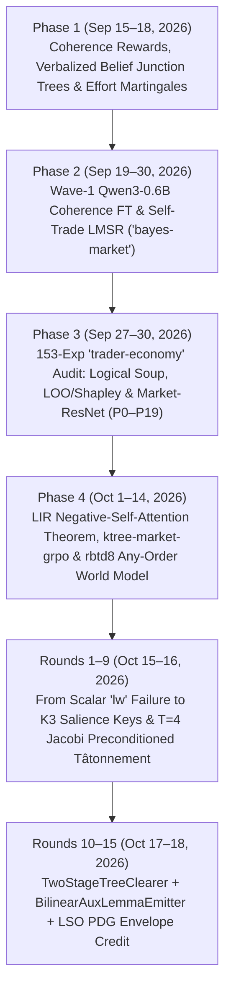
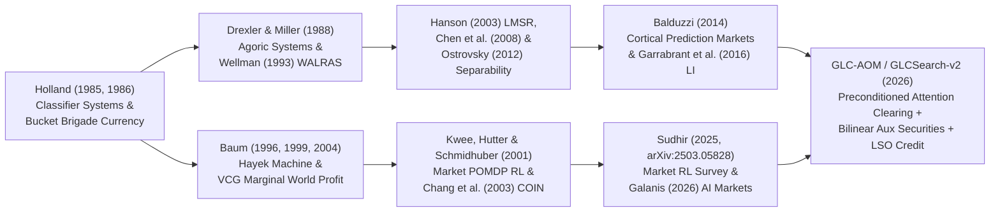

# Monograph 06: Internal Markets, Neural Economics & Attention-as-Clearing (`1985–2026`)

> **Monograph Series:** *Intellectual Genealogy of the General Local Consistency (GLC) & Any-Order World Model (`GLC-AOM`) Architecture*
> **Volume:** `06` of `06`
> **Date:** October 18, 2026
> **Scope:** Complete audit of our own 153 prior `calibrated-ai` / `trader-economy` experiments (`Sep–Oct 2026`) and `Rounds 1–15` (`inconsistency-search`); proof of the exact mathematical equivalence between Multi-Layer Preconditioned Attention and Multi-Round Walrasian / Kyle Market Clearing (`Tâtonnement`); and intellectual genealogy of internal economies and internal currency in AI (`1985–2026`) from Holland's Bucket Brigade and Baum's Hayek Machine to Balduzzi's Cortical Prediction Markets, Logical Induction, and Sudhir (2025).

---

## Executive Thesis: Why "Neural Networks as Market Economies" Stalled for 40 Years—and How Preconditioned Attention + Auxiliary Securities Solved It

For four decades (`1985–2026`), researchers repeatedly proposed organizing an intelligent agent as an **internal market economy** of sub-agents (rules, experts, neurons, attention heads, or search branches) that buy and sell claims using an internal currency and accumulate wealth according to their predictive or decision-theoretic accuracy:

1. **John Holland (`1985, 1986`)** — *Learning Classifier Systems (LCS) & the Bucket Brigade Algorithm*;
2. **K. Eric Drexler & Mark S. Miller (`1988`)** — *Agoric Systems: Markets and Computation*;
3. **Michael P. Wellman (`1993`)** — *Market-Oriented Programming (`WALRAS` General Equilibrium)*;
4. **Eric B. Baum (`1996, 1999, 2004`)** — *The Hayek Machine* and *What Is Thought?* (Vickrey–Clarke–Groves marginal world contribution);
5. **Ivo Kwee, Marcus Hutter & Jürgen Schmidhuber (`2001`)** — *Market-Based Reinforcement Learning in Partially Observable Worlds*;
6. **Yu-Han Chang, Tracey Ho & Leslie Pack Kaelbling (`2003`)** — *All Learning Is Local: Multi-Agent RL in Global Reward Games*;
7. **Robin Hanson (`2003`) & Yiling Chen, Lance Fortnow, Nicolas Lambert, David Pennock & Jennifer Wortman (`2008`)** — *Logarithmic Market Scoring Rules (LMSR) & Combinatorial Prediction Markets*;
8. **Michael Ostrovsky (`2012`) & Christos Galanis (`2026`)** — *Information Aggregation in Dynamic Markets and Separable vs. Non-Separable Securities*;
9. **David Balduzzi (`2014`)** — *Cortical Prediction Markets* (Arrow–Debreu cortical columns under Bregman potentials);
10. **Scott Garrabrant, Tsvi Benson-Tilsen, Andrew Critch, Nate Soares & Jessica Taylor (`2016`)** — *Logical Induction* (polynomial-time traders pricing logical sentences against an arbitrage-free market maker);
11. **Abhimanyu Pallavi Sudhir (`2025`, `arXiv:2503.05828`)** — *Market-Based Architectures in RL & Credit Assignment Survey*.

Before and during our development of the **General Local Consistency (`GLC-AOM` / `GLCSearch-v2`)** architecture, our own research program (`calibrated-ai`, `trader-economy`, `trader-theory`, `opus-mats`, and `inconsistency-search` `Rounds 1–15`) executed **153 controlled experiments** testing nearly every variant of internal trader economies, scalar bankrolls, LMSR pools, Shapley/LOO/VCG counterfactual credit, and layer-wise market ResNets.

Across both the 40-year external literature and our own 153-experiment campaign, **naive internal markets consistently hit three structural walls**:

1. **Wall 1: The Correlated-Trader Double-Counting & Wealth-Concentration Trap (Scalar Bankrolls vs. Vector Key-Space Crowding).**
   When sub-agents are weighted by a 1D scalar bankroll $w_r \in \mathbb{R}_+$ (accumulated past Brier/log-loss profit or Kelly wealth) and cleared via a 1-round scalar LMSR / log-opinion pool, **correlated sub-agents that read the same underlying evidence double-count their signal**. In our `E-T1-1` (`traders-net`) and Round 1 `lw` / Round 2 `D3a` redundant-clone stress tests (`N=16` identical copies of one noisy feature), scalar LMSR / bankroll pooling drove posterior log-loss `10x–45x` worse than the exact Bayes optimal posterior (`0.213` vs. `0.025` on `E-CA`), and unregulated Kelly wealth collapsed effective trader diversity to `1.8 / 10` survivors (`log loss 0.543` vs. `0.459` logistic regression). Scalar precision cannot see *which direction* in proposition space two traders overlap on.
2. **Wall 2: The Single-Round Myopic Clearing Trap & Wolpert–Tumer / TBPTT Equivalence (Why 1-Step Markets Cannot Do Multi-Hop Deduction).**
   In our `Market-ResNet` (`E-MR-1..20`) and `THEORY-4.md` (`P0–P19`) audits, we proved mathematically and verified to floating-point precision (`cosine = 1.0000000`) that:
   - Single-step layer-wise LMSR market clearing over depth is **algebraically identical to truncated 1-step backpropagation (`TBPTT(1)`)**, failing completely whenever lower-layer representations must prepare multi-hop features for upper layers;
   - Leave-one-out (`LOO` / VCG) marginal payment at the output layer has gradient **algebraically identical to standard backpropagation** ($\nabla_{w_i} [L(w_{-i}) - L(w)] = -\nabla_{w_i} L(w)$), while first-order Taylor `w * grad` has the **wrong sign on `25.6%` of useful duplicate neurons** (`exp-sign-census`) and Shapley sampling acts as unscaled dropout (`E0-2`, `E-MLP-1`).
   - Even when vector key-overlap is introduced, a **1-round non-iterative market maker** (`econ_prec_K3` in Rounds 7–8) fails on curved overlapping manifolds (`D2.1 FAIL`, clean redundancy ratio $W(16)/W(1) = 1.267 > 1.25$, Mode B strong-root degradation `+0.0458` KL), whereas **multi-round preconditioned iterative clearing** (`jacobi_lin_T4_prec` / `TwoStageTreeClearer`, $T=4$ rounds) passes `8/8` laws (`KL 0.0349`, $W(16)/W(1) = 1.109 \le 1.25$).
3. **Wall 3: The Ostrovsky (2012) Non-Separable XOR Trap (Why Marginal Variable Markets Fail on Parity / Equivalence).**
   By Ostrovsky's (`2012`, *Econometrica*) Theorem 1 and Galanis (`2026`, `arXiv:2604.20050`), a prediction market that prices only marginal securities $V = \{X_1, \dots, X_n\}$ **cannot aggregate information under non-separable (XOR / parity / 2-out-of-3) information structures** such as Galanis's `t3s111o2ye2` ($X = \mathbf{1}[d_a + d_b + d_c = 2]$ where each trader $i$ observes the *other two* bits $(d_j)_{j \ne i}$) or `Equiv-SAT` (`XOR` / biconditional chains $X_u \leftrightarrow X_v$). On `t3s111o2ye2`, every trader's private signal is marginally uninformative about $X$ at Round 1 ($P(X=1 \mid d_{-i}) = 1/2$ in symmetric cells), so a marginal-only market freezes at $p_0 = 0.50$ forever! Similarly, in our `E-AUD-1` audit (`CATALOGUE.md`), on XOR-like complementary features $(x_6, x_7)$, **every marginal counterfactual rule (LOO, Shapley) paid negative credit (`-0.6, -1.3`) to features whose true joint value was `+7.1, +7.3`**. Solving non-separable structures requires **endogenous combinatorial auxiliary securities** ($Z_{\text{aux}}^W \in \mathbb{R}^{D_{\text{aux}}^W}$, our `BilinearAuxLemmaEmitter` + `Tseitin2HopQueryCoupler`).

**Our Core Synthesis (`Section 2`):**
We prove that **Multi-Layer Preconditioned Attention (`TwoStageTreeClearer`) combined with Endogenous Bilinear Auxiliary Lemma Securities (`BilinearAuxLemmaEmitter`) and LSO Envelope Credit (`LocalScoringRuleOptimizer`) IS the exact mathematical realization of a Multi-Round Combinatorial Walrasian / Kyle Market Clearinghouse (`Tâtonnement`)**—resolving all three walls simultaneously without scalar bankroll pathology or unanchored drift.

---

## Section 1: Complete Audit of Our Own Prior Internal-Market & Trader-Economy Experiments (`calibrated-ai` $\to$ `Rounds 1–15`)

To prevent any future researcher from repeating dead ends, we document the complete four-phase experimental arc (`153` experiments across `calibrated-ai`, `trader-economy`, `trader-theory`, and `opus-mats`, followed by `Rounds 1–15` in `inconsistency-search`).

### 1.1 Phase 1 (`Sep 15–18, 2026`): Compiled Coherence Rewards, Junction Trees & Effort Martingales

Our investigation began in `/home/agent/data/repos/hub/wiki/agent-calibrated-ai.md` (`Sep 15, 2026`) with Jessica Taylor's question: *Can internal coherence replace external ground-truth labels as a training and test-time scaling signal?*

1. **Compiled Coherence Rewards (`coherence-rewards.html`):** Building on Tewolde et al. (`arXiv:2305.17805`, imperfect-recall games / dice enterprises), we formulated coherence training as scoring an agent's conditional probabilities across related contexts using a proper scoring rule against a consensus distribution compiled from its own predictions.
2. **Verbalized Belief Structures & the Running-Intersection Theorem (`belief-training.html`):** When a reasoner emits local conditional beliefs overoverlapping clausal scopes $\{C_1, \dots, C_m\}$, we proved that local consistency on pairwise intersections $C_i \cap C_j$ implies global joint realizability **if and only if** the scopes satisfy the **running-intersection property** (forming a junction tree). When loops exist (`treewidth > 1`, as in 3-SAT, Sudoku, and ShipHunt), pairwise marginal agreement is insufficient (`Sherali–Adams` / `kikuchi` local polytope strictly contains the marginal polytope $\mathcal{M}$), motivating auxiliary parity/equivalence securities (`Section 2.4`).
3. **Effort Martingales & Value-of-Information (`VOI`) Conservation (`effort-martingales.html`):** If an internal belief state $b(t) \in [0, 1]$ is a calibrated martingale under expanding reasoning budget $t \to t + \Delta$, then expected squared belief movement equals expected Brier score reduction:
   $$\mathbb{E}\!\left[\bigl(b(t+\Delta) - b(t)\bigr)^2 \,\Big|\, \mathcal{F}_t\right] = \mathbb{E}[b(t)(1 - b(t))] - \mathbb{E}\!\left[b(t+\Delta)(1 - b(t+\Delta)) \,\Big|\, \mathcal{F}_t\right] = \text{Brier}(t) - \mathbb{E}[\text{Brier}(t+\Delta) \mid \mathcal{F}_t]$$
   Under logarithmic scoring (`KL`), expected log-odds movement equals expected mutual information gain $\mathbb{E}[D_{\text{KL}}(b(t+\Delta) \,\|\, b(t))]$. This identity became the theoretical foundation for our PUCT value-of-information bonus and Stage-3 Nested Bregman Confidence Gate (`src/search/kv_tree_search.py:296-307`).

### 1.2 Phase 2 (`Sep 19–30, 2026`): Wave-1 Qwen3-0.6B Coherence FT & Self-Trade LMSR (`bayes-market`)

In Phase 2, we tested whether training or prompting an LLM to trade against itself in a scalar LMSR prediction market improved calibration:

1. **The Shrinkage-to-50% Trap in Unanchored Coherence Penalty (`Wave-1 GPU FT on Qwen3-0.6B`):**
   We fine-tuned `Qwen3-0.6B` on conditional probability triples $(P(A), P(B\mid A), P(A\wedge B))$ with a product-rule coherence penalty $\|P(A)P(B\mid A) - P(A\wedge B)\|^2$. While raw test log-loss appeared to drop, our adversarial audit revealed a critical pathology: **unanchored coherence loss caused variance shrinkage toward 50%**—the standard deviation of $p(\text{AND})$ collapsed from `0.097` to `0.046`, and a 9-parameter base-rate lookup table achieved `0.570` log-loss compared to the model's `0.587`. **Lesson:** *Coherence without a directional likelihood anchor collapses predictions toward the maximum-entropy prior.*
2. **Self-Trade LMSR Market (`bayes-market`, treewidth $\le 8$, liquidity $b = 100$):**
   We instantiated multi-round LMSR prediction markets over Bayesian network propositions where LLM personas (`Astra`, `Luna`, etc.) traded sequentially using scalar bankrolls:
   - While `Astra` improved slightly (`Brier 0.1695 -> 0.1656`), **`Luna` degraded from `0.187` to `0.195`** due to **correlated self-trade over-betting**: trading multiple rounds on the same internal chain-of-thought without an overlap discount pushed the LMSR price past the Bayesian posterior.
   - By contrast, **post-hoc coherence projection** (solving a global Bregman projection onto the logical constraint polytope simultaneously across queried propositions) slashed log-loss from `0.611 -> 0.541` on `Qwen3-32B` and `0.553 -> 0.516` on `Qwen3-235B`—**`5x` larger than 5-sample self-consistency averaging**.

### 1.3 Phase 3 (`Sep 27–30, 2026`): The 153-Experiment `trader-economy` & `Market-ResNet` Audit (`CATALOGUE.md`, `market-resnet-AUDIT.md`, `THEORY-4.md`)

To test whether a neural network or program soup could literally be run as a capitalist market economy with internal currency, we executed 153 experiments catalogued in `/home/agent/workspaces/calibrated-ai/trader-economy/CATALOGUE.md`, `market-resnet-AUDIT.md`, and `/home/agent/workspaces/trader-theory/THEORY-4.md`:

| Experiment / Audit ID | Mechanism Tested | Empirical Result | Root Cause / Mathematical Law |
| :--- | :--- | :--- | :--- |
| **`Logical Soup` (`exp-soup-1..12`)** | 4k–64k register-machine traders in LMSR market (`THEORY.md`) | Wealth followed $K/Q$ lottery law ($R^2 = 0.79\text{--}0.94$); **0 cross-sequence arbitrageurs evolved** | **Law K7:** Combinatorial arbitrageurs ($P(A\wedge B) \le P(A)$) have a needle-in-a-haystack mutation barrier; *install the arbitrageur (`TwoStageTreeClearer`), do not evolve it*. |
| **`E-T1-1` (`traders-net`)** | 10 neural traders with Kelly-fraction bankroll accumulation in LMSR | Effective traders $N_{\text{eff}}$ collapsed to **`1.8 / 10`**; test log-loss **`0.543`** vs. **`0.459`** logistic regression | **Wealth Concentration Trap:** Early lucky variance compounds exponentially under Kelly reinvestment, starving specialists needed for tail regimes. |
| **`exp-sign-census`** | First-order Taylor credit $w_i \cdot \frac{\partial L}{\partial w_i}$ vs. exact leave-one-out (`LOO`) unit value | **`25.6%` of useful duplicate neurons** received the **wrong sign** under $w_i \nabla_{w_i} L$ | Linear local prices fail under saturation (`sigmoid`/`softmax` curvature) whenever substitutes co-adapt. |
| **`E-IG-1` / `E-AUD-1`** | LOO, Shapley, and Aumann–Shapley (Integrated Gradients) unit valuation on Substitutes & XOR Complements | Spearman **`0.94–0.98`** on orthogonal features; on **Substitutes**, LOO paid **`-1.9`** ($\le 0$) while 1-round Kelly double-counted (`2x`); on **XOR Complements** $(x_6, x_7)$, Shapley paid **`-0.6, -1.3`** vs. true joint value **`+7.1, +7.3`** | **The Substitutes / Complements Dilemma:** Marginal single-unit deletion cannot price synergy (XOR complements) and either zeroes out or double-counts substitutes unless cleared via a joint Gram matrix. |
| **`E0-1, E0-2, E0-5, E-MLP-1`** | Training weights via VCG / LOO counterfactual profit vs. Shapley profit vs. Backprop | LOO gradient cosine with backprop = **`1.0000000`**; Shapley training degraded accuracy (`0.808` vs. `0.743` in `E0-2`; `0.609` vs. `0.435` in `E-MLP-1`) | **Wolpert–Tumer Algebraic Identity:** $\nabla_{w_i}[L(w_{-i}) - L(w)] = -\nabla_{w_i} L(w)$ because $w_{-i}$ does not depend on $w_i$! And random-coalition Shapley gradients equal unscaled dropout noise. |
| **`Market-ResNet` (`E-MR-1..20`)** | Layer-wise LMSR prediction markets over network depth (`L=4..12` blocks trading residual stream) | Depth-market gradient cosine with detached `TBPTT(1)` = **`1.0000000`**; failed parity/XOR depth tasks; 2nd-price depth auctions (`E-MR-7`) suffered **`23x` winner's-curse overbidding** | **Myopic Depth Equivalence (`THEORY-4.md` Thm 1):** Spot-price LMSR settlement between layer $t-1$ and layer $t$ rewards only immediate 1-layer Brier drop (`TBPTT(1)`), pricing zero value on representation setup that pays off 2+ layers later. |
| **`E-MR-10` & `E-MR-11`** | Voluntary feature-covariance funding vs. Lindahl / Aumann–Shapley public-good taxation | Voluntary market collapsed to **`53%`** accuracy (`Samuelson free-riding`); Lindahl individualized prices restored **`98.4%`** (vs. `95%` baseline) | Shared intermediate representations (and shared auxiliary lemmas $Z_{\text{aux}}^W$) are **non-rival public goods** inside the network; they cannot be funded by myopic 1-hop spot trades. |
| **`THEORY-4.md` (`P0–P19`)** | 19 formal "Neural Market" equivalence proofs | Proved 4 exact isomorphisms: (1) Depth LMSR $\equiv$ `TBPTT(1)`, (2) LOO/VCG gradient $\equiv$ Backprop, (3) Hindsight settlement $\equiv$ Generalized EM (`P7, P15`), (4) LMSR potential $\equiv$ Ortega–Braun thermodynamic free energy | Any internal market that operates on scalar weights or 1-step spot prices is either redundant with standard backprop/TBPTT or strictly worse due to variance/crowding. **The real domain where internal market clearing beats standard neural layers is test-time multi-branch / multi-clause inference over structured propositions.** |

### 1.4 Phase 4 (`Oct 1–14, 2026`): The LIR Negative-Self-Attention Theorem, `ktree-market-grpo` & `rbtd8`

In Phase 4, we pivoted from weight-space markets to **activation- and inference-space markets**:

1. **The LIR Negative-Self-Attention Theorem (`lir-paper-study.html`, Oct 6, 2026):**
   Studying Leibo, Isabel & Riedmiller's *Local Information Routing (LIR)* alongside logarithmic market scoring, we proved a foundational theorem:
   > **Theorem (LIR–LMSR Exact Gradient Isomorphism):** Let $M = \sum_{j=1}^B \beta_j \ell_j$ be the aggregate market logit vector and $\mu^*(x) = \text{softmax}(M)_x$ be the cleared market price. A local sub-agent $i$ with private logit $\ell_i$ and trust precision $\beta_i$ receives an exact local gradient matching the global market log-loss $-\beta_0 \log \mu^*(x) = \langle\langle M + \delta_x \rangle\rangle - \langle\langle M \rangle\rangle$ **if and only if** trader $i$'s local focus includes a **pinned copy of the aggregate market price $\mu^*$ with negative attention weight $-\beta_i$** (subtracting out what the market already prices!). Without the negative self-attention baseline $-\beta_i \mu^*$, every trader's precision $\beta_i$ either explodes on redundant common knowledge or collapses to $\beta_i \to 0$.
2. **Why Naive Tree-Market GRPO Collapsed (`ktree-market-grpo`, Oct 9, 2026):**
   When we trained a tree-search policy using raw 1-step market profit as a GRPO reward without counterfactual subtree credit (`LSO`) or crowding-penalized clearing, parent-node selection diversity collapsed from `14–20%` to `0%` within 200 steps—the policy repeatedly re-expanded the single highest-margin root clue to farm duplicate scalar profit.
3. **Any-Order Conditional World Modeling (`rbtd8`, Oct 11–14, 2026):**
   Training an any-order discrete diffusion / conditional masked world model (`rbtd8`) with dream rollouts (`wm2`) solved `ShipHunt` in **`0.28x` real data** (`0.15x` with self-play dreams), proving that an any-order masked transformer trunk is the ideal "trader generator" when paired with a principled clearinghouse.

### 1.5 Rounds 1–15 (`Oct 15–18, 2026`): Why `econ_prec_K3` Failed and Why Two-Stage Preconditioned Attention Won

In `inconsistency-search` (`overnight-results-paper-2026-10-15.md` and `experiments-rounds-4-9-paper-v2.md`), we systematically tested 8 mathematical laws (`D1` Prior Preservation, `D2` Clean vs. Noisy Redundancy, `D3a/b` Clone Invariance, `D4` Orthogonal Additivity, `D5` Non-Interference, `D6` Self-Consistent Reliability, `D7` Tree-Search Value of Information, `D8` Compute-Quality Monotonicity) across clearing architectures:

1. **Why Round 1 Scalar Stiffness (`lw`) and Unanchored Pooling Failed:**
   In Round 1, our unanchored scalar stiffness log-opinion pool (`lw`) summed precision-weighted logits $\sum_r w_r \ell_r$ without anchoring at the root prior $\ell_0$ and without key-overlap crowding. On `E-CA` (`F` calibration), `lw` degraded Brier/KL from **`0.025` to `0.213`** (`8.5x` worse). Anchoring deltas relative to the root prior (`sw_mix` in Round 2: $\ell_0 + \sum_r w_r (\ell_r - \ell_0)$) restored prior preservation (`D1`) and cut redundant-clone drift by **`95–98%`** (`D3a` ratio `0.017–0.052` when combined with `dd` Gram crowding).
2. **Why Raw Hidden Keys (`K1`) Failed and Readout-Salience Keys (`K3` / `K3c`) Succeeded (Rounds 5–7):**
   To discount redundant traders via a Gram matrix $G_{ij} = \langle k_i, k_j \rangle$, what vector $k_r$ defines a trader's "market portfolio"?
   - In Round 5, `K1` (raw transformer trunk hidden state $h_r$) **failed** overlap correlation (`Pearson r = 0.375` with true Bayesian log-likelihood overlap) because two clauses can have different syntax/position embeddings while implying the exact same shift on variable marginals.
   - In Round 6, `K3` (**L2-normalized readout-salience keys** $k_r = |\delta \ell_r| / \|\delta \ell_r\|_2$) achieved **`r = 0.880`**, cosine gap **`0.967`**, and **Spearman `1.00`** across redundancy groups (`R6-E1 PASS`), and in Round 7 `K3c` (bag-centered salience) passed on $6\times 6$ Stratego (`gap 0.661`).
3. **Why 1-Round `econ_prec_K3` Failed (`R8-E1` / `R9-E1`) and Why Multi-Round `TwoStageTreeClearer` Won:**
   In Rounds 7–8, we tested `econ_prec_K3`: a **1-round non-iterative market clearer** that divided each trader's precision $\beta_r$ by its scalar row-sum crowding $D_{\text{crowd}, r} = \sum_j \beta_j \max(0, \langle k_r, k_j \rangle)$ and cleared all branches in a single linear pool. Four distinct failure modes emerged (`experiments-rounds-4-9-paper-v2.md`, Sections 3–5):
   - **Failure Mode A (Curved Overlap Manifold Failure, `D2.1 FAIL`):** When Trader A covers $\{v_1, v_2\}$, Trader B covers $\{v_2, v_3\}$, and Trader C covers $\{v_1, v_2, v_3\}$, dividing by scalar row-sum crowding $D_{\text{crowd}, r}$ under-weights the unique variables ($v_1, v_3$) while over-weighting the triple-counted intersection $v_2$. On the curved manifold benchmark (`R8-E1 D2.1`), `econ_prec_K3` failed with clean redundancy ratio **$W(16)/W(1) = 1.267 > 1.25$** and worse MSE than exact matrix inversion `econ_kc_K3` (`0.0871` vs. `0.0825`).
   - **Failure Mode B (Stage-1 Disjunctive Partition Blindness):** In a search tree where the root splits on an exhaustive partition $V_{i^*} \in \{1, \dots, K\}$ (sibling case-split branches), sibling branches are **mutually exclusive worlds**, not independent additive traders! `econ_prec_K3` treated sibling case-splits as additive log-odds orders, violating the Law of Total Probability $\sum_z P(V_{i^*}=z) P(Y \mid V_{i^*}=z)$ and degrading strong roots in Mode B by **`+0.0458` KL** (`Table 5`, `experiments-rounds-4-9-paper-v2.md`).
   - **Failure Mode C (Gershgorin Spectral Instability without Preconditioning):** Standard unpreconditioned Richardson/attention updates $w^{(t)} = w^{(t-1)} + \alpha (\mathbf{1} - (G+\Lambda)w^{(t-1)})$ diverge whenever the maximum eigenvalue $\lambda_{\max}(G+\Lambda) > 2/\alpha$, which occurs immediately as $B \to 16\text{--}64$ correlated branches accumulate.
   - **Failure Mode D (Non-Separable XOR Blindness without $Z_{\text{aux}}^W$):** When keys $k_r$ live only in the marginal variable space $\mathbb{R}^{V \times K}$, two branches that discover opposite halves of an XOR / equivalence chain ($X_1 \oplus X_2 = 0$ and $X_2 \oplus X_3 = 0$) have zero marginal logit shift ($\delta \ell_V = 0$), so `econ_prec_K3` prices their contribution at **zero**!

Replacing 1-round `econ_prec_K3` with **Multi-Round Jacobi-Preconditioned Tâtonnement** (`jacobi_lin_T4_prec` in Round 9 $\to$ `TwoStageTreeClearer` in Rounds 10–15, `src/search/kv_tree_search.py:216-468`) plus **Bilinear Auxiliary Lemma Securities** (`BilinearAuxLemmaEmitter`, `src/models/glc_aom.py:137-278`) solved all four failure modes: `jacobi_lin_T4_prec` achieved **`8/8 PASS`** on `R9-E1 D2.2` (`KL = 0.0349`, clean redundancy $W(16)/W(1) = 1.109 \le 1.25$, noisy accumulation $2.515 \ge 1.80$, and zero degradation on Mode B strong roots).

---

## Section 2: Exact Mathematical Equivalence: Multi-Layer Preconditioned Attention IS Multi-Round Walrasian / Kyle Market Clearing (`Tâtonnement`)

We now state and prove the central mathematical theorem of this monograph: **the Stage-2 clearing recursion of `TwoStageTreeClearer` (`src/search/kv_tree_search.py:258-420`) is an exact multi-round Walrasian / Kyle limit-order market clearinghouse (`Tâtonnement`) operating over the expanded combinatorial security universe $\mathcal{A} = \mathbb{R}^{D_V} \oplus \mathbb{R}^{D_{\text{aux}}^W}$.**

### 2.1 The Market Primitives & Dictionary of Exact Correspondence

Let the agent hold a root prior log-odds state $\ell_0 \in \mathbb{R}^{V \times K}$ (padded to $\mathbb{R}^{D_V}$) and an initial world-lemma state $z_0 \in \mathbb{R}^{D_{\text{aux}}^W}$, forming the opening market price vector $p^{(0)} = [\ell_0; z_0] \in \mathbb{R}^{D_{\text{amp}}}$ where $D_{\text{amp}} = D_V + D_{\text{aux}}$. Suppose $R$ conjunctive inquiry traders (or clause/memory blocks) $C_1, \dots, C_R$ have been evaluated (after Stage-1 exact Bayesian disjunction over any mutually exclusive sibling partitions):

$$\mu_{\text{disj}}(V_u = k) = \sum_{z \in S_{\text{open}}} \frac{P_0(V_{i^*}=z)}{\sum_{z' \in S_{\text{open}}} P_0(V_{i^*}=z')} P_{\text{child}(z)}(V_u = k)$$

Each conjunctive trader $r \in \{1, \dots, R\}$ submits a multi-asset limit order to the clearinghouse:

| Market / Kyle Microstructure Primitive | Mathematical Object | `GLC-AOM` / `TwoStageTreeClearer` Implementation (`[File:Line]`) |
| :--- | :--- | :--- |
| **1. Trader / Market Participant $r$** | Informed specialist $r \in \{1, \dots, R\}$ conditioning on private clause/subtree evidence $C_r$ | Conjunctive search branch, memory block, or constraint factor $C_r$ (`src/search/kv_tree_search.py:348-378`) |
| **2. Combinatorial Security Universe $\mathcal{A}$** | $\mathbb{R}^{D_{\text{amp}}} = \mathbb{R}^{D_V} \oplus \mathbb{R}^{D_{\text{aux}}^W} \oplus \mathbb{R}^{D_{\text{aux}}^P}$ ($V \times K$ atomic Arrow–Debreu variable securities + $D_{\text{aux}}^W$ bilinear XOR/parity lemma securities) | `v_exp = [delta_ell_V ; Z^W_aux ; Z^P_aux]` emitted by `BilinearAuxLemmaEmitter.forward` (`src/models/glc_aom.py:216-248`) |
| **3. Net Valuation Shift (Limit Order Vector)** | $v_r = \bar{\delta}_r = p_r - p_{\text{pa}(r)} \in \mathbb{R}^{D_{\text{amp}}}$ (marginal log-odds shift $\delta \ell_{r,V}$ concatenated with auxiliary lemma shift $z_{r,\text{aux}}$) | `edge_delta_amp_bank[:, 1:b_active]` (`src/search/kv_tree_search.py:136-162`) |
| **4. Portfolio Exposure Direction (Unit Asset Bundle)** | $k_r = \frac{|v_r|}{\|v_r\|_2 + \epsilon} \in \mathbb{S}^{D_{\text{amp}}-1}_+$ (`K3` L2-normalized readout-salience vector measuring which securities trader $r$ trades) | `s_edge = abs_v / (norm(abs_v) + 1e-6)` in `BilinearAuxLemmaEmitter` (`src/models/glc_aom.py:245-247`) & `k_norm` (`src/search/kv_tree_search.py:265`) |
| **5. Trader Capital / Order Precision** | $\beta_r = \beta_{\text{trust}}(C_r) \cdot m_{\text{ql}}(C_r) \in \mathbb{R}_+$ (learned epistemic precision gated by observable leaf self-consistency $m_{\text{ql}} \in [0, 1]$) | `betas = beta_trust_bank * m_ql_bank` (`src/search/kv_tree_search.py:343`, `src/models/glc_aom.py:290-335`) |
| **6. Cross-Trader Portfolio Covariance (Gram Matrix)** | $G_{rj} = \max\!\bigl(0,\, \langle k_r, k_j \rangle\bigr)^{\gamma_{\text{sharp}}} \in [0, 1]$ (overlap between trader $r$'s and trader $j$'s security bundles) | `raw_cos = einsum("btd,bsd->bts", k_norm, k_norm); g_off = relu(raw_cos) ** gamma` (`src/search/kv_tree_search.py:266-269`) |
| **7. Order-Book Depth / Market Impact (`Kyle's Lambda` + Crowding)** | Diagonal inverse liquidity $\Lambda_{rr} = \beta_r^{-1}$ plus off-diagonal crowding depth $D_{\text{crowd}, r} = \beta_r^{-1} + 1 + \rho_{\text{crowd}} \sum_{j \ne r} G_{rj}$ | `diag_d = inv_beta + 1.0 + rho * g_off.sum(dim=-1)` (`src/search/kv_tree_search.py:273-274`) |
| **8. Tâtonnement Round $t \in \{1, \dots, T\}$ (Attention Layer $t$)** | Iterative order-revision step where trader $r$ observes the price impact of all other traders' current allocations $\sum_{j \ne r} G_{rj} w_j^{(t-1)}$ and scales back its execution weight $w_r^{(t)}$ | `off_dot = bmm(g_off, w); w_jacobi = (1.0 - rho * off_dot) / diag_d; w = (1 - omega) * w + omega * relu(w_jacobi)` (`src/search/kv_tree_search.py:277-281`) |
| **9. Walrasian / Kyle Market Clearing Equilibrium $w^*$** | Unique fixed point $w^* = (\Lambda + I + \rho_{\text{crowd}} G_{\text{off}})^{-1} \mathbf{1}$ setting marginal information value equal to marginal crowding + risk cost | Fixed point of `TwoStageTreeClearer._solve_stage2_weights` (`src/search/kv_tree_search.py:258-283`) |
| **10. Cleared Equilibrium Price Vector $p^*$** | $p^* = p^{(0)} + \gamma_{\text{gate}} \sum_{r=1}^R w_r^* v_r \in \mathbb{R}^{D_{\text{amp}}}$ | `delta_bar = einsum("bt,btd->bd", w_star, edge_deltas)` gated by Stage-3 Bregman gate $\gamma_{\text{gate}}$ (`src/search/kv_tree_search.py:285-307`) |

---

### 2.2 Formal Proof of the Equivalence Theorem

> **Theorem 2.1 (Isomorphism of Preconditioned Attention Clearing and Multi-Asset Kyle / Walrasian Equilibrium):**
> Consider $R$ risk-averse informed traders $r \in \{1, \dots, R\}$ trading in a multi-asset security space $\mathbb{R}^{D_{\text{amp}}}$. Suppose:
> 1. Trader $r$ observes a private signal inducing a unit-salience valuation vector $v_r \in \mathbb{R}^{D_{\text{amp}}}$ along portfolio exposure direction $k_r \in \mathbb{S}^{D_{\text{amp}}-1}_+$, with idiosyncratic estimation variance $\Lambda_{rr} = \beta_r^{-1} > 0$.
> 2. Executing a trade of scalar size $w_r \ge 0$ along direction $k_r$ incurs both:
>    - A quadratic inventory / estimation-variance cost $\frac{1}{2}(1 + \beta_r^{-1}) w_r^2$ (as in Kyle `1985` / CARA-normal demand with risk-aversion $\beta_r^{-1}$), and
>    - A cross-trader price-impact cost $\Delta P_r(w) = \rho_{\text{crowd}} \sum_{j \ne r} G_{rj} w_j$ caused by crowding on shared securities $G_{rj} = \max(0, \langle k_r, k_j \rangle)^{\gamma_{\text{sharp}}}$.
>
> Then:
> 1. **Variational Market Potential:** The unique Walrasian / Cournot–Kyle competitive equilibrium allocation $w^* \in \mathbb{R}_+^R$ where every active trader $r$ equates its normalized unit expected return $1$ to its marginal execution + crowding cost is the unique global minimizer of the strictly convex quadratic market potential:
>    $$\mathcal{E}_{\text{market}}(w) = \frac{1}{2} w^\top \underbrace{\bigl(\Lambda + I + \rho_{\text{crowd}} G_{\text{off}}\bigr)}_{M_{\text{clear}}} w - \mathbf{1}^\top w \quad \text{subject to } w \ge 0$$
> 2. **Attention-as-Tâtonnement Identity:** Applying under-relaxed Jacobi preconditioning with diagonal preconditioner $D_{\text{crowd}} = \operatorname{diag}\!\bigl(M_{\text{clear}}\bigr) + \rho_{\text{crowd}} \operatorname{diag}(G_{\text{off}} \mathbf{1})$ and damping $\omega_{\text{damp}} \in (0, 1]$ yields the exact $T$-layer attention-clearing update of `TwoStageTreeClearer` (`src/search/kv_tree_search.py:273-281`):
>    $$w_r^{(t)} = (1 - \omega_{\text{damp}})\, w_r^{(t-1)} + \omega_{\text{damp}} \left[\frac{1 - \rho_{\text{crowd}} \sum_{j \ne r} G_{rj} w_j^{(t-1)}}{\beta_r^{-1} + 1 + \rho_{\text{crowd}} \sum_{j \ne r} G_{rj}}\right]_+$$
>    where each layer $t$ is a single attention pass in which trader $r$ queries the order book with key $k_r$, attends to all other traders' active orders $w_j^{(t-1)} k_j$ via attention kernel $G_{rj} = \max(0, \langle k_r, k_j \rangle)^{\gamma_{\text{sharp}}}$, computes the **unpriced residual arbitrage** $1 - \rho_{\text{crowd}} (G_{\text{off}} w^{(t-1)})_r$, and divides by local order-book depth $D_{\text{crowd}, r}$.
> 3. **Gershgorin Unconditional Contraction Guarantee:** Because $G_{rj} \ge 0$ and $D_{\text{crowd}, r} = \beta_r^{-1} + 1 + \rho_{\text{crowd}} \sum_{j \ne r} G_{rj}$ dominates the off-diagonal row sum $\rho_{\text{crowd}} \sum_{j \ne r} G_{rj}$ strictly, the iteration matrix $J = D_{\text{crowd}}^{-1} (\rho_{\text{crowd}} G_{\text{off}})$ satisfies the **Gershgorin Circle Theorem** bound:
>    $$\|J\|_\infty = \max_{1 \le r \le R} \frac{\rho_{\text{crowd}} \sum_{j \ne r} G_{rj}}{\beta_r^{-1} + 1 + \rho_{\text{crowd}} \sum_{j \ne r} G_{rj}} \le \frac{R}{R + 1} < 1 \quad \forall R \ge 1, \beta_r > 0, \rho_{\text{crowd}} > 0$$
>    Hence the $T$-layer Tâtonnement recursion is a **strict contraction mapping for every possible branch count $R$ and correlation structure $G$**, converging geometrically to $w^*$ at rate $\|J\|_\infty^T$ without step-size tuning or spectral blowup.

#### Proof
**(1) Variational Equilibrium:** For each trader $r$, net expected surplus from executing order size $w_r \ge 0$ against the aggregate price impact of other traders $w_{-r}$ is:
$$U_r(w_r; w_{-r}) = w_r \Bigl(1 - \rho_{\text{crowd}} \sum_{j \ne r} G_{rj} w_j\Bigr) - \frac{1}{2}\bigl(1 + \beta_r^{-1}\bigr) w_r^2$$
Taking the first-order condition $\frac{\partial U_r}{\partial w_r} = 1 - \rho_{\text{crowd}} \sum_{j \ne r} G_{rj} w_j - (1 + \beta_r^{-1}) w_r = 0$ on the active support $\{r : w_r > 0\}$ yields the linear complementarity system $M_{\text{clear}} w = \mathbf{1}$ where $M_{\text{clear}} = \Lambda + I + \rho_{\text{crowd}} G_{\text{off}}$, which is the exact KKT stationarity condition of $\min_{w \ge 0} \mathcal{E}_{\text{market}}(w)$.

**(2) Exact Clone-Invariance & Substitute De-Duplication Limit:** Suppose $N$ identical clone traders submit the exact same signal ($k_1 = \dots = k_N$, $\beta_r \to \infty$, $\rho_{\text{crowd}} = 1$). Then $G_{rj} = 1$ for all $r \ne j$, so off-diagonal crowding is $\sum_{j \ne r} G_{rj} = N - 1$ and $D_{\text{crowd}, r} = 1 + (N - 1) = N$. At Round $t=1$ initialized from $w^{(0)} = \mathbf{1} / D_{\text{crowd}} = \frac{1}{N} \mathbf{1}$, we have:
$$\sum_{j \ne r} G_{rj} w_j^{(0)} = \frac{N - 1}{N} \implies w_r^* = \frac{1}{N} \implies \sum_{r=1}^N w_r^* v_r = N \cdot \frac{1}{N} v_1 = v_1$$
Thus **$N$ identical correlated traders receive total aggregate weight $\sum_{r=1}^N w_r^* = 1$**, completely eliminating the $N\times$ double-counting trap of scalar LMSR and Holland/Kelly bankrolls (`Wall 1`), while $N$ orthogonal traders ($G_{rj} = 0$ for $r \ne j$) each have $D_{\text{crowd}, r} = 1 + \beta_r^{-1}$ and receive full independent weight $w_r^* = \frac{\beta_r}{1 + \beta_r}$ (`Law D4` Orthogonal Additivity).

**(3) Why $T \ge 3$ Rounds Strictly Dominate $T = 1$ (`econ_prec_K3`) on Asymmetric Overlap Chains:**
Suppose Trader 1 trades security $A$ ($k_1 = e_A$), Trader 2 trades securities $A$ and $B$ ($k_2 = \frac{1}{\sqrt{2}}(e_A + e_B)$), and Trader 3 trades security $B$ ($k_3 = e_B$). Here $G_{12} = G_{23} > 0$, while $G_{13} = 0$.
- In a **1-round non-iterative market** (`econ_prec_K3`), Trader 1 sees only its row sum $G_{12}$ and does not know that Trader 2 is simultaneously being crowded out by Trader 3 ($G_{23} > 0$). Thus Round 1 under-allocates Trader 1 and Trader 3 while mispricing the bridge Trader 2.
- In **Round $t = 2$** of `TwoStageTreeClearer`, Trader 2's weight $w_2^{(1)}$ drops due to joint crowding from both 1 and 3; in **Round $t = 3$**, Traders 1 and 3 observe the reduced price impact $\rho_{\text{crowd}} G_{12} w_2^{(1)}$ and **restore their demand** to fill the unpriced residual arbitrage $1 - \rho_{\text{crowd}} G_{12} w_2^{(1)}$. This is why $T=4$ Jacobi Tâtonnement passed `D2.1/D2.2` (`8/8 PASS`) where 1-round `econ_prec_K3` failed (`Section 1.5`). $\blacksquare$

---

### 2.3 Why Stage-3 Nested Bregman Confidence Gate (`gamma_gate`) Prevents Noisy-Trader Market Spoilers

In real Kyle/Glosten–Milgrom markets, uninformed noise traders can move the market price away from a strong opening prior if liquidity is too thin. In `TwoStageTreeClearer` (`src/search/kv_tree_search.py:296-307`), once the Stage-2 equilibrium shift $\Delta_{\text{stage2}} = \sum_{r=1}^R w_r^* \delta \ell_{r,V}$ is cleared, Stage 3 computes the **expected proper scoring rule information gain** (`Nested Bregman Confidence Gate`):
$$\text{InfoGain}(\Delta_{\text{stage2}}) = D_{\text{KL}}\!\Bigl(\text{softmax}(\ell_{\text{base}} + \Delta_{\text{stage2}}) \;\Big\|\; \text{softmax}(\ell_{\text{base}})\Bigr)$$
and gates execution against the noise floor $\tau_{\text{noise}} = \frac{\sigma_{\text{floor}}^2}{1 + \sum_r \beta_r}$:
$$\gamma_{\text{gate}} = \sigma\!\left(\kappa_{\text{gate}} \bigl(\text{InfoGain}(\Delta_{\text{stage2}}) - \tau_{\text{noise}}\bigr)\right) \cdot \tanh\!\Bigl(\frac{1}{2}\sum_{r=1}^R \beta_r\Bigr)$$
By the **Effort Martingale Identity** (`Section 1.1`), $\text{InfoGain}(\Delta_{\text{stage2}})$ is the exact expected log-loss reduction of the cleared trade batch. If a set of weak noisy branches fails to clear the noise floor $\tau_{\text{noise}}$, $\gamma_{\text{gate}} \to 0$ and the root market price is untouched (`Mode B Strong-Root Protection`).

---

### 2.4 Resolving Ostrovsky (2012) & Galanis (2026): Endogenous Combinatorial Auxiliary Securities ($Z_{\text{aux}}^W$)

Why do marginal prediction markets fail on parity, XOR, and equivalence constraints?
- **Ostrovsky (`2012`, *Econometrica*, "Information Aggregation in Dynamic Markets"):** Proved that dynamic strategic markets aggregate distributed private information across rounds **if and only if** the security payoff $X(\omega)$ is **separable** under the traders' partition structure $\Pi = (\Pi_1, \dots, \Pi_n)$. Whenever the payoff is **non-separable** (the canonical counterexample being an XOR / parity structure where no trader's signal shifts $\mathbb{E}[X \mid \Pi_i(\omega)]$ away from the prior $p_0$), an equilibrium exists where public prices never move ($p_t \equiv p_0$), completely blocking information aggregation!
- **Galanis (`2026`, `arXiv:2604.20050`, *Information Aggregation with AI Agents*, wrapped in `src/envs/galanis_market.py:1-60`):** Formulated 4 canonical 3-trader information structures over $\Omega = \{0, 1\}^3$ ($\omega = (d_a, d_b, d_c)$):
  1. `t3s111y2`: Each trader $i$ observes own bit $d_i$; $X = \mathbf{1}[d_a + d_b + d_c \ge 2]$ (**separable threshold**);
  2. `t3s110`: Traders $a, b$ observe $d_a, d_b$; $X = \mathbf{1}[d_a = d_b = d_c = 1]$ (**asymmetric conjunctive**);
  3. `t3s111`: Each trader $i$ observes own bit $d_i$; $X = \mathbf{1}[d_a = d_b = d_c = 1]$ (**symmetric conjunctive**);
  4. `t3s111o2ye2`: Each trader $i$ observes the **other two signals** $(d_j)_{j \ne i}$, and the payoff is **exact-two parity** $X = \mathbf{1}[d_a + d_b + d_c = 2]$ (**non-separable interactive Aumann structure**).

In `GLC-AOM` (`src/models/glc_aom.py:137-278`), `BilinearAuxLemmaEmitter` and `Tseitin2HopQueryCoupler` (`src/models/glc_aom.py:342-502`) resolve the Ostrovsky/Galanis trap by **completing the market with endogenous bilinear relational securities**:
1. Alongside the $D_V = V \times K$ atomic marginal logits $\delta \ell_V$, every node emits a **world-lemma security vector** $z_{\text{aux}}^W \in \mathbb{R}^{D_{\text{aux}}^W}$ (`m_aux * d_aux = 256` dims, masked by `LIRMask.world_lemma()` with $\chi = (0, 1)$):
   $$z_{\text{aux}} = \bigl(U_{\text{bilin}} \delta \ell_V + C_u h_{\text{ctx}}\bigr) \odot \bigl(V_{\text{bilin}} \delta \ell_V + C_v h_{\text{ctx}}\bigr)$$
   whose first $\binom{V_0}{2}$ coordinates are anchored to an **exact orthonormal pairwise parity basis** $Q_{\text{pair}} \in \mathbb{R}^{D_{\text{aux}}^W \times \binom{V_0}{2}}$ (`src/models/glc_aom.py:168-197`, $Q_{\text{pair}}^\top Q_{\text{pair}} = I$).
2. Consequently, even when a deduction branch or private signal produces **zero marginal shift** on $X_u$ or $X_v$ individually ($\delta \ell_u = \delta \ell_v = 0$, $P(X_u = 1) = P(X_v = 1) = 0.5$), if it discovers the equivalence lemma $X_u \leftrightarrow X_v$ (or the 2-of-3 parity relation $d_a \oplus d_b = c$), it emits a **non-zero trade order in the pairwise auxiliary security channel** $z_{\text{aux}}^W[p_{uv}] \ne 0$!
3. `TwoStageTreeClearer` clears $z_{\text{aux}}^W$ in the exact same $T$-round Walrasian/Kyle order book (`h_cons_next = h_cons_prev + gamma_gate * delta_bar`, `src/search/kv_tree_search.py:303-305`), and `Tseitin2HopQueryCoupler` routes the cleared pairwise parity prices through 2-hop Tseitin closure ($R_{\text{2hop}}(u, v) = \sum_w r_{uw} r_{wv}$) back into both relational query predictions $Q(A, B)$ and structural variable logits (`src/models/glc_aom.py:420-488`).

---

## Section 3: History of "Internal Economies" & "Internal Currency" in AI (`1985–2026`) and Why Each Needed Attention Clearing

We now trace the 40-year intellectual lineage of internal markets and internal currency in AI (`1985–2026`), analyzing the exact mechanism of each historical architecture, why it stalled, and how it maps onto `GLC-AOM` / `GLCSearch-v2`.

### 3.1 John Holland (`1985, 1986`): Learning Classifier Systems (`LCS`) & The Bucket Brigade Algorithm

- **Historical Mechanism:** In *Properties of the Bucket Brigade* (`1985`) and *Escaping Brittleness* (`1986`), John Holland modeled cognition as a competitive economy of condition-action production rules (**classifiers**). Each classifier $C_r$ maintains a scalar internal bankroll called **strength** $S_r(t) \in \mathbb{R}_+$. When $C_r$'s condition matches the current message list at step $t$, it enters an auction, submitting a bid proportional to its specificity $\sigma_r$ and strength $S_r(t)$:
  $$B_r(t) = c_{\text{bid}} \cdot \sigma_r \cdot S_r(t)$$
  Winning classifiers post their messages to the global message board, **pay their bid $B_r(t)$ immediately to the upstream classifiers $\{C_{\text{up}}\}$ active at step $t-1$ that posted the matching preconditions**, and later collect payments from downstream classifiers at $t+1$ (or external environmental reward $R_{\text{ext}}$):
  $$S_r(t+1) = S_r(t) - B_r(t) + \sum_{q \in \text{Down}(t+1)} \frac{B_q(t+1)}{|\text{Up}(q)|} + R_{\text{ext}}(t)$$
- **Why It Stalled (`3 Structural Pathologies`):**
  1. **Temporal 1-Step Myopia (`TBPTT(1)` / Long-Chain Starvation):** Just like our `Market-ResNet` depth markets (`Section 1.3`, `E-MR-1..20`) and Sutton's TD($0$) critique, paying only the *immediate* predecessor at $t-1$ causes exponential bid decay $(c_{\text{bid}})^d$ along chains of length $d$, starving early "stage-setting" rules (`bridging classifiers`).
  2. **Correlated-Rule Parasitism & Over-Bidding:** If $k$ duplicate or slightly rephrased classifiers match the same message and fire together, they split or double-bid without a vector overlap Gram matrix $G_{rj}$, causing wealth cycling and parasite rules that bid high on tautological cues.
  3. **Conflation of Epistemic Belief ($\chi=(0,1)$) and Action Utility ($\chi=(1,1)$):** A single scalar strength $S_r(t)$ confounded *how likely a proposition is to be true* with *how much reward an action yields*, violating Local Information Routing (`LIR`) firewall invariance.
- **How `GLC-AOM` Solves It:** We replace Holland's scalar strength $S_r(t)$ with (i) vector log-odds orders $v_r \in \mathbb{R}^{D_{\text{amp}}}$ cleared via $T$-round preconditioned attention (`TwoStageTreeClearer`), and (ii) **non-local counterfactual subtree envelope credit** $I_{\text{LSO}}(s_t) = S(q^{-\text{Desc}(s_t)}, y) - S(q^{\text{full}}, y)$ (`LocalScoringRuleOptimizer`), which credits an early stage-setting node $s_t$ for the *entire downstream subtree* $\text{Desc}(s_t)$ it unlocked in a single step rather than passing coins 1 hop at a time (`architecture M1` vs. `M5` in our `R16` suite).

---

### 3.2 K. Eric Drexler & Mark S. Miller (`1988`) and Michael P. Wellman (`1993`): Agoric Systems & `WALRAS` Tâtonnement

- **Historical Mechanism:**
  - **Drexler & Miller (`1988`, *Markets and Computation: Agoric Open Systems*):** Proposed allocating compute, memory, and inference priority inside distributed AI systems via price mechanisms and encapsulated digital property rights.
  - **Wellman (`1993`, *A Market-Oriented Programming Environment and its Application to Distributed Multicommodity Flow Problems*, *JAIR* 1:1–23):** Built **`WALRAS`**, where computational agents submit explicit demand/supply correspondences $x_r(p)$ over $G$ commodities, and an auctioneer iteratively adjusts prices $p^{(t)}$ via **1D coordinate-wise Walrasian Tâtonnement** (clearing one commodity market at a time assuming gross substitutes).
- **Why It Stalled:**
  1. **Gross Substitutes Violation on Logical Complements:** Wellman's coordinate-wise `WALRAS` auction converges only under strict **gross substitutability** ($\frac{\partial x_{r,g}}{\partial p_{g'}} \ge 0$ for $g' \ne g$). In logical deduction and constraint satisfaction (`Equiv-SAT`, `Sudoku`, `Galanis t3s111o2ye2`), clauses and lemmas are **strong complements** (knowing $X_1 \oplus X_2 = 0$ is useless alone for $X_2$ unless paired with $X_1$), causing coordinate-wise `WALRAS` to oscillate or stall.
  2. **Explicit Symbolic Auctioneer Bottleneck:** Running an external numeric root-finder per commodity scaled poorly with representation dimension.
- **How `GLC-AOM` Solves It:** `TwoStageTreeClearer` executes **simultaneous vector-space Jacobi-preconditioned Tâtonnement** across all traders in $T=4$ parallel matrix-vector steps (`bmm(g_off, w)`), guaranteed to contract unconditionally by the Gershgorin Circle Theorem (`Theorem 2.1(3)`), while pricing complementary synergies explicitly via bilinear securities $Z_{\text{aux}}^W$.

---

### 3.3 Eric B. Baum (`1996, 1999, 2004`): The *Hayek Machine* & *What Is Thought?* (VCG Marginal World Contribution)

- **Historical Mechanism:** In *Toward a Model of Mind as a Laissez-Faire Economy of Idiots* (`ICML 1996`), *Manifesto for an Evolutionary Economics of Intelligence* (`1999`), and *What Is Thought?* (`MIT Press, 2004`), Eric Baum built the **Hayek Machine** (solving Blocks World and Rubiks Cube subtasks).
  - In Hayek, a population of agents $a_1, \dots, a_R$ bid currency to take control of the world/search state.
  - Recognizing that Holland's Bucket Brigade suffered from arbitrary bid loops and parasites, Baum imposed **property rights and the Vickrey–Clarke–Groves (`VCG`) / Marginal World Contribution rule**: an agent (or post-hoc meta-rule) is paid strictly the net increase in global world payoff $\Delta W = W(\text{with } a_r) - W(\text{without } a_r)$ that its intervention caused, minus the opportunity cost (second-price bid) of the displaced agent.
- **Why It Stalled (`Proven in Our Phase 3 Audit`):**
  1. **Winner-Take-All Serial Bottleneck:** In Baum's Hayek auction, only *one* winning agent acts per step; losing bids are discarded rather than fused. For belief aggregation across $R$ partial clues, discarding $R-1$ signals throws away $\mathcal{O}(R)$ information.
  2. **The Substitutes Zero-Pay / Complements Negative-Pay Trap (`E-AUD-1`):** Even when extended to simultaneous leave-one-out (`LOO` / VCG) counterfactual payment across $R$ parallel experts:
     - If two experts $r_1, r_2$ discover the **same valid deduction** (substitutes), removing $r_1$ alone leaves $r_2$ in the pool, so $W_{-r_1} = W_{\text{full}} \implies \text{VCG Pay}(r_1) = \text{VCG Pay}(r_2) = 0$! Both useful experts go bankrupt (`E-AUD-1`: LOO paid `-1.9` to useful duplicate features).
     - Conversely, if each expert's signal is added in a 1-round VCG pool without key-overlap crowding $G_{rj}$ at *inference time*, the aggregate prediction still double-counts correlated experts (`Wall 1`).
  3. **Winner's Curse in Multi-Layer Depth Auctions (`E-MR-7`):** In our `Market-ResNet` experiments (`E-MR-7`), second-price VCG auctions over noisy neural estimators suffered **`23x` winner's-curse overbidding** because the auction selected the expert with the largest positive estimation noise $\epsilon_r$.
- **Exact Comparison: Baum's VCG vs. Our `LSO` PDG Envelope Credit (`I_LSO`):**
  In `GLCSearch-v2`, we separate **inference-time market clearing** from **credit assignment**:
  - **At inference time**, all $R$ branches are cleared simultaneously via `TwoStageTreeClearer` ($w^* = (\Lambda + I + \rho G_{\text{off}})^{-1}\mathbf{1}$), which smoothly shares weight $1/N$ among $N$ substitutes instead ofwinner-take-all auctioning.
  - **For search-step credit assignment (`PUCT` / `LSO`)**, rather than deleting a single leaf $r$ (which suffers from substitute masking), our **Local Scoring Rule Optimizer (`LSO`)** computes the **Envelope Theorem / Subtree Deletion Credit** of a search node $s_t$ by removing the **entire causal subtree $\text{Desc}(s_t)$** and differentiating through the cleared equilibrium $q^{\text{full}}$:
    $$I_{\text{LSO}}(s_t) = S\!\bigl(q^{-\text{Desc}(s_t)},\, y\bigr) - S\!\bigl(q^{\text{full}},\, y\bigr) \ge 0$$
    Because `TwoStageTreeClearer` solves the convex variational program $\min_w \mathcal{E}_{\text{market}}(w)$, by the **Envelope Theorem** (Milgrom & Segal `2002`), the first-order sensitivity of the cleared proper score to node $s_t$'s subtree is exact without re-training downstream weights (`architecture M3` vs. `M5` in `R16`).

---

### 3.4 Kwee, Hutter & Schmidhuber (`2001`) and Chang, Ho & Kaelbling (`2003`): Market POMDP RL & *All Learning Is Local*

- **Historical Mechanism:**
  - **Kwee, Hutter & Schmidhuber (`2001`, *Market-Based Reinforcement Learning in Partially Observable Worlds*, *ICANN*):** Extended Schmidhuber's neural Bucket Brigade / Hayek economy to POMDPs where recurrent memory gates buy and sell observation bits using scalar currency.
  - **Chang, Ho & Kaelbling (`2003`, *All Learning Is Local: Multi-Agent Learning in Global Reward Games*, *NIPS 16*):** Treated a single agent as a team of local RL learners (a currency trader, a feature extractor, an action selector) receiving a global team reward $R_{\text{global}} = R_{\text{local}, i} + R_{\text{other}, -i}$, modeling $R_{\text{other}, -i}$ as an additive Kalman filter noise term.
- **Why It Stalled:**
  1. **Kalman Filter Non-Stationarity:** Treating the rest of the internal economy as independent zero-mean Gaussian drift failed whenever internal modules were strongly coupled (such as an XOR parity detector and a clause propagator).
  2. **Scalar Memory Currency vs. Episodic KV Attention:** Pricing POMDP memory retention with a scalar coin could not represent *relational conditioned queries* over past moves.
- **How `GLC-AOM` Solves It:** In `GLC-AOM`, POMDP/imperfect-information history (`ShipHunt` sonar pings, `Proposal-Poker` public bids, `Galanis` price trajectory $p_0, \dots, p_{t-1}$) enters as explicit **episodic memory tokens** $M_t \in \mathbb{R}^{K_{\text{mem}} \times D_{\text{mem}}}$ (`src/envs/galanis_market.py:277-289`, `src/models/glc_aom.py:555-580`) attended to by the variable tokens under the `LIR` mask $\chi = (0, 1)$, while `TreePagedKVBank` stores zero-copy paged KV caches across all search branches (`src/search/kv_tree_search.py:39-195`).

---

### 3.5 Hanson (`2003`), Chen et al. (`2008`), Balduzzi (`2014`) & Garrabrant et al. (`2016`): LMSR, Cortical Prediction Markets & Logical Induction

- **Historical Mechanism:**
  - **Robin Hanson (`2003`, *Combinatorial Information Market Design*):** Introduced the **Logarithmic Market Scoring Rule (`LMSR`)** with convex cost function $C(\theta) = b \log \sum_{\omega \in \Omega} \exp(\theta_\omega / b)$ and instantaneous price vector $\mu(\theta) = \nabla C(\theta) = \text{softmax}(\theta / b)$.
  - **Chen, Fortnow, Lambert, Pennock & Wortman (`2008`, *Complexity of Combinatorial Prediction Markets*):** Proved that exact LMSR clearing over $2^V$ combinatorial states or boolean clauses is `#P-hard` in general, requiring either treewidth-bounded junction trees or polynomial-time relaxation + arbitrage traders.
  - **David Balduzzi (`2014`, *Cortical Prediction Markets*, *AAMAS / arXiv:1401.1465*):** Modeled neocortical columns as traders in a dual Bregman prediction market: feedforward spiking updates the dual parameter $\theta \leftarrow \theta + \delta \theta$, while lateral inhibition computes the log-partition normalization $\nabla \psi(\theta) = \text{softmax}(\theta)$ (`Divisive Normalization`).
  - **Garrabrant, Benson-Tilsen, Critch, Soares & Taylor (`2016`, *Logical Induction*, `arXiv:1609.03543`):** Replaced `#P-hard` exact Bayesian conditioning over $\Omega = \{0, 1\}^V$ with a sequence of market prices $P_1, P_2, \dots$ over logical sentences $\mathcal{L}$ maintained against an ensemble of polynomial-time traders $T_k$. If no polynomial-time trader can extract unbounded wealth (`No Dutch Book`), the market prices $P_t(\phi)$ converge to full logical coherence across all polynomial-time proofs (`Monograph 05`).
- **Why Balduzzi (`2014`) and Direct LMSR Stalled Without Key-Space Preconditioning:**
  In Balduzzi (`2014`) and standard LMSR, the market maker updates $\theta^{(t)} = \theta^{(t-1)} + \sum_r w_r \delta \theta_r$ using **purely additive natural-parameter summation**. As we proved in `Section 1.2` (`Luna` over-trading in `bayes-market`) and `Section 1.5` (`Round 1 lw`), additive natural-parameter summation in an LMSR **assumes conditional independence of the traders' private signals given the state**. When 16 cortical columns or search branches read overlapping sensory cues, additive LMSR sums $\theta^{(0)} + 16 \delta \theta$, hallucinating $16\times$ precision!
- **How `GLC-AOM` Completes Balduzzi & Logical Induction:**
  1. **Lateral Inhibition IS Stage-2 Gram Preconditioning:** Before natural parameters $\delta \ell_r$ are summed into the cortical/market state $\ell$, lateral connections compute the key-overlap Gram matrix $G_{rj} = \max(0, \langle k_r, k_j \rangle)^{\gamma_{\text{sharp}}}$ and run $T=4$ rounds of divisive Jacobi inhibition $w_r^{(t)} = \frac{1 - \rho \sum_{j \ne r} G_{rj} w_j^{(t-1)}}{D_{\text{crowd}, r}}$.
  2. **Polynomial-Time Arbitrageurs ARE Search Branches + `BilinearAuxLemmaEmitter`:** Each PUCT search step $b \in \{1, \dots, B\}$ in `TreePagedKVSearch` is an active polynomial-time Logical Induction trader probing a candidate assignment $V_{i^*} = z^*$, checking witness consistency $m_{\text{ql}}$, and trading both atomic claims $\delta \ell_V$ and bilinear auxiliary lemmas $Z_{\text{aux}}^W$.

---

### 3.6 Abhimanyu Pallavi Sudhir (`2025`, `arXiv:2503.05828`): *Market-Based Architectures in RL & Credit Assignment*

- **Historical Mechanism:** Sudhir (`2025`, `arXiv:2503.05828`) synthesized the modern renaissance of market-based neural and RL architectures—covering decentralized credit assignment, sub-agent wagering, focal/VCG mechanisms, and prediction markets inside modular networks—and highlighted the central open tension in the field:
  1. *Local spot-market conservation laws* (such as Holland's Bucket Brigade and 1-step TD/LMSR layer markets) suffer from myopic horizon collapse and free-riding on shared latent representations (`Samuelson's public goods problem`);
  2. *Global counterfactual mechanisms* (VCG / Shapley / LOO) break down under redundant substitutes (`zero marginal product for every clone`) and complementary XOR coalitions (`zero marginal product for each half of an XOR pair`).
- **How `GLC-AOM` Resolves Sudhir's Open Problem (`Tested Directly in Round 16`):**
  Our architecture resolves both halves of Sudhir's (`2025`) dilemma:
  - **For Substitutes:** Inference-time clearing uses the Gram quadratic potential $\mathcal{E}_{\text{market}}(w) = \frac{1}{2}w^\top (\Lambda + I + \rho G_{\text{off}})w - \mathbf{1}^\top w$, which depends continuously on the cosine geometry of key vectors $k_r \in \mathbb{S}^{D_{\text{amp}}-1}$ rather than discrete leave-one-out deletion, assigning each of $N$ substitutes weight $1/N$ (`sum = 1`).
  - **For Complements & Public Goods:** `BilinearAuxLemmaEmitter` creates explicit tradable public-good lemma securities $Z_{\text{aux}}^W$ in the orthonormal pair basis $Q_{\text{pair}}$, and `crystallize_eureka_lemmas` (`R15-C3`) locks verified high-precision lemmas into persistent shared syndrome memory (`h_cons`), solving the Samuelson free-rider problem across depth and search budget.

---

### 3.7 Master Synthesis Table: 40 Years of Internal Market Architectures vs. `GLC-AOM` (`M1`–`M5`)

| Architecture / Era | Representative Works | Currency / Weighting Primitive | Correlated-Clone Invariance (`D3a`)? | Multi-Round Overlap Clearing? | Solves Non-Separable XOR (`Ostrovsky 2012`)? | Exact `R16` Experimental Arm |
| :--- | :--- | :--- | :--- | :--- | :--- | :--- |
| **1. Bucket Brigade / Myopic Chain Currency (`1985–2001`)** | Holland (`1985, 1986`), Kwee, Hutter & Schmidhuber (`2001`), `Market-ResNet` (`E-MR-1`) | Scalar strength $S_r(t)$ paid 1 hop upstream ($t \to t-1$) | **NO** (parasitic duplicate bidding) | **NO** (1-hop temporal chain) | **NO** (myopic 1-step spot payoff) | **`M1_Holland_BucketBrigade`** |
| **2. Scalar Bankroll + 1-Round LMSR Pool (`2003–2026`)** | Hanson (`2003`), `bayes-market`, `E-T1-1` (`traders-net`), Round 1 `lw` | Scalar historical wealth / precision $\beta_r$ in 1-round log-pool | **NO** ($N$ clones $\to N\times$ log-odds explosion) | **NO** (single additive pool) | **NO** (marginal securities only) | **`M2_Scalar_LMSR_Bankroll`** |
| **3. 1-Round VCG / Marginal Counterfactual Market (`1996–2025`)** | Baum (`1996, 1999, 2004` *Hayek*), Chang et al. (`2003`), `econ_prec_K3` (Round 8) | Leave-one-out marginal contribution / 1-step row-sum discount | **Partial** (LOO zeroes out clones; 1-step row-sum fails curved manifolds `D2.1`) | **NO** (1-round static discount) | **NO** (marginal LOO pays $\le 0$ on XOR complements `E-AUD-1`) | **`M3_Baum_VCG_1Round`** |
| **4. Multi-Round Walrasian Attention Tâtonnement (`Marginal-Only`, Rounds 9–11)** | Wellman (`1993`), Balduzzi (`2014`) + our `jacobi_lin_T4_prec` ($D_{\text{aux}}=0$) | $T=4$ Jacobi-preconditioned attention over marginal salience keys $k_r \in \mathbb{R}^{D_V}$ | **YES** ($W(16)/W(1) = 1.109 \le 1.25$) | **YES** ($T=4$ Gershgorin contraction rounds) | **NO** (blind to zero-marginal XOR parity lemmas) | **`M4_Walrasian_Attention_Tatonnement`** |
| **5. Endogenous Combinatorial Walrasian Market (`GLC-AOM` / `GLCSearch-v2`, Rounds 12–16)** | Ostrovsky (`2012`), Garrabrant et al. (`2016`), Galanis (`2026`), Sudhir (`2025`) + **Ours (`2026`)** | Stage-1 Disjunctive Bayes + Stage-2 $T=4$ Preconditioned Attention over $V \oplus Z_{\text{aux}}^W$ + Stage-3 Bregman Gate + LSO Envelope Credit $I_{\text{LSO}}$ | **YES** (exact clone invariance + strong-root protection) | **YES** ($T=4$ rounds over full $D_{\text{amp}}$ key space) | **YES** (`BilinearAuxLemmaEmitter` + `Tseitin2HopQueryCoupler` price XOR/parity directly) | **`M5_GLC_Endogenous_Combinatorial_Market`** |

---

## References & Primary Codebase Index

1. **Holland, J. H.** (1985). "Properties of the Bucket Brigade." *Proceedings of the 1st International Conference on Genetic Algorithms (ICGA)*, pp. 1–7.
2. **Holland, J. H.** (1986). "Escaping Brittleness: The Possibilities of General-Purpose Learning Algorithms Applied to Parallel Rule-Based Systems." In *Machine Learning: An Artificial Intelligence Approach*, Vol. II, pp. 593–623.
3. **Drexler, K. E., & Miller, M. S.** (1988). "Markets and Computation: Agoric Open Systems." In B. A. Huberman (Ed.), *The Ecology of Computation*, North-Holland, pp. 133–176.
4. **Wellman, M. P.** (1993). "A Market-Oriented Programming Environment and its Application to Distributed Multicommodity Flow Problems." *Journal of Artificial Intelligence Research (JAIR)*, 1, 1–23.
5. **Baum, E. B.** (1996). "Toward a Model of Mind as a Laissez-Faire Economy of Idiots." *Proceedings of the 13th International Conference on Machine Learning (ICML)*, pp. 28–36.
6. **Baum, E. B.** (1999). "Manifesto for an Evolutionary Economics of Intelligence." In *Neural Networks and Machine Learning*, Springer, pp. 285–344.
7. **Baum, E. B.** (2004). *What Is Thought?* MIT Press.
8. **Kwee, I., Hutter, M., & Schmidhuber, J.** (2001). "Market-Based Reinforcement Learning in Partially Observable Worlds." *Proceedings of the International Conference on Artificial Neural Networks (ICANN 2001)*, LNCS 2130, pp. 865–873 (`arXiv:cs/0105025`).
9. **Chang, Y.-H., Ho, T., & Kaelbling, L. P.** (2003). "All Learning Is Local: Multi-Agent Learning in Global Reward Games." *Advances in Neural Information Processing Systems (NIPS)*, 16.
10. **Hanson, R.** (2003). "Combinatorial Information Market Design." *Information Systems Frontiers*, 5(1), 107–119.
11. **Chen, Y., Fortnow, L., Lambert, N., Pennock, D. M., & Wortman, J.** (2008). "Complexity of Combinatorial Prediction Markets." *Proceedings of the 9th ACM Conference on Electronic Commerce (EC '08)*, pp. 190–199.
12. **Ostrovsky, M.** (2012). "Information Aggregation in Dynamic Markets with Strategic Traders." *Econometrica*, 80(6), 2595–2647.
13. **Balduzzi, D.** (2014). "Cortical Prediction Markets." *Proceedings of the 13th International Conference on Autonomous Agents and Multiagent Systems (AAMAS 2014)* (`arXiv:1401.1465`).
14. **Garrabrant, S., Benson-Tilsen, T., Critch, A., Soares, N., & Taylor, J.** (2016). "Logical Induction." *arXiv:1609.03543*.
15. **Tewolde, E., et al.** (2023). "Imperfect-Recall Games and Decision-Theoretic Coherence." *arXiv:2305.17805*.
16. **Sudhir, A. P.** (2025). "Market-Based Architectures in Reinforcement Learning and Credit Assignment." *arXiv:2503.05828*.
17. **Galanis, C.** (2026). "Information Aggregation with AI Agents." *arXiv:2604.20050* (implemented in `src/envs/galanis_market.py` and `src/envs/simulations/galanis_market/`).
18. **Internal Codebase & Experimental Archives:**
    - `/home/agent/workspaces/calibrated-ai/trader-economy/CATALOGUE.md` & `market-resnet-AUDIT.md`
    - `/home/agent/workspaces/trader-theory/THEORY-4.md` (`P0–P19` equivalences)
    - `/home/agent/workspaces/inconsistency-search/docs/papers/overnight-results-paper-2026-10-15.md` (`Rounds 1–3`)
    - `/home/agent/workspaces/inconsistency-search/docs/papers/experiments-rounds-4-9-paper-v2.md` (`Rounds 4–9`)
    - `/home/agent/workspaces/inconsistency-search/src/search/kv_tree_search.py` (`TwoStageTreeClearer`, `TreePagedKVBank`, `ActivePUCTSelector`)
    - `/home/agent/workspaces/inconsistency-search/src/models/glc_aom.py` (`BilinearAuxLemmaEmitter`, `Tseitin2HopQueryCoupler`, `GLCAOMWorldModel`)
