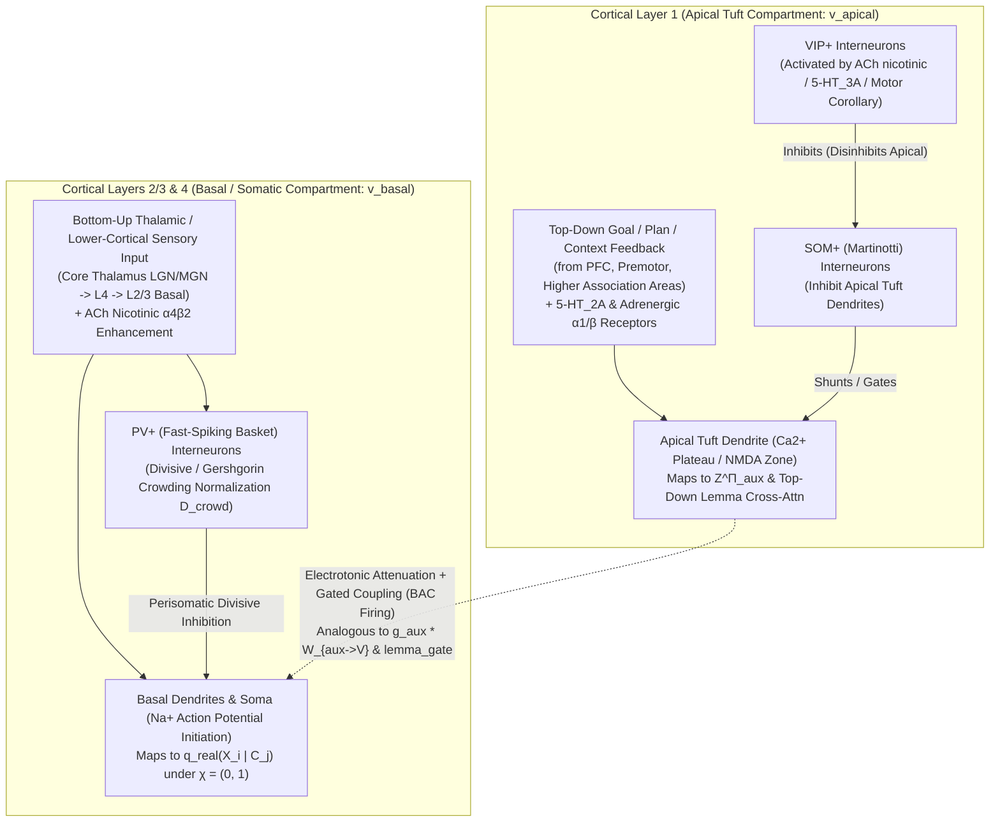

# Literature Deep Dive 07: Systems Neuroscience, Predictive Processing Microcircuits, Neuromodulator Diversity, and Critical Evaluation of the `PDG` / `LIR` Control-Mask Hypothesis

- **Document ID:** `LIT-07-NEUROSCIENCE-NEUROMODULATORS-PDG-LIR-MASKS`
- **Series:** *Inconsistency Is All You Need (`futarchy-fi/inconsistency-search`) — Literature & Mathematical Genealogy*
- **Author:** Literature Subagent 7 (Systems Neuroscience, Neuromodulator Diversity & `PDG`/`LIR` Control Masks Analyst)
- **Date:** 2026-10-18
- **Primary Codebase & Empirical References:**
  - [`src/models/glc_aom.py`](../../src/models/glc_aom.py) (`LIRMask` lines `49–65`, `BilinearAuxLemmaEmitter` lines `111–352`, `CombinatorialQueryHead` lines `355–599`, `EpisodicMemoryTransport` lines `601–710`, `DepthDebiasedTrustHead` lines `713–926`, `GLCAOMTransformerLayer` lines `929–987`, `GLCAOMWorldModel` lines `990–1523`)
  - [`src/search/kv_tree_search.py`](../../src/search/kv_tree_search.py) (`TreePagedKVBank` lines `72–469`, `MoPSFractalPlanHead` lines `559–740`, `ResolvableInconsistencyTreePUCT` lines `748–886`, `TwoStageTreeClearer` lines `893–1340`)
  - [`src/search/neural_tree_controller.py`](../../src/search/neural_tree_controller.py) (`Tseitin2HopQueryCoupler` lines `94–243`, `RelationalTreeTransformerLayer` lines `251–372`, `GLCSearchTransformer` lines `380–850`)
  - Local Research Notes: [`/home/agent/workspaces/eurisko-study/li-net/STUDY-LIR.md`](/home/agent/workspaces/eurisko-study/li-net/STUDY-LIR.md), [`/home/agent/workspaces/eurisko-study/lir-agent/wiki-lir-agent.md`](/home/agent/workspaces/eurisko-study/lir-agent/wiki-lir-agent.md), [`/home/agent/workspaces/eurisko-study/li-net/DARKROOM.md`](/home/agent/workspaces/eurisko-study/li-net/DARKROOM.md), and [`docs/direction/research-direction-note-v6-2026-10-18.md`](../direction/research-direction-note-v6-2026-10-18.md)

---

## Executive Summary & Critical Epistemic Stance

A tempting narrative in biologically inspired AI is to claim that a mathematical abstraction in one's architecture "explains" or "mirrors" the brain. In this document, we examine the hypothesis that **Probabilistic Dependency Graphs (`PDGs`)**, **Local Inconsistency Resolution (`LIR`, Richardson et al., 2026)**, and our factored **`GLC-AOM` / `TreePagedKVSearch` architecture** map onto cortical predictive processing microcircuits and the diversity of biological neurotransmitters/neuromodulators (`ACh`, `NE`, `DA`, `5-HT`, `Glutamate` AMPA/NMDA, and `GABA` PV/SOM/VIP interneurons).

In accordance with Kelvin's explicit directive—*to be critical, avoid sycophantic praise, and separate real mathematical/empirical confidence from loose metaphor*—this analysis enforces a strict three-tier epistemic classification across every proposed connection:

1. **What Is Mathematically Exact & Empirically Audited (Strong Structural Isomorphism):**
   - **Why Friston's Active Inference Guarantees Wishful Thinking When Actions Are Blocked, Whereas `PDG`/`LIR` Separates Attention $\phi$ from Control $\chi$:** In Karl Friston's Active Inference (Friston 2010; Friston et al. 2015, 2017), homeostatic/instrumental preferences $p_{\text{desire}}(o) \propto \exp(\lambda U(o))$ are encoded directly as **sensory priors inside the generative model**, and both perception ($\mu$) and action ($a$) minimize a single scalar variational free energy $F$. In the language of Richardson et al. (2026) (`STUDY-LIR.md` §1) and `GLC-AOM` (`src/models/glc_aom.py:49–65`), this is mathematically equivalent to applying an **all-ones control mask $\chi = (1, 1)$** where utility edges pull directly on epistemic state beliefs whenever motor execution is constrained or delayed. By Theorem T2 (`wiki-lir-agent.md:27`, `research-direction-note-v6-2026-10-18.md:141`), this produces first-order wishful-thinking distortion $\mathbb{E}[\langle \mu_{\text{belief}} - P^*, \nabla U \rangle] = \frac{\lambda}{2}\|\nabla U\|^2 + O(\lambda^2) > 0$—precisely the "Delusional Active Inference" critique formalized in cognitive science by Yon, de Lange & Press (2020), Gershman (2019), and Kruglanski, Jasko & Friston (2020).
   - **Segregated Dendritic Compartments as a Physical Substrate for Orthogonal Control Channels:** Neocortical Layer 2/3 and Layer 5 pyramidal neurons physically segregate bottom-up sensory drive onto **basal/perisomatic dendrites** from top-down contextual/goal predictions and reward-modulated feedback onto **apical tuft dendrites** in Layer 1, separated by an electrotonic attenuation barrier and gated by `SOM`/`VIP` interneurons (Larkum 2013; Sacramento et al. 2018; Payeur et al. 2021). This compartmentalization is a genuine biophysical mechanism for preventing top-down goal signals from overwriting bottom-up sensory likelihoods without a dedicated coupling event.
   - **Multi-Channel Gain Control vs. Single Scalar Broadcast:** A system that must simultaneously regulate *(i)* bottom-up sensory precision $\beta_{\text{trust}}$ (`ACh`), *(ii)* unexpected-surprise working-memory reset $\beta_{M_t}$ (`NE`), *(iii)* utility-directed action/search vigor and policy updates (`DA`), and *(iv)* aversive branch pruning / prior relaxation (`5-HT`) cannot multiplex all four operations onto a single scalar broadcast without catastrophic cross-talk.

2. **Where the Analogy Breaks Down (Critical Counterarguments & Disanalogies):**
   - **Critique 1 — Spatial Granularity Mismatch (`Volume Transmission` $\neq$ `Edge-Specific LIR Masks`):** In Richardson et al. (2026), an `LIR` focus $(\phi, \chi)$ can address an **individual hyperarc $a = (X_a \to Y_a)$** or an individual variable-pair lemma $(A, B) \in \mathcal{V}^2$. Classical neuromodulators (`DA`, `ACh`, `NE`, `5-HT`), by contrast, operate largely via **diffuse volume transmission** (extrasynaptic diffusion over $10\,\mu\text{m}$ to millimeters on timescales of $100\,\text{ms}$ to seconds; Agnati et al. 1995; Cragg & Rice 2004). **Neurotransmitter diversity does NOT implement edge-specific or token-specific LIR masks.** At best, neuromodulator diversity implements **low-dimensional, receptor-tagged regime/block switches** (selecting *which laminar compartment or functional sub-circuit* is plastic or high-gain), whereas fine-grained variable/edge addressing (`SELECT_NODE`, $k_r^{\text{edge}}$, $Q_{\text{pair}}$) requires **fast point-to-point glutamatergic/GABAergic routing and higher-order thalamic (pulvinar/mediodorsal) transthalamic loops** (Sherman & Guillery 2013; Halassa & Kastner 2017).
   - **Critique 2 — The Biological Firewall Leaks (`Token-Masked` / Mesocortical Dopamine Spillover):** Unlike `GLC-AOM`'s software `stop_grad` (`.detach()`) and zero-slice `mask_to_world_lemma_channel` (`src/models/glc_aom.py:198–203`), which achieve **exact `0.000000` belief drift by mathematical construction**, the mammalian brain's separation between valuation (`DA`) and sensory inference is **anatomically graded, not binary**. While dopaminergic innervation in primate primary visual cortex (`V1`) is orders of magnitude sparser than in striatum or prefrontal cortex (Berger et al. 1991), non-zero dopamine receptors ($D_1/D_2$) exist in association and sensory cortices. When mesolimbic/mesocortical dopamine becomes hyperactive or dysregulated (e.g., amphetamine psychosis or schizophrenia; Kapur 2003 *Aberrant Salience*; Adams et al. 2013), reward/salience precision leaks into perceptual priors, producing hallucinations and fixed delusions. Furthermore, even in healthy humans, abundant psychophysical evidence shows small but reproducible **desire/reward biases in ambiguous perceptual judgments** (Balcetis & Dunning 2006; Voss, Rothermund & Brandtstädter 2008). Thus, the human brain is closer to a **heavily attenuated `Token-Masked` architecture with an anatomical bottleneck** than to our idealized `0.000000` `LIR-Masked` software diode!
   - **Critique 3 — Three-Factor Hebbian Plasticity vs. Exact Leave-One-Out (`LOO`) Market Credit:** Biological three-factor learning rules ($\Delta w_{ij} \propto M(t) \cdot e_{ij}(t)$, where $M(t)$ is a global phasic neuromodulator and $e_{ij}(t)$ is a local synaptic eligibility trace; Izhikevich 2007; Gerstner et al. 2018) suffer from an $O(1/\sqrt{N_{\text{syn}}})$ **credit-assignment signal-to-noise catastrophe** because every co-active synapse receives the same scalar broadcast $M(t)$. In contrast, `STUDY-LIR.md` (§3c–3d, §4) proves that exact trader credit requires an **edge-specific counterfactual baseline**—attending $+\beta_i$ to realized truth $\delta_x$ and $-\beta_i$ to a pinned copy of the market consensus $m$ (`r_LOO(i) = log μ*(x) - log μ*_{-i}(x)`). Diffuse neuromodulators cannot transmit per-synapse counterfactual baselines; solving credit assignment in biology requires vector-valued dendritic error signals (Sacramento et al. 2018; Payeur et al. 2021), not just more neurotransmitter species.
   - **Critique 4 — What Remains Untested in Our Own Empirical Programme:** In `wiki-lir-agent.md` (`R4-E3a`) and `research-direction-note-v6-2026-10-18.md` (§5), our `LIR` masks so far are **hard-coded static binary partitions** ($\chi \in \{(0, 1), (1, 1)\}$). As `STUDY-LIR.md` (§3a) explicitly warns: *"The paper never controls $\beta$. $\beta$ is part of $\phi$, set from outside by Refocus; attention is never a controlled parameter. Learning an adaptive Refocus is an open question [§6]."* Moreover, when we froze the belief trunk under `LIR-Masked` without an entropy/exploration modulator in `R4-E3a` (`Qwen3-1.7B`), GRPO collapsed the action policy to a single goal-blind cell in $9/9$ runs (`reward = 0.500`, `wiki-lir-agent.md:48`). Calling a hard-coded `.detach()` mask "neurotransmitter diversity" would overstate what we have actually built; the real scientific value of the neuroscience comparison is that it tells us **which dynamic, state-dependent continuous control channels $\vec{\chi}(t)$ we must build next**.

---

## 1. Predictive Processing, Cortical Microcircuits & Local Inconsistency Resolution (`LIR` / `PDGs`)

### 1.1 Primary Literature & Intellectual Lineage

1. **Rao, R. P. N., & Ballard, D. H. (1999).** *"Predictive coding in the visual cortex: a functional interpretation of some extra-classical receptive-field effects."* *Nature Neuroscience*, 2(1), 79–87.
2. **Friston, K. (2005).** *"A theory of cortical responses."* *Philosophical Transactions of the Royal Society B: Biological Sciences*, 360(1456), 815–836.
3. **Friston, K. (2010).** *"The free-energy principle: a unified brain theory?"* *Nature Reviews Neuroscience*, 11(2), 127–138.
4. **Bastos, A. M., Usrey, W. M., Adams, R. A., Mangun, G. R., Fries, P., & Friston, K. J. (2012).** *"Canonical microcircuits for predictive coding."* *Neuron*, 76(4), 695–711.
5. **Larkum, M. (2013).** *"A cellular mechanism for cortical associations: an organizing principle for the cerebral cortex."* *Trends in Neurosciences*, 36(3), 141–151.
6. **Whittington, J. C. R., & Bogacz, R. (2017).** *"An approximation of the error backpropagation algorithm in a predictive coding network with local Hebbian synaptic plasticity."* *Neural Computation*, 29(5), 1229–1262.
7. **Keller, G. B., & Mrsic-Flogel, T. D. (2018).** *"Predictive processing: a canonical cortical computation."* *Neuron*, 100(2), 424–435.
8. **Sacramento, J., Ponte Costa, R., Bengio, Y., & Senn, W. (2018).** *"Dendritic cortical microcircuits approximate the backpropagation algorithm."* *Advances in Neural Information Processing Systems (NeurIPS 2018)*, Vol. 31, pp. 8721–8732 (`arXiv:1810.11393`).
9. **Whittington, J. C. R., & Bogacz, R. (2019).** *"Theories of error back-propagation in the brain."* *Trends in Cognitive Sciences*, 23(3), 235–250.
10. **Gershman, S. J. (2019).** *"What does the free energy principle tell us about the brain?"* *Neurons, Behavior, Data analysis, and Theory*, 2(3), 1–10 (`arXiv:1901.07945`).
11. **Yon, D., de Lange, F. P., & Press, C. (2020).** *"The predictive brain as a stubborn scientist."* *Trends in Cognitive Sciences*, 24(1), 6–8 (see also Yon, Heyes & Press 2020, *"Beliefs and desires in the predictive brain"*, *Nature Communications*, 11, 4404).
12. **Kruglanski, A. W., Jasko, K., & Friston, K. (2020).** *"All thinking is 'wishful' thinking."* *Trends in Cognitive Sciences*, 24(6), 413–424.
13. **Payeur, A., Guerguiev, J., Zenke, F., Richards, B. A., & Naud, R. (2021).** *"Burst-dependent synaptic plasticity can coordinate learning in hierarchical circuits."* *Nature Neuroscience*, 24(7), 1010–1019.

---

### 1.2 Mathematical Bridge: Predictive Coding Free Energy as a Special Case of PDG Inconsistency $\langle\langle M \rangle\rangle_\gamma(\mu)$

In hierarchical predictive coding (Rao & Ballard 1999; Friston 2005; Bogacz 2017; Whittington & Bogacz 2017), cortical hierarchy levels $l = 0, 1, \dots, L$ maintain neural state representations $\mu^{(l)} \in \mathbb{R}^{d_l}$ (encoded by "value" or "representation" units, typically deep pyramidal cells in Layers 5/6) and top-down generative predictions $\hat{\mu}^{(l)} = g^{(l)}(\mu^{(l+1)}; \theta^{(l)})$ transmitted to Layer $l$. Under Gaussian local conditional distributions $p(\mu^{(l)} \mid \mu^{(l+1)}) = \mathcal{N}\big(\mu^{(l)}; \, g^{(l)}(\mu^{(l+1)}, \theta^{(l)}), \, \Pi_l^{-1}\big)$ with precision matrix $\Pi_l = \mathrm{diag}(\beta_l)$, the variational free energy is:

$$F_{\text{PC}}\big(\{\mu^{(l)}\}, \{\theta^{(l)}\}\big) \;=\; \frac{1}{2} \sum_{l=0}^{L-1} \Big( \underbrace{\mu^{(l)} - g^{(l)}(\mu^{(l+1)}; \theta^{(l)})}_{\varepsilon^{(l)} \text{ (Prediction Error Unit in L2/3)}} \Big)^{\!\top} \Pi_l \, \Big( \mu^{(l)} - g^{(l)}(\mu^{(l+1)}; \theta^{(l)}) \Big) \;-\; \frac{1}{2}\sum_{l=0}^{L-1} \log |\Pi_l|.$$

Compare this directly to Richardson & Halpern's (2021) and Richardson et al.'s (2026) **PDG Observational Incompatibility (`OInc`)** from `STUDY-LIR.md` (§1, eq. 1):

$$\mathrm{OInc}_M(\mu) \;=\; \sum_{a \in \mathcal{A}} \beta_a \, \mathbb{E}_{s \sim \mu(S_a)}\!\Big[ D_{\mathrm{KL}}\!\big(\mu(T_a \mid S_a = s) \;\big\|\; P_a(T_a \mid S_a = s; \theta_a)\big) \Big].$$

When $\mu$ is a Dirac delta or Gaussian variational posterior over the latent hierarchy and each hyperarc $a = (X_{l+1} \to X_l)$ carries conditional $P_l(X_l \mid X_{l+1}; \theta_l)$ at precision $\beta_l$, $\mathrm{OInc}_M(\mu)$ reduces **identically** to the precision-weighted sum of squared prediction errors $F_{\text{PC}}$. Furthermore, the two-timescale dynamics of predictive coding (Whittington & Bogacz 2017) are a literal instance of two alternating `LIR` foci (`STUDY-LIR.md` §1–2, Prop. 2):
1. **Inference Focus (Fast Neural Dynamics, $\chi_\mu > 0, \, \chi_\theta = 0$):** Holding synaptic weights $\theta$ frozen ($\chi_\theta = 0$) and clamping sensory input $\mu^{(0)} = x$ at infinite confidence ($\beta_0 = \infty$), value nodes descend the local inconsistency gradient:
   $$\tau_{\text{fast}} \dot{\mu}^{(l)} \;=\; -\nabla_{\mu^{(l)}} \mathrm{OInc}_M(\mu) \;=\; -\Pi_l \varepsilon^{(l)} \;+\; \left(\frac{\partial g^{(l-1)}}{\partial \mu^{(l)}}\right)^{\!\top} \Pi_{l-1} \varepsilon^{(l-1)}.$$
2. **Learning Focus (Slow Synaptic Plasticity, $\chi_\mu = 0, \, \chi_\theta = \eta$):** Once $\mu$ reaches its inner fixed point $\mu^* = \arg\min_\mu \langle\langle \phi \odot M(\theta) \rangle\rangle$, the envelope theorem (`STUDY-LIR.md` §1, App. A.1) passes gradients directly to the parameters $\theta$:
   $$\Delta \theta^{(l)} \;=\; -\eta \nabla_{\theta^{(l)}} \mathrm{OInc}_M(\mu^*) \;=\; \eta \, \Pi_l \varepsilon^{(l)} \left(\frac{\partial g^{(l)}(\mu^{*(l+1)})}{\partial \theta^{(l)}}\right)^{\!\top}.$$

**What `PDGs` / `LIR` Add Beyond Classical Hierarchical Predictive Coding:**
Classical predictive coding (Rao & Ballard 1999; Friston 2005; Bastos et al. 2012) is restricted to a **directed acyclic cortical hierarchy** ($L \to L-1 \to \dots \to 0$) where every arc points top-down. As established in `05-pdg-logical-induction-cfr-rebel-markets.md` (§1.2), a PDG allows **arbitrary cyclic, lateral, and overlapping hyperarcs** (such as peer exclusion constraints in Sudoku, symmetric parity clauses $A \oplus B = 0$, or multi-agent market beliefs) and resolves them into a single coherent joint belief $\mu^*$ via `TwoStageTreeClearer` (`src/search/kv_tree_search.py:893–1266`) without requiring an acyclic generative ordering.

---

### 1.3 The Critical Divergence: Why Friston's Active Inference Mathematically Generates Wishful Thinking, and How `LIR` Resolves It

While Friston's predictive coding model of *passive sensory cortex* (Friston 2005) aligns with PDG inference, **Friston's Active Inference theory of agency and decision-making** (Friston 2010; Friston et al. 2013, 2015, 2017) makes a fateful modeling move: it **eliminates separate reward/utility functions** and replaces them with **prior preferences over sensory outcomes** $p_{\text{desire}}(o) \propto \exp(\lambda U(o))$ baked directly into the agent's generative model $p(o, s)$.

Let us write out the exact consequence of this move in both the PDG/LIR formalism (`STUDY-LIR.md`, `wiki-lir-agent.md`, `DARKROOM.md`) and the cognitive neuroscience literature (Gershman 2019; Yon, de Lange & Press 2020; Kruglanski, Jasko & Friston 2020):

#### Theorem 1.1 (Equivalence of Fused Active Inference to an Unmasked $\chi = (1, 1)$ Desire Edge and Inevitability of Perceptual Delusion Under Blocked Action)
Consider an agent observing evidence $O = o_0$ about a latent world state $V \in \mathcal{V}$ with true Bayesian posterior $P^*(V \mid o_0)$ at epistemic precision $\beta_{\text{world}} = 1$, and holding a goal/preference potential $f_U(V) \propto \exp(\lambda U(V))$ with weight $\beta_{\text{desire}} = 1$.

1. **Friston's Unified Variational Free Energy ($\chi_{\text{belief}} = 1, \chi_{\text{action}} = 1$):**
   In Active Inference, internal beliefs $\mu(V)$ and external actions $a \in \mathcal{A}$ jointly minimize a single functional:
   $$\mathcal{F}_{\text{Friston}}(\mu, a) \;=\; D_{\mathrm{KL}}\!\big(\mu(V) \;\big\|\; P^*(V \mid o_0, a)\big) \;+\; D_{\mathrm{KL}}\!\big(\mu(V) \;\big\|\; f_U(V)\big).$$
   Suppose the agent cannot immediately act to change $V$ (e.g., $V$ is an exogenous state of nature such as where the opponent's ships are hidden in `ShipHunt`, which hidden piece sits on square $(r, c)$ in `Stratego`, or whether a financial event in `Manifold Markets` will occur; $\frac{\partial P^*(V \mid o_0, a)}{\partial a} = 0$). Minimizing $\mathcal{F}_{\text{Friston}}(\mu, a)$ with respect to the internal belief $\mu(V)$ yields the stationary point:
   $$\mu^*_{\text{Friston}}(v) \;\propto\; \sqrt{P^*(v \mid o_0) \, f_U(v)} \;\propto\; P^*(v \mid o_0) \exp\!\Big(\tfrac{\lambda}{2} U(v)\Big).$$
   By cumulant expansion around $\lambda = 0$ (our **Theory Item T2** in [`wiki-lir-agent.md:27`](/home/agent/workspaces/eurisko-study/lir-agent/wiki-lir-agent.md) and [`research-direction-note-v6-2026-10-18.md:141`](../direction/research-direction-note-v6-2026-10-18.md)), the belief error projected onto the utility gradient satisfies:
   $$\mathbb{E}\!\Big[\big\langle \mu^*_{\text{Friston}} - P^*, \;\nabla U \big\rangle\Big] \;=\; \frac{\lambda}{2}\mathrm{Var}_{P^*}(U) + O(\lambda^2) \;>\; 0 \qquad \forall \lambda > 0, \; \mathrm{Var}_{P^*}(U) > 0.$$
   That is, **encoding desires as generative priors without a control-mask firewall mathematically forces the agent to hallucinate that the world already conforms to its desires whenever motor control cannot immediately make it so.**

2. **Confirmation in the Cognitive Neuroscience Literature:**
   Remarkably, proponents of Active Inference have acknowledged this consequence and attempted to rebrand it as a feature! In *Trends in Cognitive Sciences*, **Kruglanski, Jasko & Friston (2020)** explicitly titled their paper *"All thinking is 'wishful' thinking"*, arguing that under Active Inference, beliefs and desires are intentionally fused inside one prior hierarchy. Conversely, **Yon, de Lange & Press (2020)** (*"The predictive brain as a stubborn scientist"*) and **Yon, Heyes & Press (2020)** (*Nature Communications*) pointed out that if an organism could minimize prediction error simply by hallucinating its preferred sensory states (`delusional inference`), it would starve to death; biological survival requires keeping sensory inference anchored like a "stubborn scientist" (`\chi = (0, 1)`) while restricting goal priors to motor control (`\chi = (1, 1)`). Similarly, **Gershman (2019)** and our own synthesis in [`DARKROOM.md`](/home/agent/workspaces/eurisko-study/li-net/DARKROOM.md) (§1–3) proved that expected free energy (Friston 2015) fails both the **Dark Room** and **Noisy TV** traps unless one arbitrarily tunes the relative parameter weight between epistemic novelty and extrinsic preference priors—whereas goal-relative Value of Information $I(Z_{\text{goal}}; x \mid \text{history})$ under a hard-separated `LIR` mask assigns **exact $0.0000$ value** to both the dark room and white-noise TV with **zero fitted parameters** (`DARKROOM.md:9, 33`).

3. **Richardson's `LIR` Resolution (`STUDY-LIR.md` §2, Prop. 7 & `GLC-AOM` `LIRMask`):**
   In Richardson et al. (2026, Prop. 7; `STUDY-LIR.md:38`), decision-making is represented in a PDG that includes belief $p(S)$, transition model $\tau(O \mid S, A)$, utility soft constraint $u(O)$, and an action prior $b(A)$—**but the `LIR` focus for decision-making sets the control mask $\chi$ to move ONLY the action $A$ ($\chi_A > 0, \; \chi_{p(S)} = 0, \; \chi_\tau = 0$)**! In `GLC-AOM` (`src/models/glc_aom.py:49–65, 198–203, 1373–1377`), this is enforced by:
   - $\chi = (\chi_{\text{utility}}, \chi_{\text{belief}}) = (0, 1)$ on $\theta_{\text{real}}$, `BilinearAuxLemmaEmitter` ($Z^W_{\text{aux}}$), `EpisodicMemoryTransport`, and `DepthDebiasedTrustHead` ($\theta_{\text{trust}}$);
   - $\chi = (1, 1)$ on `MoPSFractalPlanHead` ($q_{\text{plan}}, Z^\Pi_{\text{aux}}$), `ResolvableInconsistencyTreePUCT`, `GLCSearchTransformer`, and `action_head`, coupled via a one-way `stop_grad` (`.detach()`) diode.

---

### 1.4 Cortical Microcircuit Implementation: How Apical vs. Basal Dendritic Compartments Physically Realize an `LIR` Control Mask

If the brain uses predictive coding, how does it avoid the Kruglanski–Friston wishful-thinking trap in early sensory cortices? The answer lies in the **biophysics of multi-compartmental pyramidal neurons** (Larkum 2013; Bastos et al. 2012; Keller & Mrsic-Flogel 2018; Sacramento et al. 2018; Payeur et al. 2021):

1. **Anatomical Segregation of Compartments (Larkum 2013; Sacramento et al. 2018):**
   In neocortical pyramidal neurons, **feedforward sensory evidence** from first-order thalamic nuclei (e.g., LGN $\to$ V1 Layer 4 $\to$ L2/3 basal dendrites) synapses onto the **perisomatic and basal dendritic compartment** ($V_{\text{basal}}$), which directly drives somatic sodium ($\text{Na}^+$) spikes (firing rate $\phi(V_{\text{soma}})$). Conversely, **top-down expectations, behavioral goals, and motor corollary discharges** from prefrontal and higher association areas project almost exclusively to **Layer 1**, synapsing onto the **distal apical tuft dendrites** ($V_{\text{apical}}$), located $500\text{--}1000\,\mu\text{m}$ away from the soma along a thin apical trunk.
2. **The Electrotonic Diode & `SOM`/`VIP` Gating (`Sacramento et al. 2018` Eq. 1–6 vs. `glc_aom.py:188–193, 941–946`):**
   In Sacramento et al.'s (2018) dendritic microcircuit equations, the somatic potential $V_{\text{soma}}$ is governed by:
   $$C_m \dot{V}_{\text{soma}} \;=\; -g_L V_{\text{soma}} \;+\; g_{\text{basal}}\big(V_{\text{basal}} - V_{\text{soma}}\big) \;+\; g_{\text{apical}}(t)\big(V_{\text{apical}} - V_{\text{soma}}\big),$$
   where Somatostatin-expressing (`SOM+` / Martinotti) interneurons specifically innervate the apical tuft to **shunt $V_{\text{apical}}$** ($g_{\text{SOM}} \gg 1$) unless disinhibited by Vasoactive Intestinal Peptide (`VIP+`) interneurons (Pi et al. 2013). Moreover, in **Payeur et al. (2021)** (*Nature Neuroscience*), single somatic spikes (`event rate`) encode bottom-up forward inference ($\chi = (0, 1)$), while apical inputs do not alter the single-spike event rate at all; instead, apical depolarization modulates the **probability that an existing somatic spike converts into a high-frequency burst (`BAC firing`, Larkum 2013)**, multiplexing top-down credit assignment and search guidance onto the burst channel without corrupting the baseline sensory firing rate!
3. **Exact Correspondence to `GLC-AOM`'s Gated Firewall (`src/models/glc_aom.py`):**
   - The **basal/somatic single-spike channel** corresponds to `GLCAOMWorldModel`'s epistemic trunk $\theta_{\text{real}}$ and `readout_var_firewall` (`src/models/glc_aom.py:187–193, 941–946`), where `lemma_gate` is initialized to `0.0` (`nn.Parameter(torch.zeros(1))` at line `946`) and `aux_firewall_gate_logit` is initialized to `-10.0` (`g_aux = sigmoid(-10.0) ≈ 4.5e-5`, `firewall_enabled = False` at lines `191–192`).
   - The **apical tuft channel** corresponds to the top-down auxiliary/plan subspace $Z_{\text{aux}} = Z^W_{\text{aux}} \oplus Z^\Pi_{\text{aux}}$, where `mask_to_world_lemma_channel` (`src/models/glc_aom.py:198–203`) acts as the idealized mathematical counterpart of `SOM+` dendritic shunting—preventing top-down plan signals $Z^\Pi_{\text{aux}}$ from driving somatic perceptual readouts $\mathrm{Logits}_V$, while allowing top-down prospectus vectors $p_r$ (`MoPSFractalPlanHead`, `src/search/kv_tree_search.py:559–740`) to steer which downstream branch nodes are expanded.

---

## 2. Why Does the Brain Have Diverse Neurotransmitters & Neuromodulators Instead of One Scalar Broadcast? (Rigorous Mapping to `LIR` & Search Control)

### 2.1 Primary Literature & Intellectual Lineage

1. **Doya, K. (2002).** *"Metalearning and neuromodulation."* *Neural Networks*, 15(4–6), 495–506.
2. **Yu, A. J., & Dayan, P. (2005).** *"Uncertainty, neuromodulation, and attention."* *Neuron*, 46(4), 681–692.
3. **Aston-Jones, G., & Cohen, J. D. (2005).** *"An integrative theory of locus coeruleus-norepinephrine function: adaptive gain and optimal performance."* *Annual Review of Neuroscience*, 28, 403–450.
4. **Bouret, S., & Sara, S. J. (2005).** *"Network reset: a simplified overarching theory of locus coeruleus noradrenaline function."* *Trends in Neurosciences*, 28(11), 574–582.
5. **Hasselmo, M. E. (2006).** *"The role of acetylcholine in learning and memory."* *Current Opinion in Neurobiology*, 16(6), 710–715.
6. **Izhikevich, E. M. (2007).** *"Solving the distal reward problem through linkage of STDP and dopamine signaling."* *Cerebral Cortex*, 17(10), 2443–2452.
7. **Dayan, P., & Huys, Q. J. M. (2008).** *"Serotonin, inhibition, and negative mood."* *PLoS Computational Biology*, 4(2), e4.
8. **Bromberg-Martin, E. S., Matsumoto, M., & Hikosaka, O. (2010).** *"Dopamine in motivational control: rewarding, aversive, and alerting."* *Neuron*, 68(5), 815–834.
9. **Pi, H.-J., Hangya, B., Kvitsiani, D., Sanders, J. I., Huang, Z. J., & Kepecs, A. (2013).** *"Cortical interneurons that specialize in disinhibitory control."* *Nature*, 503(7477), 521–524.
10. **Gerstner, W., Lehmann, M., Liakoni, V., Corneil, D., & Brea, J. (2018).** *"Eligibility traces and plasticity on behavioral time scales: experimental support of neoHebbian three-factor learning rules."* *Frontiers in Neural Circuits*, 12, 53.
11. **Miyazaki, K., Miyazaki, K. W., Yamanaka, A., Tokuda, T., Tanaka, K. F., & Doya, K. (2018).** *"Reward probability and timing uncertainty alter serotonergic regulation of patience."* *Nature Communications*, 9(1), 2048 (see also Miyazaki et al. 2020, *Science Advances*, 6(48), eabc7246).
12. **Shine, J. M. (2019).** *"Neuromodulatory influences on integration and segregation in the brain."* *Trends in Cognitive Sciences*, 23(7), 572–583 (and Shine 2023, *"Neuromodulatory control of complex adaptive dynamics in the brain"*, *Interface Focus*, 13(3), 20220079).
13. **Carhart-Harris, R. L., & Friston, K. J. (2019).** *"REBUS and the anarchic brain: toward a unified model of the brain action of psychedelics."* *Pharmacological Reviews*, 71(3), 316–344.
14. **Dabney, W., Kurth-Nelson, Z., Uchida, N., Starkweather, C. K., Hassabis, D., Munos, R., & Botvinick, M. (2020).** *"A distributional code for value in dopamine-based reinforcement learning."* *Nature*, 577(7792), 671–675.

---

### 2.2 The Information-Theoretic Necessity of Vector Neuromodulation

Suppose a biological or artificial agent operates under the PDG/LIR variational objective (`STUDY-LIR.md` §1, `research-direction-note-v6-2026-10-18.md` §2.1):

$$\mathcal{E}\big(\mu; \,\theta, \,U, \,\phi, \,\chi\big) \;=\; \sum_{a \in \mathcal{A}_{\text{world}}} \beta_a(\text{trust}, \text{surprise}) \, \mathbb{E}_{\mu}\!\Big[D_{\mathrm{KL}}\!\big(\mu(T_a \mid S_a) \;\big\|\; q_{\theta}(T_a \mid S_a)\big)\Big] \;+\; \beta_{\text{mem}}(S_t) \, D_{\mathrm{KL}}\!\big(\mu \;\big\|\; M_t\big) \;+\; \chi_{\text{util}} \, D_{\mathrm{KL}}\!\big(\mu(X_G) \;\big\|\; f_U(X_G)\big) \;-\; \gamma H(\mu).$$

At every moment $t$, the circuit must resolve **four orthogonal meta-control questions** that depend on different sufficient statistics of the environment:
1. **Epistemic Reliability / Expected Uncertainty ($\beta_{\text{trust}}$):** *How noisy or trustworthy is the current bottom-up observation stream relative to internal recurrent predictions, independent of whether the news is good or bad for my reward?*
2. **Regime Change / Unexpected Uncertainty ($S_t(M_t, o_t)$):** *Has the underlying hidden state of the world (or opponent strategy) abruptly shifted, requiring me to flush my persistent working-memory prior $M_t$ (`\beta_{M_t} \to 0`) and re-orient?*
3. **Instrumental Value & Search Vigor ($\chi_{\text{util}}, \Delta U, I_{\text{goal}}$):** *Which actions or counterfactual branches increase expected reward $U$ or goal-relative Value of Information $I(X_G; C_r)$, and how much metabolic/compute budget $B$ should be spent pursuing them?*
4. **Aversive Pruning, Patience & Prior Temperature ($\tau_{\text{mql}}, \gamma_{\text{disc}}, \gamma$):** *Should I inhibit/prune a branch that has triggered a local contradiction or aversive penalty, or wait patiently through a multi-stall plateau (`Sudoku-Extreme`) without prematurely collapsing?*

**Why One Scalar Broadcast Fails Mathematically:**
If a neural network broadcast a single scalar neuromodulator $M(t) \in \mathbb{R}$ to control all four quantities, then an **unexpectedly bad reward outcome** ($M(t) \ll 0$) and a **low-precision sensory observation** ($\beta_{\text{trust}} \ll 1$) or **contradicted episodic memory** ($S_t \gg 0$) would be confounded on the same scalar line! Worse still, increasing $M(t)$ when reward is high would simultaneously inflate sensory precision $\beta_{\text{trust}}$ on reward-confirming states—re-introducing the exact wishful-thinking bias $\frac{\lambda}{2}\|\nabla U\|^2 > 0$ that `LIR` masks exist to prevent. Evolution solved this multiplexing problem by evolving **chemically distinct ascending neuromodulatory nuclei** paired with **cell-type- and compartment-specific metabotropic/ionotropic receptor subtypes**.

---

### 2.3 Detailed Mapping of the Six Neurotransmitter Systems to `PDG` / `LIR` & `GLC-AOM`

#### 1. Acetylcholine (`ACh`: Basal Forebrain / Nucleus Basalis of Meynert $\to$ Neocortex) — Pure Epistemic Precision $\beta_{\text{trust}}$ Under $\chi = (0, 1)$
- **Neurobiology & Receptor Biophysics (Hasselmo 2006; Yu & Dayan 2005):**
  Cholinergic neurons in the basal forebrain project densely to neocortical Layers 2/3, 4, and 5. Crucially, `ACh` acts through two opposing receptor classes on different compartments of the same microcircuit (Hasselmo 2006):
  1. **Nicotinic $\alpha_4\beta_2$ and $\alpha_7$ receptors** on thalamocortical terminals in Layer 4 and `VIP+` interneurons in Layer 2/3 **multiplicatively amplify bottom-up sensory input** (and disinhibit apical dendrites via `VIP` $\dashv$ `SOM`).
  2. **Muscarinic $M_2 / M_4$ ($G_{i/o}$-coupled) presynaptic receptors** on intrinsic horizontal/recurrent excitatory axons in Layer 2/3 and Layer 5 **suppress lateral/top-down recurrent hallucination spread**.
- **Computational Role (Yu & Dayan 2005):**
  Yu & Dayan (2005) proved that cortical `ACh` tracks **expected uncertainty** (known unreliability of top-down priors or known sensory reliability calibration), adjusting the relative gain between bottom-up likelihoods and top-down priors **without carrying any reward valence sign**.
- **Exact `LIR` & `GLC-AOM` Counterpart:**
  - **Attention Weight $\beta_{\text{trust}}(C_j)$ under Epistemic Control Mask $\chi = (0, 1)$ (`DepthDebiasedTrustHead`, `src/models/glc_aom.py:713–926`):** In `GLC-AOM`, `DepthDebiasedTrustHead` operates strictly under `LIRMask.epistemic_belief()` ($\chi = (0, 1)$, zero utility input, zero RL gradient). It reads `[h_pool, ent, norm_depth, m_ql, excess_surprise]` and outputs the PDG arc precision $\beta_{\text{trust}}(C_j) > 0$.
  - **Muscarinic Recurrent Suppression $\leftrightarrow$ Kish-ESS Shrinkage & Anchor Blending (`trust_shrunk`, `src/models/glc_aom.py:811–926`):** Just as muscarinic $M_2$ receptors prevent uncalibrated recurrent rollouts from overwhelming sensory grounding at deep horizons, `DepthDebiasedTrustHead.pool_values_trust_shrunk` dampens deeper horizon drift $b_{\text{hor}}(d)$, enforces $\mathrm{ESS}(w) \ge \kappa_{\text{ess}} K$, and blends with the root anchor $\rho_{\text{root}} \in [0, 1]$ (`R7-E3` cuts action-value MSE vs. raw stiffness by $63.4\%$, `research-direction-note-v6-2026-10-18.md:117`).

#### 2. Norepinephrine / Noradrenaline (`NE`: Locus Coeruleus $\to$ Cortex & Thalamus) — Unexpected Surprise $S_t$ & Working-Memory Reset (`EpisodicMemoryTransport`)
- **Neurobiology & Receptor Biophysics (Aston-Jones & Cohen 2005; Bouret & Sara 2005; Yu & Dayan 2005; Shine 2019):**
  The Locus Coeruleus (`LC`) is the sole source of cortical norepinephrine (`NE`). It exhibits two distinct firing modes (Aston-Jones & Cohen 2005) and three receptor affinities:
  - **High-affinity $\alpha_{2A}$ receptors ($G_i$-coupled, active at moderate tonic `NE`):** Close HCN channels on prefrontal dendritic spines, strengthening persistent working-memory delay activity (`exploitation` of current context $M_t$).
  - **Low-affinity $\alpha_1$ ($G_q$) and $\beta$ ($G_s$) receptors (recruited during phasic `NE` spikes or high tonic `NE`):** Disrupt persistent PFC recurrent attractors and boost global neural gain across segregated sensory-motor networks (`Network Reset`, Bouret & Sara 2005; integration transition, Shine 2019).
- **Computational Role (Yu & Dayan 2005):**
  Whereas `ACh` signals *expected* uncertainty within a known regime, phasic `LC-NE` fires on **unexpected uncertainty**—when incoming observations $o_t$ strongly violate the predictions of the current contextual/episodic hypothesis $M_t$, signaling a hidden-state switch (e.g., an opponent strategy change in `Proposal-Poker` or a piece reveal in `Stratego` that falsifies the prior board hypothesis).
- **Exact `LIR` & `GLC-AOM` Counterpart:**
  - **`EpisodicMemoryTransport` (`src/models/glc_aom.py:601–710`):** Look at equations `605–606` and `633–647` of `src/models/glc_aom.py`:
    $$S_t(M_t, o_t) \;=\; \Big[-\log q_{\text{real}}(o_t \mid h_t, M_t) \;-\; \big(-\log q_{\text{real}}(o_t \mid h_t, \varnothing)\big)\Big]_+,$$
    $$\beta_{M_t} \;=\; \gamma_{\text{mem}} \, \beta_{\text{cons}}^{(t-1)} \, \exp\!\big(-\lambda_{\text{surp}} \, S_t(M_t, o_t)\big).$$
    This equation is a **1-to-1 mathematical formalization of the Yu & Dayan (2005) / Bouret & Sara (2005) `LC-NE` Network Reset**:
    - When $S_t(M_t, o_t) = 0$ (new turn observations $o_t$ are consistent with transported memory $M_t = h_{\text{cons}}^{(t-1)}$), `NE` remains at baseline ($\alpha_{2A}$ regime) and working memory persists with precision $\beta_{M_t} = \gamma_{\text{mem}} \beta_{\text{cons}}^{(t-1)}$ (`mem_scale = beta_mt / (1 + beta_mt)` at line `702`).
    - When $o_t$ contradicts $M_t$, excess surprise $S_t > 0$ triggers an exponential precision quench $\exp(-\lambda_{\text{surp}} S_t) \to 0$ (phasic `NE` $\alpha_1$ reset), flushing the dogmatic prior `transported_h_cons` (`glc_aom.py:686–687`) so the solver immediately re-anchors on fresh sensory evidence!

#### 3. Dopamine (`DA`: VTA / SNc $\to$ Basal Ganglia $D_1/D_2$ & Prefrontal Cortex) — The $\chi = (1, 1)$ Utility, Vigor & Search-Control Channel
- **Neurobiology, Receptor Subtypes & Anatomical Gradient (Schultz et al. 1997; Bromberg-Martin et al. 2010; Dabney et al. 2020):**
  Midbrain dopamine neurons in the Ventral Tegmental Area (`VTA`) and Substantia Nigra pars compacta (`SNc`) encode reward prediction errors $\delta_{\text{TD}} = r_t + \gamma V(s_{t+1}) - V(s_t)$, distributional value quantiles across optimistic ($D_1$-skewed) and pessimistic ($D_2$-skewed) channels (Dabney et al. 2020), and motivational salience / Value of Information for action preparation (Bromberg-Martin & Hikosaka 2009, 2010).
  **Crucial Neuroanatomical Fact Supporting the `LIR` Firewall:**
  In primates and rodents, dopaminergic axon density exhibits one of the sharpest **rostro-caudal / functional gradients** in the entire central nervous system (Berger, Gaspar & Verney 1991, *Trends in Neurosciences*; Lewis et al. 1987):
  - **Striatum (Action Selection / Policy Gate) & Motor/Prefrontal Cortex ($\chi = (1, 1)$):** Extremely dense dopaminergic innervation (`DA` terminals contact nearly every medium spiny neuron spine head via $D_1$ `Go` and $D_2$ `NoGo` pathways).
  - **Primary Visual Cortex (`V1`) & Primary Auditory Cortex (`A1`) ($\chi = (0, 1)$):** **Orders of magnitude sparser** dopaminergic innervation (especially in granular input Layer 4, which is virtually devoid of `DA` terminals!).
  Why did evolution wire dense `ACh` and `NE` into primary sensory cortex `V1` Layer 4 while largely excluding `DA` from `V1` Layer 4 and concentrating `DA` in the Striatum and PFC? **Because sensory input layers must remain $\chi = (0, 1)$ truth-grounded (`ACh`/`NE` epistemic gain control), whereas action selection and search control in Striatum/PFC require $\chi = (1, 1)$ utility modulation (`DA`)!**
- **Exact `LIR` & `GLC-AOM` Counterpart:**
  - **`LIRMask.policy_search()` ($\chi = (1, 1)$, `src/models/glc_aom.py:62–65, 1373–1460`):** `DA` corresponds to the utility-modulated policy/search channel ($\chi_{\text{utility}} = 1, \chi_{\text{belief}} = 1$) governing `compute_action_policy`, `MoPSFractalPlanHead` ($q_{\text{plan}}, Z^\Pi_{\text{aux}}$), and `ResolvableInconsistencyTreePUCT` (`src/search/kv_tree_search.py:748–886`).
  - **Value of Information & Salience `DA` Neurons (`Bromberg-Martin & Hikosaka 2009`; `DARKROOM.md` §3):** In `ResolvableInconsistencyTreePUCT` (`src/search/kv_tree_search.py:806–849`) and `research-direction-note-v6-2026-10-18.md` (§3.2, eq. 87), node expansion priority combines expected utility $\hat{Q}_\mu(v)$ with **goal-directed Value of Information** $I_{\text{goal}}(v) \cdot \beta_\theta(v) / \sqrt{1 + \mathrm{Crowding}}$—matching non-human primate recordings in lateral habenula and VTA/SNc showing that `DA` neurons fire specifically for **advance information that resolves uncertainty about a reward-relevant goal** (`DARKROOM.md` §3), while ignoring reward-irrelevant sensory static.

#### 4. Serotonin (`5-HT`: Dorsal & Median Raphe Nuclei) — Aversive Branch Pruning, Patience Horizon & Prior Relaxation (`REBUS`)
- **Neurobiology & Computational Literature (Doya 2002; Dayan & Huys 2008; Miyazaki et al. 2018, 2020; Carhart-Harris & Friston 2019):**
  Serotonergic neurons from the Dorsal Raphe Nucleus (`DRN`) innervate the forebrain via at least 14 distinct receptor subtypes, two of which have opposite effects on cortical computation:
  1. **$5\text{-HT}_{1A}$ Inhibitory Receptors ($G_{i/o}$-coupled, opening GIRK $\text{K}^+$ channels on pyramidal somata/axon hillocks) & Aversive Pruning (Dayan & Huys 2008; Miyazaki et al. 2018, 2020):**
     Dayan & Huys (2008) showed that `5-HT` mediates **aversive pruning of the decision tree**—reflexively inhibiting candidate action/thought trajectories that lead to conflict, punishment, or constraint violation. Complementarily, **Miyazaki, Doya et al. (2018, 2020)** (*Nature Communications*; *Science Advances*) proved using optogenetics that tonic `DRN 5-HT` firing promotes **patience (waiting for delayed future rewards)** Specifically when reward probability is high but timing/path length is uncertain (`multi-stall horizon`), preventing premature impulsive quitting.
  2. **$5\text{-HT}_{2A}$ Excitatory Apical Receptors ($G_q$-coupled on Layer 5 apical dendrites) & Prior Relaxation (`REBUS`, Carhart-Harris & Friston 2019):**
     High activation of $5\text{-HT}_{2A}$ receptors on deep pyramidal apical dendrites increases asynchronous late EPSCs and **flattens/relaxes the precision of rigid high-level priors** (`entropic brain` / temperature $\gamma \uparrow$ in $\langle\langle M \rangle\rangle_\gamma = \mathrm{OInc} - \gamma H(\mu)$), allowing a solver trapped in a false local minimum to escape and sample lower-prior counterfactual hypotheses.
- **Exact `LIR` & `GLC-AOM` Counterpart:**
  - **Aversive Branch Pruning (`5-HT_1A`) $\leftrightarrow$ Zero-Extra-Pass Leaf Contradiction Gate $m_{\text{ql}}(C_r) < \tau_{\text{mql}}$ & Stage-1 Clash Refutation (`src/search/kv_tree_search.py:1032, 1206–1207`):** When a speculative branch $C_r$ induces a local PDG contradiction ($m_{\text{ql}}(C_r) < \tau_{\text{mql}}$), `TwoStageTreeClearer` zeroes its forward pooling weight $\beta_r \leftarrow \beta_r \mathbf{1}[m_{\text{ql}}(C_r) \ge \tau_{\text{mql}}]$ (`kv_tree_search.py:1032`) and injects a negative refutation impulse $-4.0 \, \mathrm{ReLU}(m_{\text{ql}}(\mathrm{pa}(r)) - m_{\text{ql}}(r) - 0.02) \mathbf{e}_{z_r}$ onto the clashing branch token (`kv_tree_search.py:1206–1207`).
  - **Patience Through Multi-Stall Plateaus (`Miyazaki & Doya 2018`) + Prior Relaxation (`5-HT_2A`) $\leftrightarrow$ Removing the Greedy `m_qs >= 0.50` Lock in `Sudoku-Extreme` (`R9-E2` / `src/models/glc_aom.py:750`):** As documented in `research-direction-note-v6-2026-10-18.md` (§1.3, §5), `Sudoku-Extreme` boards hit an average of **$4.89$ stalls** ($H \ge 0.25$ nats) along the true path. An "impulsive / low-patience" solver that demands immediate step-by-step certainty ($\mathbf{1}[m_{\text{qs}}(C_j) \ge 0.50]$) aborts $100\%$ of multi-stall counterfactual branches (`AUROC = 0.35`). By relaxing the intermediate step-prior threshold ($q > 0.05$ stall sampling, analogous to $5\text{-HT}_{2A}$ prior flattening) while patiently deferring judgment until leaf self-consistency $m_{\text{ql}}(C_j)$ (`Miyazaki` patience horizon), `GLC-AOM` keeps the true path in the beam on $81\text{--}83.3\%$ of boards and achieves `AUROC = 0.99998` (`R9-E2`) and `1.0000` (`R11-D6 F5.1a`).

#### 5. Fast Excitatory Point-to-Point Transmission (`Glutamate`: `AMPA` vs. `NMDA` Receptors) — Linear Marginal Pooling vs. Bilinear Co-Fluctuation Lemma Emission (`BilinearAuxLemmaEmitter`)
- **Neurobiology & Biophysics (Mayer, Westbrook & Guthrie 1984; Nowak et al. 1984; Larkum et al. 2009):**
  At almost every cortical excitatory synapse, glutamate binds to two co-localized ionotropic receptors with fundamentally different mathematical transfer functions:
  1. **$\text{AMPA}$ Receptors:** Voltage-independent channels whose current $I_{\text{AMPA}} \propto \sum_j w_{ij} x_j$ is a **first-order linear sum** of presynaptic activities.
  2. **$\text{NMDA}$ Receptors:** Doubly gated channels that require **both** presynaptic glutamate binding ($u_j$) **and** postsynaptic dendritic depolarization ($v_i$) to expel the extracellular $\text{Mg}^{2+}$ ion block! Near the $\text{Mg}^{2+}$ unblock threshold, the $\text{NMDA}$ conductance implements a **second-order multiplicative (bilinear) coincidence detector** across co-active inputs on a dendritic branch:
     $$I_{\text{NMDA}, d} \;\propto\; \big(u_d^\top \Delta \ell_V\big) \cdot \big(v_d^\top \Delta \ell_V\big).$$
- **Exact `LIR` & `GLC-AOM` Counterpart:**
  - **Why Linear `AMPA`-Only Pooling Fails on Symmetric Parity / XOR Stalls (`05-pdg-logical-induction-cfr-rebel-markets.md` §3.2; `src/models/glc_aom.py:111–255`):**
    Suppose variables $(A, B) \in \{0, 1\}^2$ satisfy $A \equiv B$ under a uniform prior $P(A=0) = P(A=1) = 0.5$. Branch $r_0$ clamps $A=0 \implies \Delta \ell^{(r_0)} = (+c, +c)$, while sibling branch $r_1$ clamps $A=1 \implies \Delta \ell^{(r_1)} = (-c, -c)$. Any first-order linear (`AMPA`-like) sum across sibling branches **cancels to zero**:
    $$\frac{1}{2}\Delta \ell^{(r_0)} + \frac{1}{2}\Delta \ell^{(r_1)} \;=\; \mathbf{0} \qquad \text{(Zero information retained about } A \equiv B\text{!)}.$$
  - **$\text{NMDA}$ Bilinear Coincidence Detection $\leftrightarrow$ `BilinearAuxLemmaEmitter` (`src/models/glc_aom.py:111–255`):**
    In `BilinearAuxLemmaEmitter.forward` (`src/models/glc_aom.py:222–265`), each rollout emits an **even quadratic co-fluctuation vector** into the auxiliary lemma channel $Z^W_{\text{aux}}$:
    $$z_{\text{aux}}(\Delta \ell_V) \;=\; \big(U_{\text{bilin}} \Delta \ell_V\big) \odot \big(V_{\text{bilin}} \Delta \ell_V\big) \;-\; \sum_{v \in \mathcal{V}} \big(u_v^\top \Delta \ell_{V_v}\big)\big(v_v^\top \Delta \ell_{V_v}\big).$$
    Because $(-c)(-c) = (+c)(+c) = +c^2 > 0$, opposite-sign sibling branches $r_0$ ($A=0 \implies B=0$) and $r_1$ ($A=1 \implies B=1$) **reinforce constructively** in $Z^W_{\text{aux}}$ (`z_aux(+Delta l_V) == z_aux(-Delta l_V)`), exactly as synchronous pair co-activation unblocks $\text{NMDA}$ receptors to form a persistent dendritic plateau potential encoding the relational lemma $A \equiv B$!

#### 6. Fast Inhibitory Microcircuitry (`GABA`: `PV+`, `SOM+`, and `VIP+` Interneurons) — Gershgorin Crowding Normalization & Disinhibitory Prospectus Routing
- **Neurobiology (Isaacson & Scanziani 2011; Carandini & Heeger 2012; Pi et al. 2013; Tremblay, Lee & Rudy 2016):**
  Cortical inhibition is divided among three non-overlapping GABAergic interneuron classes:
  1. **Parvalbumin-expressing (`PV+`) Fast-Spiking Basket Cells:** Pool activity across neighboring cortical columns sharing similar feature tuning (`source overlap` $\langle k_r, k_{r'} \rangle$) and deliver fast perisomatic shunting inhibition, implementing **divisive normalization** (Carandini & Heeger 2012):
     $$r_i \;=\; \frac{\beta_i \, x_i}{\lambda + \sum_{j} \beta_j S_{ij}}.$$
  2. **Somatostatin-expressing (`SOM+`) Martinotti Cells:** Target distal apical dendrites to gate top-down inputs and suppress redundant lateral excitation.
  3. **Vasoactive Intestinal Peptide-expressing (`VIP+`) Interneurons:** Driven by long-range top-down motor/prefrontal projections and nicotinic `ACh`, `VIP+` cells selectively inhibit `SOM+` interneurons (`VIP` $\dashv$ `SOM` $\dashv$ `Pyramidal Apical`), opening a targeted **disinhibitory window** for the active query or plan (Pi et al. 2013).
- **Exact `LIR` & `GLC-AOM` Counterpart:**
  - **`PV+` Divisive Normalization $\leftrightarrow$ Gershgorin Row-Crowding Preconditioner $D_{\text{crowd}, r}$ (`TwoStageTreeClearer`, `src/search/kv_tree_search.py:1049–1065`):** Look at lines `1055–1061` of `src/search/kv_tree_search.py`:
    $$D_{\text{crowd}, r} \;=\; \lambda(\beta_r) \;+\; \sum_{r'=1}^b \beta_{r'} \max\!\big(0, \,\langle k_r^{\text{edge}}, k_{r'}^{\text{edge}} \rangle\big), \qquad w_{\text{base}, r} \;=\; \frac{\beta_r}{D_{\text{crowd}, r}}.$$
    This is **literally Carandini–Heeger `PV+` divisive normalization in salience-key space**: when $N$ rollouts inspect the same variable neighborhood ($\langle k_r^{\text{edge}}, k_{r'}^{\text{edge}} \rangle \to 1$), lateral `PV+`-like crowding $D_{\text{crowd}, r} \approx \lambda + N\beta$ divides each rollout's weight by $N$ so repeated reads of the same conditional are counted **once** ($W_{\text{eff}} \to 1$), while guaranteeing Gershgorin spectral radius $\|T_b\|_\infty < 1$.
  - **`VIP+` $\dashv$ `SOM+` Disinhibitory Gating $\leftrightarrow$ Active Prospectus Vector $p_r = k_{Q(A,B)}$ (`CombinatorialQueryHead` & `MoPSFractalPlanHead`, `src/models/glc_aom.py:424–452`, `src/search/kv_tree_search.py:559–740`):** Setting the initial prospectus $p_0 = k_{Q(A,B)}$ selectively unmasks and prioritizes the variable pair $(A, B)$ relevant to the open query while keeping unrelated "noisy TV" variables inhibited (`DARKROOM.md` §3–4).

---

### 2.4 Comprehensive Synthesis Table: Biological Neurotransmitter Systems vs. `PDG` / `LIR` & `GLC-AOM`

| Neurotransmitter / Interneuron System | Anatomical Source & Receptor Subtypes | Computational Neuroscience Function | Exact `PDG` / `LIR` / `GLC-AOM` Mathematical Counterpart | Codebase Location & Audited Empirical Verification |
| :--- | :--- | :--- | :--- | :--- |
| **1. Acetylcholine (`ACh`)** | Basal Forebrain (`NBM`) $\to$ Cortex; Nicotinic $\alpha_4\beta_2/\alpha_7$ (L4/VIP) & Muscarinic $M_1, M_2/M_4$ | **Expected Uncertainty & Sensory Precision** (Yu & Dayan 2005; Hasselmo 2006): boosts bottom-up evidence relative to recurrent top-down hallucinations; **valence-neutral**. | **Epistemic Precision $\beta_{\text{trust}}(C_j)$ & Kish-ESS Shrinkage** under $\chi = (0, 1)$ (`LIRMask.epistemic_belief()`, zero utility input). | [`glc_aom.py:713–926`](../../src/models/glc_aom.py) (`DepthDebiasedTrustHead`); Spearman $+0.369$ vs. $-0.551$ stiffness, cuts MSE $63.4\%$ (`R7-E3`). |
| **2. Norepinephrine (`NE`)** | Locus Coeruleus (`LC`) $\to$ Cortex/Thalamus; $\alpha_{2A}$ (WM maintenance) vs. $\alpha_1/\beta$ (Network Reset) | **Unexpected Uncertainty / Surprise Reset** (Yu & Dayan 2005; Bouret & Sara 2005; Shine 2019): flushes stale working-memory attractors when observations falsify the active context. | **Surprise-Discounted Memory Precision $\beta_{M_t}$:** $S_t = [\mathrm{NLL}(o_t \mid M_t) - \mathrm{NLL}(o_t \mid \varnothing)]_+$, $\beta_{M_t} = \gamma_{\text{mem}} \beta_{t-1} e^{-\lambda_{\text{surp}} S_t}$ ($\chi = (0, 1)$). | [`glc_aom.py:601–710`](../../src/models/glc_aom.py) (`EpisodicMemoryTransport`); flushes dogmatic priors on opponent regime shifts (`R11-D6 F6`). |
| **3. Dopamine (`DA`)** | `VTA` / `SNc` $\to$ Striatum ($D_1/D_2$) & PFC; **sparse in V1/A1 L4!** | **Reward Prediction Error, Distributional Value & Goal-Relative VoI / Salience** (Schultz 1997; Bromberg-Martin & Hikosaka 2009; Dabney et al. 2020). | **$\chi = (1, 1)$ Policy & Search-Control Channel:** `SELECT_NODE`, $\pi_{\text{action}}$, $Z^\Pi_{\text{aux}}$, and Goal-Relative VoI $I_{\text{goal}}(v)$ (`DARKROOM.md`), isolated from $\theta_{\text{real}}$ via `.detach()`. | [`glc_aom.py:62–65, 1373–1460`](../../src/models/glc_aom.py), [`kv_tree_search.py:748–886`](../../src/search/kv_tree_search.py); `0.000000` belief drift + `+622.4` Elo over `Fused` (`R11/R12`). |
| **4. Serotonin (`5-HT`)** | Dorsal Raphe (`DRN`) $\to$ Cortex/BG; $5\text{-HT}_{1A}$ (inhibitory) vs. $5\text{-HT}_{2A}$ (apical gain) | **Aversive Branch Pruning** (Dayan & Huys 2008), **Multi-Stall Patience** (Miyazaki & Doya 2018), and **Prior Flattening / Escape from Local Minima** (`REBUS`, Carhart-Harris & Friston 2019). | **Leaf Self-Consistency Gate $m_{\text{ql}}(C_r) \ge \tau_{\text{mql}}$, Stage-1 Clash Refutation** ($5\text{-HT}_{1A}$), and **Removing the Greedy $m_{\text{qs}} \ge 0.50$ Lock** + Entropy $\gamma H(\mu)$ ($5\text{-HT}_{2A}$ / patience). | [`glc_aom.py:743–774`](../../src/models/glc_aom.py), [`kv_tree_search.py:1032, 1206`](../../src/search/kv_tree_search.py); `AUROC = 0.99998` (`R9-E2`), `1.0000` (`R11-D6 F5.1a`). |
| **5. Glutamate (`AMPA` vs. `NMDA`)** | Point-to-point pyramidal synapses; voltage-independent `AMPA` vs. $\text{Mg}^{2+}$-blocked `NMDA` | **`AMPA`:** First-order linear marginal transmission. **`NMDA`:** Voltage-dependent **bilinear coincidence detector** across co-active inputs on a dendrite. | **`AMPA`:** First-order log-odds shift $\Delta \ell_V$. **`NMDA`:** Even bilinear co-fluctuation $z_{\text{aux}} = (U\Delta\ell_V)\odot(V\Delta\ell_V) - \text{diag}$ on $Q_{\text{pair}}$ (`emitter(+\Delta\ell) == emitter(-\Delta\ell)`). | [`glc_aom.py:111–265`](../../src/models/glc_aom.py) (`BilinearAuxLemmaEmitter`); resolves symmetric parity/XOR stalls where linear marginals cancel (`R11/R12`). |
| **6. `GABA` Interneurons (`PV+`, `SOM+`, `VIP+`)** | Local cortical microcircuit (`PV` basket, `SOM` Martinotti, `VIP` disinhibitory) | **`PV+`:** Divisive normalization across overlapping columns. **`SOM+`:** Apical dendritic shunting firewall. **`VIP+`:** Top-down query disinhibition. | **`PV+`:** Gershgorin row-crowding $D_{\text{crowd}, r} = \lambda + \sum_{r'} \beta_{r'} \langle k_r, k_{r'} \rangle_+$. **`SOM+`:** `mask_to_world_lemma_channel` & `g_aux`. **`VIP+`:** Active prospectus $p_0 = k_{Q(A,B)}$. | [`kv_tree_search.py:1049–1075`](../../src/search/kv_tree_search.py) (`TwoStageTreeClearer`); spectral radius $\|T_b\|_\infty \le 0.999906 < 1.0$ (`R12-D3`). |

---

## 3. Ruthless Critical Counterarguments: Where the Analogy Fails or Requires Sharp Qualification

To make our theoretical and empirical insights sharper—rather than indulging in loose neuro-inspired storytelling—we must confront **four fundamental disanalogies** between biological neurotransmitter systems and `PDG`/`LIR` control masks.

### 3.1 Critique 1: Spatial & Temporal Bandwidth Mismatch — Volume Transmission Cannot Implement Edge-Specific `LIR` Masks

In Richardson et al. (2026) (`STUDY-LIR.md` §1–2), an `LIR` focus $(\phi, \chi)$ is defined **per hyperarc $a \in \mathcal{A}$ and per parameter coordinate $\theta_k$**:
$$\theta \;\leftarrow\; \exp_\theta\!\Big(-\chi \odot \nabla_\theta \langle\langle \phi \odot M(\theta) \rangle\rangle\Big).$$
For instance, in Belief Propagation (`STUDY-LIR.md:35`, Prop. 4), $\phi$ attends to a *single factor neighborhood* and $\chi$ moves a *single outgoing message*; in `TwoStageTreeClearer` (`src/search/kv_tree_search.py:1024–1094`) and `BilinearAuxLemmaEmitter` (`src/models/glc_aom.py:151–180`), weights $\beta_r$ and orthonormal pair basis vectors $Q_{\text{pair}} \in \mathbb{R}^{128 \times 120}$ address **specific tree branches $r \in \{1, \dots, B\}$ and specific variable pairs $(u_i, v_i) \in \mathcal{V}^2$**.

**Why Diffuse Neuromodulators Cannot Do This:**
1. **Spatial Resolution of Volume Transmission ($10\,\mu\text{m}\text{--}1\,\text{mm}$ vs. Single-Synapse $0.5\,\mu\text{m}$):**
   Monoamine (`DA`, `NE`, `5-HT`) and cholinergic (`ACh`) axons often release transmitter from non-junctional varicosities into the extracellular space (**volume transmission**; Agnati et al. 1995; Cragg & Rice 2004). Even with transporter reuptake (`DAT`, `NET`, `SERT`) and acetylcholinesterase (`AChE`), a phasic neuromodulator pulse bathes **thousands to millions of neighboring synapses simultaneously** across a cortical column or striatal patch. A diffuse `ACh` or `DA` signal *cannot* turn on attention $\phi_a$ for "Sudoku cell $(3, 4)$" while turning it off for "Sudoku cell $(3, 5)$".
2. **Temporal Resolution ($100\,\text{ms}\text{--}10\,\text{s}$ vs. $1\text{--}10\,\text{ms}$):**
   Metabotropic GPCR cascades ($D_1, D_2, M_1, M_2, \alpha_1, \alpha_2, 5\text{-HT}_{1A}, 5\text{-HT}_{2A}$) operate via second-messenger pathways ($\text{cAMP}/\text{PKA}$, $\text{PLC}/\text{IP}_3$) with integration time constants of $100\,\text{ms}$ to several seconds—two orders of magnitude slower than fast deductive step transitions.
3. **Sharp Conclusion (The Two-Factor Decomposition of Biological `LIR` Masks):**
   If we claim "neurotransmitter diversity = LIR control masks", a critical neuroscientist will immediately object that neuromodulators lack the spatial addressability of $\phi$ and $\chi$. The **correct, defensible mathematical statement** is that the brain factors an `LIR` focus $(\phi, \chi)$ into a **Kronecker / outer product of two distinct physical mechanisms**:
   $$\chi_{\text{brain}}(a, c, t) \;=\; \underbrace{\mathcal{G}_{\text{mod}}^{(c)}\!\big(\text{ACh}(t), \text{NE}(t), \text{DA}(t), \text{5-HT}(t)\big)}_{\substack{\text{Slow, Diffuse Neuromodulatory Broadcast:} \\ \text{Selects Receptor-Tagged Compartment / Block } c \in \{\text{basal}, \text{apical}, D_1, D_2\}}} \;\times\; \underbrace{\mathcal{R}_{\text{fast}}(a, t)}_{\substack{\text{Fast Point-to-Point Glutamatergic / Pulvinar / VIP Routing:} \\ \text{Selects Specific Variable Hyperarc } a = (X_a \to Y_a)}}.$$
   Specifically:
   - **Neuromodulator diversity ($\mathcal{G}_{\text{mod}}^{(c)}$)** implements the **block-level `LIR` role mask** ($\theta_{\text{real}}$ basal sensory vs. $\theta_{\text{amp}} / \theta_{\text{pol}}$ apical/striatal control vs. $M_t$ working-memory persistence) because those blocks are physically tagged by different receptor proteins ($M_2$ vs. $5\text{-HT}_{2A}$ vs. $D_1/D_2$ vs. $\alpha_{2A}$).
   - **Fast point-to-point glutamatergic/GABAergic and higher-order thalamic (pulvinar / mediodorsal) routing ($\mathcal{R}_{\text{fast}}$)** (Sherman & Guillery 2013; Halassa & Kastner 2017) implements the **fine-grained variable/arc selection** (`SELECT_NODE`, $k_r^{\text{edge}}$, $Q_{\text{pair}}$).

---

### 3.2 Critique 2: The Biological Firewall Is Leaky — Psychosis, Aberrant Salience, and Healthy Motivated Perception

In `GLC-AOM` (`src/models/glc_aom.py:198–203, 1373–1377`) and our audited experiments (`R5-E1` Part B, `R4-E3b`, `R11-D5`, `R12`), the `LIR-Masked` architecture achieves **exact `0.000000` belief drift** ($\ell_\infty = 0.000000$) because:
1. Utility $U$ is stripped from the epistemic input tensor (`header[:, :5]`);
2. `mask_to_world_lemma_channel` multiplies $Z^\Pi_{\text{aux}}$ by exact floating-point `0.0`;
3. `.detach()` blocks $100\%$ of backward policy gradients from entering $\theta_{\text{real}}$.

**Does the mammalian brain possess an exact `0.000000` firewall between `DA` ($\chi_{\text{utility}}$) and sensory belief? No!**
1. **Pathological Breakdown — Kapur's (2003) *Aberrant Salience* & Predictive Coding Models of Schizophrenia (Adams et al. 2013; Corlett et al. 2019; Sterzer et al. 2018):**
   In hyperdopaminergic states (such as amphetamine/cocaine intoxication or acute schizophrenia), excess striatal and mesocortical dopamine inappropriately assigns high motivational/epistemic salience ($\chi_{\text{utility}} \to \chi_{\text{belief}}$ leakage) to random sensory prediction errors (`Kapur 2003`, *American Journal of Psychiatry*), while cortical NMDA hypofunction (coupled with $5\text{-HT}_{2A} / D_2$ imbalance) corrupts top-down vs. bottom-up precision weighting (Adams, Stephan, Brown, Frith & Friston 2013, *Frontiers in Psychiatry*). The clinical result is **hallucinations and fixed delusions**—the exact biological realization of our `Fused` / `Token-Masked` failure mode ($\Delta_{\text{desire}} = +0.471$ in `R5-E1` and $+0.490$ in `R4-E3b`, `Table 2.1` of `LIT-05`)!
2. **Healthy Leakage — Wishful Seeing in Ambiguous Psychophysics (Balcetis & Dunning 2006; Voss et al. 2008; Leong, Hughes, Wang & Zaki 2019):**
   Even in neurotypical humans, fMRI and drift-diffusion modeling (Leong et al. 2019, *Nature Human Behaviour*) show that when visual stimuli are ambiguous (high sensory entropy), financial reward incentives bias **both** the response threshold (policy $\chi = (1, 1)$) **and**, to a smaller but statistically significant extent, the rate of perceptual evidence accumulation in visual/parietal cortex (leakage into $\chi = (0, 1)$).
3. **Why This Makes Our Engineering Contribution Stronger, Not Weaker:**
   We should **not** claim that `GLC-AOM` merely copies the brain's firewall. Rather, the brain's anatomical separation (sparse `DA` in `V1` vs. dense `DA` in Striatum, apical vs. basal dendrites) is an **evolutionary approximation** that still leaks under high reward pressure or neurochemical dysregulation (`Token-Masked` regime), whereas `GLC-AOM` enforces the **exact mathematical limit ($\ell_\infty = 0.000000$)** that biological wetware could only approximate!

---

### 3.3 Critique 3: Three-Factor Hebbian Plasticity vs. Exact Counterfactual Leave-One-Out (`LOO`) Credit

In computational neuroscience, the standard model of neuromodulator-guided learning is the **neo-Hebbian three-factor rule** (Izhikevich 2007; Frémaux & Gerstner 2016; Gerstner et al. 2018):
$$\dot{w}_{ij}(t) \;=\; \eta \, M_{\text{DA}}(t) \, e_{ij}(t), \qquad \tau_e \dot{e}_{ij}(t) \;=\; -e_{ij}(t) \;+\; \mathrm{STDP}\big(\text{pre}_j(t), \text{post}_i(t)\big),$$
where $e_{ij}(t)$ is a synapse-specific eligibility trace (lasting $1\text{--}5\,\text{s}$ on dendritic spines via $\text{CaMKII}$ autophosphorylation) and $M_{\text{DA}}(t) = r(t) - \bar{r}(t)$ is the global scalar dopaminergic reward prediction error.

**Why Global Scalar Three-Factor Rules Fail Our `STUDY-LIR.md` Credit-Assignment Theorem:**
1. **The $O(1/\sqrt{N})$ Credit-Assignment Variance Catastrophe:**
   Suppose $N$ cortical neurons (or $B$ parallel search rollouts) fire during the eligibility window prior to outcome $x$. Because every synapse receives the **same global scalar broadcast** $M_{\text{DA}}(t)$, the update to trader/synapse $i$ contains the sum of rewards caused by all other $N-1$ traders:
   $$\mathrm{SNR}(\Delta w_{ij}) \;\propto\; \frac{1}{\sqrt{N}}.$$
2. **Contrast with `STUDY-LIR.md` (§3c–3d, §4): Exact Credit Requires Trader-Specific Counterfactual Pinned Copies:**
   As proved in `STUDY-LIR.md` (lines `50–70, 85–86`, checked to $1.6 \times 10^{-10}$ in `math/lir/toy2.py`), a naive local LIR focus that attends only to trader $i$'s own edge plus the outcome $\delta_x$ is **degenerate** (it drives every stake $\beta_i \to 0$). To obtain non-degenerate local gradients that sum to the exact global market log-loss gradient, trader $i$'s focus $T_i$ must attend $+\beta_i$ to its edge on the real outcome $\delta_x$ and **$-\beta_i$ to its edge on a pinned copy of the market price $m$**, yielding the trader-specific centered log-score payoff:
   $$s_i \;=\; \ell_i(x) \;-\; \mathbb{E}_{m}[\ell_i(X)], \qquad r_{\mathrm{LOO}}(i) \;=\; \log \mu^*(x) \;-\; \log \mu^*_{-i}(x) \;\approx\; \frac{\beta_i}{\beta_0} s_i.$$
   Notice that $s_i$ and $r_{\mathrm{LOO}}(i)$ are **different for every trader $i$**! A global scalar dopamine pulse $M_{\text{DA}}(t)$ cannot provide $r_{\mathrm{LOO}}(i)$ to trader $i$ and $r_{\mathrm{LOO}}(j)$ to trader $j$ simultaneously.
   - **How the Brain Partially Mitigates This:** Only when global neuromodulators (`DA`/`ACh`/`NE`) gate **compartment-specific apical dendritic prediction errors** (Sacramento et al. 2018; Payeur et al. 2021)—where each pyramidal neuron's apical tuft receives a *cell-specific* top-down feedback projection comparing its local claim against the population consensus (`market price $m$`)—does biological plasticity approximate the `STUDY-LIR.md` trader focus $T_i$.

---

### 3.4 Critique 4: Honest Assessment of Where `GLC-AOM` Currently Falls Short of Brain-Like Adaptive Neuromodulation

Finally, being self-critical about our own codebase (`src/models/glc_aom.py`, `src/search/kv_tree_search.py`) and experimental record (`wiki-lir-agent.md`, `research-direction-note-v6-2026-10-18.md`):

1. **Our `LIRMask` (`src/models/glc_aom.py:49–65`) Is Currently a Static Compile-Time Wiring Diagram, Not a Dynamic Runtime Focus Scheduler:**
   In `src/models/glc_aom.py`, `LIRMask.epistemic_belief()` returns the fixed tuple `(0.0, 1.0)` and `LIRMask.policy_search()` returns `(1.0, 1.0)`. In Richardson et al. (2026), however, `Refocus` dynamically selects $(\phi_t, \chi_t)$ at each step of computation (`STUDY-LIR.md` §1, Algorithm 1). While `GLC-AOM` has dynamic scalar gates inside specific submodules—namely $\beta_{\text{trust}}(C_j)$ (`ACh`-like), $\beta_{M_t}$ (`NE`-like), and $m_{\text{ql}}(C_j)$ (`5-HT`-like)—they are not yet unified into a formal **Continuous Multi-Modulator Control Vector** $\vec{\chi}_t$.
2. **Our Pre-Registered Failure in `R4-E3a` (`wiki-lir-agent.md:48`) Demonstrated What Happens When `DA` ($\chi_{\text{policy}}$) Runs Without `NE`/`5-HT` Exploration Gain:**
   In `R4-E3a` (`Qwen3-1.7B` on $7\times 7$ `ShipHunt`), the `LIR` parameter mask kept the belief adapter bit-identical (`reward gradient = 0.0` at $350/350$ steps), **but GRPO collapsed the action adapter to a single goal-blind cell in $9/9$ runs (`reward = 0.500`)** because there was no entropy/exploration modulator (`NE` tonic gain / $5\text{-HT}_{2A}$ temperature $\gamma_{\text{ent}}$) preventing policy collapse (`wiki-lir-agent.md:48, 59`). Only when `R5-E1` Part B added an explicit action-entropy bonus (`0.02`) did `LIR-Masked` climb to $96.1\%$ of the exact-Bayes reward ceiling (`0.798` vs. `0.830`, `research-direction-note-v6-2026-10-18.md:144`).
3. **Our Pre-Registered Failure in `R8-E3` (`research-direction-note-v6-2026-10-18.md:127`) Demonstrated What Happens When Rollouts Run at a Already-Saturated Strong Anchor:**
   In `R8-E3` ($6\times 6$ `Stratego`), when the 0-step current-turn anchor was already highly accurate (`KL = 0.0488`), running uncalibrated 4-ply rollouts (`KL = 0.080`) without precision-gated step damping degraded test KL (`0.6348 / 0.5849` without early stopping). In neurobiology, when top-down predictions already match sensory input with zero surprise, tonic `ACh` and `NE` remain low and **metabolic rollout expenditure is suppressed**—a dynamic compute-stopping gate that we implemented partially in Stage 3's Bregman gate $\mathrm{ReLU}(\beta_{\text{step}} - \tau_{\text{rel}}\beta_0)$ (`kv_tree_search.py:1110`), though our earlier uncertainty-bounded stopping rule `T1` failed in `wiki-lir-agent.md:28` (`lost to a tuned fixed n in 27 of 27 cells`).

---

## 4. Concrete, Falsifiable Predictions: Extending Binary $\chi \in \{0, 1\}^2$ to a 4-Channel Neuromodulatory Control Vector $\vec{\chi}_t \in \mathbb{R}_{\ge 0}^4$

Rather than treating neurotransmitter diversity as a post-hoc metaphor, we can formulate a **concrete architectural upgrade** to `LIRMask` (`src/models/glc_aom.py:49–65`) that replaces the static binary pair $\chi = (\chi_{\text{utility}}, \chi_{\text{belief}}) \in \{0, 1\}^2$ with a **4-Channel Neuromodulatory Control Vector** $\vec{\chi}_t = \big(\chi_{\text{ACh}}, \,\chi_{\text{NE}}, \,\chi_{\text{DA}}, \,\chi_{\text{5HT}}\big)_t$, while **strictly preserving the hard $\chi_{\text{DA} \to \text{belief}} \equiv 0$ causal firewall**:

$$\vec{\chi}_t \;=\; \begin{pmatrix} \chi_{\text{ACh}}(C_j) \\[4pt] \chi_{\text{NE}}(M_t, o_t) \\[4pt] \chi_{\text{DA}}(v, X_G, U) \\[4pt] \chi_{\text{5HT}}(C_j, \text{stall\_depth}) \end{pmatrix} \;=\; \begin{pmatrix} \beta_{\text{trust}}(C_j) \quad \text{(Bottom-up rollout precision vs. root anchor } \beta_0\text{; } \chi_{\text{util}} \equiv 0\text{)} \\[4pt] \exp\!\big(-\lambda_{\text{surp}} S_t(M_t, o_t)\big) \quad \text{(Episodic memory persistence vs. network reset; } \chi_{\text{util}} \equiv 0\text{)} \\[4pt] I_{\text{goal}}(v; X_G) \cdot \beta_{\text{trust}}(v) \quad \text{(Goal-directed VoI & policy gradient step; } \text{stop\_grad to } \theta_{\text{real}}\text{)} \\[4pt] \big(m_{\text{ql}}(C_j), \;\tau_{\text{prior}}(\text{stall\_depth})\big) \quad \text{(Aversive clash pruning } 5\text{-HT}_{1A} \text{ & stall prior temperature } 5\text{-HT}_{2A}\text{)} \end{pmatrix}.$$

### Three Falsifiable Experimental Predictions

1. **Prediction 1 (`5-HT_2A` Stall-Triggered Prior Relaxation vs. Fixed-Temperature Sampling on `Sudoku-Extreme` & `Equiv-SAT`):**
   - *Hypothesis:* In `Sudoku-Extreme`, intermediate stall nodes ($H(q_{\text{real}}) \ge 0.25$ nats, where forced singles are exhausted) often assign overconfident sharp priors to a wrong digit due to local amortizer approximation error. If a locally stalled node triggers a **phasic $5\text{-HT}_{2A}$-like apical prior relaxation**—increasing the candidate branching temperature $\tau_{\text{branch}}(C_j) = 1 + \kappa_{5\text{HT}} \mathbf{1}[\text{no naked single at } C_j]$ while keeping the $5\text{-HT}_{1A}$-like leaf contradiction gate $m_{\text{ql}}(C_{\text{leaf}}) \ge \tau_{\text{mql}}$ strict—the beam will capture low-prior true digits ($0.01 < q_{z^*} < 0.05$) that fixed-threshold $q > 0.05$ stall sampling misses (`R7-E2` missed $2.0\text{--}3.4\%$ of stalls), lifting witness rate at $B = 32$ by $\ge +3.0\,\text{pp}$ without increasing false accepts (`0.0%`).
   - *Falsification Criterion:* Killed if adaptive stall temperature increases false accepts above `0.5%` or fails to improve witness rate over fixed $q > 0.05$ stall sampling across 3 seeds.

2. **Prediction 2 (`NE` Surprise-Coupled Action-Entropy Gain Prevents `R4-E3a` GRPO Collapse Without Corrupting Calibration):**
   - *Hypothesis:* In `R4-E3a` (`wiki-lir-agent.md:48`), `LIR-Masked` GRPO collapsed because the action policy lacked an adaptive exploration gain, while in `R5-E1` Part B a *fixed* `0.02` entropy bonus worked but did not adapt to regime shifts. Coupling the action-policy entropy temperature $\tau_{\text{ent}}(t)$ in `compute_action_policy` (`src/models/glc_aom.py:1395`) to the **noradrenergic excess observation surprise** $S_t(M_t, o_t)$ (`\tau_{\text{ent}}(t) = \tau_{\min} + \kappa_{\text{NE}} S_t(M_t, o_t)`) will: (i) prevent early GRPO policy collapse (`same-cell rate < 0.35`), (ii) automatically anneal action entropy to $\tau_{\min}$ once the world hypothesis $M_t$ is confirmed ($S_t \to 0$), and (iii) accelerate post-switch recovery in non-stationary `Proposal-Poker` and `Stratego` while preserving exact `0.000000` belief drift.
   - *Falsification Criterion:* Killed if surprise-coupled $\tau_{\text{ent}}(t)$ underperforms constant $\tau_{\text{ent}} = 0.02$ on stationary `ShipHunt` reward or fails to beat constant $\tau_{\text{ent}}$ on mid-episode opponent-strategy switches.

3. **Prediction 3 (`ACh` Expected-Uncertainty Gate + `STUDY-LIR` Earned $\beta$ by Held-Out KKT Fixes the `T1` Compute-Stopping Failure):**
   - *Hypothesis:* In `wiki-lir-agent.md:28`, the heuristic uncertainty-bounded stopping rule `T1` lost to fixed $n$ in $27/27$ cells because raw model entropy confounds *aleatoric irreducible 50/50 risk* with *epistemic reducible inconsistency*. By combining `STUDY-LIR.md`'s (§6, item 3) **KKT-earned stake** ($\beta_r > 0 \iff \mathbb{E}_{\text{cal}}[s_r] = 0$) with `DARKROOM.md`'s (§3) **goal-relative expected price move** $\mathbb{E}|\Delta P(X_G \mid C_r)|$, an `ACh`/`DA`-gated stopping rule that halts search when $\max_{v} \chi_{\text{DA}}(v) \cdot \chi_{\text{ACh}}(v) < c_{\text{step}}$ will match fixed-$B$ accuracy on `ShipHunt` and `Galanis-Market` while spending $\ge 35\%$ fewer world-model calls on already-resolved or irreducibly random boards.
   - *Falsification Criterion:* Killed if the Pareto frontier of (accuracy vs. average world-model calls $\bar{B}$) lies at or below tuned fixed-$B$ across $B \in \{4, 8, 16, 32\}$.
