# Master Literature Genealogy & Architectural Synthesis: How 75 Years of Game Search, Constraint Deduction, Iterative Linear Solvers, Any-Order Generative Models, Epistemic Game Theory, Systems Neuroscience, and Brain-Like AGI Alignment Converge in `GLC-AOM` and `GLCSearch-v2`

- **Document ID:** `LIT-00-MASTER-GENEALOGY-SYNTHESIS`
- **Repository:** `/home/agent/workspaces/inconsistency-search` (`futarchy-fi/inconsistency-search`)
- **Date:** 2026-10-18
- **Scope:** Master Index & Cross-Module Synthesis across Literature Deep Dives `01` through `08` (`58` Landmark Papers + `153` Internal Trader-Economy Experiments + 5-Round Multi-Harness Society Critiques, `1950–2026`)

---

## 1. Index of the Eight Literature Deep Dives (`docs/literature/01`–`08`)

| Monograph | File Path | Core Theoretical Pillars & Landmark Authors | Primary `GLC-AOM` & `GLCSearch-v2` Modules Mapped |
| :---: | :--- | :--- | :--- |
| **`01`** | [`01-gofai-metareasoning-eurisko-ebl-cdcl.md`](01-gofai-metareasoning-eurisko-ebl-cdcl.md) | **Classical & Neural Tree/DAG Search:** Shannon (1950), Knuth & Moore (1975 $\alpha\text{--}\beta$), Allis (1994 `PNS`), Nagai (2002 `df-pn`), Kocsis & Szepesvári (2006 `UCT`), Silver et al. (2016–2018 `AlphaGo`/`AlphaZero`), Schrittwieser et al. (2020 `MuZero`), Czech et al. (2021 `KataGo MCGS`), Danihelka et al. (2022 `Gumbel MuZero`), Howard (1966 `VoI`). | `TreePagedKVBank` (`anc_mask`, `dag_anc_mask`, `Used(j)`), `ResolvableInconsistencyTreePUCT` ($\Phi(C_j)$, `MVoI`), `MoPSFractalPlanHead` ($P_\perp(K_{\text{done}})$), `GLCSearchTransformer` (`v1` & `v2` Upgrades `V2.1`, `V2.2`, `V2.4`). |
| **`02`** | [`02-metaheuristics-hyperheuristics-nrpa-mcts-pns.md`](02-metaheuristics-hyperheuristics-nrpa-mcts-pns.md) | **Any-Order Autoregressive Models, Discrete Diffusion & Energy-Based Models:** Uria et al. (2014 `NADE`), Germain et al. (2015 `MADE`), Shih et al. (2022 `XLNet`/`Any-Order AR`), Austin et al. (2021 `D3PM`), Lou et al. (2024 `SED`), Sahoo et al. (2024 `MDLM`), Kim et al. (2025 Adaptive Unmasking Order), LeCun et al. (2006 `EBM`), Kwon et al. (2023 `vLLM PagedAttention`), Yao et al. (2023 `Tree of Thoughts`). | `GLCAOMWorldModel` (`compute_any_order_loss` random-permutation teacher forcing), `TreePagedKVBank` ($O(1)$ bit-mask KV paging), `BilinearAuxLemmaEmitter` (`decode_top_down_from_prefix`), Order-Adaptive Stiffness + Plan Unmasking (`_select_step_var_and_val`). |
| **`03`** | [`03-neural-algorithmic-reasoning-clrs-mctsnet-incontext.md`](03-neural-algorithmic-reasoning-clrs-mctsnet-incontext.md) | **Combinatorial Deduction (`CDCL` SAT), Tseitin Encoding & Variational Belief Propagation:** Tseitin (1968), Pearl (1988 `BP`), Silva & Sakallah (1996 `GRASP`), Moskewicz et al. (2001 `Chaff` Watched Literals), Yedidia, Freeman & Weiss (2001–2005 Bethe/Kikuchi Free Energy), Braunstein, Mézard & Zecchina (2005 `Survey Propagation`), Selsam et al. (2019 `NeuroSAT`), Biere et al. (2020–2024 `CaDiCaL`/`Kissat`). | `DepthDebiasedTrustHead.compute_leaf_self_consistency` ($m_{\text{ql}}(C_j)$), `BilinearAuxLemmaEmitter` ($Z^W_{\text{aux}}$ + orthonormal pair basis $Q_{\text{pair}}$), `Tseitin2HopQueryCoupler` ($C^{(2)}_{A,B}$), `TwoStageTreeClearer` (Stage 1 Disjunctive Counterfactual Bayes), `GLCSearch-v2` Upgrade `V2.5` (Global Nogood Broadcast $\mathcal{M}_{\text{nogood}}$). |
| **`04`** | [`04-sos-searchformer-gflownets-anyorder.md`](04-sos-searchformer-gflownets-anyorder.md) | **In-Context Preconditioned Linear Solvers, Psychometric `IRT`/`ECI` & Multiplayer `mElo`:** Gershgorin (1931), Stein (1956), Kish (1965 `ESS`), Oswald et al. (2023), Ahn et al. (2023), Vladymyrov et al. (2024 `Mesa-Optimization / Preconditioned GD in Attention`), Rasch (1960), Schmid & Leiman (1957 Bifactor `IRT`), Bradley & Terry (1952), Davidson (1970), Balduzzi et al. (2018 `mElo` Hodge Decomposition). | `TwoStageTreeClearer.stage2_preconditioned_clearing` (Gershgorin row-crowding $D_{\text{crowd}, r}$ + `looped_attn_T3` / `jacobi_lin_T4_prec`), `DepthDebiasedTrustHead.pool_values_trust_shrunk` (Kish-ESS James–Stein shrinkage), `src/eval/mini_eci.py` (Schmid-Leiman 3-factor Bifactor `Mini-ECI` & Mechanistic Redundancy Law), `src/eval/elo_league.py` (`BayesianEloLeague` + $2K$-dim `mElo`). |
| **`05`** | [`05-pdg-logical-induction-cfr-rebel-markets.md`](05-pdg-logical-induction-cfr-rebel-markets.md) | **PDGs, Logical Induction, Causal Firewalls, Prediction Markets & Imperfect-Information Games:** Savage (1954), Aumann (1976), Geanakoplos & Polemarchakis (1982), Joyce (1999 `CDT`), Hanson (2003, 2013 `LMSR` & `Futarchy`), Zinkevich et al. (2007 `CFR`), Ostrovsky (2012), Tammelin (2014 `CFR+`), Garrabrant et al. (2016 `Logical Induction`), Moravčík et al. (2017 `DeepStack`), Brown et al. (2018 `Libratus`, 2020 `ReBeL`), Perolat et al. (2022 `DeepNash`/`R-NaD`), Schmid et al. (2023 `Student of Games`), Richardson & Halpern (2021–2024 `PDGs`), Galanis (2024, 2026), Sokota et al. (2026 `Ataraxos`). | `LIRMask` ($\chi=(0,1)$ vs. $\chi=(1,1)$ causal belief–desire firewall), `BilinearAuxLemmaEmitter` (Ostrovsky/Hanson XOR combinatorial securities), `EpisodicMemoryTransport` ($M_t$), `GLCSearch-v2` Upgrade `V2.3` ($\mathcal{M}_{\text{infoset}}$ + ancestor log-reach + Regret-Matching head $\sigma_{\text{RM}}$), `GalanisMarketEnv` & `ProposalPokerEnv`. |
| **`06`** | [`06-internal-markets-neural-economics-attention-clearing.md`](06-internal-markets-neural-economics-attention-clearing.md) | **Internal Markets, Neural Economics & Attention-as-Clearing (`1985–2026` + 153-Exp `calibrated-ai` Audit):** Holland (1985, 1986 `Bucket Brigade`), Drexler & Miller (1988 `Agoric Systems`), Wellman (1993 `WALRAS`), Baum (1996, 1999, 2004 `Hayek Machine` & VCG World Profit), Kwee, Hutter & Schmidhuber (2001 `Market POMDP`), Chang, Ho & Kaelbling (2003 `All Learning Is Local`), Kyle (1985), Chen et al. (2008), Ostrovsky (2012), Balduzzi (2014 `Cortical Prediction Markets`), Sudhir (2025 `arXiv:2503.05828`), plus our 153 `calibrated-ai`/`trader-economy` experiments (`Logical Soup`, `Market-ResNet`, `THEORY-4.md` `P0–P19`) and `R16`/`R17`. | `TwoStageTreeClearer` (Exact Walrasian/Kyle $T$-round Tâtonnement $w^* = (\Lambda + I + \rho G_{\text{off}})^{-1}\mathbf{1}$), `BilinearAuxLemmaEmitter` + `Tseitin2HopQueryCoupler` (Ostrovsky/Galanis combinatorial completion $V \oplus Z^W_{\text{aux}}$), Core-Capped Behavioral VCG & Zero-Global-Backprop Decentralized Market Training (`benchmarks/run_r16_internal_market.py`, `benchmarks/run_r17_decentralized_market.py`). |
| **`07`** | [`07-neuroscience-neuromodulators-pdg-lir-masks.md`](07-neuroscience-neuromodulators-pdg-lir-masks.md) | **Systems Neuroscience, Predictive Coding & Neurotransmitter Diversity vs. PDG/LIR Control Masks:** Rao & Ballard (1999), Doya (2002 `Metalearning & Neuromodulation`), Yu & Dayan (2005 `ACh Expected vs. NE Unexpected Uncertainty`), Friston (2005–2020 `Active Inference` vs. `Wishful Thinking`), Kapur (2003 `Aberrant Salience`), Larkum (2013) & Sacramento et al. (2018 `Apical vs. Basal Dendritic Compartments`), Carandini & Heeger (2012 `PV+ Divisive Normalization`), Carhart-Harris & Friston (2019 `5-HT2A REBUS`), Dabney et al. (2020 `Distributional DA`). | `ACh` $\leftrightarrow$ `DepthDebiasedTrustHead` ($\beta_{\text{trust}}$ under $\chi=(0,1)$); `NE` $\leftrightarrow$ `EpisodicMemoryTransport` ($\exp(-\lambda_{\text{surp}} S_t)$); `DA` $\leftrightarrow$ $\chi=(1,1)$ Policy/Search Control (`SELECT_NODE`, $\pi_{\text{step}}$); `5-HT` $\leftrightarrow$ $m_{\text{ql}}$ contradiction pruning & multi-stall patience; `NMDA` $\text{Mg}^{2+}$ unblock $\leftrightarrow$ `BilinearAuxLemmaEmitter`; `PV+ GABA` $\leftrightarrow$ Gershgorin $D_{\text{crowd}, r}$; plus critical volume-transmission rank & biological firewall-leakage analysis. |
| **`08`** | [`08-steven-byrnes-steering-subsystem-symbol-grounding-alignment.md`](08-steven-byrnes-steering-subsystem-symbol-grounding-alignment.md) | **Brain-Like AGI Safety, Steven Byrnes's Steering vs. Learning Subsystem & The Genome Symbol Grounding Problem:** Byrnes (2020–2026 `Intro to Brain-Like AGI Safety`, `Steering vs. Learning Subsystem`, `Symbol Grounding Problem`, `Thought Assessors`, `Transient Empathy`, `Valence & Beliefs`, `Against Empathy-by-Default`), Hubinger et al. (2019 `Mesa-Optimization`), Shah et al. (2022 `Goal Misgeneralization`), Wentworth (2021 `Natural Abstractions`), Geiger et al. (2021–2024 `Causal IIA`). | Proves **Theorem 1.1** ($O(D_{\text{aux}})$ gauge non-identifiability of ungrounded learned world-model latents $Z_{\text{aux}}^W$), **Theorem 2.1** (`LIR` $\chi=(0,1)$ eliminates gradient wishful thinking), and **Theorem 3.1** (why signed $\hat{Q}$ in `SELECT_NODE` creates finite-budget confirmation bias, fixed by Sign-Symmetric Decision VoI $I_{\text{goal}}^{\text{sym}}$ and Martingale-Preserving Disjunctive Difference Estimation). |

---

## 2. Master Intellectual Genealogy Diagram (`1950–2026` $\to$ `GLC-AOM` & `GLCSearch-v2`)

```mermaid
flowchart TD
  subgraph S1["Stream 01: Tree & Graph Search (1950–2022)"]
    P_AB["Shannon (1950) / Knuth & Moore (1975)<br/>Minimax & Alpha-Beta Pruning"]
    P_PNS["Allis (1994) / Nagai (2002)<br/>Proof-Number Search (PNS / df-pn)"]
    P_AZ["Kocsis & Szepesvári (2006) / Silver et al. (2017–2020)<br/>UCT, AlphaZero PUCT & MuZero"]
    P_MCGS["Czech et al. (2021) KataGo MCGS<br/>& Danihelka et al. (2022) Gumbel SH"]
  end

  subgraph S2["Stream 02: Any-Order Models & KV Paging (2014–2025)"]
    P_AO["Uria (2014) / Germain (2015) / Shih (2022)<br/>Any-Order Autoregressive Models (AO-ARM)"]
    P_MDM["Austin (2021) / Sahoo (2024) / Kim et al. (2025)<br/>Discrete Diffusion & Adaptive Unmasking Order"]
    P_KV["Kwon et al. (2023) vLLM PagedAttention<br/>& Yao et al. (2023) Tree of Thoughts"]
  end

  subgraph S3["Stream 03: Constraint Solving & Variational BP (1968–2024)"]
    P_TSE["Tseitin (1968)<br/>Auxiliary Extension Variables"]
    P_CDCL["Silva & Sakallah (1996) / Moskewicz (2001) / Biere (2020)<br/>CDCL Backjumping & Global Nogood Clauses"]
    P_BP["Pearl (1988) / Yedidia, Freeman & Weiss (2005)<br/>Belief Propagation & Bethe/Kikuchi Free Energy"]
  end

  subgraph S4["Stream 04: In-Context Linear Solvers & Psychometrics (1931–2024)"]
    P_GERSH["Gershgorin (1931) / Stein (1956) / Kish (1965)<br/>Spectral Circle Bound, Shrinkage & ESS"]
    P_ICGD["Oswald et al. (2023) / Vladymyrov et al. (2024)<br/>Looped Attention as Preconditioned GD / Jacobi"]
    P_IRT["Schmid & Leiman (1957) / Balduzzi et al. (2018)<br/>Bifactor IRT (Mini-ECI) & Hodge mElo"]
  end

  subgraph S5["Stream 05: PDGs, Logical Induction, Markets & CFR (1954–2026)"]
    P_PDG["Richardson & Halpern (2021–2024)<br/>Probabilistic Dependency Graphs (Inc + IDef)"]
    P_LI["Savage (1954) / Joyce (1999) / Garrabrant et al. (2016)<br/>Causal Independence & Logical Induction"]
    P_MKT["Aumann (1976) / Hanson (2003, 2013) / Ostrovsky (2012) / Galanis (2026)<br/>LMSR, Futarchy & XOR Separability"]
    P_CFR["Zinkevich (2007) / Tammelin (2014) / Brown (2020 ReBeL)<br/>Perolat (2022 DeepNash) / Schmid (2023 SoG) / Sokota (2026 Ataraxos)"]
  end

  subgraph S6["Stream 06: Internal Economies, Neural Currency & Attention Clearing (1985–2026)"]
    P_BB["Holland (1985, 1986) Bucket Brigade<br/>& Kwee, Hutter & Schmidhuber (2001)"]
    P_HAYEK["Drexler & Miller (1988) / Wellman (1993) WALRAS<br/>& Baum (1996, 1999, 2004) Hayek VCG"]
    P_CPM["Kyle (1985) / Balduzzi (2014) Cortical Markets<br/>& Sudhir (2025) + 153 calibrated-ai Audits"]
  end

  subgraph GLC["Unified Architecture: GLC-AOM + TreePagedKVSearch + GLCSearch-v2"]
    M_WM["GLCAOMWorldModel (θ_real, χ=(0,1))<br/>+ LIR Causal Firewall (0.000000 Drift)"]
    M_AUX["BilinearAuxLemmaEmitter (Z^W_aux ⊕ Z^Π_aux)<br/>+ Orthonormal Pair Basis Q_pair & Tseitin2Hop"]
    M_TRUST["DepthDebiasedTrustHead (m_ql, β_trust)<br/>+ Kish-ESS trust_shrunk & EpisodicMemoryTransport M_t"]
    M_CLEAR["TwoStageTreeClearer<br/>Disjunctive Bayes + Gershgorin Preconditioned Clearing + Bregman Gate"]
    M_CTRL["GLCSearchTransformer v2 + TreePagedKVBank<br/>M_desc, M_anc, V2.1 Spine Minimax/PNS, V2.2 DAG MCGS,<br/>V2.3 Infoset CFR+, V2.4 Gumbel Rank, V2.5 Global Nogoods"]
  end

  P_AO --> M_WM
  P_MDM --> M_WM
  P_LI --> M_WM
  P_PDG --> M_TRUST
  P_PDG --> M_CLEAR
  P_TSE --> M_AUX
  P_MKT --> M_AUX
  P_MKT --> M_CLEAR
  P_GERSH --> M_TRUST
  P_GERSH --> M_CLEAR
  P_ICGD --> M_CLEAR
  P_BP --> M_CLEAR
  P_BB --> M_CTRL
  P_HAYEK --> M_CLEAR
  P_CPM --> M_CLEAR
  P_KV --> M_CTRL
  P_AB --> M_CTRL
  P_PNS --> M_CTRL
  P_AZ --> M_CTRL
  P_MCGS --> M_CTRL
  P_CDCL --> M_CTRL
  P_CFR --> M_CTRL
```

---

## 3. Comprehensive Master Comparison Table: 58 Landmark Works (1950–2026) vs. `GLC-AOM` & `GLCSearch-v2`

| # | Year & Citation | Stream | Core Mathematical Contribution | Fundamental Limitation / Bottleneck in Prior Work | How `GLC-AOM` & `GLCSearch-v2` Generalize or Resolve It (`[File:Line]` & Audited Evidence) |
| :-: | :--- | :---: | :--- | :--- | :--- |
| **1** | **Shannon (1950)** *Programming a Computer for Playing Chess* (*Phil. Mag.*) | `01` | Minimax backup $V(s) = \max_a \min_{b} V(s')$ over fixed-depth game trees. | Requires depth-proportional sequential recursion; deterministic $\arg\max$ is maximally exploitable in hidden-info games. | `GLCSearch-v2` Upgrade `V2.1` (`neural_tree_controller.py:655–679`) implements arbitrary-depth recurrent bottom-up ply backup in weights, while Upgrade `V2.3` switches to Regret Matching on imperfect-info games (`R15-C4 PASS`). |
| **2** | **Bradley & Terry (1952)** *Rank Analysis of Incomplete Block Designs* (*Biometrika*) & **Davidson (1970)** (*JASA*) | `04` | Paired-comparison log-odds win/tie model $P(i \succ j) = \frac{\pi_i}{\pi_i + \pi_j + \nu\sqrt{\pi_i \pi_j}}$. | Transitive 1D scalar Elo cannot represent cyclic rock–paper–scissors intransitivities across search cohorts. | `BayesianEloLeague` (`src/eval/elo_league.py`) combines exact BTD MLE + 500-bootstrap CIs with Balduzzi $2K$-dim antisymmetric `mElo` (`Stage-2` & `R11-D3 PASS`). |
| **3** | **Kuhn (1953)** *Extensive Games and the Problem of Information* (*Ann. Math. Stud.*) | `05` | Defines Information Sets $I \in \mathcal{I}_i$ and proves equivalence of behavioral and mixed strategies under perfect recall. | Classical extensive-form solvers require explicit enumeration of hidden histories $h \in I$. | `TreePagedKVBank.get_relational_masks()["infoset_mask"]` (`kv_tree_search.py:388, 412–414`) groups sampled rollout particles by observation signature without full infoset enumeration. |
| **4** | **Savage (1954)** *The Foundations of Statistics* (Wiley) | `05` | Subjective Expected Utility $\mathbb{E}_{P(S)}[U(S, a)]$ with strict independence between state beliefs $P(S)$ and utility $U$. | Standard neural RL (`Fused` / `Token-Masked`) violates Savage independence by tilting hidden representations along $\nabla U$. | `LIRMask` (`glc_aom.py:49–65, 1074–1097`) enforces $\chi=(0,1)$ on beliefs vs. $\chi=(1,1)$ on policy, achieving exact `0.000000` belief drift under RL and utility swaps (`R5-E1`, `R4-E3b`, `R11-D5 PASS`). |
| **5** | **Stein (1956)** *Inadmissibility of the Usual Estimator for the Mean of a Multivariate Normal* (*Berkeley Symp.*) & **James & Stein (1961)** | `04` | Proves empirical shrinkage toward a low-variance anchor strictly dominates unshrunk MLE in MSE for $D \ge 3$. | Raw learned precision weights $\beta_{\text{trust}}$ can inflate variance when rollouts share common horizon bias. | `DepthDebiasedTrustHead.pool_values_trust_shrunk` (`glc_aom.py:849–926`) optimizes $(\gamma_{\text{trust}}, \rho_{\text{root}})$ on calibration data to guarantee $\mathrm{MSE}(\text{trust\_shrunk}) \le \min(\mathrm{MSE}(\text{unif}), \mathrm{MSE}(C_0), \mathrm{MSE}(\text{stiff}))$. |
| **6** | **Schmid & Leiman (1957)** *The Development of Hierarchical Factor Solutions* (*Psychometrika*) | `04` | Orthogonalizes correlated group factors into a general ability factor $g$ plus domain-specific group residuals $(f_D, f_P, f_S)$. | Standard single-factor Rasch/IRT conflates general search intelligence with domain-specific memorization. | `src/eval/mini_eci.py` implements the 3-factor Schmid-Leiman Bifactor `Mini-ECI` (`R11-D2 PASS`: $g$ accounts for `76.4% >= 55%` of common variance across 12 games). |
| **7** | **Kish (1965)** *Survey Sampling* (Wiley) | `04` | Defines Effective Sample Size $\mathrm{ESS}(w) = \frac{(\sum_r w_r)^2}{\sum_r w_r^2}$ for weighted Monte Carlo estimators. | Unconstrained softmax/power weighting collapses $\mathrm{ESS} \to 1$ when one hallucinated rollout has extreme confidence. | `DepthDebiasedTrustHead.trust_shrunk_weights` (`glc_aom.py:811–847`) enforces $\mathrm{ESS}(w) \ge \kappa_{\text{ess}} K$ (`0.65 K`) on every instance. |
| **8** | **Jeffrey (1965)** *The Logic of Decision* vs. **Joyce (1999)** *The Foundations of Causal Decision Theory* | `05` | Distinguishes Evidential Decision Theory $P(S \mid A)$ from Causal Decision Theory $P(S \mid \mathrm{do}(A))$. | Outcome-conditioned or reward-weighted training induces evidential wishful thinking ($P(S \mid \text{high reward})$). | `GLCAOMWorldModel.compute_action_policy` (`glc_aom.py:1395–1460`) applies a causal `stop_grad` (`detach()`) diode so actions read beliefs, never vice versa (`R11-D5 F4.1/F4.2 = 0.000000`). |
| **9** | **Howard (1966)** *Information Value Theory* (*IEEE Trans. SSC*) | `01` | Defines Value of Information ($\mathrm{VoI}$) as expected utility gain from resolving uncertainty before acting. | Exact myopic $\mathrm{VoI}$ requires $O(|\mathcal{V}| \cdot K)$ forward passes per candidate probe step. | `ResolvableInconsistencyTreePUCT` (`kv_tree_search.py:764–818`) computes closed-form Marginal VoI $\mathrm{MVoI}(j) = \frac{m_{\text{ql}}(C_j)\beta_{\text{trust}}(C_j)\max_v I_{\text{goal}}H(V_v)}{1 + \mathrm{Crowding}(p_j, K^{\text{edge}})}$ in $O(1)$ extra passes. |
| **10** | **Tseitin (1968)** *On the Complexity of Derivation in Propositional Calculus* (*Steklov Math. Inst.*) | `03` | Introduces auxiliary extension variables $z_{AB} \leftrightarrow (A \leftrightarrow B)$ to convert exponential resolution proofs into polynomial-size derivations. | Pure variable-marginal representations $\mathbb{R}^{D_V}$ have zero capacity for uncommitted equivalence lemmas $A \equiv B$. | `BilinearAuxLemmaEmitter` (`glc_aom.py:111–267`) and `Tseitin2HopQueryCoupler` (`neural_tree_controller.py:94–243`) emit continuous Tseitin lemmas into $Z^W_{\text{aux}}$ on $Q_{\text{pair}}$ (`R12-D1` & `R14-D4 PASS`). |
| **11** | **Knuth & Moore (1975)** *An Analysis of Alpha-Beta Pruning* (*Artificial Intelligence*) | `01` | Formalizes directional $[\alpha, \beta]$ window bounds propagated from earlier-explored siblings to prune later siblings. | Standard Transformer sibling masks $\mathcal{M}_{\text{sib}}$ are permutation-symmetric and cannot represent sequential sibling cutoffs. | `GLCSearch-v2` Upgrade `V2.1` (`neural_tree_controller.py:680–704`, `ROUND4-SCOREBOARD.md` `V2.1′`) propagates $(\alpha, \beta)$ bounds via directed sibling masks (`R13-D2 PASS`). |
| **12** | **Aumann (1976)** *Agreeing to Disagree* (*Ann. Stat.*) & **Geanakoplos & Polemarchakis (1982)** (*JET*) | `05` | Common knowledge of posteriors implies agreement; iterative public revision converges in finite steps. | Requires agents to condition on the entire sequence of public announcements without dogmatic prior lock-in. | `EpisodicMemoryTransport` (`glc_aom.py:601–710`) and `GalanisMarketEnv` (`galanis_market.py:106–148`) transport public belief snapshots into $M_t$ with surprise-discounted precision $\beta_{M_t}$. |
| **13** | **Hellwig (1980)** (*JET*) & **Clemen & Winkler (1985)** *Limits for Precision of Information from Dependent Sources* (*Oper. Res.*) | `04`/`05` | Shows $N$ correlated signals with pairwise correlation $\rho$ yield bounded precision $\frac{N\beta}{1 + (N-1)\rho}$. | Naive log-linear pooling or uniform averaging double-counts correlated rollouts $N$-fold ($\mathrm{KL}$ diverges at large $B$). | `TwoStageTreeClearer` (`kv_tree_search.py:1024–1094`) implements the exact Three-Regime Weight Law $W_{\text{eff}}(N,\rho,\beta) = \frac{N\beta}{\lambda + (1+(N-1)\rho)\beta}$ (`R9-E1 D2.2 PASS`). |
| **14** | **Pearl (1988)** *Probabilistic Reasoning in Intelligent Systems* (Morgan Kaufmann) | `03` | Introduces Belief Propagation (`BP`) message passing on polytrees and Bayesian networks. | Loopy BP diverges or double-counts evidence on cyclic graphs (such as Sudoku or 2D ShipHunt grids). | `TwoStageTreeClearer` replaces uncontrolled loopy messages with Gershgorin-preconditioned normal equations ($\|T_b\|_\infty < 1$ guaranteed for all $B \le 256$, `R12-D3 PASS`). |
| **15** | **Allis (1994)** *Searching for Solutions in Games and Artificial Intelligence (`PNS`)* & **Nagai (2002)** (`df-pn`) | `01` | Evaluates AND/OR trees via Proof Numbers ($\mathrm{pn}$) and Disproof Numbers ($\mathrm{dn}$) to select the Most-Proving Node. | Alternating $(\min, \sum)$ semiring evaluation is $\mathsf{NC}^1$-complete and impossible in a fixed-depth $L$-layer Transformer (`Theorem R4.3`). | `GLCSearch-v2` Upgrade `V2.1` (`neural_tree_controller.py:661–704`) computes recurrent bottom-up $(\mathrm{pn}, \mathrm{dn})$ across arbitrary tree depth $d_{\max}$ (`R13-D2 PASS`). |
| **16** | **Silva & Sakallah (1996)** *GRASP* (*ICCAD*) & **Moskewicz et al. (2001)** *Chaff* (*DAC*) | `03` | Introduces Conflict-Driven Clause Learning (`CDCL`), non-chronological 1-UIP backjumping, and watched literals. | Standard MCTS/beam search either restarts from the root or backtracks chronologically by 1 step upon hitting a dead-end. | `GLCSearch-v2` combines $\mathcal{M}_{\text{anc}}$ 1-UIP ancestor backjumping with Upgrade `V2.5` Global Nogood Broadcast $\mathcal{M}_{\text{nogood}}$ (`neural_tree_controller.py:746–760`, `R13-D3 PASS`). |
| **17** | **Hart & Mas-Colell (2000)** *A Simple Adaptive Procedure Leading to Correlated Equilibrium* (*Econometrica*) | `05` | Introduces Regret Matching: playing actions proportional to positive cumulative regret $\mathrm{ReLU}(R_+(a))$ eliminates exploitability. | Standard tree search controllers use softmax or $\arg\max$ over $Q$-values rather than $\mathrm{ReLU}$ positive regrets. | `GLCSearch-v2` (`neural_tree_controller.py:453, 723–732`) includes an explicit $\mathrm{ReLU}$ Regret-Matching readout $\sigma_{\text{RM}}(j) \propto \mathrm{ReLU}(v_{\text{CF}}(j) - v_{\text{CF}}(\mathrm{pa}(j)))$ (`R13-D5` & `R15-C4 PASS`). |
| **18** | **Hanson (2003, 2007)** *Combinatorial Information Market Design* & *LMSR*; **Hanson (2013)** *Futarchy* | `05`/`06` | Logarithmic Market Scoring Rule $C(q) = b\log \sum_\omega e^{q_\omega/b}$ and decision-conditional governance betting ("vote on values, bet on beliefs"). | Full combinatorial LMSR requires $2^{|\mathcal{V}|}$ state tracking; 1-round scalar LMSR double-counts correlated traders (`Luna` in `bayes-market`). | `TwoStageTreeClearer` + `BilinearAuxLemmaEmitter` clear combinatorial claims in $O(D_{\text{amp}})$, while `ProposalPokerEnv` (`proposal_poker.py`) + `LIRMask` separate governance values from epistemic beliefs. |
| **19** | **Yedidia, Freeman & Weiss (2005)** *Constructing Free-Energy Approximations and Generalized BP* (*IEEE Trans. IT*) | `03` | Shows loopy BP fixed points correspond to stationary points of the non-convex Bethe free energy. | Bethe free energy lacks convexity when loops have strong repulsive/XOR couplings, leading to oscillation. | Richardson's PDG free energy $\mathcal{E}(\mu; \theta)$ (`research-direction-note-v6.md:47`) is strictly convex for $\gamma > 0$, and `TwoStageTreeClearer` Stage 3 guarantees non-increasing expected KL. |
| **20** | **Kocsis & Szepesvári (2006)** *Bandit Based Monte-Carlo Planning (`UCT`)* (*ECML*) | `01` | Applies UCB1 at every tree node, accumulating subtree visit counts $N(j) = |\mathrm{Desc}(j)|$ and mean values $Q(j)$. | In `R11`/`R12`, 1-hop parent updates (`Theorem R4.1`) could not represent subtree aggregation $N(j)$ or $Q(j)$ across depth $>1$. | `TreePagedKVBank` incremental `anc_mask` + `GLCSearch-v1/v2` (`Theorem R4.2`, `neural_tree_controller.py:586–592`) compute exact $N^{\text{MCTS}}(j)$ and $Q^{\text{MCTS}}(j)$ in 1 layer (`R13-D1 PASS`). |
| **21** | **Zinkevich et al. (2007)** *Regret Minimization in Games with Incomplete Information (`CFR`)* (*NeurIPS*) & **Tammelin (2014)** (`CFR+`) | `05` | Decomposes overall extensive-form regret into additive counterfactual regrets at each information set $I$. | Tabular `CFR`/`CFR+` requires traversing the full game tree or enumerating all hands in $I$. | `GLCSearch-v2` Upgrade `V2.3` (`neural_tree_controller.py:715–732`) pools counterfactual values across sampled tree particles via $\mathcal{M}_{\text{infoset}}$ and ancestor reach $\pi_{-i}(j)$ (`R13-D5 PASS`). |
| **22** | **Lanctot et al. (2009)** *Monte Carlo Sampling for Regret Minimization (`MCCFR`)* (*NeurIPS*) | `05` | Unbiasedly estimates counterfactual values from sampled trajectories rather than full tree traversals. | Requires hand-crafted outcome/external sampling schemes and tabular infoset tables. | `GLCSearch-v2` performs neural any-order trajectory sampling in `TreePagedKVBank` and pools reach-weighted infoset values via attention mask $\mathcal{M}_{\text{infoset}}$. |
| **23** | **Ostrovsky (2012)** *Information Aggregation in Dynamic Markets with Strategic Traders* (*Econometrica*) | `05`/`06` | Characterizes **separable** vs. **non-separable** (XOR/equivalence) securities for dynamic market aggregation. | Non-separable XOR/equivalence securities fail to aggregate in marginal-only markets ($\mathbb{E}[X \mid \Pi_i] = \mathbb{E}[X]$). | `BilinearAuxLemmaEmitter` (`glc_aom.py:111–267`) makes XOR/equivalence securities separable via even bilinear co-fluctuations on $Q_{\text{pair}}$ (`R12-D1`, `R14-D4` & `R16 PASS`). |
| **24** | **Uria et al. (2014)** *NADE* & **Germain et al. (2015)** *MADE: Masked Autoencoder for Distribution Estimation* (*ICML*) | `02` | Trains a single neural network over random variable orderings $\pi \sim S_{|\mathcal{V}|}$ to estimate arbitrary conditionals. | Different orderings $\pi \neq \pi'$ produce mutually inconsistent marginals ($\mathrm{Inc}(\mu) > 0$) at 1-pass inference ($B=0$). | `GLCAOMWorldModel` trains with `compute_any_order_loss` (`glc_aom.py:1462–1523`) and resolves multi-ordering inconsistencies at test time via `TreePagedKVSearch` + `TwoStageTreeClearer`. |
| **25** | **Garrabrant, Benson-Tilsen, Critch, Soares & Taylor (2016)** *Logical Induction* (`arXiv:1609.03543`) | `05`/`06` | Formalizes boundedly rational deductive belief updating via an arbitrage-free market of polynomial-time traders; proves Self-Trust requires soft indicators. | Theoretical algorithm over Turing machine enumerations; not directly instantiated as a differentiable neural search architecture. | `TwoStageTreeClearer` acts as an inference-time logical inductor over rollout traders, using soft $m_{\text{ql}}(C_j)$ indicators (`Thm 4.3.12`) and distilling coherence into weights. |
| **26** | **Silver et al. (2017, 2018)** *AlphaGo Zero & AlphaZero* (*Nature* / *Science*) | `01` | Combines deep policy-value networks $(p_\theta, v_\theta)$ with PUCT tree search. | Assumes known simulator, perfect information, and single sequential action space (no cross-branch key deduplication). | `GLC-AOM` learns the world model $q_{\text{real}}$, deduplicates overlapping branches via $k_r^{\text{edge}}$ Gram matrix, and damps hallucinations via $\beta_{\text{trust}}(C_j)$. |
| **27** | **Moravčík et al. (2017)** *DeepStack* (*Science*) & **Brown & Sandholm (2018, 2019)** *Libratus / Pluribus* (*Science*) | `05` | Continual depth-limited subgame re-solving using range vectors $\Delta(S_{\text{priv}})$ and deep counterfactual value nets. | Domain-specific to Poker (`1,326` private hands); requires exact tabular range enumeration at subgame boundaries. | `GLCSearch-v2` replaces explicit `1,326`-hand range vectors with factored `GLC-AOM` beliefs, `EpisodicMemoryTransport` $M_t$, and $\mathcal{M}_{\text{infoset}}$ particle pooling. |
| **28** | **Lambert, Ostrovsky & Panov (2018)** *Strategic Trading in Informationally Complex Environments* (*Econometrica*) | `04`/`05`/`06` | Derives equilibrium weights $(K^\top B K + \lambda I)^{-1} K^\top B v$ for traders with correlated continuous signals. | Requires known signal covariance matrix $\Sigma$; not connected to neural attention or tree search. | `TwoStageTreeClearer` estimates overlap online from bag-centered edge-salience keys $G_{r,r'} = \langle k_r^{\text{edge}}, k_{r'}^{\text{edge}} \rangle_+$ (`R6-E1 D1 PASS`, Pearson `0.880`). |
| **29** | **Balduzzi et al. (2018)** *Re-evaluating Evaluation (`mElo`)* (*NeurIPS*) | `04` | Uses Schur/Hodge decomposition $p_{ij} = \sigma(r_i - r_j + \mathbf{u}_i^\top \mathbf{v}_j)$ to separate transitive skill from cyclic game dynamics. | Not previously integrated with psychometric bifactor IRT (`Mini-ECI`) across compute budgets $B = 0 \to 256$. | `src/eval/elo_league.py` and `src/eval/mini_eci.py` jointly track BTD Elo, rank-$2K$ `mElo`, and Schmid-Leiman `Mini-ECI` across $B \in \{0..256\}$. |
| **30** | **Schrittwieser et al. (2020)** *Mastering Atari, Go, Chess and Shogi by Planning with a Learned Model (`MuZero`)* (*Nature*) | `01`/`05` | Plans in an abstract latent space trained end-to-end purely to predict rewards, values, and policies. | Latent state has zero epistemic grounding and violates Savage independence (reward gradients directly warp latent world state). | `GLC-AOM` grounds states in any-order domain variables $\mathcal{V}$ + $Z^W_{\text{aux}}$ under the `LIR` firewall (`0.000000` belief drift, `+622.4` Elo over `Fused` in `R12`). |
| **31** | **Brown, Bakhtin, Lerer & Gong (2020)** *Combining Deep RL and Search for Imperfect-Information Games (`ReBeL`)* (*NeurIPS*) | `05` | Unifies RL and search in imperfect-info games by defining Markovian subgames over Public Belief States (`PBS`). | Cannot scale to games where $|S_{\text{priv}}|$ is combinatorially large (e.g., $10^{33}$ setups in Stratego or $K^{|V|}$ grids). | `GLCSearch-v2` scales to Stratego, ShipHunt, and markets by combining factored any-order unmasking with $\mathcal{M}_{\text{infoset}}$ and Regret Matching (`R15-C4 PASS`). |
| **32** | **Richardson & Halpern (2021)** *Probabilistic Dependency Graphs* (*AAAI*); **Richardson (2022)** (*AISTATS*); **Richardson, Halpern & De Sa (2023)** (*UAI*); **Richardson (2024)** (*Cornell PhD Thesis*) | `05` | Defines PDGs over arbitrary local conditionals with $\langle\langle M \rangle\rangle_\gamma(\mu) = \mathrm{Inc}_M(\mu) + \gamma\,\mathrm{IDef}_M(\mu)$ and proves unique joint recovery as $\mathrm{Inc} \to 0$. | Exact discrete PDG inference requires exponential-cone optimization over cluster marginals ($O(K^{w+1})$ or $O(K^{|\mathcal{V}|})$). | `GLC-AOM` + `TwoStageTreeClearer` implements a polynomial-time, amortized neural realization of PDG LIR using $m_{\text{ql}}(C_j)$, $\beta_{\text{trust}}(C_j)$, and preconditioned tangent clearing. |
| **33** | **Czech et al. (2021)** *Monte-Carlo Graph Search for AlphaZero (`MCGS`)* & **KataGo** | `01` | Generalizes MCTS from trees to DAGs by merging transposition-equivalent states via Zobrist hashes. | Standard neural tree controllers operate on syntactic parent pointers and miss cousin transpositions (`Theorem R4.3`). | `TreePagedKVBank` (`kv_tree_search.py:406–410`) and `GLCSearch-v2` Upgrade `V2.2` (`dag_anc_mask`) pool values and visits across canonical state transpositions (`R13-D4 PASS`). |
| **34** | **Danihelka et al. (2022)** *Policy Improvement by Planning with Gumbel (`Gumbel MuZero`)* (*ICLR*) | `01` | Uses Gumbel-Top-$k$ trick and Sequential Halving (`SH`) to guarantee policy improvement even at tiny budgets $B \ge 2$. | Softmax sibling attention cannot compute ordinal quantile ranks $\mathrm{rank}_{\text{sib}}(j) \le \lceil m/2^p \rceil$ (`Theorem R4.3`). | `GLCSearch-v2` Upgrade `V2.4` (`neural_tree_controller.py:734–743`) computes pairwise sibling dominance ranks `rank_sib` for exact Sequential Halving (`R13-D6 PASS`). |
| **35** | **Perolat et al. (2022)** *Mastering the Game of Stratego with Model-Free MARL (`DeepNash` / `R-NaD`)* (*Science*) | `05` | Solves Stratego ($10^{535}$ complexity, $10^{40}$ setups) via model-free Regularized Nash Dynamics without PBS enumeration. | Uses **zero inference-time tree search** because `ReBeL`/`DeepStack` PBS search cannot handle $10^{40}$ hidden setups. | `GLC-AOM` + `GLCSearch-v2` brings multi-step tree search ($B \le 256$) to Stratego by unmasking hidden pieces along tree particles and applying $\mathcal{M}_{\text{infoset}}$ + Regret Matching. |
| **36** | **Kwon et al. (2023)** *Efficient Memory Management for LLM Serving with `PagedAttention` (`vLLM`)* (*SOSP*) | `02` | Pages KV-cache blocks to share common prompt prefixes across parallel sequences without memory duplication. | Designed for token-level LLM serving rather than $O(1)$ bit-mask DAG/tree relational attention and normal-equation clearing. | `TreePagedKVBank` (`kv_tree_search.py:72–469`) stores 1 KV slot per search node with $O(1)$ bit-mask forking (`kv_equiv_max_diff == 0.000000000` in `R11-D0`/`R12-D0`). |
| **37** | **Schmid et al. (2023)** *Student of Games: A Unified Learning Algorithm for Both Perfect and Imperfect Information Games* (*Science Advances*) | `05` | Unifies AlphaZero and DeepStack/ReBeL via growing-tree CFR (`GT-CFR`) over Public Belief States (`PBS`). | Still requires enumerating the full PBS distribution vector $\beta_{\text{pub}}$ at every public node; lacks deductive SAT/CSP lemma channels ($Z^W_{\text{aux}}$) and `LIR` firewall. | `GLCSearch-v2` unifies **all 6 search paradigms** (`MCTS`, `Minimax/PNS`, `CDCL`, `MCGS/BP`, `CFR+`, `Gumbel-SH`) across 12 games without PBS enumeration (`R13` & `R14 PASS`). |
| **38** | **Oswald et al. (2023)** (*ICML*) & **Vladymyrov et al. (2024)** *Linear Transformers Are Versatile In-Context Learners* (`arXiv:2402.14180`) | `04`/`06` | Proves multi-layer residual attention executes preconditioned gradient descent / Richardson / Jacobi iterations on $(K^\top B K + \lambda I)w = K^\top B v$. | Unpreconditioned attention diverges when rollout count $B$ scales from $16 \to 256$ (`\|T_b\|_\infty > 1$). | `TwoStageTreeClearer` (`kv_tree_search.py:1024–1094`) preconditions `looped_attn_T3` / `jacobi_lin_T4_prec` by $D_{\text{crowd}, r}$, guaranteeing $\|T_b\|_\infty < 1$ for all $B \le 256$. |
| **39** | **Sahoo et al. (2024)** *Simple and Effective Masked Diffusion Language Models (`MDLM`)* (*NeurIPS*) & **Kim et al. (2025)** (`arXiv:2502.06768`) | `02` | Shows masked discrete diffusion is an any-order autoregressive ensemble, and adaptive unmasking order lifts Sudoku accuracy from $<7\%$ to $\sim 90\%$. | Single-trajectory greedy unmasking still fails when hitting multi-way deductive stalls ($H \ge 0.25$ nats) without backtracking or case-splitting. | `TreePagedKVSearch` combines adaptive stiffness/plan unmasking with multi-branch case splitting, `MoPSFractalPlanHead` orthogonalization, and `TwoStageTreeClearer` (`100.0%` Sudoku witnesses at $B=256$ in `R12-D3`). |
| **40** | **Galanis, Ioannou & Kotronis (2024)** (*Rev. Econ. Stud.*) & **Galanis (2026)** *Information Aggregation with AI Agents* (`arXiv:2604.20050`) | `05`/`06` | Demonstrates fragility of market information aggregation under ambiguity, partitioned awareness (`t3s111o2ye2`), and AI traders. | Standard LLM traders fail to invert multi-round price histories or resolve non-separable signal parities. | `GalanisMarketEnv` (`galanis_market.py`) + `GLC-AOM` (`EpisodicMemoryTransport` $M_t$ + `BilinearAuxLemmaEmitter` + `GLCSearch-v2-Infoset-CFR`) achieves `0.0149` exploitability and `97.44%` H2H win rate (`R15-C4 PASS`). |
| **41** | **Sudhir (2025)** *Market-Based Architectures in RL and Beyond* (`arXiv:2503.05828`) & **Ngo (2025–2026)** *Coalitional Agency & Webs of Beliefs* | `05`/`06` | Frames internal subagent beliefs as a Garrabrant prediction market, surveys local vs. counterfactual credit, and separates epistemic anchors from goal drives. | Highlights the open tension between myopic 1-step spot markets and VCG substitute/complement collapse. | Resolved in `GLC-AOM` (`TwoStageTreeClearer` continuous Gram quadratic potential for substitutes + `BilinearAuxLemmaEmitter` public-good lemmas for XOR complements + `Core-Capped Behavioral VCG`, verified in `R16` & `R17`). |
| **42** | **Sokota et al. (2026)** *Ataraxos: Belief-Network and Update-Equivalence Search for Imperfect-Information Games* (*Nature*) | `01`/`05` | Samples hidden piece configurations $Z^{(r)}$, rolls out moves using an exact simulator, and applies a 1-step MMD log-odds update. | Requires an **exact simulator**; flat 1-step MMD pooling degrades strong roots (`+0.0939` KL in `R9-E1`, `Mini-ECI` drops to `86.89` at $B=256$ in `R12`). | `GLC-AOM` operates over a **learned** any-order world model (`2.65M` params) with tree-paged search and nested precision-gated clearing (`Mini-ECI` `106.35`, `1206.5` Elo vs. `712.0` for `Flat-Ataraxos-MMD` in `R12`). |
| **43** | **Holland (1985, 1986)** *Properties of the Bucket Brigade* (*ICGA*) & *Escaping Brittleness* | `06` | Introduces Classifier Systems (`LCS`) with scalar strength $S_r(t)$ and 1-hop upstream bid payment $B_r(t) = c_{\text{bid}}\sigma_r S_r(t)$. | Suffers from exponential 1-hop chain decay (`TBPTT(1)` myopia), duplicate-rule parasitism, and belief–utility conflation. | `GLCSearch-v2` replaces 1-hop bucket-brigade coins with $T$-round vector attention clearing (`TwoStageTreeClearer`) and non-local subtree envelope credit $I_{\text{LSO}}(s_t)$ (`M5` beats `M1` in `R16`). |
| **44** | **Kyle (1985)** *Continuous Auctions and Insider Trading* (*Econometrica*) | `06` | Derives equilibrium order size and price impact (`Kyle's lambda`) under quadratic liquidity depth. | Single-asset sequential dealer model without multi-asset neural salience keys or Gershgorin preconditioning. | `TwoStageTreeClearer` (`kv_tree_search.py:258–283`) realizes multi-asset Kyle/Walrasian clearing with diagonal depth $\Lambda_{rr} = \beta_r^{-1}$ and off-diagonal crowding $\rho G_{\text{off}}$ (`Monograph 06 Thm. 2.1`). |
| **45** | **Drexler & Miller (1988)** *Markets and Computation: Agoric Open Systems* & **Wellman (1993)** *`WALRAS`* (*JAIR*) | `06` | Proposes internal computational price mechanisms and coordinate-wise Walrasian Tâtonnement over agent demand schedules. | Coordinate-wise `WALRAS` requires strict gross substitutability and stalls on logical complements (XOR / 3-SAT). | `TwoStageTreeClearer` executes simultaneous vector Jacobi Tâtonnement in $T=4$ parallel matrix-vector steps (`\|J\|_\infty < 1` unconditionally) while pricing complements via $Z^W_{\text{aux}}$. |
| **46** | **Baum (1996, 1999, 2004)** *The Hayek Machine* (*ICML*) & *What Is Thought?* (MIT Press) | `06` | Replaces Holland's Bucket Brigade with property rights and Vickrey–Clarke–Groves (`VCG`) marginal world profit $\Delta W = W(\text{with } r) - W(\text{without } r)$. | Winner-take-all serial execution; LOO/VCG pays $\le 0$ to useful substitutes and overpays XOR shills (`Theorem R5.1'`). | `TwoStageTreeClearer` shares weight $1/N$ smoothly across substitutes at inference time, while `S4_Core_Capped_Behavioral_VCG` + `A4` Sequential Greedy LCB Bankruptcy solves decentralized training & architecture search (`R17 PASS`). |
| **47** | **Kwee, Hutter & Schmidhuber (2001)** *Market-Based RL in Partially Observable Worlds* (*ICANN*) & **Chang, Ho & Kaelbling (2003)** *All Learning Is Local* (*NeurIPS*) | `06` | Extends internal currency bidding to recurrent POMDP memory gates and models team reward as local signal + Kalman noise. | Scalar memory coins cannot represent relational conditioning over move history; Kalman noise fails under strong module coupling. | `EpisodicMemoryTransport` (`glc_aom.py:601–710`) + `TreePagedKVBank` represent POMDP history as structured KV tokens $M_t$ under the `LIR` mask $\chi=(0,1)$. |
| **48** | **Chen, Fortnow, Lambert, Pennock & Wortman (2008)** *Complexity of Combinatorial Prediction Markets* (*ACM EC*) | `06` | Proves exact LMSR clearing over boolean combinations is `#P-hard`, motivating polynomial-time approximations and arbitrageurs. | Leaves open how to embed tractable combinatorial securities inside a neural world model. | `BilinearAuxLemmaEmitter` + `Tseitin2HopQueryCoupler` embed $\binom{V_0}{2}$ orthonormal pairwise parity securities $Q_{\text{pair}}$ in $O(D_{\text{amp}})$ time (`src/models/glc_aom.py:168–197`). |
| **49** | **Balduzzi (2014)** *Cortical Prediction Markets* (*AAMAS* / `arXiv:1401.1465`) | `06` | Models cortical columns as traders updating dual Bregman natural parameters $\theta \leftarrow \theta + \delta \theta$ with lateral divisive normalization. | Purely additive natural-parameter updates double-count correlated columns (`Wall 1`). | `TwoStageTreeClearer` implements lateral inhibition as $T=4$ Jacobi preconditioning over readout-salience keys $k_r$ *before* natural-parameter aggregation. |
| **50** | **Our 153-Experiment `calibrated-ai` & `trader-economy` Audit (`Sep–Oct 2026`)** (`CATALOGUE.md`, `market-resnet-AUDIT.md`, `THEORY-4.md`) | `06` | Proves 4 exact equivalences (`Depth LMSR = TBPTT(1)`, `LOO = Backprop`, `Hindsight = EM`, `LMSR = Free Energy`) and the LIR Negative-Self-Attention Theorem. | Demonstrates why weight-space and 1-step scalar markets fail (`E-T1-1`, `E-AUD-1`, `E-MR-1..20`, `econ_prec_K3`). | Directly motivated the two-stage inference-time clearing + bilinear auxiliary security architecture of `GLC-AOM` (`Monograph 06`, Section 1) and the `R17` zero-global-backprop VCG market. |
| **51** | **Rao & Ballard (1999)** (*Nature Neurosci.*) & **Friston (2005, 2010)** *The Free-Energy Principle: A Unified Brain Theory?* (*Nature Rev. Neurosci.*) | `07` | Formulates hierarchical cortical inference as minimizing variational free energy over sensory prediction errors. | Fusing prior preferences $p_{\text{desire}}(o)$ into a single scalar free energy $F$ (`Active Inference`) corresponds to $\chi=(1,1)$ everywhere, provably inducing wishful thinking ($\text{bias} = \frac{\lambda}{2}\mathrm{Var}(U) > 0$). | `GLC-AOM` replaces unified scalar free energy with factored `PDG`/`LIR` control masks ($\chi=(0,1)$ for world beliefs vs. $\chi=(1,1)$ for policy), achieving `0.000000` belief distortion (`Monograph 07 §1`). |
| **52** | **Doya (2002)** *Metalearning and Neuromodulation* (*Neural Networks*) & **Yu & Dayan (2005)** *Uncertainty, Neuromodulation, and Attention* (*Neuron*) | `07` | Proposes that `ACh` signals expected uncertainty (bottom-up precision), `NE` signals unexpected uncertainty (network reset), `DA` signals TD reward/action gain, and `5-HT` regulates aversive horizon. | Conceptual scalar neuromodulators lack edge-specific addressing (`Welch Crosstalk Floor` in `Round 5`) and can self-lock delusions if `NE` surprise is self-referential. | `GLC-AOM` pairs 4-channel neuromodulatory gain (`ACh` $\leftrightarrow \beta_{\text{trust}}$, `NE` $\leftrightarrow \exp(-\lambda_{\text{surp}}S_t)$, `DA` $\leftrightarrow \chi=(1,1)$ VoI, `5-HT` $\leftrightarrow m_{\text{ql}}$ pruning) with fast point-to-point key routing (`Monograph 07 §2–3`). |
| **53** | **Kapur (2003)** *Psychosis as a State of Aberrant Salience* (*Am. J. Psychiatry*) & **Adams, Stephan, Brown, Frith & Friston (2013)** (*Front. Psychiatry*) | `07` | Demonstrates that hyperdopaminergic $D_2$ spillover into sensory/association precision weighting produces clinical delusions and hallucinations. | Shows the biological brain's anatomical $\chi=(0,1)$ firewall is graded rather than absolute (`Shared-Carrier Spectral Leakage` in `Round 5`). | Provides the exact biological pathology corresponding to our `Fused` / `Token-Masked` ablations (`59.3% -> 0.0%` sycophancy in `lir-agent` and `+622.4` Elo gain for `LIR-Masked` over `Fused` in `R12`). |
| **54** | **Larkum (2013)** (*Trends Neurosci.*) & **Sacramento, Ponte Costa, Bengio & Senn (2018)** *Dendritic Cortical Microcircuits* (*NeurIPS*) | `07` | Shows Layer 5 pyramidal neurons segregate bottom-up feed-forward inputs onto **basal dendrites** and top-down context/feedback onto **apical tufts** gated by `SOM+`/`VIP+` interneurons. | Apical-basal BAC burst multiplexing (`Payeur et al. 2021`) still leaks utility into synaptic plasticity if gated by outcome rather than observation (`Fable Thm A.6`). | `GLC-AOM` enforces an exact software diode (`Z^W_aux` vs. `Z^Pi_aux` + `detach()` on action/plan heads) together with `NMDA`-like bilinear coincidence (`BilinearAuxLemmaEmitter`) and `PV+` divisive normalization ($D_{\text{crowd}, r}$). |
| **55** | **Byrnes (2020–2026)** *Intro to Brain-Like-AGI Safety*, *The Valence Series* & *Against Empathy-by-Default* (*Alignment Forum*) | `08` | Identifies the **Symbol Grounding Problem** between the innate hypothalamic **Steering Subsystem** ($\sim 10^7$ bits) and the neocortical **Learning Subsystem** (where all high-level concepts live as ungrounded latents). | All 4 biological grounding mechanisms (sensory proxies, TD Thought Assessors, Transient Empathy, Valence-on-Beliefs) fail via $O(D)$ gauge non-identifiability (`Theorem 1.1`), sign-flip (`spite` vs. `empathy`), or wishful thinking. | `Monograph 08` & `Society Round 5` formalize `Theorem 1.1` ($B_D \subset O(D_{\text{aux}})$ gauge sloppiness) and `Theorem 3.1` (replacing signed $\hat{Q}$ in `SELECT_NODE` with Sign-Symmetric Decision VoI $I_{\text{goal}}^{\text{sym}}$ + Martingale-Preserving Disjunctive Difference Estimation). |
| **56** | **Wentworth (2021)** *Natural Abstractions* & **Geiger, Lu, Icard & Potts (2021–2024)** *Causal Abstraction & Interchange Intervention Alignment (`IIA`)* (*NeurIPS*) | `03`/`08` | Formalizes when two neural/symbolic systems compute the same causal algorithm via counterfactual sub-tree swaps (`IIA`). | Previously applied to small fixed classifiers rather than emergent test-time game-tree search algorithms or steering-to-world-model ontology grounding. | Used in `R14-D2` (`RESULTS-R14-UNSUP-DISCOVERY.md`) to prove `GLCSearch-v2` causally discovers `MCTS` (`IIA = 0.840`), `CDCL` (`IIA = 0.887`), and `CFR` (`IIA = 0.848`) without teacher supervision, and in `Monograph 08` for causal bottleneck grounding. |
| **57** | **Ausubel & Milgrom (2002)** *Ascending Auctions with Package Bidding* (*B.E. J. Theor. Econ.*) & **Yokoo, Sakurai & Matsubara (2004)** *False-Name-Proof Mechanisms* (*GEB*) | `06` | Proves that while VCG is strategy-proof for substitutes, under **complements** (`XOR`) a single agent can profitably split into multiple false-name shills to collect $2\times$ the joint surplus. | Pure uncapped LOO/VCG neural credit assignment (`Baum 1999`, `M3` in `R16`) is vulnerable both to complementary XOR shills (`Theorem R5.1'`) and opposing $+s/-s$ Sybil twins (`Astra Prop C.3`). | `R17` (`RESULTS-R17-DECENTRALIZED-MARKET.md`) introduces **`S4_Core_Capped_Behavioral_VCG`** + behavioral cross-fit covariance $G_{\text{off}}$ + sequential telescoping `Shapley-Log-MSR`, cutting clone rent by `97.86%` and making shill-splitting unprofitable (`-0.04 < 0`). |
| **58** | **LeCun, Denker & Solla (1990)** *Optimal Brain Damage (`OBD`)* (*NeurIPS*) & **Molchanov et al. (2019)** *Taylor Importance Pruning* (*CVPR*) | `06` | Prunes neural network weights/modules using 1st-order Taylor (`|w * grad|`) or 2nd-order diagonal Hessian (`w^2 H_ii`) saliency. | On co-adapted or duplicate modules, `w * grad` has a **`62.5%` sign-flip rate** (`R17-E3`) and retains `100%` of redundant clones (`0%` pruned) because clones split gradient $1/K$. | `A4_VCG_Wealth_Architecture_Market` (`R17-E3`) uses Sequential Greedy LCB Bankruptcy + VoI Incubator Mitosis under compute rent, pruning `100%` of junk and `100%` of excess clones while cutting active compute rent by `58.33%` (`95.83%` acc). |

---

## 4. Module-by-Module Cross-Reference Matrix (`src/` $\leftrightarrow$ Literature Streams `01`–`08`)

| Codebase Module & Exact File Path | LIR Mask $\chi$ | Primary Mathematical Operations | Governing Equations & Theorems | Connected Literature Deep Dives (`01`–`08`) |
| :--- | :---: | :--- | :--- | :---: |
| **`GLCAOMWorldModel`** ([`src/models/glc_aom.py:990–1523`](../../src/models/glc_aom.py)) | $\chi=(0,1)$ (trunk) / $\chi=(1,1)$ (policy) | Any-order variable transformer over `[hdr_emb, mem_tokens, var_emb]`, local structural constraint residual, detached action head, random-permutation teacher-forced loss $\mathcal{L}_{\text{any-order}}$. | $\mathcal{L}_{\text{any-order}}(h_{\text{cons}}; x^*) = -\mathbb{E}_{\pi \sim S_{|V|}}\big[\sum_t \log q_\theta(x^*_{\pi(t)} \mid x_O, x^*_{\pi(<t)}, h_{\text{cons}})\big]$ (`Member 2 Thm. 1`). | `02` (AO-ARM, MDLM), `05` (PDGs, Savage/Joyce LIR Firewall), `06` (`rbtd8`), `07` (Basal vs. Apical Dendritic Firewall), `08` (Byrnes Learning vs. Steering Subsystem) |
| **`BilinearAuxLemmaEmitter`** ([`src/models/glc_aom.py:111–352`](../../src/models/glc_aom.py)) | $\chi=(0,1)$ ($Z^W_{\text{aux}}$) $\oplus$ $\chi=(1,1)$ ($Z^\Pi_{\text{aux}}$) | Strictly even diagonal-free bilinear co-fluctuation emitter $(U^\top \Delta \ell_V)\odot(V^\top \Delta \ell_V) - \text{diag}$ projected onto QR orthonormal pair basis $Q_{\text{pair}} \in \mathbb{R}^{128 \times 120}$ ($Q_{\text{pair}}^\top Q_{\text{pair}} = I_{120}$), gated readout firewall, bidirectional top-down prefix decoder, VICReg regularizer. | $z_{\text{aux}}(+\Delta \ell_V) \equiv z_{\text{aux}}(-\Delta \ell_V)$ (`F1.5 = 0.000000`); $\big\|\nabla_{Z^\Pi_{\text{aux}}}\mathrm{Logits}_V\big\|_\infty \equiv 0$ (`F1.3 = 0.000000`). | `03` (Tseitin Variables), `05` & `06` (Ostrovsky 2012 XOR Separability), `07` (`NMDA` $\text{Mg}^{2+}$ Coincidence Detector), `08` ($O(D_{\text{aux}})$ Gauge Non-Identifiability `Thm 1.1`) |
| **`CombinatorialQueryHead` & `Tseitin2HopQueryCoupler`** ([`src/models/glc_aom.py:355–599`](../../src/models/glc_aom.py), [`src/search/neural_tree_controller.py:94–243`](../../src/search/neural_tree_controller.py)) | $\chi=(0,1)$ | Symmetry-invariant query token $e_{Q(A,B)}$, active prospectus seed $p_0 = k_{Q(A,B)}$, $O(D_{\text{aux}})$ bilinear inner-product readout + 2-hop Tseitin relay coupling $C^{(2)}_{A,B}$ + `split="cal"` Platt scaling. | $C^{(2)}_{A,B} = \max_{u \neq A,B} |\tanh C^{(1)}_{A,u}\tanh C^{(1)}_{u,B}|\operatorname{sign}(C^{(1)}_{A,u}C^{(1)}_{u,B})$ (`R12-D1` & `R14-D4 PASS`: `Equiv-SAT cal_query_kl = 0.0249`). | `03` (Tseitin Resolution), `05` & `06` (Chen et al. 2008 Combinatorial Markets), `08` (Boundary-Anchored Counterfactual Query Grounding) |
| **`EpisodicMemoryTransport`** ([`src/models/glc_aom.py:601–710`](../../src/models/glc_aom.py)) | $\chi=(0,1)$ | Transports prior-turn consensus $h_{\text{cons}}^{(t-1)}$ into $K_{\text{mem}} = 8$ present-time tokens $M_t$, discounted by excess observation surprise $S_t(M_t, o_t) = [\mathrm{NLL}(o_t \mid M_t) - \mathrm{NLL}(o_t \mid \varnothing)]_+$. | $\beta_{M_t} = \gamma_{\text{mem}} \beta_{t-1} \exp(-\lambda_{\text{surp}} S_t(M_t, o_t))$. | `05` (Aumann 1976 Interactive Revision), `06` (Kwee et al. 2001 POMDP Market Memory), `07` (Yu & Dayan 2005 Locus Coeruleus `NE` Network Reset & `Round 5` Rényi Ceiling) |
| **`DepthDebiasedTrustHead`** ([`src/models/glc_aom.py:713–926`](../../src/models/glc_aom.py)) | $\chi=(0,1)$ | Zero-extra-pass leaf self-consistency $m_{\text{ql}}(C_j)$, depth-debiased reliability precision $\beta_{\text{trust}}(C_j)$, horizon-bias subtraction $b_{\text{hor}}(d)$, and Kish-ESS James–Stein shrinkage (`trust_shrunk`). | $m_{\text{ql}}(C_j) = \min_{v \in O_j \setminus O_0} q_{\text{real}}(V_v = z_v \mid C_j)$; $\mathrm{ESS}(w) \ge 0.65 K$. | `04` (Stein 1956 Shrinkage, Kish 1965 ESS), `05` (PDG Precision $\beta_a$), `06` (Kyle 1985 Inverse Variance), `07` (Basal Forebrain `ACh` Expected Uncertainty & `5-HT` Contradiction Gate) |
| **`TreePagedKVBank`** ([`src/search/kv_tree_search.py:72–469`](../../src/search/kv_tree_search.py)) | State Bank | Stores per-node KV summaries, $O(1)$ bit-mask ancestor matrix $M_{\text{tree}}$, transitive descendant mask $\mathcal{M}_{\text{desc}} = M_{\text{tree}}^\top$, action exhaustion `Used(j)`, canonical state signature $\mathrm{canon}(O_j)$, `dag_anc_mask`, and `infoset_mask`. | $M_{\text{tree}}[b+1, :] = M_{\text{tree}}[j, :] \lor \mathbf{e}_{b+1}^\top$; `kv_equiv_max_diff == 0.000000000` (`R11-D0`–`R14-D0`). | `01` (MCTS, KataGo MCGS Transpositions), `02` (vLLM PagedAttention), `05` (Kuhn Infosets) |
| **`MoPSFractalPlanHead`** ([`src/search/kv_tree_search.py:559–740`](../../src/search/kv_tree_search.py)) | $\chi=(1,1)$ | Bessel-free Mixture of Power Sphericals on $\mathbb{S}^{D_{\text{amp}}-1}$, exact $m \times m$ Ridge-Damped Gram Orthogonal Projector $P_\perp(K_{\text{done}})$, and orthogonal residual plan transport along continuing chains. | $P_\perp(K_{\text{done}}) = I - K^\top (K B K^\top + \lambda_{\text{plan}} I)^{-1} K B$ (`F6.2a = 97.92%`, `F6.2b = -95.4%` KL cut in `R11-D6`). | `01` (Hierarchical / Fractal Planning), `04` (Gram–Schmidt / Ridge Projection in RKHS), `06` (Anti-Crowding Portfolio Orthogonalization) |
| **`ResolvableInconsistencyTreePUCT`** ([`src/search/kv_tree_search.py:748–886`](../../src/search/kv_tree_search.py)) | $\chi=(1,1)$ | Computes resolvable inconsistency potential $\Phi(C_j)$, closed-form Marginal VoI $\mathrm{MVoI}(j)$, and key-space crowding penalty over active tree checkpoints $C_0 \dots C_b$. | $\Phi(C_j) = m_{\text{ql}}(C_j)\beta_{\text{trust}}(C_j)\max_{v \in U(C_j)} I_{\text{goal}}(v)H(V_v)$. | `01` (AlphaZero PUCT, Howard VoI), `05` (PDG Inconsistency Targeting), `07` (`DA` Salience/VoI), `08` (Byrnes Thought Assessors & Sign-Symmetric VoI `Thm 3.1`) |
| **`TwoStageTreeClearer`** ([`src/search/kv_tree_search.py:893–1340`](../../src/search/kv_tree_search.py)) | $\chi=(0,1)$ | Stage 1 Counterfactual Disjunctive Bayes Mixture; Stage 2 Bag-Centered Edge Keys $k_r^{\text{edge}}$ + Gershgorin Row-Crowding Preconditioned `looped_attn_T3` / `jacobi_lin_T4_prec`; Stage 3 Nested Precision-Gated Bregman Update. | $D_{\text{crowd}, r} = \lambda(\beta_r) + \sum_{r'} \beta_{r'}\langle k_r^{\text{edge}}, k_{r'}^{\text{edge}}\rangle_+$; $\|T_b\|_\infty < 1$ (`0.999878` at $B=256$ in `R12-D3`). | `03` (Disjunctive BP), `04` (Gershgorin 1931, Vladymyrov et al. 2024), `05` (PDG Clearing), `06` (`Thm 2.1` Walrasian Tâtonnement), `07` (`PV+ GABA` Divisive Normalization), `08` (Martingale-Preserving Difference Estimator `Round 5 Thm B.2`) |
| **`GLCSearchTransformer` (`v1` & `v2`)** ([`src/search/neural_tree_controller.py:380–850`](../../src/search/neural_tree_controller.py)) | $\chi=(1,1)$ | Neural search-tree controller unifying `Algo 1` (`MCTS-PUCT`), `Algo 2` (`Minimax/α-β/PNS`), `Algo 3` (`CDCL Global Nogood`), `Algo 4` (`MCGS DAG + Disjunctive BP`), `Algo 5` (`CFR+ Infoset Regret Matching`), and `Algo 6` (`Gumbel Sequential Halving`). | `Theorem R4.1` (1-hop barrier), `Theorem R4.2` ($O(1)$-layer MCTS via $\mathcal{M}_{\text{desc}}$), `Theorem R4.3` (5 `v1` barriers resolved by `V2.1`–`V2.5`, verified in `R13` & `R14`). | `01` (`MCTS`, `Minimax`, `PNS`, `MCGS`, `Gumbel-SH`), `03` (`CDCL`, `CLRS-30`), `05` (`CFR+` / `ReBeL` / `Student of Games`), `06` (Endogenous Market Search Policy) |