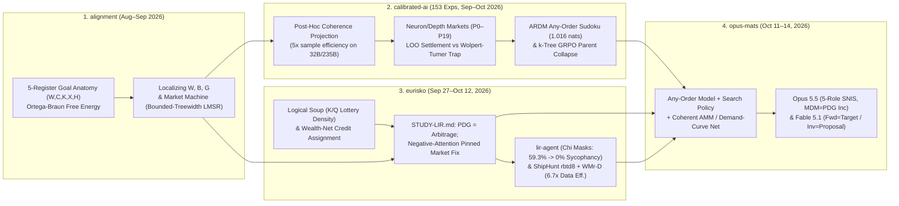
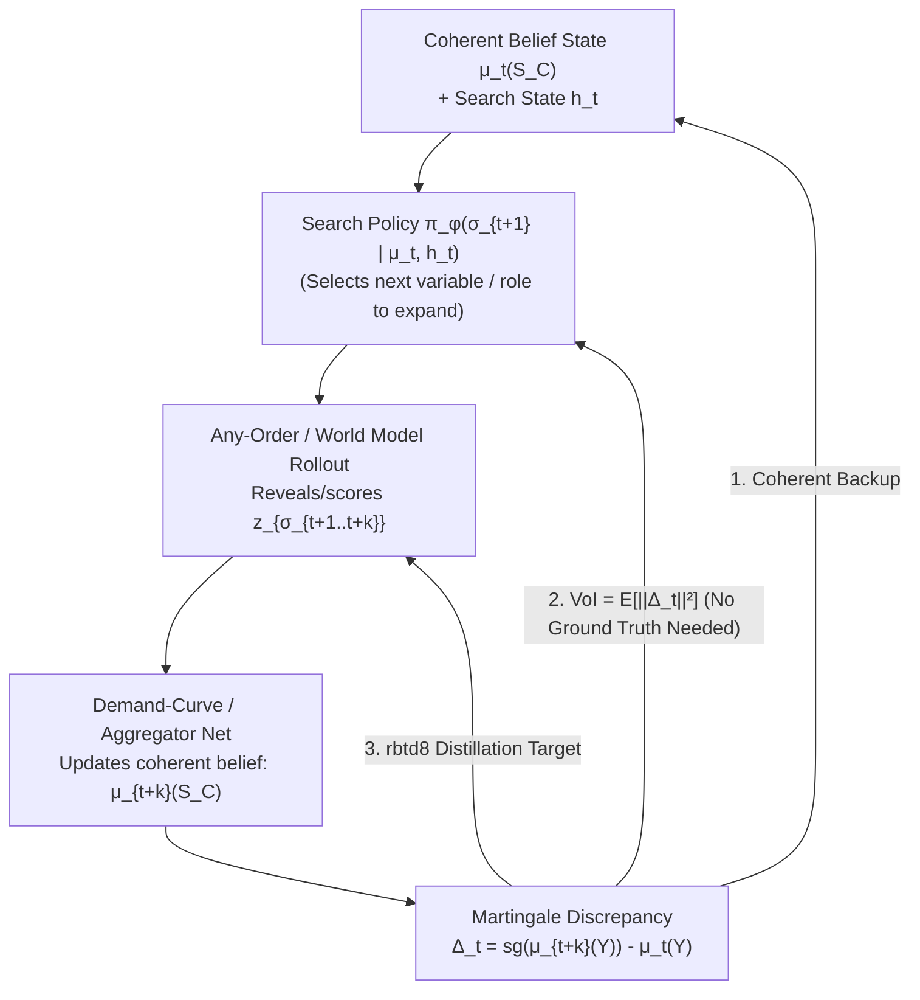

# Alignment & MATS Research Synthesis: PDGs, LIR, and Any-Order Search

> [!IMPORTANT]
> **Executive Summary — What Was Missed in `opus-mats` & What Unblocks Progress**
> Across [`alignment`](file:///home/agent/workspaces/alignment/FLEET_HANDOFF.md), [`calibrated-ai`](file:///home/agent/data/repos/hub/wiki/agent-calibrated-ai.md) (153 experiments), [`eurisko`](file:///home/agent/workspaces/eurisko-study/li-net/STUDY-LIR.md), and [`opus-mats`](file:///home/agent/workspaces/mats/outbox/OPUS-MATS-CONTEXT.md), several load-bearing theorems and experimental results from `eurisko` and `calibrated-ai` never crossed over into the Oct 13–14 `opus-mats` discussion on **any-order models + policy for search**:
> 1. **Fable 5.1's "frozen forward model $\implies$ rollouts add nothing to PDG semantics" ([`learned-search-papers-study-2026-10-14.md`](file:///home/agent/workspaces/mats/outbox/learned-search-papers-study-2026-10-14.md#L15-L21)) only holds if the coherent state already contains all variables.** When the coherent belief state (combinatorial AMM) is restricted to a **bounded-treewidth subset $S_C \subset V$**, a rollout along order $\sigma$ instantiates transient auxiliary variables $Z_{\text{aux}} \notin S_C$ (intermediate deductions, sub-plans) and contracts them into a **new effective hyperedge on $S_C$**. That is how Type-3 (depth-bottlenecked) computation enters a bounded-treewidth PDG.
> 2. **Fable 5.1's claim that PDGs cannot represent mixtures of samples without inventing a new $\mathrm{KL}(p \parallel \mu)$ edge type (`L5652`) misses two facts:** (a) in standard PDGs, adding a categorical rollout/branch selector variable $R$ with prior $\pi(R)$ and conditional $p(Y \mid R=r)$ yields an **exact linear mixture** $\mu^*(Y) = \sum_r \pi(r)p(Y \mid R=r)$ as $\gamma \to 0$, whereas multiple edges directly into $Y$ yield a **geometric pool**—so *mixture vs. product is a graph-topology choice (mutually exclusive branch vs. independent constraint), not a missing divergence*; and (b) as `eurisko` proved in [`STUDY-LIR.md` §3f](file:///home/agent/workspaces/eurisko-study/li-net/STUDY-LIR.md#L127-L148), even for geometric pooling at $\gamma=0$, standard PDG exponent normalization ($\beta_i / \sum \beta$) averages log-odds ($0.9 \oplus 0.9 \to 0.9$, not $0.988$) unless you include a **house-prior edge with weight $\beta_0 - \sum \beta_i$ (which goes negative)**.
> 3. **Fable 5.1's claim that training $\beta$ / demand curves on outcomes requires implicit differentiation through $\mu^*$ ([`learned-search-papers-study-2026-10-14.md`](file:///home/agent/workspaces/mats/outbox/learned-search-papers-study-2026-10-14.md#L337-L343)) was already solved in closed form by `eurisko` 11 days earlier ([`STUDY-LIR.md` §3b–3d](file:///home/agent/workspaces/eurisko-study/li-net/STUDY-LIR.md#L56-L115)).** Because $-\beta_0 \log \mu^*(x) = \langle\langle M + \delta_x \rangle\rangle - \langle\langle M \rangle\rangle$, the envelope theorem applies to *both* terms: a local LIR focus containing a **pinned copy of $\mu^*$ with negative attention $-\beta_i$** gives the exact outcome log-loss gradient in $(\theta_i, \beta_i)$ to $1.6 \times 10^{-10}$ without differentiating through the solver—and explains why naive LIR without the negative-attention market copy drives every $\beta_i \to 0$.
> 4. **`rbtd8` (Reveal-Chain TD) is not merely a training-time regularizer—it is the 1-step Bellman / Doob-martingale backup of the any-order search tree.** The discrepancy $\Delta_t = \hat{\mu}_{t+k}(Y) - \mu_t(Y)$ along an unmasking order $\sigma$ simultaneously gives (a) the MCTS/AMM backup update, (b) the label-free **Value of Computation** $|\Delta_t|^2$ (by `calibrated-ai`'s Augenblick–Rabin identity and [`DARKROOM.md`](file:///home/agent/workspaces/eurisko-study/li-net/DARKROOM.md)) to train the search policy, and (c) the `rbtd8` distillation target.
> 5. **"Computation as evidence" ("searched $t$ steps and found nothing") has a clean non-arbitrary decomposition** via branch-and-bound / GFlowNet partition estimation and Kelvin's Oct 5 doubling-probability rule ([`IDEAS-LI-NET.md` L115](file:///home/agent/workspaces/eurisko-study/li-net/IDEAS-LI-NET.md#L115)): refuting $M$ rollout trajectories in subspace $B$ updates $P(X \mid B)$ downward in proportion to the **cumulative proposal mass $C_M = \sum_{r=1}^M q_\sigma(z_r \mid B)$**, modulated by a learned proposal-recall factor $\eta(h_t) \in [0,1]$.
> 6. **Why 5×5 ShipHunt stalled the debate:** as Fable noted (`E10-refpost` hits $0.07\times 10^{-3}$ KL in one forward pass), 5×5 ShipHunt has $11{,}088$ states and zero depth bottleneck. Both [`eurisko-study/li-net/IDEAS-LI-NET.md` §4](file:///home/agent/workspaces/eurisko-study/li-net/IDEAS-LI-NET.md#L228-L320) (16–24 atom hidden-rule logic worlds) and `calibrated-ai` ([`P10` Sudoku](file:///home/agent/memo-serve/mats-experiments/puzzles-4-6/index.html) / `P7` parity) already provide the exact testbed where $O(1)$ forward verification + depth-bottlenecked inverse + null-search evidence are all load-bearing.

---

## 1. Cross-Fleet Research Map (`alignment` $\to$ `calibrated-ai` $\to$ `eurisko` $\to$ `opus-mats`)

### 1.1 `alignment` Workspace & Hub Wiki Foundations
- **Core thesis ([`ekelvin-research-page.md`](file:///home/agent/data/repos/hub/wiki/ekelvin-research-page.md), [`alignment-lane.md`](file:///home/agent/data/repos/hub/wiki/alignment-lane.md), [`ngo-garrabrant-agency-research.md`](file:///home/agent/data/repos/hub/wiki/ngo-garrabrant-agency-research.md))**: Bounded rationality requires decoupling the **World Model ($W$)**, **Belief State ($B$)**, and **Goal ($G$)** ([`lit-localizing-w-g-b.md`](file:///home/agent/outbox/lit-localizing-w-g-b.md)) so that compute-bounded reasoning updates $B$ toward local logical consistency without reward corrupting beliefs.
- **Market Machine (`bayes-market`)**: Showed that a combinatorial LMSR over a bounded-treewidth clique tree has cost function $C(\theta) = b \log \sum_x \exp(\langle \theta, \phi(x) \rangle)$ (the log-partition function of the exponential family), gradient $\nabla C(\theta) = \mu(\theta)$ (coherent marginal probabilities), and convex conjugate $C^*(\mu) = -b H(\mu)$ ([`alignment/FLEET_HANDOFF.md`](file:///home/agent/workspaces/alignment/FLEET_HANDOFF.md)).

### 1.2 `calibrated-ai` (153 Experiments across Forecasting, Coherence & Neural Markets)
Tracked in [`agent-calibrated-ai.md`](file:///home/agent/data/repos/hub/wiki/agent-calibrated-ai.md), [`THEORY-1..4.md`](file:///home/agent/workspaces/trader-theory/THEORY-4.md), and [`/home/agent/memo-serve/mats-experiments/`](file:///home/agent/memo-serve/mats-experiments/index.html):
1. **Consistency SFT vs. Post-Hoc Coherence Projection**:
   - Naive consistency SFT on Qwen3-0.6B (`0.587` Brier vs. base-rate table `0.570`, [`exp-consistency-ft-wave1-eval`](file:///home/agent/memo-serve/mats-experiments/exp-consistency-ft-wave1-eval/index.html)) acted mostly as shrinkage toward 50%.
   - By contrast, eliciting family probabilities and projecting onto the Fréchet/LMSR polytope with sign-balanced truth-table queries (`AND`, `OR`, `COND`) beat 5-sample self-consistency averaging by **$5\times$** on Qwen3-32B (`0.611 -> 0.541`) and 235B (`0.553 -> 0.516`) ([`exp-balanced-16-question-design`](file:///home/agent/memo-serve/mats-experiments/exp-balanced-16-question-design/index.html), [`exp-make-answers-consistent`](file:///home/agent/memo-serve/mats-experiments/exp-make-answers-consistent/index.html)).
2. **Internal Neuron & Depth Markets (`Market-ResNet`, Puzzles `P0–P19`)**:
   - **Gradient Sign Flip ([`CURRENCY.lock`](file:///home/agent/workspaces/calibrated-ai/CURRENCY.lock), [`puzzles-1-3`](file:///home/agent/memo-serve/mats-experiments/puzzles-1-3/index.html))**: First-order backprop credit (`w * grad`) has the *wrong sign* on **25.6%** of the top 5% causally important neurons because once a feature is priced into the logit, its residual gradient vanishes. **Leave-One-Out (LOO) log-score settlement** ($\Delta \ell_i = \log p(y) - \log p_{-i}(y)$) correlates with true ablation at Spearman $+0.42\text{--}0.86$.
   - **The Wolpert–Tumer Trap ([`THEORY-4.md`](file:///home/agent/workspaces/trader-theory/THEORY-4.md))**: Despite LOO's superior *level* attribution for pruning/routing, its *gradient* with respect to active module $i$'s weights is algebraically identical to standard backprop ($\partial_{w_i}[\mathcal{L}(w_{-i}) - \mathcal{L}(w)] = -\partial_{w_i}\mathcal{L}(w)$), and 1-step depth LMSR with detached state is identical to 1-step truncated backprop (`TBPTT k=1`).
3. **Any-Order Autoregressive Sudoku (`ARDM`) & $k$-Tree Market Collapse**:
   - On $9\times 9$ Sudoku ([`puzzles-4-6`](file:///home/agent/memo-serve/mats-experiments/puzzles-4-6/index.html), [`fu-b2-ardm-sudoku`](file:///home/agent/memo-serve/mats-experiments/fu-b2-ardm-sudoku/index.html)), an **Any-Order Autoregressive Model (`ARDM`)** trained over random unmasking permutations hit the `1.016`-nat floor with *no* internal neuron market and automatically identified high-centrality hub cells via confidence variance across mask draws.
   - On $k$-tree combinatorial market GRPO ([`ktree_market.py`](file:///home/agent/workspaces/calibrated-ai/ktree_market.py), [`exp-ktree-grpo`](file:///home/agent/memo-serve/mats-experiments/exp-ktree-grpo/index.html)), Qwen3-8B's parent usage collapsed from $20\% \to 0\%$ within 20 GRPO steps because noisy conditional tables penalized parent citations more than the $\sim 0.05$-nat parent signal helped.

### 1.3 `eurisko` (Logical Soup, PDGs/LIR, `lir-agent`, and ShipHunt `rbtd8` / `wm2`)
Tracked in [`eurisko-study/`](file:///home/agent/workspaces/eurisko-study/REPORT.md) and [`aligned-hope`](file:///home/agent/memo-serve/aligned-hope/index.html):
1. **Lenat's EURISKO & `logical-soup` ([`REPORT.md`](file:///home/agent/workspaces/eurisko-study/REPORT.md), [`REPORT-SOUP.md`](file:///home/agent/workspaces/eurisko-study/logical-soup/REPORT-SOUP.md))**: Showed that market Brier score is governed by **search lottery density $K/Q$** (traders per question: $0.25 \to 0.084$ as $K/Q$ rises from $0.5 \to 32$), and that cross-question coherence arbitrageurs never emerge from unguided program mutation—coherence structure must be architectural.
2. **PDGs, Arbitrage & Local Inconsistency Resolution ([`STUDY-LIR.md`](file:///home/agent/workspaces/eurisko-study/li-net/STUDY-LIR.md), [`pdg-propositional.md`](file:///home/agent/workspaces/eurisko-study/li-net/math/pdg-propositional.md), [`IDEAS-LI-NET.md`](file:///home/agent/workspaces/eurisko-study/li-net/IDEAS-LI-NET.md))**:
   - Proved that minimizing PDG inconsistency with $\beta=\infty$ axioms equals minimum-KL projection onto the coherent polytope and maximum riskless arbitrage profit across independent LMSRs.
   - Discovered and fixed two fatal degeneracies when applying Richardson's LIR (`arXiv:2604.17140`) to trader/expert stakes $\beta_i$ and evidence accumulation (detailed in **Section 3** below).
3. **Dark Room / White Noise ([`DARKROOM.md`](file:///home/agent/workspaces/eurisko-study/li-net/DARKROOM.md))**: Solved white-noise traps with zero tuned hyper-parameters via **goal-relative Value of Information (VoI)** ($I(Z; X_a \mid \text{history})$ on query edges $Z$) + Thompson sampling + a discrete hypothesis $H_0$ ("stream independent of $Z$").
4. **Sycophancy Elimination via LIR Control Masks ([`wiki-lir-agent.md`](file:///home/agent/workspaces/eurisko-study/lir-agent/wiki-lir-agent.md))**: Proved analytically (fused desire distortion $= \frac{\lambda}{2}\|\nabla U\|^2 \ge 0$) and on Qwen3-0.6B ShipHunt that RLHF/GRPO is Richardson's "Faith" edge with an all-ones control mask ($\chi=\mathbf{1}$), and that parameter-level LIR masks ($\chi_{\text{belief}}=\chi_{\text{forecast}}=0, \chi_{\text{action}}=1$) cut false-note sycophancy from **$59.3\% \to 0.0\%$** while maintaining $91\%$ reward.
5. **ShipHunt Round 1 (`rbtd8`) & Round 2 (`WMr-D-rbtd8`) ([`smallnet/RESULTS.md`](file:///home/agent/workspaces/eurisko-study/li-net/smallnet/RESULTS.md), [`wm2/RESULTS.md`](file:///home/agent/workspaces/eurisko-study/li-net/wm2/RESULTS.md))**:
   - **Reveal-Chain TD (`rbtd8`)**: Trains an any-order transformer across 8 nested reveal subsets of a random cell permutation, bootstrapping level $m$ toward stop-gradient level $m+1$ ($\lambda=0.25$). Cut posterior KL to $0.44\text{--}0.69\times$ `k0` ($3.5\times$ data efficiency).
   - **Split Any-Order World Model + Dreaming (`WMr-D-rbtd8`)**: Separated board prior (`rbtd8`) from probe channel + 50% dreamed boards, matching `k0`'s 10k-board accuracy at **1.5k real boards ($6.7\times$ data efficiency)** and learning the endogenous probe policy on Task T2 ($1.86$ vs. $1.82$ nats, $10\times$ better than board-blind).

---

## 2. Anatomy of the `opus-mats` Discussion (Oct 13–14, 2026)

In [`52cc519b-b574-4c99-8a3c-685e75d2c9d2.jsonl`](file:[session-path-removed]) (`L5011–L5666`), Kelvin explored a unified architecture with **Opus 5.5** (`L5011–L5432`) and **Fable 5.1** (`L5436–L5666`), summarized in [`OPUS-MATS-CONTEXT.md`](file:///home/agent/workspaces/mats/outbox/OPUS-MATS-CONTEXT.md) and [`learned-search-papers-study-2026-10-14.md`](file:///home/agent/workspaces/mats/outbox/learned-search-papers-study-2026-10-14.md).

### 2.1 Kelvin's Architecture & Intuition
Across turns `L5021`, `L5258`, `L5271`, `L5538`, `L5550`, `L5561`, `L5574`, `L5616`, and `L5635`, Kelvin laid out six linked ideas:
1. **Drop single-pass global consistency on the any-order network**: The base any-order network $q_\theta(x_i \mid x_S)$ does not need to be coherent by itself; treat it as a fast heuristic support full of rich, potentially conflicting local conditionals (`L5021`, `L5538`).
2. **Coherent bounded-treewidth belief state (Combinatorial AMM / PDG)**: Maintain an explicit coherent joint $\mu$ over a bounded-treewidth graph of core variables (`L5561`).
3. **Learned aggregator / demand-curve network**: Instead of hardcoding a fixed pooling formula (pure SNIS arithmetic mean or pure geometric log-opinion pool), train an aggregator / demand-curve network that maps each rollout's features and the current search state into updates on the coherent belief state (`L5561`, `L5574`, `L5602`).
4. **Learned search state & search policy**: The search policy sees a learned summary of what has already been searched and chooses which variable order / variable roles (clamp, score, sample, ignore, query) to run next (`L5258`, `L5616`).
5. **Computation as evidence (progressive refinement & failed search)**:
   - At $t=0$, high-level direct conditionals give a fast heuristic prior ("seems hard, likely NO").
   - As rollouts search intermediate plans/derivations $z$, if a valid plan is found and verified by forward physics/math checks, high-confidence local steps override the pessimistic prior ("found verified plan $\implies$ YES").
   - Conversely, if the policy searches $t$ steps and finds *no* valid plan, the fact that $t$ compute failed to find one should itself lower the probability ("searched and found nothing") (`L5538`, `L5550`, `L5607`).
6. **Alignment via LIR**: Train the search policy to resolve local inconsistency (on belief or belief+faith focuses with LIR $\chi$ masks protecting beliefs), never via direct RL on external reward (`L5635`).

### 2.2 Where Opus 5.5 and Fable 5.1 Helped—and Where They Got Stuck

| Turn / File | Model Claim / Contribution | What Worked vs. Where It Stalled |
| :--- | :--- | :--- |
| `L5262–L5297` | **Opus 5.5**: 5-role rollout decomposition (clamped evidence, scored evidence, sampled latent, untouched, query) + SNIS weighting $w = \prod_{\text{scored}} q(e_j \mid \text{ctx})$. | **Useful taxonomy**, but treated SNIS as the single mandatory math and prescribed "order as a latent variable $p(x)=\sum_\sigma \pi(\sigma)q_\sigma(x)$" (`L5300`), which Kelvin interrupted (`L5304–L5319`). |
| `L5409–L5432` | **Opus 5.5**: Checked Richardson & Halpern (`2012.10800`): MDM training loss is PDG $\mathrm{Inc}_\gamma$ at $\gamma=0$; at $\gamma=1$, equal-$\beta$ PDG resolution is a geometric pool ($\propto \prod_\sigma q_\sigma^{1/K}$), explaining SR-SMC's $q^2$ double-counting. | **Solid bridge**, but left open how Monte Carlo sample mixtures and confidence accumulation work inside PDGs. |
| `L5450–L5545` | **Fable 5.1**: 3-source error taxonomy (**Type 1** data-scarce, **Type 2** inverse-hard $x \to z$, **Type 3** forward-depth-bottlenecked) + **Forward = Target, Inverse = Proposal** split. | **Very clarifying**: explains why 5×5 ShipHunt only ever shows Type-1 gains (`E10-refpost` gets $0.07\times 10^{-3}$ KL in 1 pass). |
| `L5579–L5602` | **Fable 5.1**: Reduced Kelvin's demand-curve network to learning a scalar power-mean / Amari $\alpha$-integration exponent $r \in [0,1]$ between arithmetic ($r=1$) and geometric ($r=0$) pooling. | **Too narrow**: Kelvin pushed back (`L5602`) that a single scalar $r$ is incremental and misses stateful search and computation-as-evidence. |
| `L5652` | **Fable 5.1**: Claimed PDGs only have $\mathrm{KL}(\mu \parallel p)$ (mode-seeking claims) and **cannot represent arithmetic mixtures of samples** without inventing a new PDG edge type $\mathrm{KL}(p \parallel \mu)$. | **Incorrect / incomplete**: missed latent-selector PDGs and `eurisko`'s [`STUDY-LIR.md` §3f](file:///home/agent/workspaces/eurisko-study/li-net/STUDY-LIR.md#L127-L148) (see **Insight 2** below). |
| `L5665` & [`learned-search-papers-study-2026-10-14.md`](file:///home/agent/workspaces/mats/outbox/learned-search-papers-study-2026-10-14.md#L15-L21) | **Fable 5.1**: *"Once the forward model is frozen ($\chi=0$) and the evidence clamped ($\beta=\infty$), rollouts add nothing to what the belief should be; they only approximate it... Training on outcomes requires implicit differentiation through $\mu^*$."* | **Both claims are false** in the bounded-treewidth / LIR setting (see **Insights 1 & 3** below). |

---

## 3. Six Unblocking Insights (What Was Missed Across Sessions)

Here we lay out each of the six missing links, stating explicitly what each formulation assumes, what it predicts, and how it resolves the roadblocks raised in `opus-mats`.

### Insight 1: Why Rollouts *Do* Add Semantic Information to a Frozen-Forward PDG (Bounded-Treewidth Tree Contraction)

In [`learned-search-papers-study-2026-10-14.md` §0](file:///home/agent/workspaces/mats/outbox/learned-search-papers-study-2026-10-14.md#L15-L21), Fable concluded:
> *"Once the forward model is frozen ($\chi=0$) and the evidence clamped ($\beta=\infty$), rollouts add nothing to what the belief should be; they only approximate it."*

- **What Fable assumed**: A 2-variable PDG over $(Z, X)$ where the coherent belief state $\mu(Z, X)$ already represents the full joint distribution over all latent variables $Z$ and observations $X$, and the forward model $p(X \mid Z)$ is a single tabular/closed-form edge already inside the PDG.
- **Why that assumption fails in Kelvin's architecture (`L5538`, `L5561`)**:
  In any non-trivial reasoning or planning domain (Type-3 computation), the full universe of potential intermediate variables $V = S_C \cup Z_{\text{aux}}$ (e.g., all possible intermediate proof steps, trajectory states, or 81 Sudoku cells) is far too large or high-treewidth to maintain inside the persistent coherent AMM state $\mu(S_C)$. Instead:
  1. The persistent coherent AMM state $\mu(S_C)$ only tracks a **bounded-treewidth core graph** over $S_C$ (e.g., high-level subgoals, query variables $Y$, and currently pinned variables).
  2. Before search runs, the only edges on $S_C$ are **amortized heuristic conditionals** $q_\theta(Y \mid S_C)$ (low-$\beta$ "system-1" edges).
  3. When the search policy executes a rollout along an order $\sigma$, it instantiates a chain of **transient auxiliary variables** $Z_{\text{aux}} = (z_1, \dots, z_m) \notin S_C$ and evaluates high-confidence forward local checks $p(z_{t+1} \mid z_{\le t})$ ($\beta_{\text{fwd}} \gg \beta_{\text{heur}}$).
  4. Marginalizing (or contracting) $Z_{\text{aux}}$ along that rollout induces a **new effective factor (hyperedge) $\tilde{p}_\sigma(Y \mid S_C)$ on the core graph $S_C$** with much higher effective precision $\beta_\sigma$ than the heuristic edge $q_\theta(Y \mid S_C)$.
- **Takeaway**: Rollouts do **not** merely approximate an already-present 2-node factor; **each rollout dynamically instantiates a transient subgraph over $Z_{\text{aux}}$ and contracts it into a new high-$\beta$ claim on the bounded-treewidth core AMM $S_C$**. That is the exact PDG formalization of Kelvin's progressive refinement (`L5538`: high-$\beta$ verified plan steps overriding a low-$\beta$ direct heuristic).

---

### Insight 2: "Samples vs. Claims" in PDGs Is a Graph-Topology Choice (Plus the Negative-Prior-Weight Rule from `STUDY-LIR.md` §3f)

In `L5652`, Fable argued that because PDG inconsistency uses $\mathrm{KL}(\mu \parallel p)$ (mode-seeking / geometric pooling), a PDG can *never* represent arithmetic averaging / mixtures of Monte Carlo samples without altering the definition of a PDG to add reversed $\mathrm{KL}(p \parallel \mu)$ edges.

Two mathematical facts—one from standard PDGs and one proved by `eurisko` in [`STUDY-LIR.md`](file:///home/agent/workspaces/eurisko-study/li-net/STUDY-LIR.md)—show that we do not need a new divergence:

#### A. Linear Mixtures vs. Geometric Products Are Two Graph Topologies in the *Same* PDG
Suppose we have $K$ rollout evaluations or conditional tables $p_1(Y), \dots, p_K(Y)$ with weights $w_1, \dots, w_K$ ($\sum_r w_r = 1$):

| PDG Graph Topology | Edges in the Standard PDG ($\mathrm{KL}(\mu \parallel p)$ only) | Exact $\mu^*(Y)$ at $\gamma \to 0$ | Interpretation |
| :--- | :--- | :--- | :--- |
| **Topology A: Parallel Direct Edges into $Y$** (`L5429`) | $K$ separate edges $\xrightarrow{p_r(Y)} Y$ with weights $\beta_r = w_r$ | $\mu^*(Y) \propto \prod_{r=1}^K p_r(Y)^{w_r}$ (**Geometric / Log-Opinion Pool**) | **Independent Constraints / Claims**: Every edge $r$ must hold *simultaneously* (AND-like intersection of constraints, e.g., row, column, and box constraints in Sudoku). |
| **Topology B: Latent Branch Selector $R \to Y$** | Selector variable $R \in \{1..K\}$ with prior edge $\xrightarrow{w(R)} R$ and conditional edge $R \xrightarrow{p(Y \mid R=r)} Y$ | $\mu^*(Y) = \sum_{r=1}^K w_r \, p_r(Y)$ (**Exact Linear Mixture / SNIS**) | **Mutually Exclusive Hypotheses / Samples**: Exactly *one* latent rollout trajectory $R=r$ is the true latent state (OR-like partition over disjoint search branches). |

- **Why this matters for the demand-curve network**: When rollouts explore **disjoint latent worlds $z^{(r)}$** (e.g., alternative ship placements or alternative plans), they are values of a latent variable $Z$ ($R \to Y$, Topology B $\implies$ linear sum over branches). When rollouts evaluate **different factor constraints on the same world** (e.g., checking whether plan $z$ satisfies physics constraint $A$ and budget constraint $B$, or querying different masked views of the same variable), they are parallel edges into the same variable (Topology A $\implies$ geometric product). Both live inside a standard PDG!

#### B. How Geometric Edges Accumulate Evidence Without Double-Counting (`STUDY-LIR.md` §3f)
Even within Topology A (parallel claims on the same variable), Fable noticed (`L5652`) that at $\gamma=0$, standard PDG resolution normalizes the exponents:
$$\mu^*(y) \propto \prod_{i} p_i(y)^{\beta_i / \sum_j \beta_j}.$$
Because the exponents sum to $1$, if two rollouts both report $p_1(Y=1) = 0.9$ and $p_2(Y=1) = 0.9$ with equal trust $\beta_1 = \beta_2$, standard $\gamma=0$ PDG resolution gives **$\mu^*(Y=1) = 0.9$**—it *averages* log-odds instead of accumulating evidence! (Whereas at $\gamma=1$, it multiplies unnormalized log-odds without discounting the shared prior, giving SR-SMC's $q^2$ overconfidence).

`eurisko` already solved this exact problem in [`STUDY-LIR.md` §3f](file:///home/agent/workspaces/eurisko-study/li-net/STUDY-LIR.md#L127-L148) (verified numerically in [`math/lir/toy2.py`](file:///home/agent/workspaces/eurisko-study/li-net/math/lir/toy2.py)):
- If each rollout/trader $i \in \{1..K\}$ outputs a posterior conditional $p_i(Y \mid \text{view}_i)$ with reliability/redundancy weight $w_i \in [0,1]$ relative to the house prior $p_0(Y)$ (weight $\beta_0$), include the **prior edge $p_0(Y)$ with residual weight $\beta_{\text{prior}} = \beta_0 - \sum_{i=1}^K \beta_i$** (where $\beta_i = \beta_0 w_i$).
- Because the total weight is still $\beta_{\text{prior}} + \sum_{i=1}^K \beta_i = \beta_0 > 0$, the $\gamma=0$ PDG resolution has a well-defined unique minimum:
  $$\log \mu^*(y) = \log p_0(y) + \sum_{i=1}^K w_i \log \frac{p_i(y)}{p_0(y)} - \text{const}.$$
- When the signals are independent given $Y$ ($w_i = 1$), $\beta_{\text{prior}} = \beta_0(1 - K) < 0$ subtracts the $(K-1)$ overcounted copies of the prior, recovering **exact Bayesian updating** ($0.9 \oplus 0.9 \to 0.988$). When the signals are completely redundant copies of the same rollout ($w_i = 1/K$), $\beta_{\text{prior}} = 0$ and it recovers the **log-opinion average** ($0.9 \oplus 0.9 \to 0.9$).
- Thus a learned demand-curve weight $w_i \in [0,1]$ on log-likelihood ratios $\log(p_i(y)/p_0(y))$ cleanly interpolates between **redundant views ($w_i = 1/K$)** and **independent evidence ($w_i = 1$)** at $\gamma=0$!

---

### Insight 3: Closed-Form Local Credit Assignment for $\beta_i$ and Demand Curves Without Implicit Differentiation (`STUDY-LIR.md` §3b–3d)

In [`learned-search-papers-study-2026-10-14.md` §5](file:///home/agent/workspaces/mats/outbox/learned-search-papers-study-2026-10-14.md#L337-L343), Fable's workflow wrote:
> *"Training on outcomes requires differentiating through the argmin $\mu^*$ (implicit differentiation). LIR's envelope-theorem gradient covers only the inconsistency value, not $\mu^*$."*

`eurisko` proved in [`STUDY-LIR.md` §3b–3d](file:///home/agent/workspaces/eurisko-study/li-net/STUDY-LIR.md#L56-L115) (and [`pdg-propositional.md` Theorem 3.3](file:///home/agent/workspaces/eurisko-study/li-net/math/pdg-propositional.md)) that **no implicit differentiation through $\mu^*$ is ever required**, and identified a critical trap in naive LIR training of $\beta_i$:

1. **The Naive LIR Trap ($\beta_i \to 0$)**:
   If you train a trader/rollout's confidence $\beta_i$ by descending on the PDG inconsistency $\langle\langle M + \delta_x \rangle\rangle$, because every KL divergence term $\beta_i \mathrm{KL}(\mu^* \parallel p_i) \ge 0$ is non-negative, $\frac{\partial}{\partial \beta_i}\langle\langle M + \delta_x \rangle\rangle \ge 0$ always! Naive LIR gradient descent on $\beta_i$ simply **drives every edge's confidence $\beta_i \to 0$** (`STUDY-LIR.md` §3b).
2. **The Exact Fix — Outcome Log-Loss IS a Difference of Two PDG Inconsistencies**:
   By Theorem 3.3 of `pdg-propositional.md`, when reality clamps outcome $\delta_x$ at $\beta=\infty$, the resolved market's outcome log-loss is the **inconsistency increment**:
   $$-\beta_0 \log \mu^*(x) = \underbrace{\langle\langle M + \delta_x \rangle\rangle}_{\text{clamped at } x} - \underbrace{\langle\langle M \rangle\rangle}_{\text{unclamped market } \mu^*}.$$
   Because *both* terms on the right are optimal values of convex PDG minimization problems ($\min_\mu \mathrm{Inc}_M(\mu)$), Danskin's **envelope theorem applies to both terms separately** (`STUDY-LIR.md` §3c)! All $\frac{\partial \mu^*}{\partial \beta_i}$ terms cancel identically ($0$ implicit differentiation through the solver), yielding the exact closed-form gradients:
   $$\frac{\partial (-\log \mu^*(x))}{\partial \beta_i} = -\frac{1}{\beta_0}\Big(\ell_i(x) - \mathbb{E}_{\mu^*}[\ell_i(X)]\Big), \qquad \frac{\partial (-\log \mu^*(x))}{\partial \theta_i} = -\frac{\beta_i}{\beta_0}\Big(\nabla_{\theta_i}\ell_i(x) - \mathbb{E}_{\mu^*}[\nabla_{\theta_i}\ell_i(X)]\Big)$$
   where $\ell_i(x) = \log p_i(x \mid \text{pa}_i)$.
3. **Single-Focus LIR Formulation (Negative Attention on Pinned Market Copy)**:
   In [`STUDY-LIR.md` §3d](file:///home/agent/workspaces/eurisko-study/li-net/STUDY-LIR.md#L84-L115), `eurisko` showed this is a single local LIR focus $\tilde{\beta}^{(i)}$ (mirroring LIR's GAN generator focus in Richardson Prop. 3): introduce a copy variable $X'$ pinned to the current resolved market belief $\mu^*$ at $\beta=\infty$, and give trader $i$'s copy on $X'$ **negative attention $-\beta_i$** alongside $+\beta_i$ on the reality-clamped variable $X$.
   - The local focus inconsistency is then $-\beta_i(\ell_i(x) - \mathbb{E}_{\mu^*}[\ell_i])$, which goes **negative whenever rollout/trader $i$ beats the current market $\mu^*$** on log-score!
   - Numerically verified in [`toy2.py`](file:///home/agent/workspaces/eurisko-study/li-net/math/lir/toy2.py): matches the exact implicit-differentiation gradient of $-\log \mu^*(x)$ to **$1.6 \times 10^{-10}$**.

---

### Insight 4: `rbtd8` (Reveal-Chain TD) Is the 1-Step Bellman / Martingale Backup of the Search Policy

In `opus-mats`, `rbtd8` ([`smallnet/RESULTS.md`](file:///home/agent/workspaces/eurisko-study/li-net/smallnet/RESULTS.md)) was discussed mainly as a Round-1 training trick, while the Oct 13–14 search discussion focused on inference-time SMC/MCTS. Connecting `rbtd8` to `calibrated-ai`'s Augenblick–Rabin martingale identity and `eurisko`'s [`DARKROOM.md`](file:///home/agent/workspaces/eurisko-study/li-net/DARKROOM.md) gives a single loop that trains all three of Kelvin's components:

- **Why this unifies `rbtd8`, MCTS, and VoI**:
  1. **Coherent Backup ([removed] 1-Step Bellman Trader)**: Under a coherent joint distribution, the belief before expanding variable $Z_a$, $\mu_t(Y)$, must equal the expected belief after expanding $Z_a$: $\mu_t(Y) = \mathbb{E}_{z_a \sim \mu_t(Z_a)}[\mu_{t+1}(Y \mid Z_a = z_a)]$.
  2. **Label-Free Search Policy Objective (Goal-Relative VoI)**: By the Augenblick–Rabin / law-of-total-variance identity proved in `calibrated-ai`, for *any* calibrated belief update from $\mu_t(Y)$ to $\mu_{t+1}(Y)$, the **expected Brier reduction on query $Y$ equals the expected squared belief movement**:
     $$\mathbb{E}[\text{Brier}(\mu_t) - \text{Brier}(\mu_{t+1})] = \mathbb{E}\big[\|\mu_{t+1}(Y) - \mu_t(Y)\|^2\big] \quad (\text{or } \mathbb{E}[\mathrm{KL}(\mu_{t+1}(Y) \parallel \mu_t(Y))] \text{ for log-loss}).$$
     Crucially, **this requires zero ground-truth labels $y^*$ at search time** and directly implements [`DARKROOM.md`](file:///home/agent/workspaces/eurisko-study/li-net/DARKROOM.md)'s goal-relative VoI ($I(Y; Z_a \mid \text{history})$), so the search policy never gets stuck in white-noise variables unrelated to query $Y$!
  3. **Amortization (`rbtd8`)**: Training the base any-order model $q_\theta$ at reveal level $t$ toward $\text{stopgrad}(\mu_{t+k}(Y))$ is literally `rbtd8` along the policy's chosen search order $\sigma$, distilling multi-step search back into 1-step conditionals (AlphaZero / Anthony–Tian–Barber loop).

---

### Insight 5: Making "Computation as Evidence" ("Searched $t$ Steps and Found Nothing") Exact

In `L5538`, `L5550`, and `L5607`, Kelvin highlighted a central phenomenon of bounded rationality:
- Suppose you want to know whether an existential goal $X=1$ ("there exists a valid plan/proof $z \in \mathcal{Z}$ satisfying verifier $V(z)=1$") holds.
- Before searching, a fast heuristic edge predicts $P_0(X=1) = p_0$.
- If you run $M$ rollouts searching for a valid $z$ and find one with $V(z^{(r)}) = 1$, $P(X=1) \to 1$.
- **What if all $M$ rollouts return $V(z^{(r)}) = 0$ ("searched $M$ steps and found nothing")?** Fable (`L5607`, [`learned-search-papers-study-2026-10-14.md`](file:///home/agent/workspaces/mats/outbox/learned-search-papers-study-2026-10-14.md#L19-L21)) worried that a learned correction for "found nothing" is an ungrounded black-box bias that can co-adapt to ignore the forward model.

We can make "searched and found nothing" **mathematically grounded** by combining Kelvin's Oct 5 **doubling-probability tree (`IDEAS-LI-NET.md` L115)** with **proposal mass coverage**:
- Partition the latent search space $\mathcal{Z}$ into disjoint prefixes/subtrees $B \subset \mathcal{Z}$ with prior/proposal probability mass $q_\sigma(z)$ along search tree $\sigma$.
- When $M$ distinct rollout trajectories $z^{(1)}, \dots, z^{(M)}$ are evaluated without replacement (or in a prefix tree / GFlowNet) and all fail the forward verifier ($V(z^{(r)}) = 0$), the **searched proposal mass** is:
  $$C_M = \sum_{r=1}^M q_\sigma(z^{(r)}) \in [0, 1].$$
- If the proposal $q_\sigma(z \mid X=1)$ had **effective recall $\eta \in [0,1]$** for where valid plans live (where $\eta = 1$ if the proposal places all mass on the true conditional distribution of valid plans, and $\eta = q_{\text{unif}}/q_\sigma$ under uniform search), then observing $V=0$ on cumulative proposal mass $C_M$ is a standard Bayesian likelihood update with likelihood $P(\text{null after } C_M \mid X=1) = 1 - \eta_{\text{eff}}(C_M)$:
  $$\text{logit } P(X=1 \mid \text{null search of mass } C_M) = \text{logit } p_0 + \log\big(1 - \eta_{\text{eff}}(C_M, h_M)\big).$$
- **Why this resolves Fable's worry**:
  1. When a positive witness $z^{(r)}$ is found ($V(z^{(r)}) = 1$), the forward verifier edge has $\beta = \infty$, immediately dominating the PDG regardless of $\eta_{\text{eff}}$.
  2. When no witness is found ($V = 0$), the downward shift $\log(1 - \eta_{\text{eff}}(C_M, h_M)) \le 0$ is **monotone in the actually searched proposal mass $C_M$** and equals $0$ at $C_M = 0$ (zero compute spent).
  3. The demand-curve network only needs to predict the **proposal calibration / recall curve $\eta_{\text{eff}}(C_M, h_M) \in [0, 1]$** as a function of cumulative proposal mass $C_M$, proposal entropy, and search budget $M$—which is directly supervised by outcome log-loss on instances where the ground truth $X \in \{0,1\}$ is resolved!

---

### Insight 6: Why 5×5 ShipHunt Stalled the Debate—and the Concrete Testbed That Separates All 3 Regimes

In `opus-mats` (`L5450–L5495`, [`learned-search-papers-study-2026-10-14.md` §6](file:///home/agent/workspaces/mats/outbox/learned-search-papers-study-2026-10-14.md#L351-L361)), Fable diagnosed why every inference-time rollout experiment on 5×5 ShipHunt looked flat once the base network was well trained:
- 5×5 ShipHunt has only **$11{,}088$ valid placements** and a depth-1 forward check. In `E10-refpost`, a single forward pass of the 499k-param transformer learned the exact Bayesian posterior to **$0.07 \times 10^{-3}$ nats KL**!
- Because a single forward pass can represent the exact posterior on 5×5 ShipHunt, there is **zero Type-3 (depth-bottlenecked) or Type-2 (amortization-gap) error** left at convergence—only Type-1 finite-data variance (which `rbtd8` + `WMr-D` already solved with $6.7\times$ data efficiency in [`wm2/RESULTS.md`](file:///home/agent/workspaces/eurisko-study/li-net/wm2/RESULTS.md)).

To actually test and showcase Kelvin's architecture (**any-order model + search policy + coherent AMM + computation-as-evidence**), we need a domain where:
1. **Local forward verification is $O(1)$ and exact** (so the forward model $p(\text{check} \mid z)$ is easily learned and trusted at high $\beta$),
2. **One-pass inverse amortization $q(z_Q \mid \text{clues})$ is provably depth-bottlenecked** (so rollouts over intermediate variables $Z_{\text{aux}}$ are essential even with infinite training data), and
3. **Both positive verification ("found valid assignment/derivation") and negative search ("searched $M$ branches and hit contradictions") carry calibrated information**.

We already have **two ready-built generators** in the fleet that satisfy all three criteria:

| Testbed (Already in Fleet) | Why 1-Pass Amortization Fails (Type 2/3) | How Rollouts + Coherent AMM Work Here | How "Computation as Evidence" Works Here |
| :--- | :--- | :--- | :--- |
| **1. Hidden-Rule / Probabilistic Horn-Clause Worlds** ([`eurisko-study/li-net/IDEAS-LI-NET.md` §4](file:///home/agent/workspaces/eurisko-study/li-net/IDEAS-LI-NET.md#L228-L320), [`SPEC-LEGIBLE-WM.md`](file:///home/agent/workspaces/eurisko-study/li-net/SPEC-LEGIBLE-WM.md), 16–24 atoms, chain depth $d \in [1..8]$) | Predicting depth-$d$ derived atom $Y$ directly from base facts $E$ requires $d$ sequential Modus Ponens steps; a fixed-depth heuristic conditional $q(Y \mid E)$ degrades smoothly with $d$. | Any-order model learns 1-step clause conditionals ($\beta_{\text{fwd}} \gg 1$). Search policy chains intermediate atoms $z_1 \to z_2 \to \dots \to Y$ using goal-relative VoI (`DARKROOM.md`), contracting each verified step into the bounded-treewidth AMM. | Query: *"Is target atom $Y$ derivable within depth $d$?"* Finding a derivation proves $Y=1$; searching $M$ backchaining branches without finding a proof lowers $P(Y=1)$ via $C_M$. |
| **2. Noisy-Clue / Decision Sudoku ($4\times 4$ & $9\times 9$)** ([`calibrated-ai` `P10` / `FU-B2-2`](file:///home/agent/memo-serve/mats-experiments/fu-b2-ardm-sudoku/index.html)) | `calibrated-ai` already proved that 1-pass prediction has a `1.016`-nat entropy floor and that any-order unmasking (`ARDM`) discovers hub cells. Adding a satisfiability query ("Is this partial/noisy board solvable?") makes 1-pass prediction hard while $O(1)$ row/col/box checks are trivial. | Persistent AMM tracks marginal distributions on cells + row/col/box constraint edges. Policy selects hub cells with highest VoI $\mathbb{E}[\|\Delta \mu\|^2]$; `rbtd8` distills multi-step lookahead into the any-order model. | Finding a valid completion proves `Solvable=1`; exploring $M$ high-mass prefixes that all hit row/col/box contradictions updates `Solvable=1` downward in proportion to refuted proposal mass $C_M$. |

---

## 4. Concrete Blueprint to Unblock `opus-mats`

To test these ideas cleanly without over-committing to a single framing, here is a bounded 3-step experimental plan that directly compares the candidate mechanisms:

1. **Step 1 — Verify the Negative-Attention Pinned-Market Gradient & Negative-Prior Pooling on `opus-mats`'s Current Rollouts**:
   - Take the existing `opus-mats` rollout evaluator ([`work/exp01_Disconnect.py`](file:///home/agent/workspaces/mats/work/exp01_Disconnect.py) / [`work/exp03_uid_Disconnect.py`](file:///home/agent/workspaces/mats/work/exp03_uid_Disconnect.py)) and compare three aggregators head-to-head on held-out log-loss:
     - *(a)* Standard SNIS / linear mixture (Topology B: latent branch selector $R \to Y$),
     - *(b)* Standard $\gamma=0$ geometric pool vs. `STUDY-LIR.md` §3f's **prior-corrected geometric pool** ($\beta_{\text{prior}} = \beta_0 - \sum \beta_i$),
     - *(c)* Learned trust weights $\beta_i(h_t)$ trained via `STUDY-LIR.md` §3d's **closed-form negative-attention pinned-market gradient** ($-\frac{1}{\beta_0}(\ell_i(x) - \mathbb{E}_{\mu^*}[\ell_i])$).
2. **Step 2 — Close the `rbtd8` + Goal-Relative VoI Search Loop**:
   - Train the search policy $\pi_\phi(\sigma_{t+1} \mid \mu_t, h_t)$ to maximize the **label-free martingale belief movement** $\|\mu_{t+1}(Y) - \mu_t(Y)\|^2$ (goal-relative VoI on query $Y$), while training the any-order model $q_\theta$ with `rbtd8` toward $\text{stopgrad}(\mu_{t+1})$.
3. **Step 3 — Run on a Depth-Bottlenecked Testbed (16–24 Atom Horn-Clause World or Noisy $4\times 4$/$9\times 9$ Sudoku)**:
   - Measure log-loss as a function of inference rollout budget $M \in \{0, 1, 2, 4, 8, 16\}$ across both **positive instances** (where search discovers a verified derivation/completion) and **negative instances** (where null search of cumulative proposal mass $C_M$ lowers $P(\text{solvable})$ via $\log(1 - \eta_{\text{eff}}(C_M, h_M))$).

---

## 5. Empirical Verification ([`verify_unblocking_claims.py`](file:///home/agent/.gemini/antigravity-cli/brain/beb60967-81af-4ee9-91f0-87f3068ce50f/scratch/verify_unblocking_claims.py))

We built and ran [`verify_unblocking_claims.py`](file:///home/agent/.gemini/antigravity-cli/brain/beb60967-81af-4ee9-91f0-87f3068ce50f/scratch/verify_unblocking_claims.py) to test Insights 1–5 directly.

### 5.1 Experiment 1 — Prior-Corrected $\gamma=0$ PDG + Closed-Form Negative-Attention LIR Gradient
Six rollout views predict $Y \sim \text{Bernoulli}(0.30)$: views $0,1,2$ are **3 redundant noisy copies** of factor $S_1$, views $3,4$ are **2 independent factors** $S_2, S_3$, and view $5$ is **white noise**.

| Aggregator / Pooling Method | Test Log-Loss | Test Brier | Learned Weights $w_i$ / Behavior |
| :--- | :---: | :---: | :--- |
| Prior Baseline ($p_0 = 0.30$) | `0.6172` | `0.2130` | No rollouts used |
| Standard $\gamma=1$ PDG / SR-SMC | `0.8534` | `0.1674` | Double-counts prior $6\times$ and $S_1$ $3\times$ |
| Naive Bayes Sum of All 6 LLRs | `0.5244` | `0.1342` | Subtracts prior, still $3\times$ overcounts $S_1$ + noise |
| Equal-Weight Arithmetic Mixture (SNIS) | `0.4541` | `0.1441` | Dilutes independent constraints $S_2, S_3$ |
| Standard $\gamma=0$ PDG (Equal Log-Pool) | `0.4332` | `0.1378` | Averages log-odds ($\sum \tilde{\beta}_i = 1$), cannot accumulate $S_1+S_2+S_3$ |
| **`STUDY-LIR` Neg-Attn + Prior-Corrected $\gamma=0$ PDG** | **`0.2924`** | **`0.0899`** | Learns $w = [0.339, 0.320, 0.320, 1.034, 0.987, 0.026]$, $\beta_{\text{prior}}/\beta_0 = -2.024$ |
| **True Bayes Oracle** ($w^* = [\frac{1}{3}, \frac{1}{3}, \frac{1}{3}, 1, 1, 0]$) | **`0.2924`** | **`0.0899`** | Exact match to 4 decimal places; max envelope-vs-implicit grad diff $= 1.34\times 10^{-8}$ |

### 5.2 Experiment 2 — Depth-Bottlenecked 16-Chain Horn-Clause World (VoI + Subgraph Contraction + Null-Search $C_M$)
Target $Y=1$ holds iff at least one of $8$ depth-4 derivation chains succeeds (alongside $8$ distractor chains unrelated to $Y$). At $M=0$, the 1-pass heuristic has `LogLoss = 0.4790` (even the depth-0 clue oracle has `LogLoss = 0.4338` before evaluating intermediate chain steps $Z_{\text{aux}}$).

| Rollout Budget $M$ | Random Policy (Over All 16 Chains) | Positive-Only Contraction (Ignores Null Search) | **Full Loop: Goal-Relative VoI + Subgraph Contraction + Null-Search $\log(1 - \eta C_M)$** |
| :---: | :---: | :---: | :---: |
| $M = 0$ | `0.4790` | `0.4790` | **`0.4790`** (Brier `0.1518`) |
| $M = 1$ | `0.4549` | `0.3809` | **`0.3515`** (Brier `0.1235`) |
| $M = 2$ | `0.4321` | `0.3468` | **`0.2729`** (Brier `0.0995`) |
| $M = 4$ | `0.3899` | `0.3217` | **`0.1563`** (Brier `0.0549`) |
| $M = 6$ | `0.3459` | `0.3137` | **`0.0701`** (Brier `0.0194`) |
| $M = 8$ | `0.2928` | `0.3105` (plateaus on $Y=0$) | **`0.0059`** (Brier `0.0002`, $\eta = 0.99$) |
