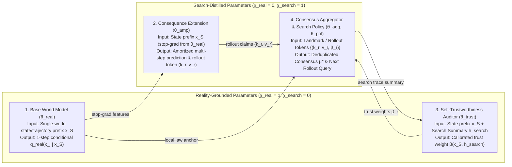

# Inconsistency Is All You Need

*Coherent beliefs from rollouts that disagree: policy-independent beliefs over a factored world model*

**Research direction note. Kelvin Azevedo Santos, MATS autumn 2026 (mentor: Deger Turan, Metaculus). Drafted with the Gemini Argon agent; edited. Status: proposal with early evidence, see the section below.**

---

## Executive Abstract

Current foundation models conflate three distinct computational roles inside a single autoregressive parameter set and a single linear context window: **(1) the World Model** (what is true or lawful about the environment), **(2) the Search and Aggregation Policy** (which intermediate variables or counterfactual trajectories to evaluate next, and how to combine them), and **(3) Utility or Alignment Preferences** (which outcomes to steer toward). Because chain-of-thought reasoning appends all intermediate search steps into one serial context window of length $N$, test-time compute scales linearly before saturating context capacity, and reinforcement learning on outcomes directly mutates the model's underlying beliefs (producing sycophancy, reward hacking, and delusional planning when searching over an imperfect world model).

We propose a factored architecture and training framework that cleanly separates these roles while generalizing **(a) standard autoregressive Transformers**, **(b) AlphaZero / MuZero Monte Carlo Tree Search (MCTS)**, and **(c) belief-network + update-equivalence search for imperfect-information games (e.g., Ataraxos)**. The architecture pairs an **Any-Order World Model** ($q_\theta$) with a **Consensus Memory & Attention Aggregator** that scales test-time compute in two dimensions—running $k$ parallel or tree-forked rollouts of bounded context length $n$ ($O(k \cdot n)$ compute with $O(n)$ context memory per rollout).

Our central mathematical requirement is **Policy-Independent Consensus**: for any fixed world model and modular utility function, the optimization target of search is defined as the unique minimizer $\mu^*$ of the world model's **Probabilistic Dependency Graph (PDG) Inconsistency Energy**. As a consequence, the asymptotic consensus depends *only* on the world model's local constraints and the modular utility factor—never on the initial search policy's priors or sampling biases. Achieving policy-independence requires the aggregator to **deduplicate redundant rollout information** (projecting onto the span of discovered constraints rather than naively averaging rollout outputs), while **Local Inconsistency Resolution (LIR) parameter masks** establish a duality between *internalizing simulated search consequences* and *auditing search trustworthiness against reality*.

---

## Evidence so far (pre-registered, audited; 15-16 Oct 2026; full write-up at mats.ekelvin.com/experiments)

- **Stiffness is learnable, but it is the model's own entropy.** On a permuted cellular-automaton grid the stiffness head ranks conditioning sets by exact information gain with Spearman 0.92-0.95 (AUC 0.85-0.87 for true local blankets); plain predictive entropy ranks them equally (0.93-0.95), and so does a one-step self-consistency score (0.697 vs 0.700 at predicting epistemic error).
- **Search beats one pass only in a window.** With the local law learned and the query beyond one-pass depth, chains cut KL to the exact posterior by 13-31% (CA bridges and forward queries) and 46% (6x6 Sudoku, confidence-first); where one pass is already near-exact, every search arm hurts. Stiffness-guided and VoI routing did not beat random order on bridges; VoI over stiff cells gave the best forward gains (31%).
- **Aggregation.** An unanchored stiffness-weighted log pool is harmful; a one-pass-anchored convex pool makes most search arms beat one pass. Learned linear-transformer aggregators over vector rollout tokens matched, but did not beat, the anchored mixture (5 of 6 pre-registered checks failed).
- **Key fingerprints deduplicate.** Source-attention keys cut redundant-view drift by 95-98% and separate forward from backward evidence (cosine 0.95 to about 0) once the target's hidden state is removed from the key.
- **"Searched and found nothing" is calibrated evidence** on deep-contradiction Sudoku boards (one pass fooled at 1.84 nats; null search with a recall floor cuts it by >99%); refuted believed mass did not beat a count of refuted chains.
- **Honesty under RL (LIR control masks, toy):** keeping belief parameters out of the reward's control cut false-note sycophancy from 59.3% to 0.0% at 91% of the reward.

---

## 1. Core Architectural Decomposition & LIR Parameter Separation

Let $V = \{1, \dots, M\}$ denote the variables of a domain (observed states $O$, latent/hidden world variables $Z$, actions $A$, and future outcomes/values $Y$). Instead of training a single monolithic network on mixed reality and search gradients, we partition a shared Transformer representation into four parameter blocks governed by **Local Inconsistency Resolution (LIR) control masks** $\chi \in \{0, 1\}$, which strictly dictate which training signals may update which parameters:

### The Duality Between Consequence Distillation ($\theta_{\text{amp}}$) and Self-Trustworthiness ($\theta_{\text{trust}}$)

A foundational tension in self-play and learned world models is that **distilling search conclusions back into the model is necessary to internalize multi-step consequences**, yet training a world model on its own search outputs risks self-amplifying delusions away from reality. Our parameter split resolves this via a strict structural duality:

| Parameter Block | Input Conditioning | Training Signal (LIR Mask $\chi$) | Functional Role |
| :--- | :--- | :--- | :--- |
| **1. Base World Model ($\theta_{\text{real}}$)** | Single-world partial assignment $x_S = \{(v_1, x_1), \dots, (v_m, x_m)\}$ | **Real-world data only** ($\chi_{\text{real}}=1, \chi_{\text{search}}=0$) | Learns the reality-only local rules/physics of the environment $q_{\text{real}}(x_i \mid x_S)$. Never sees search tree addresses, other rollouts, or utility weights. |
| **2. Consequence Extension ($\theta_{\text{amp}}$)** | **Single-world state $x_S$** *(reading `stop_grad` features from $\theta_{\text{real}}$)* | **Search Consensus $\mu^*_{\text{consensus}}$** ($\chi_{\text{real}}=0, \chi_{\text{search}}=1$) | **Internalizes multi-step search consequences:** predicts from a bare scenario $x_S$ what a deep search starting at $x_S$ will conclude, and emits rollout summary tokens $(k_r, v_r)$ without mutating $\theta_{\text{real}}$. |
| **3. Self-Trustworthiness ($\theta_{\text{trust}}$)** | **State $x_S$ + Search Summary $h_{\text{search}}$** *(depth, rollout path, reliance on $\theta_{\text{amp}}$ vs. $\theta_{\text{real}}$)* | **Real-world outcome error only** ($\chi_{\text{real}}=1, \chi_{\text{search}}=0$) | **Audits the search against reality:** distinguishes *genuine aleatoric risk* (e.g., a calibrated 50/50 hidden piece, which has high entropy but **high trust**) from *epistemic hallucinations* on unfamiliar trajectories (which may have low entropy but **zero trust**). |
| **4. Modular Utility / Faith ($U$)** | Outcome / action variables $X_G$ | Fixed or external preference specification ($\chi_{\text{world}}=0, \chi_{\text{action}}=1$) | Specifies desired outcomes $f_U(X_G) \propto \exp(\lambda U(X_G))$ on top of the world model without distorting beliefs over uncontrolled variables. |

---

## 2. Mathematical Formulation: Policy-Independent Consensus via Inconsistency Minimization

### 2.1 The Global Target (Independent of the Search Policy)

For any fixed world model $\theta = (\theta_{\text{real}}, \theta_{\text{amp}}, \theta_{\text{trust}})$, its collection of local conditional distributions $\{q_\theta(X_i \mid X_S)\}$ weighted by their calibrated trustworthiness $\beta_\theta(i \mid S) \ge 0$ defines a **Probabilistic Dependency Graph (PDG)** $M_{\text{world}}(\theta)$. When combined with a modular utility/goal factor $f_U(X_G) \propto \exp(\lambda U(X_G))$, any candidate belief-and-action distribution $\mu(V)$ has a well-defined **Total Inconsistency Energy**:

$$\mathcal{E}(\mu; \theta, U) \;=\; \underbrace{\sum_{(S \to i)} \beta_\theta(i \mid S) \, \mathbb{E}_{\mu(X_S)}\!\Big[ \mathrm{KL}\big(\mu(X_i \mid X_S) \;\big\|\; q_\theta(X_i \mid X_S)\big) \Big]}_{\text{World-Model Observational Incompatibility}} \;+\; \underbrace{\mathrm{KL}\big(\mu(X_G) \;\big\|\; f_U(X_G)\big)_{\chi_{\text{world}}=0}}_{\text{Modular Goal / Utility Incompatibility}} \;-\; \gamma H(\mu).$$

For any entropy regularization $\gamma > 0$, $\mathcal{E}(\mu; \theta, U)$ is strictly convex in $\mu$ and admits a **unique global minimizer**:

$$\mu^*(\theta, U) \;=\; \arg\min_{\mu} \, \mathcal{E}(\mu; \theta, U).$$

**Key Alignment & Interpretability Property:** $\mu^*(\theta, U)$ is a mathematical function **solely of the world model $\theta$ and the utility specification $U$**. It has zero dependence on the search policy $\pi_{\text{pol}}$. (Assumptions: the policy has full support over rollouts, the aggregator deduplicates redundant claims, and the statement is about the $k \to \infty$ limit; at finite $k$ the policy sets how fast the consensus converges.) Even if the search policy becomes a complex, alien heuristic, *what* it converges to is anchored purely to minimizing the logical inconsistency of the world model and explicit utility.

### 2.2 Why Policy-Independence Requires Rollout Deduplication

In practice, we cannot evaluate every subset $(S \to i)$ in $\mathcal{E}(\mu; \theta, U)$ simultaneously. Instead, the search policy $\pi_{\text{pol}}$ sequentially executes $k$ rollouts, where each rollout $r \in \{1, \dots, k\}$ materializes a bounded trajectory of $n$ variables $x_{S_r}$ and emits a learned **key vector $k_r \in \mathbb{R}^d$** (encoding *which latent constraints or sub-scenarios were evaluated*) and a **value/claim vector $v_r \in \mathbb{R}^m$** (encoding *what the rollout concluded*), with trustworthiness weight $\beta_r = \beta_\theta(x_{S_r}, h_r)$.

Suppose the search policy is biased and samples rollout trajectory A nine times as often as trajectory B. Under naive averaging or unweighted log-opinion pooling, trajectory A receives $9\times$ the weight of trajectory B in the $k \to \infty$ limit—meaning **the asymptotic answer is corrupted by the search policy's sampling distribution**.

To make the consensus $\mu^*_k$ invariant to how frequently $\pi_{\text{pol}}$ visits each branch, the aggregator must **deduplicate already-incorporated information**:

$$\mu^*_k \;=\; \arg\min_{\mu} \sum_{\text{distinct subspaces } \mathcal{C}} \beta_{\mathcal{C}} \, d_{\mathrm{KL}}\big(\mu_{\mathcal{C}}, \, v_{\mathcal{C}}\big) \quad \stackrel{\text{local linear form}}{\Longleftrightarrow} \quad \mu^*_k \;=\; \big(K^\top B K + \lambda I\big)^{-1} K^\top B v$$

where $K = [k_1, \dots, k_k]^\top$ and $B = \mathrm{diag}(\beta_1, \dots, \beta_k)$. Because $(K^\top B K)^{-1} K^\top B$ projects onto the *subspace spanned by the rollout keys* $K$, repeating an identical or linearly redundant rollout key $k_r$ multiple times cancels out in the inverse. Consequently:
1. **Any full-support search policy $\pi_{\text{pol}}$ converges to the exact same fixed point $\mu^*(\theta, U)$ as $k \to \infty$.**
2. **The role of the Search Policy $\pi_{\text{pol}}$ and Aggregator $\theta_{\text{agg}}$ is purely to accelerate finite-$k$ convergence**—selecting rollouts with high Value of Information (orthogonal keys $k_r$ that resolve large inconsistencies in the current consensus).

---

## 3. Concrete Mechanics: How Consensus Is Calculated & How the Search Policy Works

### 3.1 Step-by-Step Calculation of the Consensus ($\mu^*_k$)

At any point during search, the Consensus maintains a **working memory (Blackboard) of Landmark Scenarios** $\{S_0, S_1, \dots, S_M\}$, where $S_0 = O$ is the root observation and each $S_j$ ($j \ge 1$) is a pinned intermediate scenario (a partial assignment of world variables whose World-Model KV state is cached). For each Landmark $S_j$ and target query variable $Y$ (such as candidate actions $A$ or hidden variables $Z$), the consensus distribution $\mu^*_k(Y \mid S_j) = \mathrm{softmax}(\ell^{(k)}(S_j))$ is calculated in **log-odds (logit) space** via four concrete steps:

1. **Step 0 — Fast Prior Initialization ($k = 0$):**
   Before any rollout runs, evaluating the Consequence Extension $\theta_{\text{amp}}$ directly on $S_j$ produces the 0-step baseline logits $\ell^{(0)}(S_j)$ with house prior confidence $\beta_0$.
2. **Step 1 — Single-Rollout Execution & Claim Emission ($r \in \{1, \dots, k\}$):**
   Rollout $r$ starts from a chosen Landmark $S_j$ and materializes $n$ variables $(v_1, x_1), \dots, (v_n, x_n)$ using the World Model $\theta_{\text{real}} \cup \theta_{\text{amp}}$. At the end of the $n$ steps:
   - $\theta_{\text{amp}}$ emits a **Topic Key $k_r \in \mathbb{R}^d$** (*which latent variables/sub-interactions were tested*) and a **Log-Odds Shift Claim $v_r = \Delta \ell_r$** (*how much this trajectory revises $\ell^{(0)}(S_j)$*).
   - $\theta_{\text{trust}}$ inspects the state and rollout summary to emit a **Trustworthiness Weight $\beta_r \ge 0$**.
3. **Step 2 — Iterative Attention Deduplication Across Rollouts ($l = 1, \dots, L$ layers):**
   In a PDG with prior anchor $\ell^{(0)}$, independent evidence adds in log-odds space ($\ell = \ell^{(0)} + \sum_r \beta_r \Delta \ell_r$), whereas redundant claims must be subtracted so repeated branches are not double-counted. Across $L \approx 3\text{--}4$ attention layers over the rollout summaries $\{(k_r, v_r, \beta_r)\}$:
   $$\text{residual}^{(l)}_r \;=\; v_r \;-\; \mathrm{Attn}_l\!\big(q = k_r, \; K = \{k_{r'}\}, \; V = \{h^{(l-1)}_{r'}\}\big), \qquad \ell^{(l)} \;=\; \ell^{(l-1)} \;+\; \eta_l \sum_{r=1}^k \beta_r \, W_{\text{out}} \, \text{residual}^{(l)}_r.$$
   - **Layer 1** computes the trust-weighted log-odds pool (recovering Ataraxos's 1-step MMD update as the $L=1$ special case).
   - **Layers $2 \dots L$** compare each rollout's key $k_r$ against the draft consensus; if 9 rollouts explored the same Left-Flank skirmish, their aligned keys cause Layers $2 \dots L$ to subtract the 8 redundant copies, while an uncrowded Right-Flank rollout retains its full residual weight.
4. **Step 3 — Cross-Landmark Propagation (Mixtures vs. Constraints):**
   When rollouts branch on **mutually exclusive values of a conditioning variable $Z$** to form child Landmarks $S_{j, z} = S_j \cup \{Z = z\}$, the parent consensus combines the resolved child landmarks via the law of total probability weighted by the consensus belief $\mu^*_k(Z = z \mid S_j)$:
   $$\mu^*_k(Y \mid S_j) \;=\; \sum_{z} \mu^*_k(Z = z \mid S_j) \, \mu^*_k(Y \mid S_{j, z}).$$

---

### 3.2 Concrete Mechanics of the Search Policy ($\pi_{\text{pol}}$)

Because the target $\mu^*(\theta, U)$ is already fixed by the World Model and Utility, the Search Policy's sole objective is **Value of Computation (VoI)**: choosing the rollout $r$ that produces the largest **trusted, non-redundant shift** in the consensus toward $\mu^*(\theta, U)$.

To launch rollout $r$, $\pi_{\text{pol}}$ makes two concrete decisions using a lightweight policy head over the Consensus Blackboard and current trajectory prefix:

1. **Decision A — Where to Start (Landmark Selection $S_j \in \{S_0, \dots, S_M\}$):**
   $\pi_{\text{pol}}$ selects which Landmark Scenario $S_j$ in the Consensus Memory to fork from (and promotes any intermediate rollout state with high unresolved value variance into a new Landmark $S_{M+1}$).
2. **Decision B — Which Variable or Action to Materialize Next ($v_m \in V \setminus S_{\text{prefix}}$):**
   At each step $m = 1, \dots, n$ of the rollout, $\pi_{\text{pol}}$ chooses which unrevealed variable $v_m$ to query next:
   - If $v_m \in Z$ is a **hidden/latent world variable** (e.g., an opponent's concealed piece or an intermediate deduction step), the world model materializes $x_{v_m} \sim q_\theta(X_{v_m} \mid \text{prefix})$.
   - If $v_m \in A$ is a **decision/action variable**, $\pi_{\text{pol}}$ selects a candidate move $a_m$ to simulate.

#### The Search Policy Scoring Rule (Generalized Key-Space PUCT + VoI)
What makes a candidate variable or action $v$ worth expanding next? $\pi_{\text{pol}}$ scores candidates by combining **three signals** already present in the World Model and Consensus:
$$\mathrm{Score}_{\text{pol}}(v \mid \text{prefix}, \text{Consensus}) \;=\; \underbrace{I_{\text{goal}}(v)}_{\substack{\text{Impact / sensitivity on} \\ \text{goal variables } X_G}} \;\times\; \underbrace{\beta_\theta(v \mid \text{prefix})}_{\substack{\text{Trustworthy Stiffness:} \\ \text{constrained \& reliable in } q_\theta}} \;\times\; \underbrace{\frac{1}{\sqrt{1 + \mathrm{Crowding}(k_v, K_{<r})}}}_{\substack{\text{Key-Space Novelty:} \\ \mathrm{Crowding} = \sum_{r'<r} \beta_{r'} \max(0, \langle k_v, k_{r'} \rangle)}}.$$

Look at how this single rule unifies belief unmasking and MCTS tree search:
- **On hidden belief variables $Z$:** It selects variables that are **tightly constrained by current evidence AND trustworthy** (high $\beta_\theta$) but **not yet resolved in the consensus**, propagating local certainties before guessing uncertain variables.
- **On action variables $A$:** It directly generalizes AlphaZero's **PUCT formula**, replacing the discrete tabular visit count $N(s, a)$ with **continuous Key-Space Crowding $\sum_{r'} \beta_{r'} \max(0, \langle k_a, k_{r'} \rangle)$**—so if a previous rollout on a *different* branch already tested the same local skirmish motif $k_a$, the policy immediately knows that motif is crowded and explores an uncrowded alternative!

---

## 4. Training Losses & Local Credit Assignment

All four components train concurrently without backpropagating through the $k \times n$ rollout loops:

1. **Base World Model ($\theta_{\text{real}}$) & Self-Trustworthiness ($\theta_{\text{trust}}$) — Reality Grounding ($\chi_{\text{real}}=1, \chi_{\text{search}}=0$):**
   - $\theta_{\text{real}}$ minimizes standard any-order log-loss $-\log q_{\text{real}}(x_i \mid x_S)$ on realized environment trajectories.
   - $\theta_{\text{trust}}$ predicts the realized calibration/surprisal gap $e_r = \mathrm{KL}(\delta_{x_{\text{real}}} \parallel \mu_r)$ given $(x_S, h_{\text{search}})$ on real outcomes, setting $\beta_r = \exp(-\hat{e}_r)$.
2. **Aggregator ($\theta_{\text{agg}}$) & Rollout Summaries ($\theta_{\text{amp}}$) — End-to-End Attention + LIR Leave-One-Out Credit ($\chi_{\text{search}}=1$):**
   - When reality (or a large-$K$ reference search) provides target $x$, the consensus log-loss equals the **PDG Inconsistency Increment** $-\beta_0 \log \mu^*_k(x) = \langle\langle M_k + \delta_x \rangle\rangle - \langle\langle M_k \rangle\rangle$.
   - Backpropagating $-\log \mu^*_k(x)$ through the $L$ attention layers trains $\theta_{\text{amp}}$ to align keys $\langle k_r, k_{r'} \rangle \gg 0$ on overlapping constraints and orthogonalize keys on independent constraints.
   - Simultaneously, by the envelope theorem (evaluating rollout $r$ against $+\delta_x$ and a pinned negative-attention copy $-\mu^*_k$), each rollout receives exact local credit equal to its **Leave-One-Out (LOO) consensus gain**:
     $$r_{\mathrm{LOO}}(r) \;=\; \log \mu^*_k(x) - \log \mu^*_{k \setminus \{r\}}(x) \;\approx\; \frac{\beta_r}{\beta_0}\Big(\ell_r(x) - \mathbb{E}_{\mu^*_k}[\ell_r(X)]\Big).$$
   - $\theta_{\text{amp}}$ also distills the resolved consensus $\mu^*_k(S_j)$ onto each Landmark $S_j$ (`stop_grad` on $\theta_{\text{real}}$).
3. **Search Policy ($\pi_{\text{pol}}$) — Maximizing Single-Step Consensus Improvement:**
   - Rollout $r$ is rewarded by its **non-redundant information gain** $R_{\text{pol}}(r) = \mathrm{KL}\big(\mu^*_K \;\big\|\; \mu^*_{K \setminus \{r\}}\big)$ (or immediate martingale shift $\mathrm{KL}(\mu^{(r)} \parallel \mu^{(r-1)})$), training $\pi_{\text{pol}}$ to propose rollouts that move the consensus to $\mu^*$ in minimal steps $k$.

---

## 5. Summary of Paradigm Unification

| Special Case | How It Is Instantiated in Our Architecture | What Our Generalization Adds |
| :--- | :--- | :--- |
| **1. Standard Autoregressive LLM** | Fix $\pi_{\text{pol}}$ to left-to-right token order ($v_m = m$) with $k=1$ rollout and zero intermediate landmarks. | Decouples world knowledge ($\theta_{\text{real}}$) from search depth ($k \times n$), removing the linear context-window bottleneck. |
| **2. AlphaZero / MuZero MCTS** | Landmarks $S_j$ = tree nodes; $\pi_{\text{pol}}$ = PUCT selection (using key-crowding as visit count); $\theta_{\text{amp}}$ = value/policy head; Aggregator = tree-path backup. | Shares information **across distinct tree branches** via learned key similarity $(k_r, v_r)$ whenever different move orders trigger overlapping local sub-skirmishes (transpositions/commutativity), and damps world-model hallucinations via $\theta_{\text{trust}}$. |
| **3. Ataraxos (Nature 2026 Stratego)** | Phase 1 unmasks hidden opponent pieces $Z^{(r)}$ via the any-order world model (generalizing Ataraxos's fixed row-major belief decoder); Phase 2 runs rollouts from root candidates and applies a 1-layer log-odds update. | Replaces fixed row-major belief sampling with any-order stiffness/VoI ordering, and extends Ataraxos's depth-1 tabular update to multi-landmark tree search over a *learned* world model. |

---

## References

- Richardson, O. E. and Halpern, J. Y. (2021). Probabilistic Dependency Graphs. AAAI. arXiv:2012.10800.
- Richardson, O. E. (2022). Loss as the Inconsistency of a Probabilistic Dependency Graph. arXiv:2202.11862.
- Richardson, O. E. (2026). Local Inconsistency Resolution. arXiv:2604.17140.
- Sokota, S., Farina, G., Wu, D. J., Hu, H., Wang, K. A., Kolter, J. Z. and Brown, N. (2023/24). The Update-Equivalence Framework for Decision-Time Planning. arXiv:2304.13138.
- Ataraxos: Vinitsky, E., Farina, G. et al. (2026). Nature, doi:10.1038/s41586-026-11036-y (Stratego; beat four-time world champion Pim Niemeijer 15-1-4; belief network plus look-ahead within sampled belief states).
- Vladymyrov, M. et al. (2024). Linear Transformers are Versatile In-Context Learners. arXiv:2402.14180.
- Silver, D. et al. (2017). Mastering the game of Go without human knowledge (AlphaZero). Nature 550.
