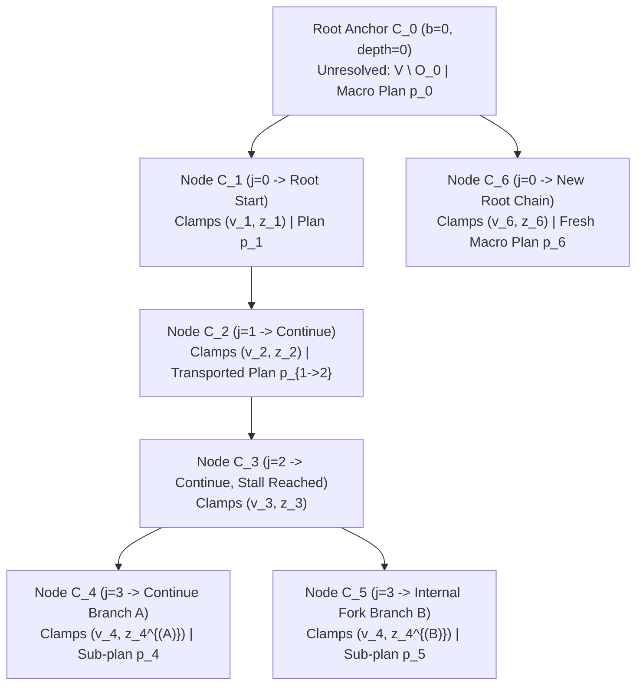

# Round 1 Proposal — Member 1: Fractal Prospectus Plans & The Universal Tree-Paged KV-Cache Search Machine

**Author:** Member 1 (Theory & Literature Proposer: Fractal Prospectus Plans & Learned KV-Cache Tree Control)  
**Date:** 2026-10-18  
**Repository:** `futarchy-fi/inconsistency-search`  
**Target:** Zero-heuristic test-time compute scaling ($B = 0 \to 128+$) under strict Local Inconsistency Resolution (LIR) separation ($\chi_{\text{real}} = (1,0), \, \chi_{\text{search}} = (0,1)$).

---

## 1. Executive Thesis & Literature Synthesis

### 1.1 Why Hand-Picked Search Heuristics Violate the Bitter Lesson
Across Rounds 1–9 (`research-direction-note-v4-2026-10-17.md` §5), the Any-Order World Model ($q_\theta$) + Consensus Aggregator (`looped_attn_T3` / `jacobi_lin_T4_prec`) proved that policy-independent belief pooling cuts one-pass KL by $41\text{--}89\%$. However, the *search controllers* generating those rollouts still relied on domain-specific, hand-tuned structural heuristics:
1. **Hardcoded Rollout Horizons:** $6\times 6$ Stratego (`R6-E3`–`R8-E3`) used a fixed 4-ply rollout window ($n=4$), even when `R8-E3` (`D2` FAIL) showed myopic depth-1 claims had lower MSE (`0.0397` vs. `0.0451`) than noisy 4-ply playouts at strong anchors.
2. **Hardcoded Stall Entropy Thresholds & Wave Counts:** `Sudoku-Extreme` (`R7-E2`–`R9-E2`) triggered branching only when minimum cell entropy crossed a hand-picked threshold $H(q) \ge 0.25$ nats with candidate pruning $q_{z, d} > 0.05$ across a fixed number of level-synchronous waves ($L=4$), while `R9-E2` showed that a hand-picked chain-time step floor $m_{\text{qs}} \ge 0.50$ (`AUROC = 0.35`) choked off non-greedy stochastic exploration between $m=16$ and $m=32$.
3. **First-Step-Only Plan Conditioning:** Conditioning a rollout only on its root action or a static wave index fails to provide multi-scale lookahead guidance when a trajectory traverses multiple coupled bottlenecks across depths $b = 1 \dots 128$.

### 1.2 Theoretical Synthesis: Four Pillars of the Zero-Heuristic Machine
To eliminate all hand-tuned depth limits, wave counts, and stall thresholds, we unify four results from systems, directional statistics, and reinforcement learning:

1. **Tree-Paged KV-Cache Attention (`vLLM` Kwon et al., 2023; `SGLang / RadixAttention` Zheng et al., 2024; `SpecInfer` Miao et al., 2024):**
   Instead of running $k$ isolated chains that recompute prefixes or advance in synchronous waves, the search state at step $b \in \{0, 1, \dots, B\}$ is a **tree-paged KV-cache bank** $\mathcal{C}_b = \{C_0, C_1, \dots, C_b\}$. Each step $b \to b+1$ selects **any** existing checkpoint $j \in \{0, \dots, b\}$ (`SELECT_NODE(j)`) and appends **one** variable-value assignment $(v, z)$ (`STEP(v, z)`) in $O(1)$ incremental token compute via a causal ancestor mask $M_{\text{tree}} \in \{0, 1\}^{(B+1)\times(B+1)}$.
2. **Scale-Invariant (Fractal) Prospectus Plans on $\mathbb{S}^{D_{\text{amp}}-1}$ (`Power Spherical` De Cao & Aziz, 2020; Hierarchical Goal-Conditioned RL, Levy et al., 2019):**
   In the continuous Space of Information (Lambert, Ostrovsky & Panov, 2018), any subtrajectory $C_j \to \dots \to C_{j'}$ induces a belief shift $\Delta \ell_{j \to j'}$ whose normalized salience direction $k^{\text{post}}_{j \to j'} \in \mathbb{S}^{D_{\text{amp}}-1}$ lives on the unit hypersphere of the amplified latent space ($D_{\text{amp}} = |V| + d_{\text{aux}}$). Because the *same* Plan Head $q_{\text{plan}}(p \mid C_j, K_{\text{done}})$ predicts target directions in $\mathbb{S}^{D_{\text{amp}}-1}$ conditioned on the unresolved subspace of $C_j$, plans are **self-similar across scales**: macro-plans at the root $C_0$, meso-plans at internal forks $C_j$, and micro-plans near leaves $C_{j'}$.
3. **Fractal Hindsight Experience Replay (`HER`, Andrychowicz et al., 2017) + Orthogonal Plan Transport:**
   Every realized tree path $C_j \prec C_t \prec C_{j'}$ provides hindsight supervision at **all pairs of scales $(j, j')$ simultaneously**. As a chain advances from $C_j$ to $C_t$ under active plan $p_r \in \mathbb{S}^{D_{\text{amp}}-1}$, the realized shift $\delta_{j \to t}$ is projected out via **Orthogonal Residual Plan Transport** on $\mathbb{S}^{D_{\text{amp}}-1}$, keeping the remaining plan direction aligned with the unresolved variables $V \setminus O_t$.
4. **DAG GFlowNet Subtrajectory Balance (`SubTB`, Madan et al., 2023; Bengio et al., 2023) + Normal-Equation Leave-Subtree-Out (`LSO`) Credit:**
   Because different sequences of `SELECT_NODE` + `STEP` can construct the same set of leaf hypotheses, tree expansion is a **DAG GFlowNet**. Combining Subtrajectory Balance with the **Leave-Subtree-Out (LSO)** consensus gain (derived from the normal equations $(K^\top B K + \lambda I)w = K^\top B v$) automatically penalizes redundant branches (whose deduplicated weights $w_b \to 0$) and rewards branches that either reduce consensus inconsistency $\mathcal{L}_{\text{cons}}$ or refute false hypotheses via Computation-as-Evidence.

---

## 2. The Universal Tree-Paged KV-Cache Search Machine

### 2.1 State Space & Tree-Paged KV Bank $\mathcal{C}_b$
Let $V = \{1, \dots, M\}$ be the domain variables (cells, hidden pieces, actions, market prices, utility mandates, or relational queries $Q(A,B)$) and let $D_{\text{amp}} = |V| + d_{\text{aux}}$ be the amplified latent dimension (where the $d_{\text{aux}}$ coordinates carry LIR mask $\chi = (0, 1)$ and store learned bidirectional lemmas).

At search step $b \in \{0, 1, \dots, B\}$, the search machine maintains a **Tree-Paged KV-Cache Bank** $\mathcal{C}_b = \{C_0, C_1, \dots, C_b\}$ of $b+1$ nodes:

$$\mathcal{C}_b \;=\; \Big\{\, C_m = \big(\mathrm{parent}(m), \, \mathrm{depth}(m), \, (v_m, z_m), \, O_m, \, \mathrm{KV}_m, \, h_m, \, \ell_m, \, k_m, \, \beta_m, \, p_m^{\text{act}}\big) \;\Big\}_{m=0}^b.$$

1. **Root Anchor Node ($m = 0$):**
   - Initialized from the observed clamps $x_O$ (and present-time episodic memory tokens $M_t$ in sequential imperfect-information games).
   - $\mathrm{parent}(0) = \varnothing$, $\mathrm{depth}(0) = 0$, $O_0 = O$.
   - Single-pass evaluation of $\theta_{\text{real}}$ + $\theta_{\text{amp}}$ yields root KV-cache $\mathrm{KV}_0$, amplified state $h_0 \in \mathbb{R}^{D_{\text{amp}}}$, root belief logits $\ell_0 \in \mathbb{R}^{D_{\text{amp}} \times K_{\text{val}}}$, anchor precision $\beta_0 > 0$, and root key $k_0 = \mathbf{0} \in \mathbb{R}^{D_{\text{amp}}}$.
2. **Search Node ($m \in \{1, \dots, b\}$):**
   - Created at step $m$ by selecting parent node $j_m = \mathrm{parent}(m) \in \{0, \dots, m-1\}$ and clamping variable $v_m \in V \setminus O_{j_m}$ to value $z_m \in \mathcal{X}_{v_m}$.
   - $O_m = O_{j_m} \cup \{v_m\}$, $\mathrm{depth}(m) = \mathrm{depth}(j_m) + 1$.
   - $\mathrm{KV}_m \in \mathbb{R}^{L_{\text{wm}} \times 2 \times d_{\text{model}}}$ stores **only the single new token's** Key/Value vectors across the $L_{\text{wm}}$ world-model layers.
   - The ancestor set of node $m$ is $\mathrm{Anc}(m) = \{m, \mathrm{parent}(m), \mathrm{parent}(\mathrm{parent}(m)), \dots, 0\}$.
   - The **Causal Tree Attention Mask** $M_{\text{tree}} \in \{0, 1\}^{(B+1) \times (B+1)}$ satisfies:
     $$M_{\text{tree}}[m, m'] \;=\; \begin{cases} 1 & \text{if } m' \in \mathrm{Anc}(m), \\ 0 & \text{otherwise.} \end{cases}$$
     When node $m$ is created from parent $j_m$, row $M_{\text{tree}}[m, :]$ is formed in $O(1)$ time by copying row $M_{\text{tree}}[j_m, :]$ and setting bit $m$ to $1$:
     $$M_{\text{tree}}[m, :] \;=\; M_{\text{tree}}[j_m, :] \;\lor\; \mathbf{e}_m^\top.$$



### 2.2 Elementary Transition Semantics: `SELECT_NODE(j)` + `STEP(v, z)`
At step $b \to b+1$ (with current bank $\mathcal{C}_b = \{C_0, \dots, C_b\}$ and current consensus state $h_{\text{cons}}^{(b)}$), the search machine executes a compound action $a_{b+1} = (j_{b+1}, v_{b+1}, z_{b+1})$:

#### Phase 1: `SELECT_NODE` ($j_{b+1} \in \{0, 1, \dots, b\}$)
The pointer network $\pi_{\text{sel}}(j \mid \mathcal{C}_b, h_{\text{cons}}^{(b)})$ defines a categorical distribution over $\{0, 1, \dots, b\}$. A single unified action space encompasses all three search topology operations:
- **$j_{b+1} = b$ (Continue Current Chain):** Extends the most recently created node $C_b$ to depth $\mathrm{depth}(b) + 1$ with zero context switching.
- **$0 < j_{b+1} < b$ (Internal Tree Fork):** Pauses the current branch and forks a new child from internal checkpoint $C_{j_{b+1}}$ (e.g., returning to a stall node after a branch completes or refutes, or splitting a high-uncertainty landmark).
- **$j_{b+1} = 0$ (Root Restart):** Initiates a fresh chain from the root $C_0$, steered away from already-explored subspaces $K_{\text{done}}^{(b)}$.

**Exact Feasibility & Duplicate-Branch Masking (Why Stall Detection Is Automatic):**
For every node $j \in \{0, \dots, b\}$ and variable-value pair $(v, z)$, let $\mathrm{Used}(j) \subset (V \setminus O_j) \times \mathcal{X}$ be the set of child transitions already instantiated from $C_j$:
$$\mathrm{Used}(j) \;=\; \big\{\, (v_m, z_m) \;:\; m \in \{1, \dots, b\}, \; \mathrm{parent}(m) = j \,\big\}.$$
A variable $v \in V \setminus O_j$ is **open at node $j$** if $\exists z \in \mathcal{X}_v$ such that $(v, z) \notin \mathrm{Used}(j)$ and $q_{\theta_{\text{real}}}(X_v = z \mid C_j) > 0$.
A node $C_j$ is **expandable** ($\mathrm{Exp}(j) = 1$) iff:
1. $C_j$ is not a refuted contradiction ($\text{chk}(C_j) = 1$), and
2. $C_j$ has at least one open variable $v \in V \setminus O_j$.

If $\mathrm{Exp}(j) = 0$, $\pi_{\text{sel}}(j \mid \mathcal{C}_b, h_{\text{cons}}^{(b)}) = 0$ (logit masked to $-\infty$).
Crucially, when $C_j$ is selected a second time (an internal fork), masking out $\mathrm{Used}(j)$ in $\pi_{\text{step}}$ **automatically forces the fork to explore an unvisited value $z^{(2)} \ne z^{(1)}$** (or an alternative variable $v' \ne v$) without any hardcoded stall threshold $H \ge 0.25$!

#### Phase 2: `FRACTAL_PLAN` ($p_{b+1} \in \mathbb{S}^{D_{\text{amp}}-1}$)
Given the selected parent node $j = j_{b+1}$, how is the active prospectus plan $p_{b+1} \in \mathbb{S}^{D_{\text{amp}}-1}$ determined?
- **Case A — Root Start or Internal Fork ($j < b$ or $b = 0$):**
  A new sub-branch is being launched from $C_j$. The Plan Head samples a fresh target direction on the unit hypersphere:
  $$p_{b+1} \;\sim\; q_{\text{plan}}\!\left(p \;\Big|\; C_j, \, K_{\text{done}}^{(b)}, \, h_{\text{cons}}^{(b)}\right) \;\in\; \mathbb{S}^{D_{\text{amp}}-1}.$$
- **Case B — Chain Continuation ($j = b > 0$):**
  Node $C_b$ was reached from $C_{\mathrm{parent}(b)}$ under active plan $p_b^{\text{act}} \in \mathbb{S}^{D_{\text{amp}}-1}$, realizing the single-step salience shift $\delta_b = s_{\mathrm{parent}(b) \to b} \in \mathbb{R}_{\ge 0}^{D_{\text{amp}}}$.
  We update the plan via **Orthogonal Residual Plan Transport** blended with a learned continuous refinement gate $g_{\text{ref}}(C_b, p_b^{\text{act}}) \in [0, 1]$:
  $$\tilde{p}_{\text{trans}} \;=\; \mathrm{normalize}\!\left( \mathrm{proj}_{U_b}\!\Big(p_b^{\text{act}} - \frac{\langle p_b^{\text{act}}, \, \delta_b \rangle}{\|\delta_b\|_2^2 + \epsilon} \delta_b\Big) \right), \qquad p_{b+1} \;=\; \mathrm{normalize}\!\Big((1 - g_{\text{ref}}) \tilde{p}_{\text{trans}} + g_{\text{ref}} \, \mu_{\text{plan}}(C_b, K_{\text{done}}^{(b)})\Big),$$
  where $\mathrm{proj}_{U_b}(\cdot)$ zeroes out coordinates $i \in O_b$ that are already clamped at $C_b$.
  *Geometric meaning:* As the chain clamps variables and resolves their consequences along $p_b^{\text{act}}$, the realized component along $\delta_b$ is subtracted off, so $p_{b+1}$ continuously rotates into the **remaining unresolved coordinates** of the original prospectus plan!

#### Phase 3: `STEP` ($(v_{b+1}, z_{b+1}) \sim \pi_{\text{step}}(v, z \mid C_j, p_{b+1}, h_{\text{cons}}^{(b)})$)
Conditioned on parent $C_j$ ($j = j_{b+1}$), active prospectus plan $p_{b+1} \in \mathbb{S}^{D_{\text{amp}}-1}$, and consensus state $h_{\text{cons}}^{(b)}$, the step policy selects an open variable-value pair $(v_{b+1}, z_{b+1}) \notin \mathrm{Used}(j)$ and executes 1 incremental forward step of the world model $\theta_{\text{real}}$ + $\theta_{\text{amp}}$ to create node $C_{b+1}$.

---

## 3. Active, Self-Similar / Fractal Prospectus Plans on $\mathbb{S}^{D_{\text{amp}}-1}$

### 3.1 Why the Same $q_{\text{plan}}$ Is Naturally Fractal Across Tree Depths
In our architecture, a prospectus plan $p \in \mathbb{S}^{D_{\text{amp}}-1}$ is a unit vector in the amplified variable-plus-lemma space $\mathbb{R}^{D_{\text{amp}}}$ predicting the **normalized belief-shift footprint** of a subtrajectory starting at $C_j$ and ending at a descendant $C_{j'}$ ($j \prec j'$):

$$k^{\text{post}}_{j \to j'} \;=\; \frac{s_{j \to j'}}{\|s_{j \to j'}\|_2 + \epsilon} \;\in\; \mathbb{S}^{D_{\text{amp}}-1}, \qquad s_{j \to j', i} \;=\; \big\|\ell_{j', i} - \ell_{j, i}\big\|_2 \quad \forall i \in \{1, \dots, D_{\text{amp}}\}.$$

Why does a **single weight-shared network** $q_{\text{plan}}(p \mid C_j, K_{\text{done}}, h_{\text{cons}})$ produce high-level macro-plans at the root $C_0$, medium-level sub-plans at intermediate nodes $C_j$, and fine-grained micro-plans near leaves $C_{j'}$ without any hardcoded hierarchy?

1. **Support Contraction Along Any Chain ($U_0 \supset U_j \supset U_{j'}$):**
   At any node $C_j$, the clamped set $O_j$ and the already-entailed deterministic coordinates $\{i \in V \setminus O_j : H(q_{\theta}(\cdot \mid C_j)_i) < \epsilon\}$ have zero remaining belief shift ($\ell_{j', i} - \ell_{j, i} \approx 0$ for all descendants $j' \succ j$).
   - **At the Root $C_0$ ($\mathrm{depth}=0$):** Almost all variables $V \setminus O_0$ and latent lemmas $Z_{\text{aux}}$ have high unresolved entropy. The support of $k^{\text{post}}_{0 \to j'}$ spans a **coarse, global subspace** (e.g., an entire coupled ship fleet or multi-box Sudoku constraint web).
   - **At an Intermediate Fork $C_j$ ($\mathrm{depth} \sim 10$):** Macro regions are already clamped or entailed in $\ell_j$. The unresolved entropy $H(\ell_j)$ is localized to a **meso-scale cluster** (e.g., a single $3\times 3$ box/row intersection or a local tactical battlefront).
   - **Near a Leaf $C_{j'}$ ($\mathrm{depth} \sim 30$):** Only 2–3 coupled variables remain unresolved; $k^{\text{post}}_{j' \to j''}$ is a **sharp, low-level tactical micro-plan**.
2. **Automatic Concentration Scaling ($\kappa(C_j)$):**
   Because $q_{\text{plan}}$ predicts both directional modes $\mu_m(C_j) \in \mathbb{S}^{D_{\text{amp}}-1}$ and concentration parameters $\kappa_m(C_j) > 0$ from the entropy profile of $\ell_j$, $\kappa_m(C_0)$ is naturally low (broad exploration over macro directions) while $\kappa_m(C_j)$ grows monotonically with depth as the remaining unresolved subspace narrows!

### 3.2 Tractable Directional Parametrization: Mixture of Power Sphericals ($\mathrm{MoPS}$) with Key-Space Repulsion
Standard von Mises-Fisher ($\mathrm{vMF}$) distributions on $\mathbb{S}^{D-1}$ require modified Bessel functions $I_{D/2-1}(\kappa)$ that overflow or require rejection sampling in PyTorch when $D_{\text{amp}} \in [64, 512]$ and $\kappa > 100$.
We instead parameterize $q_{\text{plan}}$ as an $M_{\text{modes}}$-component **Mixture of Power Spherical ($\mathrm{MoPS}$) distributions** (De Cao & Aziz, 2020) on $\mathbb{S}^{D_{\text{amp}}-1}$, which has an exact closed-form density in elementary functions, exact reparameterized gradients (`rsample`), and numerically stable evaluation for any $D_{\text{amp}} \ge 2$ and $\kappa \in (0, \infty)$:

For a single Power Spherical component $\mathrm{PS}(\mu, \kappa)$ with unit direction $\mu \in \mathbb{S}^{D_{\text{amp}}-1}$ and concentration $\kappa > 0$:
$$p_{\mathrm{PS}}(p \mid \mu, \kappa) \;=\; C_{D_{\text{amp}}}(\kappa) \, \big(1 + \langle \mu, p \rangle\big)^\kappa, \qquad p \in \mathbb{S}^{D_{\text{amp}}-1},$$
$$\log C_{D_{\text{amp}}}(\kappa) \;=\; -\left(\kappa + \frac{D_{\text{amp}}-1}{2}\right) \log 2 \;-\; \frac{D_{\text{amp}}-1}{2}\log \pi \;+\; \log \Gamma\!\left(\kappa + D_{\text{amp}} - 1\right) \;-\; \log \Gamma\!\left(\kappa + \frac{D_{\text{amp}}-1}{2}\right).$$

**Exact Differentiable Sampling (`rsample`):**
1. Sample $Z \sim \mathrm{Beta}\!\left(\alpha = \kappa + \frac{D_{\text{amp}}-1}{2}, \; \beta = \frac{D_{\text{amp}}-1}{2}\right)$ and set $T = 2Z - 1 \in [-1, 1]$ (the cosine $\langle \mu, p \rangle$).
2. Sample $V_{\perp} \sim \mathcal{U}(\mathbb{S}^{D_{\text{amp}}-2})$ by normalizing an isotropic Gaussian $g \sim \mathcal{N}(0, I_{D_{\text{amp}}-1})$.
3. Form $Y = \big[T, \; \sqrt{1 - T^2}\, V_{\perp}^\top\big]^\top \in \mathbb{S}^{D_{\text{amp}}-1}$ and apply the Householder reflection $H(\mu) = I - 2 u u^\top / \|u\|_2^2$ (with $u = \mathbf{e}_1 - \mu$) to map $\mathbf{e}_1 \mapsto \mu$:
   $$p \;=\; H(\mu) Y \;\in\; \mathbb{S}^{D_{\text{amp}}-1}.$$

**Built-In Key-Space Repulsion & Unresolved Masking in $\mu_m(C_j, K_{\text{done}}^{(b)})$:**
To ensure $q_{\text{plan}}$ steers search away from subspaces already covered by $K_{\text{done}}^{(b)} = [k_1, \dots, k_b] \in \mathbb{R}^{b \times D_{\text{amp}}}$ with precisions $\beta_{1:b}$, the Plan Head computes:
1. **Unresolved Epistemic Mask $u(C_j) \in \mathbb{R}_{\ge 0}^{D_{\text{amp}}}$:**
   $$u_i(C_j) \;=\; \begin{cases} 0 & \text{if } i \in O_j \text{ (already clamped at } C_j\text{)}, \\ H\!\big(q_{\theta}(\cdot \mid C_j)_i\big) + \sigma(w_{\text{inc}}^\top h_{j, i}) & \text{if } i \in (V \setminus O_j) \cup Z_{\text{aux}}. \end{cases}$$
2. **Normal-Equation Crowding Projector $P_{\text{done}}^{(b)}$:**
   Using a single cross-attention pass from $C_j$'s unresolved query $q_{\text{unres}}(C_j)$ over keys $K_{\text{done}}^{(b)}$ weighted by $\beta_{1:b}$:
   $$c_{\text{crowd}}(C_j, K_{\text{done}}^{(b)}) \;=\; \sum_{r=1}^b \frac{\beta_r}{\lambda_{\text{plan}} + \sum_{r'} \beta_{r'} \max(0, \langle k_r, k_{r'} \rangle)} \max\!\big(0, \, \langle u(C_j), k_r \rangle\big) \, k_r.$$
3. **Mode Prediction:**
   For each mode $m \in \{1, \dots, M_{\text{modes}}\}$, an MLP head on $\big[h_j, \, h_{\text{cons}}^{(b)}, \, u(C_j), \, c_{\text{crowd}}\big]$ outputs raw score $\tilde{\mu}_m \in \mathbb{R}^{D_{\text{amp}}}$, concentration $\kappa_m = \mathrm{softplus}(\tilde{\kappa}_m)$, and mixture logit $\alpha_m$:
   $$\mu_m\big(C_j, K_{\text{done}}^{(b)}\big) \;=\; \mathrm{normalize}\!\Big(\, u(C_j) \odot \mathrm{softplus}\!\big(\tilde{\mu}_m - \gamma_{\text{rep}} \, c_{\text{crowd}}\big) \,\Big) \;\in\; \mathbb{S}^{D_{\text{amp}}-1}.$$
   By multiplying elementwise by $u(C_j) \ge 0$ and subtracting $\gamma_{\text{rep}} c_{\text{crowd}}$, every mode $\mu_m \in \mathbb{S}^{D_{\text{amp}}-1}$ is guaranteed to:
   - Have **zero mass on already-clamped variables $O_j$** (automatic scale contraction as $O_j$ grows),
   - Point into **unexplored, high-entropy coordinates** of $\mathbb{S}^{D_{\text{amp}}-1}$ (automatic key-space novelty).

### 3.3 Conditioning $\pi_{\text{step}}(v, z \mid C_t, p_r, h_{\text{cons}})$ on the Active Plan $p_r$
Given parent node $C_t$ ($t = j_{b+1}$) and active plan $p_r = p_{b+1} \in \mathbb{S}^{D_{\text{amp}}-1}$, how does $p_r$ steer the choice of variable $v \in V \setminus O_t$ and value $z \in \mathcal{X}_v$?

We factorize $\pi_{\text{step}}$ into a **Plan-Aligned Variable Policy** $\pi_{\text{var}}(v \mid C_t, p_r, h_{\text{cons}})$ and a **Feasibility-Gated Value Policy** $\pi_{\text{val}}(z \mid C_t, v, p_r, h_{\text{cons}})$:

$$\pi_{\text{step}}(v, z \mid C_t, p_r, h_{\text{cons}}) \;=\; \pi_{\text{var}}(v \mid C_t, p_r, h_{\text{cons}}) \cdot \pi_{\text{val}}(z \mid C_t, v, p_r, h_{\text{cons}}).$$

#### 1. Plan-Aligned Variable Policy $\pi_{\text{var}}(v \mid C_t, p_r, h_{\text{cons}})$
When variable $v \in V \setminus O_t$ is clamped at node $C_t$, it directly resolves coordinate $v$ AND propagates through the local dependency graph to shift coupled coordinates $i \in \{1, \dots, D_{\text{amp}}\}$.
Let $\hat{J}_t(v) \in \mathbb{R}_{\ge 0}^{D_{\text{amp}}}$ be the **Predicted Propagation Footprint** of clamping variable $v$ at state $C_t$, computed via the world model's attention map $A_{\text{wm}}(C_t) \in \mathbb{R}^{D_{\text{amp}} \times D_{\text{amp}}}$ (read via `stop_grad`) plus a lightweight learned bilinear head $W_{\text{prop}}$:
$$\hat{J}_t(v) \;=\; \mathbf{e}_v \;+\; \mathrm{softplus}\!\big(A_{\text{wm}}(C_t)_{:, v} + W_{\text{prop}} \, h_{t, v}\big) \;\in\; \mathbb{R}_{\ge 0}^{D_{\text{amp}}}.$$
Then the alignment between candidate variable $v$ and the active prospectus plan $p_r \in \mathbb{S}^{D_{\text{amp}}-1}$ is the inner product $\langle \hat{J}_t(v), \, p_r \rangle$, combined with a FiLM-modulated policy score:
$$\mathrm{logit}_{\text{var}}(v \mid C_t, p_r, h_{\text{cons}}) \;=\; \underbrace{c_{\text{align}} \, \big\langle \mathrm{normalize}(\hat{J}_t(v)), \; p_r \big\rangle}_{\text{Direct + Coupled Plan Alignment}} \;+\; \underbrace{w_{\text{stiff}} \, \beta_{\theta}(v \mid C_t)}_{\substack{\text{Forced-Step Stiffness Bonus:} \\ -H(q_\theta(X_v \mid C_t)) \cdot \hat{\beta}_{\text{trust}}(C_t, v)}} \;+\; \underbrace{\mathrm{MLP}_{\text{var}}\!\big([h_{t, v}, \, h_{\text{cons}, v}, \, p_{r, v}]\big)}_{\text{Learned Local Search Priority}},$$
masked to $-\infty$ if variable $v$ has no open values at $C_t$.

*Notice the emergent two-regime behavior without any hardcoded $H \ge 0.25$ threshold:*
- When a variable $v$ is **forced/stiff** ($H(q_\theta(X_v \mid C_t)) \approx 0$) and aligned with $p_r$, both the stiffness bonus and plan alignment fire, rapidly sweeping forced deductions along the prospectus region.
- When all forced variables in the region are exhausted (a natural stall), stiffness differences vanish across open variables, and the directional inner product $\langle \hat{J}_t(v), p_r \rangle$ smoothly breaks ties to select the bottleneck variable $v^*$ that unlocks the target subspace $p_r$!

#### 2. Feasibility-Gated Value Policy $\pi_{\text{val}}(z \mid C_t, v, p_r, h_{\text{cons}})$
Once variable $v$ is selected at $C_t$, the candidate values $z \in \mathcal{X}_v$ must respect:
1. **Duplicate-Branch Exclusion:** Any value $z$ with $(v, z) \in \mathrm{Used}(t)$ is masked to $-\infty$. (Thus, if $C_t$ is revisited via `SELECT_NODE(t)`, it *must* try a new value $z' \notin \mathrm{Used}(t)$!)
2. **World-Model Prior Support + Utility / Plan Tilt:**
   $$\mathrm{logit}_{\text{val}}(z \mid C_t, v, p_r, h_{\text{cons}}) \;=\; \log q_{\theta_{\text{real}}}(X_v = z \mid C_t) \;+\; \eta_{\text{cons}} \log \mu_b(X_v = z) \;+\; \phi_{\text{val}}\big(h_{t, v}, \, z, \, p_r\big) \;+\; \chi_{\text{action}}(v) \, \lambda U(v, z),$$
   masked to $-\infty$ for $(v, z) \in \mathrm{Used}(t)$.

---

## 4. Training Without Heuristics: Fractal HER + GFlowNet Subtrajectory Balance

All search parameters $\theta_{\text{search}} = (\theta_{\text{sel}}, \theta_{\text{plan}}, \theta_{\text{step}}, \psi_{\text{flow}})$ carry LIR mask $\chi = (0, 1)$ and receive **zero gradient into $\theta_{\text{real}}$** (`stop_grad` on all world-model states $\mathrm{KV}_m, \ell_m, k_m$).

### 4.1 Counterfactual Leave-Subtree-Out (`LSO`) & Refutation Credit
Given a completed search tree $\mathcal{T}_B = \{C_0, C_1, \dots, C_B\}$ at budget $B$, the Consensus Aggregator (`looped_attn_T3` / `jacobi_lin_T4_prec`) clears the normal equations $(K_B^\top B_B K_B + \lambda(B_B) I) w = K_B^\top B_B v$ with root anchor $C_0$ to produce posterior sequence $\{\mu_0, \mu_1, \dots, \mu_B\}$.

Let $\mathcal{L}_{\text{cons}}(\mu_b; x^*) = -\sum_{i \in V \setminus O} \log \mu_b(x^*_i \mid x_O)$ be the consensus belief loss at step $b$. Each transition $b \to b+1$ (from parent $j = j_{b+1}$ to child $C_{b+1}$) receives a three-part local credit $r_{\text{tree}}(b+1)$:

1. **Immediate Step Consensus Drop (Anytime Progress):**
   $$\Delta \mathcal{L}_{\text{step}}(b+1) \;=\; \mathcal{L}_{\text{cons}}(\mu_b; x^*) \;-\; \mathcal{L}_{\text{cons}}(\mu_{b+1}; x^*).$$
2. **Counterfactual Leave-Subtree-Out (`LSO`) Gain at Budget $B$:**
   Let $\mathrm{Subtree}(b+1) = \{m \in \{b+1, \dots, B\} : b+1 \in \mathrm{Anc}(m)\}$ be the subtree rooted at $C_{b+1}$. Generalizing the exact LOO envelope theorem (`research-direction-note-v4` §4) to trees, the counterfactual contribution of $\mathrm{Subtree}(b+1)$ to the final consensus $\mu_B$ is:
   $$R_{\mathrm{LSO}}(b+1) \;=\; \mathcal{L}_{\text{cons}}(\mu_{B \setminus \mathrm{Subtree}(b+1)}; x^*) - \mathcal{L}_{\text{cons}}(\mu_B; x^*) \;\approx\; \sum_{m \in \mathrm{Subtree}(b+1)} w_m \Big(\ell_m(x^*) - \mathbb{E}_{\mu_B}[\ell_m(X)]\Big),$$
   where $w_m \ge 0$ is node $C_m$'s **deduplicated normal-equation weight**.
   *Key property:* If a branch explores a subspace already saturated by earlier branches ($\rho \to 1$), normal-equation clearing drives its effective weight $w_m \propto \beta_m / c_m \to 0$, so $R_{\mathrm{LSO}}(b+1) \to 0$ automatically!
3. **Computation-as-Evidence Refutation Credit (Fast Falsification of Bad Branches):**
   If node $C_{b+1}$ exposes a valid forward-check contradiction ($\text{chk}(C_{b+1}) = 0$) on a false ancestor hypothesis $(v_a, z_a \ne x^*_{v_a})$ that had prior probability $q_\theta(z_a \mid C_{\mathrm{parent}(a)}) > 0$, it eliminates false probability mass from its ancestor's mixture (§3.1.4 of `research-direction-note-v4`):
   $$R_{\text{refute}}(b+1) \;=\; \mathbb{I}\big[\text{chk}(C_{b+1}) = 0\big] \cdot \frac{-\log\!\big(1 - q_\theta(z_a \mid C_{\mathrm{parent}(a)})\big)}{\mathrm{depth}(b+1) - \mathrm{depth}(a) + 1}.$$
   Dividing by the refutation length $\mathrm{depth}(b+1) - \mathrm{depth}(a) + 1$ rewards **shortest-path refutations** (finding the contradiction in 2 steps rather than 10 steps, then immediately jumping back to $\mathrm{parent}(a)$ via `SELECT_NODE`).

Combining all three terms gives the total transition credit:
$$r_{\text{tree}}(b+1) \;=\; \Delta \mathcal{L}_{\text{step}}(b+1) \;+\; \gamma_{\mathrm{LSO}} \, R_{\mathrm{LSO}}(b+1) \;+\; \gamma_{\text{ref}} \, R_{\text{refute}}(b+1).$$

### 4.2 Multi-Scale Hindsight Plan Conditioning (Fractal HER)
Every ancestor-descendant pair $(C_j, C_{j'})$ in $\mathcal{T}_B$ ($0 \le j < j' \le B$ with $j \in \mathrm{Anc}(j')$) defines a realized subtrajectory $\tau_{j \to j'} = (C_{t_0}=C_j, C_{t_1}, \dots, C_{t_L}=C_{j'})$ of length $L = \mathrm{depth}(j') - \mathrm{depth}(j) \ge 1$.
Regardless of the prospectus plan $p$ that was active during exploration, $\tau_{j \to j'}$ achieved the **realized hindsight direction**:

$$k^{\text{post}}_{j \to j'} \;=\; \frac{s_{j \to j'}}{\|s_{j \to j'}\|_2 + \epsilon} \;\in\; \mathbb{S}^{D_{\text{amp}}-1}, \qquad s_{j \to j', i} \;=\; \big\|\ell_{j', i} - \ell_{j, i}\big\|_2.$$

Crucially, along the intermediate nodes $t_0, t_1, \dots, t_{L-1}$ of $\tau_{j \to j'}$, the remaining hindsight direction from $C_{t_s}$ to $C_{j'}$ is $k^{\text{post}}_{t_s \to j'} \in \mathbb{S}^{D_{\text{amp}}-1}$.

1. **Fractal Hindsight Step Policy Objective ($\mathcal{L}_{\text{HER-step}}$):**
   We sample ancestor-descendant pairs $(j, j')$ across **all depth scales** in $\mathcal{T}_B$ (root-to-leaf $0 \to j'$, root-to-internal $0 \to j$, internal-to-internal $j \to j'$, and internal-to-leaf $j' \to j''$) with non-trivial shift $\|s_{j \to j'}\|_2 > \epsilon_{\text{shift}}$ and train $\pi_{\text{step}}$ by maximum likelihood under the hindsight plan $k^{\text{post}}_{t_{s-1} \to j'}$:
   $$\mathcal{L}_{\text{HER-step}}(\theta_{\text{step}}) \;=\; -\!\!\sum_{(j \prec j') \in \mathcal{T}_B} \!\!\omega_{\text{her}}(j, j') \sum_{s=1}^{L} \log \pi_{\text{step}}\!\Big(v_{t_s}, z_{t_s} \;\Big|\; C_{t_{s-1}}, \; p = k^{\text{post}}_{t_{s-1} \to j'}, \; h_{\text{cons}}^{(t_{s-1})}\Big),$$
   where $\omega_{\text{her}}(j, j') = \mathbb{I}\big[\|s_{j \to j'}\|_2 > \epsilon_{\text{shift}} \land \text{chk}(C_{j'}) = 1\big] \cdot \big(1 + \max(0, R_{\mathrm{LSO}}(j'))\big)$.
   *Why this works:* Even from epoch 0 before $q_{\text{plan}}$ is trained, $\pi_{\text{step}}$ learns a consistent inverse-dynamics map across all scales: given any target direction $p \in \mathbb{S}^{D_{\text{amp}}-1}$ at any depth $C_t$, clamping which $(v, z)$ produces belief shift along $p$?

2. **Advantage-Weighted Hindsight Plan Head Objective ($\mathcal{L}_{\text{plan}}$):**
   For every node $C_j$ and descendant $C_{j'} \succ C_j$, define the subtrajectory consensus advantage:
   $$A_{\text{plan}}(j \to j') \;=\; \Big(\mathcal{L}_{\text{cons}}(\mu_{b(j)}; x^*) - \mathcal{L}_{\text{cons}}(\mu_{b(j')}; x^*)\Big) \;+\; \gamma_{\mathrm{LSO}} R_{\mathrm{LSO}}(j') \;-\; \hat{V}_{\psi}(C_j \mid \mathcal{C}_{b(j)}).$$
   We train $q_{\text{plan}}$ at node $C_j$ to assign high probability density on $\mathbb{S}^{D_{\text{amp}}-1}$ to the hindsight directions $k^{\text{post}}_{j \to j'}$ of **positive-advantage subtrajectories**, plus an analytical Power-Spherical entropy bonus $H(q_{\text{plan}})$ to preserve multi-modal coverage:
   $$\mathcal{L}_{\text{plan}}(\theta_{\text{plan}}) \;=\; -\!\!\sum_{(j \prec j') \in \mathcal{T}_B} \!\! \exp\!\left(\mathrm{clip}\!\Big(\frac{A_{\text{plan}}(j \to j')}{\tau_{\text{adv}}}, -5, 5\Big)\right) \mathbb{I}\big[A_{\text{plan}}(j \to j') > 0\big] \log q_{\text{plan}}\!\Big(k^{\text{post}}_{j \to j'} \;\Big|\; C_j, K_{\text{done}}^{(b(j))}, h_{\text{cons}}^{(b(j))}\Big) \;-\; \lambda_{\text{ent}} \sum_{b=0}^{B-1} H\!\big(q_{\text{plan}}(\cdot \mid C_{j_{b+1}}, K_{\text{done}}^{(b)})\big).$$

### 4.3 DAG GFlowNet Subtrajectory Balance (`SubTB`) for `SELECT_NODE` ($\pi_{\text{sel}}$)
To train $\pi_{\text{sel}}(j \mid \mathcal{C}_b, h_{\text{cons}}^{(b)})$ (deciding whether to continue $j=b$, fork $0 < j < b$, or restart $j=0$) jointly with $\pi_{\text{step}}$, we formulate tree construction $\mathcal{T}_0 \to \mathcal{T}_1 \to \dots \to \mathcal{T}_B$ as a **DAG GFlowNet** with state $S_b = (\mathcal{T}_b, h_{\text{cons}}^{(b)})$:
- **Forward Policy $P_F(S_{b+1} \mid S_b)$:**
  $$\log P_F(S_{b+1} \mid S_b, p_{b+1}) \;=\; \log \pi_{\text{sel}}\!\big(j_{b+1} \mid S_b\big) \;+\; \log \pi_{\text{step}}\!\big(v_{b+1}, z_{b+1} \mid C_{j_{b+1}}, p_{b+1}, h_{\text{cons}}^{(b)}\big).$$
- **Order-Invariant Backward Policy $P_B(S_b \mid S_{b+1})$:**
  At tree $\mathcal{T}_{b+1}$, let $\mathcal{L}^*(\mathcal{T}_{b+1}) = \{m \in \{1, \dots, b+1\} : \nexists m' \text{ with } \mathrm{parent}(m') = m\}$ be the set of current leaf nodes of $\mathcal{T}_{b+1}$. Any leaf $m \in \mathcal{L}^*(\mathcal{T}_{b+1})$ could have been the last node added to form $\mathcal{T}_{b+1}$. Thus, the uniform leaf-removal backward policy is:
  $$\log P_B(S_b \mid S_{b+1}) \;=\; -\log \big|\mathcal{L}^*(\mathcal{T}_{b+1})\big|.$$
  *Why this term matters:* Adding $-\log |\mathcal{L}^*(\mathcal{T}_{b+1})|$ prevents $\pi_{\text{sel}}$ from arbitrarily preferring a single deep chain ($|\mathcal{L}^*|=1$) over a balanced multi-branch tree ($|\mathcal{L}^*| = K$) solely due to permutation counting!
- **State Log-Flow Estimator $\log F_\psi(S_b)$:**
  Parameterized as the current negative consensus loss plus the sum of remaining node potentials:
  $$\log F_\psi(S_b) \;=\; -\frac{1}{\tau_{\text{flow}}} \mathcal{L}_{\text{cons}}(\mu_b; x^*) \;+\; \log \sum_{m=0}^b \mathrm{Exp}(m) \exp\!\big(\hat{V}_\psi(C_m \mid S_b)\big),$$
  where the pointer logits of $\pi_{\text{sel}}$ are directly tied to the node potentials $\hat{V}_\psi(C_m \mid S_b)$:
  $$\pi_{\text{sel}}(j \mid S_b) \;=\; \frac{\mathrm{Exp}(j) \exp\!\big(\hat{V}_\psi(C_j \mid S_b)\big)}{\sum_{m=0}^b \mathrm{Exp}(m) \exp\!\big(\hat{V}_\psi(C_m \mid S_b)\big)}.$$
- **1-Step Detailed Balance / SubTB($\lambda$) Loss:**
  Substituting $\pi_{\text{sel}}(j \mid S_b)$ into the GFlowNet Detailed Balance condition causes the partition function $\log \sum_m \mathrm{Exp}(m) e^{\hat{V}_\psi(C_m \mid S_b)}$ to **cancel out identically**, yielding an exact, low-variance local consistency objective for $\hat{V}_\psi$ and $\pi_{\text{step}}$:
  $$\mathcal{L}_{\text{SubTB}}(\psi, \theta_{\text{step}}) \;=\; \sum_{b=0}^{B-1} \Big( \hat{V}_\psi(C_{j_{b+1}} \mid S_b) + \log \pi_{\text{step}}(v_{b+1}, z_{b+1} \mid C_{j_{b+1}}, p_{b+1}) - \frac{1}{\tau_{\text{flow}}} r_{\text{tree}}(b+1) - \log \sum_{m=0}^{b+1} \mathrm{Exp}(m) e^{\hat{V}_\psi(C_m \mid S_{b+1})} + \log |\mathcal{L}^*(\mathcal{T}_{b+1})| \Big)^2.$$

### 4.4 Total Search Training Objective
$$\mathcal{L}_{\text{total}}(\theta_{\text{search}}) \;=\; \mathcal{L}_{\text{SubTB}}(\psi, \theta_{\text{step}}) \;+\; \lambda_{\text{HER}} \, \mathcal{L}_{\text{HER-step}}(\theta_{\text{step}}) \;+\; \lambda_{\text{plan}} \, \mathcal{L}_{\text{plan}}(\theta_{\text{plan}}).$$

---

## 5. Anytime Monotonicity Guarantee Across $b = 0 \dots 128+$

**Proposition 1 (Anytime Monotonicity of the Tree-Paged Consensus Pool).**  
*Let $\mathcal{C}_b = \{C_0, C_1, \dots, C_b\}$ be the tree-paged KV-cache bank at step $b \in \{0, 1, \dots, B\}$, where $C_0$ is the root anchor with precision $\beta_0 > 0$, and each search node $C_m$ ($m \ge 1$) emits root-relative salience key $k_m \in \mathbb{S}^{D_{\text{amp}}-1}$, shift claim $v_m = \ell_m - \ell_0$, and self-consistency + trust gated precision:*
$$\beta_m \;=\; \hat{\beta}_{\text{trust}}(C_m) \cdot \mathbb{I}\big[\text{chk}(C_m) = 1\big] \cdot \sigma\!\left(\frac{m_{\text{ql}}(C_m) - \tau_{\text{mql}}}{\tau_{\text{sc}}}\right), \qquad m_{\text{ql}}(C_m) = \min_{c \in O_m \setminus O_0} q_{\theta_{\text{real}}}(X_c = z_c \mid C_m).$$
*If the consensus aggregator updates via anchor-anchored preconditioned normal-equation clearing (`looped_attn_T3` or `jacobi_lin_T4_prec`) with nested residual damping $g_b \in [0, 1]$ calibrated on held-out reality:*
1. **Unresolved & Contradiction Safety:** *Whenever node $C_{b+1}$ is invalid ($\text{chk}(C_{b+1}) = 0$) or self-inconsistent ($m_{\text{ql}}(C_{b+1}) \ll \tau_{\text{mql}}$), $\beta_{b+1} \to 0$, leaving the normal-equation matrix $K_b^\top B_b K_b + \lambda I$ and right-hand side $K_b^\top B_b V_b$ invariant: $\mu_{b+1} = \mu_b$ identically ($\Delta \mathrm{KL} = 0.0000$).*
2. **Deduplication Under Redundant Tree Continuations:** *If $C_{b+1}$ is a redundant continuation of $C_j$ with $\langle k_{b+1}, k_j \rangle = \rho \to 1$ and identical shift $v_{b+1} = v_j$, the combined normal-equation weight $W_{\text{eff}}(2, \rho=1, \beta) = \frac{2\beta}{\lambda + 2\beta}$ is bounded by $\le 1$, preventing linear overcounting of long chains.*
3. **Monotonic Expected KL Reduction:** *Under calibrated precision $\beta_{b+1} \propto \mathrm{Var}(\varepsilon_{b+1} \mid \mathcal{C}_b)^{-1}$, the expected posterior KL divergence satisfies:*
   $$\mathbb{E}\big[\mathrm{KL}(P^* \Vert \mu_{b+1})\big] \;\le\; \mathbb{E}\big[\mathrm{KL}(P^* \Vert \mu_b)\big] \qquad \forall b \in \{0, 1, \dots, B-1\}.$$

---

## 6. Complete PyTorch Architecture Specification

Below is the complete, self-contained PyTorch implementation of:
1. `TreePagedKVCache`: $O(1)$ tree-forking KV-cache bank with ancestor mask $M_{\text{tree}}$ and duplicate-branch tracker $\mathrm{Used}(j)$.
2. `PowerSphericalMixture`: Exact, Bessel-free, reparameterizable directional distribution on $\mathbb{S}^{D_{\text{amp}}-1}$ with analytical entropy.
3. `FractalProspectusPlanHead` ($q_{\text{plan}}$): Key-space repulsive, unresolved-masked fractal plan generator + orthogonal residual plan transport.
4. `UniversalTreeSearchPolicy` ($\pi_{\text{sel}} + \pi_{\text{step}}$): Joint `SELECT_NODE(j)` pointer network and plan-conditioned `STEP(v, z)` policy.
5. `FractalHERAndSubTBLoss`: Multi-scale hindsight plan relabeling + GFlowNet Subtrajectory Balance training module.

```python
from __future__ import annotations
import math
from dataclasses import dataclass
from typing import Optional, Tuple, List

import torch
import torch.nn as nn
import torch.nn.functional as F
from torch.distributions import Beta, Categorical


# ==============================================================================
# 1. Tree-Paged KV-Cache Bank (O(1) Fork, Continue, and Root-Restart)
# ==============================================================================

@dataclass
class TreePagedKVState:
    """
    Stores the tree-paged KV cache and topological metadata for up to B_max + 1 nodes
    across a batch of size N_batch.
    Node 0 is always the Root Anchor C_0. Nodes 1..b are created sequentially.
    """
    batch_size: int
    max_nodes: int          # B_max + 1
    num_vars: int           # |V|
    num_vals: int           # K_val (domain size per variable)
    d_amp: int              # D_amp = |V| + d_aux
    num_layers: int         # L_wm
    d_model: int            # World model hidden dim

    # Current number of active nodes (b + 1), starts at 1 (only C_0 present)
    num_active: int
    # Parent index for each node: [N_batch, B_max + 1], parent(0) = 0
    parent_idx: torch.Tensor
    # Tree depth of each node: [N_batch, B_max + 1], depth(0) = 0
    depth: torch.Tensor
    # Causal tree ancestor mask: [N_batch, B_max + 1, B_max + 1] (bool)
    # tree_mask[:, m, m'] == True iff m' is an ancestor of m
    tree_mask: torch.Tensor
    # Variable clamped mask O_m: [N_batch, B_max + 1, |V|] (bool)
    clamped_mask: torch.Tensor
    # Already-expanded child transitions Used(j): [N_batch, B_max + 1, |V|, K_val] (bool)
    used_children: torch.Tensor
    # Node validity (chk == 1): [N_batch, B_max + 1] (bool)
    is_valid: torch.Tensor
    # Paged KV cache: [N_batch, L_wm, 2, B_max + 1, d_model]
    kv_bank: torch.Tensor
    # Amplified node representations h_m: [N_batch, B_max + 1, D_amp, d_model]
    h_bank: torch.Tensor
    # Node belief logits l_m: [N_batch, B_max + 1, D_amp, K_val]
    logits_bank: torch.Tensor
    # Root-relative salience keys k_m: [N_batch, B_max + 1, D_amp]
    keys_bank: torch.Tensor
    # Trust & self-consistency precision beta_m: [N_batch, B_max + 1]
    beta_bank: torch.Tensor
    # Active prospectus plan at each node p_m: [N_batch, B_max + 1, D_amp]
    plan_bank: torch.Tensor

    @classmethod
    def initialize_from_root(
        cls,
        root_clamped_mask: torch.Tensor,   # [N, |V|] bool
        root_kv: torch.Tensor,             # [N, L_wm, 2, d_model]
        root_h: torch.Tensor,              # [N, D_amp, d_model]
        root_logits: torch.Tensor,         # [N, D_amp, K_val]
        root_beta: torch.Tensor,           # [N]
        root_plan: torch.Tensor,           # [N, D_amp]
        max_steps: int,
    ) -> "TreePagedKVState":
        N, V = root_clamped_mask.shape
        _, L_wm, _, d_model = root_kv.shape
        _, D_amp, K_val = root_logits.shape
        max_nodes = max_steps + 1
        device = root_logits.device
        dtype = root_logits.dtype

        parent_idx = torch.zeros((N, max_nodes), dtype=torch.long, device=device)
        depth = torch.zeros((N, max_nodes), dtype=torch.long, device=device)
        tree_mask = torch.zeros((N, max_nodes, max_nodes), dtype=torch.bool, device=device)
        tree_mask[:, 0, 0] = True

        clamped_mask = torch.zeros((N, max_nodes, V), dtype=torch.bool, device=device)
        clamped_mask[:, 0] = root_clamped_mask

        used_children = torch.zeros((N, max_nodes, V, K_val), dtype=torch.bool, device=device)
        is_valid = torch.zeros((N, max_nodes), dtype=torch.bool, device=device)
        is_valid[:, 0] = True

        kv_bank = torch.zeros((N, L_wm, 2, max_nodes, d_model), dtype=dtype, device=device)
        kv_bank[:, :, :, 0, :] = root_kv

        h_bank = torch.zeros((N, max_nodes, D_amp, d_model), dtype=dtype, device=device)
        h_bank[:, 0] = root_h

        logits_bank = torch.zeros((N, max_nodes, D_amp, K_val), dtype=dtype, device=device)
        logits_bank[:, 0] = root_logits

        keys_bank = torch.zeros((N, max_nodes, D_amp), dtype=dtype, device=device)
        beta_bank = torch.zeros((N, max_nodes), dtype=dtype, device=device)
        beta_bank[:, 0] = root_beta

        plan_bank = torch.zeros((N, max_nodes, D_amp), dtype=dtype, device=device)
        plan_bank[:, 0] = root_plan

        return cls(
            batch_size=N,
            max_nodes=max_nodes,
            num_vars=V,
            num_vals=K_val,
            d_amp=D_amp,
            num_layers=L_wm,
            d_model=d_model,
            num_active=1,
            parent_idx=parent_idx,
            depth=depth,
            tree_mask=tree_mask,
            clamped_mask=clamped_mask,
            used_children=used_children,
            is_valid=is_valid,
            kv_bank=kv_bank,
            h_bank=h_bank,
            logits_bank=logits_bank,
            keys_bank=keys_bank,
            beta_bank=beta_bank,
            plan_bank=plan_bank,
        )

    @torch.no_grad()
    def append_node(
        self,
        selected_parent: torch.Tensor,     # [N] in {0 .. b}
        var_idx: torch.Tensor,             # [N] in {0 .. |V|-1}
        val_idx: torch.Tensor,             # [N] in {0 .. K_val-1}
        new_kv: torch.Tensor,              # [N, L_wm, 2, d_model]
        new_h: torch.Tensor,               # [N, D_amp, d_model]
        new_logits: torch.Tensor,          # [N, D_amp, K_val]
        new_beta: torch.Tensor,            # [N]
        new_valid: torch.Tensor,           # [N] bool
        active_plan: torch.Tensor,         # [N, D_amp]
        eps: float = 1e-6,
    ) -> int:
        """
        Appends node C_{b+1} in O(1) memory operations without copying prefix KV tensors.
        Returns the index new_idx = b + 1.
        """
        b_next = self.num_active
        assert b_next < self.max_nodes, "Exceeded max_nodes in TreePagedKVState"
        batch_arange = torch.arange(self.batch_size, device=selected_parent.device)

        # 1. Record parent & depth
        self.parent_idx[:, b_next] = selected_parent
        self.depth[:, b_next] = self.depth[batch_arange, selected_parent] + 1

        # 2. O(1) bit-mask copy for ancestor attention mask M_tree
        parent_ancestors = self.tree_mask[batch_arange, selected_parent, :]  # [N, max_nodes]
        self.tree_mask[:, b_next, :] = parent_ancestors
        self.tree_mask[:, b_next, b_next] = True

        # 3. Update clamped variables O_{b+1} = O_j U {v_{b+1}}
        parent_clamped = self.clamped_mask[batch_arange, selected_parent, :]
        self.clamped_mask[:, b_next, :] = parent_clamped
        self.clamped_mask[batch_arange, b_next, var_idx] = True

        # 4. Mark (v_{b+1}, z_{b+1}) as used at parent j so subsequent forks at j explore new branches
        self.used_children[batch_arange, selected_parent, var_idx, val_idx] = True

        # 5. Store KV, hidden state, logits, validity, precision, and plan
        self.is_valid[:, b_next] = new_valid
        self.kv_bank[:, :, :, b_next, :] = new_kv
        self.h_bank[:, b_next] = new_h
        self.logits_bank[:, b_next] = new_logits
        self.beta_bank[:, b_next] = torch.where(new_valid, new_beta, torch.zeros_like(new_beta))
        self.plan_bank[:, b_next] = active_plan

        # 6. Compute root-relative salience key k_{b+1} in S^{D_amp - 1} (K3 salience)
        root_logits = self.logits_bank[:, 0]  # [N, D_amp, K_val]
        shift_norm = torch.norm(new_logits - root_logits, p=2, dim=-1)  # [N, D_amp]
        salience_key = shift_norm / (torch.norm(shift_norm, p=2, dim=-1, keepdim=True) + eps)
        self.keys_bank[:, b_next] = salience_key

        self.num_active = b_next + 1
        return b_next

    def get_open_var_val_mask(self, node_idx: torch.Tensor) -> torch.Tensor:
        """
        For a batch of selected nodes j [N], returns boolean mask [N, |V|, K_val]
        indicating which (v, z) pairs are open (v not clamped at j AND (v, z) not already in Used(j)).
        """
        batch_arange = torch.arange(self.batch_size, device=node_idx.device)
        clamped = self.clamped_mask[batch_arange, node_idx]          # [N, |V|]
        used = self.used_children[batch_arange, node_idx]            # [N, |V|, K_val]
        open_mask = (~clamped.unsqueeze(-1)) & (~used)               # [N, |V|, K_val]
        return open_mask

    def get_expandable_node_mask(self) -> torch.Tensor:
        """
        Returns boolean mask [N, b+1] of nodes in {0 .. b} that are valid and have >= 1 open (v, z).
        """
        b = self.num_active
        clamped = self.clamped_mask[:, :b]                           # [N, b, |V|]
        used = self.used_children[:, :b]                             # [N, b, |V|, K_val]
        has_open = ((~clamped.unsqueeze(-1)) & (~used)).any(dim=(-1, -2))  # [N, b]
        return self.is_valid[:, :b] & has_open

    def get_leaf_mask(self) -> torch.Tensor:
        """
        Returns boolean mask [N, b+1] of current leaves in T_b (nodes with no children in 1..b).
        Used by the order-invariant GFlowNet backward policy P_B(S_{b-1} | S_b) = 1 / |Leaves(T_b)|.
        """
        b = self.num_active
        if b <= 1:
            return torch.ones((self.batch_size, b), dtype=torch.bool, device=self.parent_idx.device)
        parents_of_active = self.parent_idx[:, 1:b]                  # [N, b-1]
        is_parent = torch.zeros((self.batch_size, b), dtype=torch.bool, device=self.parent_idx.device)
        is_parent.scatter_(1, parents_of_active, True)
        # Non-root nodes with no children are removable leaves
        leaf_mask = ~is_parent
        leaf_mask[:, 0] = False
        return leaf_mask


# ==============================================================================
# 2. Mixture of Power Spherical Distributions on S^{D_amp - 1}
# ==============================================================================

class PowerSphericalMixture(nn.Module):
    """
    Numerically exact, Bessel-free directional distribution on S^{D_amp - 1}
    supporting reparameterized sampling, exact log-density, and analytical entropy.
    """
    def __init__(self, d_amp: int, eps: float = 1e-6):
        super().__init__()
        self.d_amp = d_amp
        self.eps = eps

    def _log_normalizer(self, kappa: torch.Tensor) -> torch.Tensor:
        """
        Computes log C_D(kappa) in closed form using lgamma.
        kappa: [..., M]
        """
        D = float(self.d_amp)
        half_d_minus_1 = 0.5 * (D - 1.0)
        return (
            -(kappa + half_d_minus_1) * math.log(2.0)
            - half_d_minus_1 * math.log(math.pi)
            + torch.lgamma(kappa + D - 1.0)
            - torch.lgamma(kappa + half_d_minus_1)
        )

    def log_prob(
        self,
        p: torch.Tensor,           # [..., D_amp] unit vector in S^{D_amp - 1}
        mu: torch.Tensor,          # [..., M, D_amp] unit mode vectors
        kappa: torch.Tensor,       # [..., M] concentrations > 0
        mix_logits: torch.Tensor,  # [..., M] mixture logits
    ) -> torch.Tensor:
        """
        Evaluates exact mixture log density log q_plan(p | C_j, K_done).
        """
        # Cosine similarity <mu_m, p> in [-1, 1]
        cos_sim = torch.sum(mu * p.unsqueeze(-2), dim=-1).clamp(-1.0 + self.eps, 1.0 - self.eps)
        log_c = self._log_normalizer(kappa)
        comp_log_prob = log_c + kappa * torch.log1p(cos_sim)         # [..., M]
        log_mix = F.log_softmax(mix_logits, dim=-1)                  # [..., M]
        return torch.logsumexp( log_mix + comp_log_prob, dim=-1 )

    def sample(
        self,
        mu: torch.Tensor,          # [N, M, D_amp]
        kappa: torch.Tensor,       # [N, M]
        mix_logits: torch.Tensor,  # [N, M]
    ) -> Tuple[torch.Tensor, torch.Tensor]:
        """
        Samples p ~ MoPS(mu, kappa, mix_logits) via Householder reflection of Beta + S^{D-2}.
        Returns (p [N, D_amp], log_prob [N]).
        """
        N, M, D = mu.shape
        device = mu.device
        dtype = mu.dtype

        # Select mixture component m ~ Categorical(mix_logits)
        comp_idx = Categorical(logits=mix_logits).sample()           # [N]
        batch_arange = torch.arange(N, device=device)
        mu_sel = mu[batch_arange, comp_idx]                          # [N, D]
        kappa_sel = kappa[batch_arange, comp_idx]                    # [N]

        # Sample T = 2Z - 1 where Z ~ Beta(kappa + (D-1)/2, (D-1)/2)
        half_d_minus_1 = torch.full_like(kappa_sel, 0.5 * (D - 1.0))
        alpha = kappa_sel + half_d_minus_1
        beta_dist = Beta(alpha, half_d_minus_1)
        z = beta_dist.rsample()                                      # [N]
        t = 2.0 * z - 1.0                                            # [N]

        # Sample uniform direction v_perp on S^{D-2}
        v_raw = torch.randn((N, D - 1), device=device, dtype=dtype)
        v_perp = v_raw / (torch.norm(v_raw, p=2, dim=-1, keepdim=True) + self.eps)

        # Canonical vector y around e_1 = [1, 0, ..., 0]
        sin_t = torch.sqrt((1.0 - t * t).clamp_min(self.eps)).unsqueeze(-1)
        y = torch.cat([t.unsqueeze(-1), sin_t * v_perp], dim=-1)     # [N, D]

        # Householder reflection mapping e_1 -> mu_sel
        e1 = torch.zeros_like(mu_sel)
        e1[:, 0] = 1.0
        u = e1 - mu_sel
        u_norm_sq = torch.sum(u * u, dim=-1, keepdim=True) + self.eps
        p = y - 2.0 * torch.sum(u * y, dim=-1, keepdim=True) * u / u_norm_sq
        p = p / (torch.norm(p, p=2, dim=-1, keepdim=True) + self.eps)

        log_p = self.log_prob(p, mu, kappa, mix_logits)
        return p, log_p

    def component_entropy(
        self,
        kappa: torch.Tensor,       # [..., M]
        mix_logits: torch.Tensor,  # [..., M]
    ) -> torch.Tensor:
        """
        Analytical entropy of Power Spherical components + mixture entropy.
        """
        D = float(self.d_amp)
        half_d_minus_1 = 0.5 * (D - 1.0)
        log_c = self._log_normalizer(kappa)
        digamma_diff = torch.digamma(kappa + half_d_minus_1) - torch.digamma(kappa + D - 1.0)
        comp_ent = -log_c - kappa * (math.log(2.0) + digamma_diff)
        probs = F.softmax(mix_logits, dim=-1)
        mix_ent = Categorical(logits=mix_logits).entropy()
        return mix_ent + torch.sum(probs * comp_ent, dim=-1)


# ==============================================================================
# 3. Active, Self-Similar / Fractal Prospectus Plan Head (q_plan)
# ==============================================================================

class FractalProspectusPlanHead(nn.Module):
    """
    Scale-invariant Plan Head q_plan(p | C_j, K_done, h_cons).
    Applies identically at Root C_0 (coarse macro-plan), internal nodes C_j (meso sub-plan),
    and near-leaf nodes C_{j'} (fine tactical micro-plan), plus Orthogonal Residual Transport
    along continuing chains.
    """
    def __init__(
        self,
        d_amp: int,
        d_model: int,
        num_vars: int,
        num_modes: int = 4,
        eps: float = 1e-6,
    ):
        super().__init__()
        self.d_amp = d_amp
        self.d_model = d_model
        self.num_vars = num_vars
        self.num_modes = num_modes
        self.eps = eps

        self.coord_proj = nn.Linear(d_model * 2 + 2, d_model)
        self.mode_head = nn.Linear(d_model, num_modes)
        self.global_pool = nn.Sequential(
            nn.Linear(d_model, d_model),
            nn.SiLU(),
            nn.Linear(d_model, num_modes * 2),  # kappa + mix_logits
        )
        self.repulsion_gain = nn.Parameter(torch.tensor(1.0))
        self.plan_ridge = nn.Parameter(torch.tensor(0.5))
        self.refinement_gate = nn.Sequential(
            nn.Linear(d_model + 1, 1),
            nn.Sigmoid(),
        )
        self.mops = PowerSphericalMixture(d_amp=d_amp, eps=eps)

    def compute_unresolved_mask_and_crowding(
        self,
        node_h: torch.Tensor,              # [N, D_amp, d_model]
        node_logits: torch.Tensor,         # [N, D_amp, K_val]
        node_clamped: torch.Tensor,        # [N, |V|] bool
        keys_done: torch.Tensor,           # [N, b+1, D_amp]
        beta_done: torch.Tensor,           # [N, b+1]
    ) -> Tuple[torch.Tensor, torch.Tensor]:
        """
        Computes unresolved epistemic mask u(C_j) [N, D_amp] and normal-equation
        key-space crowding vector c_crowd(C_j, K_done) [N, D_amp].
        """
        N, D_amp, _ = node_logits.shape
        probs = F.softmax(node_logits, dim=-1)
        entropy = -torch.sum(probs * torch.log(probs.clamp_min(self.eps)), dim=-1)  # [N, D_amp]

        # Mask out already-clamped variables O_j in the first |V| coordinates
        unres_mask = torch.ones((N, D_amp), dtype=node_logits.dtype, device=node_logits.device)
        unres_mask[:, :self.num_vars] = (~node_clamped).to(node_logits.dtype)
        u_cj = unres_mask * (entropy + 0.05)                                        # [N, D_amp]

        # Normal-equation crowding weights across explored keys K_done
        # Gram matrix G_{r, r'} = max(0, <k_r, k_r'>)
        gram = torch.bmm(keys_done, keys_done.transpose(1, 2)).clamp_min(0.0)       # [N, b+1, b+1]
        weighted_deg = torch.bmm(gram, beta_done.unsqueeze(-1)).squeeze(-1)         # [N, b+1]
        ridge = F.softplus(self.plan_ridge)
        eff_w = beta_done / (ridge + weighted_deg + self.eps)                       # [N, b+1]

        overlap_with_u = torch.bmm(keys_done, u_cj.unsqueeze(-1)).squeeze(-1).clamp_min(0.0)
        c_crowd = torch.bmm((eff_w * overlap_with_u).unsqueeze(1), keys_done).squeeze(1)  # [N, D_amp]
        return u_cj, c_crowd

    def get_distribution_params(
        self,
        node_h: torch.Tensor,              # [N, D_amp, d_model]
        cons_h: torch.Tensor,              # [N, D_amp, d_model]
        node_logits: torch.Tensor,         # [N, D_amp, K_val]
        node_clamped: torch.Tensor,        # [N, |V|] bool
        keys_done: torch.Tensor,           # [N, b+1, D_amp]
        beta_done: torch.Tensor,           # [N, b+1]
    ) -> Tuple[torch.Tensor, torch.Tensor, torch.Tensor, torch.Tensor]:
        """
        Returns (mu [N, M, D_amp], kappa [N, M], mix_logits [N, M], u_cj [N, D_amp]).
        """
        u_cj, c_crowd = self.compute_unresolved_mask_and_crowding(
            node_h, node_logits, node_clamped, keys_done, beta_done
        )
        feat_in = torch.cat(
            [node_h, cons_h, u_cj.unsqueeze(-1), c_crowd.unsqueeze(-1)], dim=-1
        )  # [N, D_amp, 2*d_model + 2]
        coord_feat = F.silu(self.coord_proj(feat_in))                               # [N, D_amp, d_model]

        # Raw directional scores per mode: [N, D_amp, M] -> [N, M, D_amp]
        raw_mu = self.mode_head(coord_feat).transpose(1, 2)                         # [N, M, D_amp]
        rep_gain = F.softplus(self.repulsion_gain)
        repulsed_scores = F.softplus(raw_mu - rep_gain * c_crowd.unsqueeze(1))
        masked_mu = u_cj.unsqueeze(1) * repulsed_scores + 1e-5                      # [N, M, D_amp]
        mu = masked_mu / (torch.norm(masked_mu, p=2, dim=-1, keepdim=True) + self.eps)

        # Concentration kappa_m and mixture logits alpha_m from pooled unresolved representation
        pooled = torch.sum(coord_feat * u_cj.unsqueeze(-1), dim=1) / (
            torch.sum(u_cj, dim=-1, keepdim=True) + self.eps
        )
        global_out = self.global_pool(pooled)                                       # [N, 2*M]
        raw_kappa, mix_logits = torch.chunk(global_out, 2, dim=-1)
        kappa = F.softplus(raw_kappa) + 1.0                                         # [N, M]
        return mu, kappa, mix_logits, u_cj

    def transport_or_sample_plan(
        self,
        is_continuation: torch.Tensor,     # [N] bool (True if j_{b+1} == b > 0)
        prev_plan: torch.Tensor,           # [N, D_amp]
        realized_shift: torch.Tensor,      # [N, D_amp] s_{parent(b) -> b}
        node_h: torch.Tensor,              # [N, D_amp, d_model]
        cons_h: torch.Tensor,              # [N, D_amp, d_model]
        node_logits: torch.Tensor,         # [N, D_amp, K_val]
        node_clamped: torch.Tensor,        # [N, |V|] bool
        keys_done: torch.Tensor,           # [N, b+1, D_amp]
        beta_done: torch.Tensor,           # [N, b+1]
    ) -> Tuple[torch.Tensor, torch.Tensor, torch.Tensor]:
        """
        Executes Phase 2 (FRACTAL_PLAN):
        - On root start or internal fork (~is_continuation), samples p ~ q_plan(. | C_j, K_done).
        - On chain continuation (is_continuation), applies Orthogonal Residual Plan Transport
          subtracting the already-realized shift delta_b and projecting onto unresolved U_b.
        Returns (active_plan [N, D_amp], log_q_plan [N], plan_entropy [N]).
        """
        mu, kappa, mix_logits, u_cj = self.get_distribution_params(
            node_h, cons_h, node_logits, node_clamped, keys_done, beta_done
        )
        sampled_p, log_p = self.mops.sample(mu, kappa, mix_logits)
        ent = self.mops.component_entropy(kappa, mix_logits)

        # Orthogonal Residual Plan Transport for continuing chains
        shift_sq = torch.sum(realized_shift * realized_shift, dim=-1, keepdim=True) + self.eps
        proj_coeff = torch.sum(prev_plan * realized_shift, dim=-1, keepdim=True) / shift_sq
        orth_plan = prev_plan - proj_coeff * realized_shift
        # Zero out clamped coordinates O_b and re-normalize
        unres_binary = (u_cj > 0).to(prev_plan.dtype)
        orth_plan = orth_plan * unres_binary + 1e-5 * u_cj
        orth_plan = orth_plan / (torch.norm(orth_plan, p=2, dim=-1, keepdim=True) + self.eps)

        # Blend with dominant mode of q_plan via learned refinement gate
        top_mode = mu[:, 0, :]
        alignment = torch.sum(orth_plan * top_mode, dim=-1, keepdim=True)
        pooled_h = node_h.mean(dim=1)
        g_ref = self.refinement_gate(torch.cat([pooled_h, alignment], dim=-1))      # [N, 1]
        transported_p = (1.0 - g_ref) * orth_plan + g_ref * top_mode
        transported_p = transported_p / (torch.norm(transported_p, p=2, dim=-1, keepdim=True) + self.eps)

        active_plan = torch.where(is_continuation.unsqueeze(-1), transported_p, sampled_p)
        return active_plan, log_p, ent


# ==============================================================================
# 4. Universal Tree Search Policy: SELECT_NODE(j) + Plan-Steered STEP(v, z)
# ==============================================================================

class UniversalTreeSearchPolicy(nn.Module):
    """
    Zero-heuristic controller combining:
      1. SELECT_NODE(j in {0..b}) via GFlowNet node potentials V_psi(C_j | S_b)
      2. FRACTAL_PLAN(p in S^{D_amp - 1}) via FractalProspectusPlanHead
      3. STEP(v, z) conditioned on (C_j, p, h_cons)
    """
    def __init__(
        self,
        d_amp: int,
        d_model: int,
        num_vars: int,
        num_vals: int,
        num_plan_modes: int = 4,
    ):
        super().__init__()
        self.d_amp = d_amp
        self.d_model = d_model
        self.num_vars = num_vars
        self.num_vals = num_vals

        self.plan_head = FractalProspectusPlanHead(
            d_amp=d_amp, d_model=d_model, num_vars=num_vars, num_modes=num_plan_modes
        )

        # 1. Node Potential Network V_psi(C_j | S_b) for SELECT_NODE(j)
        # Takes [node_summary, cons_summary, depth_feat, remaining_entropy, novelty_score, is_tip]
        self.node_potential_net = nn.Sequential(
            nn.Linear(d_model * 2 + 4, d_model),
            nn.SiLU(),
            nn.Linear(d_model, 1),
        )

        # 2. Plan-Aligned Variable Policy pi_var(v | C_t, p_r, h_cons)
        # Predicts propagation footprint J_hat_t(v) in R^{D_amp}
        self.prop_footprint_head = nn.Linear(d_model, d_amp)
        self.var_score_mlp = nn.Sequential(
            nn.Linear(d_model * 2 + 3, d_model // 2),
            nn.SiLU(),
            nn.Linear(d_model // 2, 1),
        )
        self.align_scale = nn.Parameter(torch.tensor(2.0))
        self.stiff_scale = nn.Parameter(torch.tensor(1.0))

        # 3. Feasibility-Gated Value Policy pi_val(z | C_t, v, p_r, h_cons)
        self.val_tilt_mlp = nn.Sequential(
            nn.Linear(d_model * 2 + 1, d_model // 2),
            nn.SiLU(),
            nn.Linear(d_model // 2, num_vals),
        )
        self.cons_prior_weight = nn.Parameter(torch.tensor(0.5))

    def compute_node_potentials(
        self,
        tree_state: TreePagedKVState,
        cons_h: torch.Tensor,              # [N, D_amp, d_model]
    ) -> Tuple[torch.Tensor, torch.Tensor]:
        """
        Computes GFlowNet node potentials V_psi(C_j | S_b) [N, b+1] and masked pointer logits.
        """
        b = tree_state.num_active
        N = tree_state.batch_size
        device = cons_h.device
        dtype = cons_h.dtype

        h_nodes = tree_state.h_bank[:, :b, :self.num_vars].mean(dim=2)              # [N, b, d_model]
        cons_summary = cons_h[:, :self.num_vars].mean(dim=1, keepdim=True).expand(-1, b, -1)

        # Remaining unresolved entropy at each node C_j
        logits_v = tree_state.logits_bank[:, :b, :self.num_vars]                    # [N, b, |V|, K_val]
        probs_v = F.softmax(logits_v, dim=-1)
        ent_v = -torch.sum(probs_v * torch.log(probs_v.clamp_min(1e-6)), dim=-1)    # [N, b, |V|]
        open_v = tree_state.get_open_var_val_mask(
            torch.arange(b, device=device).unsqueeze(0).expand(N, b).reshape(-1)
        ).reshape(N, b, self.num_vars, self.num_vals).any(dim=-1)                   # [N, b, |V|]
        rem_ent = (ent_v * open_v.to(dtype)).sum(dim=-1, keepdim=True) / float(self.num_vars)

        # Normalized depth & tip indicator (j == b - 1)
        depth_feat = tree_state.depth[:, :b].to(dtype).unsqueeze(-1) / float(tree_state.max_nodes)
        is_tip = torch.zeros((N, b, 1), dtype=dtype, device=device)
        is_tip[:, b - 1, 0] = 1.0

        # Key-space crowding of each node's key against the current bank
        keys_b = tree_state.keys_bank[:, :b]                                        # [N, b, D_amp]
        betas_b = tree_state.beta_bank[:, :b]                                       # [N, b]
        gram = torch.bmm(keys_b, keys_b.transpose(1, 2)).clamp_min(0.0)
        crowding = torch.bmm(gram, betas_b.unsqueeze(-1))                           # [N, b, 1]
        novelty_feat = torch.rsqrt(1.0 + crowding)

        node_in = torch.cat(
            [h_nodes, cons_summary, depth_feat, rem_ent, novelty_feat, is_tip], dim=-1
        )
        potentials = self.node_potential_net(node_in).squeeze(-1)                   # [N, b]

        expandable = tree_state.get_expandable_node_mask()                          # [N, b]
        masked_logits = potentials.masked_fill(~expandable, -1e9)
        return potentials, masked_logits

    def evaluate_step_logits(
        self,
        node_h: torch.Tensor,              # [N, D_amp, d_model]
        node_logits: torch.Tensor,         # [N, D_amp, K_val]
        node_beta: torch.Tensor,           # [N]
        cons_h: torch.Tensor,              # [N, D_amp, d_model]
        cons_logits: torch.Tensor,         # [N, D_amp, K_val]
        active_plan: torch.Tensor,         # [N, D_amp] in S^{D_amp - 1}
        open_var_val_mask: torch.Tensor,   # [N, |V|, K_val] bool
        utility_bonus: Optional[torch.Tensor] = None,  # [N, |V|, K_val]
    ) -> Tuple[torch.Tensor, torch.Tensor]:
        """
        Computes variable logits [N, |V|] and conditional value logits [N, |V|, K_val]
        steered by active_plan p_r in S^{D_amp - 1}.
        """
        N = node_h.shape[0]
        V = self.num_vars
        h_v = node_h[:, :V]                                                         # [N, |V|, d_model]
        cons_v = cons_h[:, :V]                                                      # [N, |V|, d_model]
        logits_v = node_logits[:, :V]                                               # [N, |V|, K_val]

        # 1. Predicted Propagation Footprint J_hat_t(v) in R^{D_amp}
        eye_v = torch.eye(V, self.d_amp, device=node_h.device, dtype=node_h.dtype).unsqueeze(0)
        j_hat = eye_v + F.softplus(self.prop_footprint_head(h_v))                   # [N, |V|, D_amp]
        j_hat_norm = j_hat / (torch.norm(j_hat, p=2, dim=-1, keepdim=True) + 1e-6)

        # Inner product alignment <normalize(J_hat_t(v)), p_r>
        plan_align = torch.bmm(j_hat_norm, active_plan.unsqueeze(-1)).squeeze(-1)   # [N, |V|]

        # Local stiffness bonus: -H(q_theta(X_v | C_t)) * beta_t
        probs_v = F.softmax(logits_v, dim=-1)
        ent_v = -torch.sum(probs_v * torch.log(probs_v.clamp_min(1e-6)), dim=-1)    # [N, |V|]
        max_ent = math.log(float(self.num_vals))
        stiffness = (max_ent - ent_v) * node_beta.unsqueeze(-1)                     # [N, |V|]

        plan_v = active_plan[:, :V].unsqueeze(-1)                                   # [N, |V|, 1]
        var_in = torch.cat(
            [h_v, cons_v, plan_v, plan_align.unsqueeze(-1), stiffness.unsqueeze(-1)], dim=-1
        )
        var_logits = (
            self.align_scale * plan_align
            + self.stiff_scale * stiffness
            + self.var_score_mlp(var_in).squeeze(-1)
        )                                                                           # [N, |V|]

        var_is_open = open_var_val_mask.any(dim=-1)                                 # [N, |V|]
        var_logits = var_logits.masked_fill(~var_is_open, -1e9)

        # 2. Value logits conditioned on (C_t, v, p_r, h_cons)
        wm_log_probs = F.log_softmax(logits_v, dim=-1)                              # [N, |V|, K_val]
        cons_log_probs = F.log_softmax(cons_logits[:, :V], dim=-1)                  # [N, |V|, K_val]
        val_tilt = self.val_tilt_mlp(torch.cat([h_v, cons_v, plan_v], dim=-1))      # [N, |V|, K_val]

        val_logits = wm_log_probs + F.softplus(self.cons_prior_weight) * cons_log_probs + val_tilt
        if utility_bonus is not None:
            val_logits = val_logits + utility_bonus
        val_logits = val_logits.masked_fill(~open_var_val_mask, -1e9)

        return var_logits, val_logits

    def select_and_step(
        self,
        tree_state: TreePagedKVState,
        cons_h: torch.Tensor,              # [N, D_amp, d_model]
        cons_logits: torch.Tensor,         # [N, D_amp, K_val]
        utility_bonus: Optional[torch.Tensor] = None,
    ) -> dict:
        """
        Executes one complete search decision at step b -> b+1:
          1. SELECT_NODE(j in {0..b})
          2. FRACTAL_PLAN(p in S^{D_amp - 1})
          3. STEP(v, z)
        """
        b = tree_state.num_active
        N = tree_state.batch_size
        batch_arange = torch.arange(N, device=cons_h.device)

        # Phase 1: SELECT_NODE(j)
        potentials, sel_logits = self.compute_node_potentials(tree_state, cons_h)
        sel_dist = Categorical(logits=sel_logits)
        j_sel = sel_dist.sample()                                                   # [N] in {0 .. b-1}
        log_pi_sel = sel_dist.log_prob(j_sel)

        # Extract selected parent C_j features (strictly detached from theta_real)
        node_h = tree_state.h_bank[batch_arange, j_sel].detach()
        node_logits = tree_state.logits_bank[batch_arange, j_sel].detach()
        node_clamped = tree_state.clamped_mask[batch_arange, j_sel]
        node_beta = tree_state.beta_bank[batch_arange, j_sel].detach()

        # Phase 2: FRACTAL_PLAN
        is_continuation = (j_sel == (b - 1)) & (b > 1)
        prev_plan = tree_state.plan_bank[batch_arange, j_sel]
        parent_of_j = tree_state.parent_idx[batch_arange, j_sel]
        parent_logits = tree_state.logits_bank[batch_arange, parent_of_j].detach()
        realized_shift = torch.norm(node_logits - parent_logits, p=2, dim=-1)       # [N, D_amp]

        active_plan, log_q_plan, plan_ent = self.plan_head.transport_or_sample_plan(
            is_continuation=is_continuation,
            prev_plan=prev_plan,
            realized_shift=realized_shift,
            node_h=node_h,
            cons_h=cons_h.detach(),
            node_logits=node_logits,
            node_clamped=node_clamped,
            keys_done=tree_state.keys_bank[:, :b].detach(),
            beta_done=tree_state.beta_bank[:, :b].detach(),
        )

        # Phase 3: STEP(v, z)
        open_mask = tree_state.get_open_var_val_mask(j_sel)                         # [N, |V|, K_val]
        var_logits, val_logits = self.evaluate_step_logits(
            node_h=node_h,
            node_logits=node_logits,
            node_beta=node_beta,
            cons_h=cons_h.detach(),
            cons_logits=cons_logits.detach(),
            active_plan=active_plan,
            open_var_val_mask=open_mask,
            utility_bonus=utility_bonus,
        )

        var_dist = Categorical(logits=var_logits)
        v_sel = var_dist.sample()                                                   # [N]
        val_logits_sel = val_logits[batch_arange, v_sel]                            # [N, K_val]
        val_dist = Categorical(logits=val_logits_sel)
        z_sel = val_dist.sample()                                                   # [N]

        log_pi_step = var_dist.log_prob(v_sel) + val_dist.log_prob(z_sel)

        return {
            "j_sel": j_sel,
            "v_sel": v_sel,
            "z_sel": z_sel,
            "active_plan": active_plan,
            "log_pi_sel": log_pi_sel,
            "log_pi_step": log_pi_step,
            "log_q_plan": log_q_plan,
            "plan_entropy": plan_ent,
            "potentials": potentials,
        }


# ==============================================================================
# 5. Fractal Hindsight Plan Conditioning (HER) + GFlowNet SubTB Trainer
# ==============================================================================

class FractalHERAndSubTBLoss(nn.Module):
    """
    Computes the joint zero-heuristic training objective:
      L_total = L_SubTB + lambda_HER * L_HER_step + lambda_plan * L_plan
    over all multi-scale ancestor-descendant pairs (j < j') in the search tree T_B.
    """
    def __init__(
        self,
        tau_flow: float = 0.1,
        tau_adv: float = 0.1,
        lambda_her: float = 1.0,
        lambda_plan: float = 1.0,
        lambda_ent: float = 0.01,
        shift_eps: float = 1e-4,
    ):
        super().__init__()
        self.tau_flow = tau_flow
        self.tau_adv = tau_adv
        self.lambda_her = lambda_her
        self.lambda_plan = lambda_plan
        self.lambda_ent = lambda_ent
        self.shift_eps = shift_eps

    def compute_subtb_loss(
        self,
        step_records: List[dict],          # Length B records from select_and_step
        tree_rewards: torch.Tensor,        # [N, B] r_tree(b+1)
        leaf_counts: torch.Tensor,         # [N, B] |Leaves(T_{b+1})|
        next_partition_logs: torch.Tensor, # [N, B] log sum_m Exp(m) exp(V_psi(C_m | S_{b+1}))
    ) -> torch.Tensor:
        """
        GFlowNet 1-step Detailed Balance / SubTB loss with order-invariant leaf backward policy.
        """
        batch_arange = torch.arange(tree_rewards.shape[0], device=tree_rewards.device)
        losses = []
        for b, rec in enumerate(step_records):
            j_b = rec["j_sel"]
            v_psi_j = rec["potentials"][batch_arange, j_b]
            log_pi_step = rec["log_pi_step"]
            r_b = tree_rewards[:, b]
            log_z_next = next_partition_logs[:, b]
            log_leaves = torch.log(leaf_counts[:, b].clamp_min(1.0))

            residual = (
                v_psi_j
                + log_pi_step
                - (r_b / self.tau_flow)
                - log_z_next
                + log_leaves
            )
            losses.append(torch.mean(residual * residual))
        return torch.stack(losses).mean()

    def compute_fractal_her_and_plan_loss(
        self,
        policy: UniversalTreeSearchPolicy,
        tree_state: TreePagedKVState,
        cons_h_history: torch.Tensor,      # [N, B+1, D_amp, d_model]
        cons_logits_history: torch.Tensor, # [N, B+1, D_amp, K_val]
        cons_loss_history: torch.Tensor,   # [N, B+1] L_cons(mu_b; x*)
        lso_credits: torch.Tensor,         # [N, B+1] R_LSO(m)
        step_vars: torch.Tensor,           # [N, B+1] v_m (index 1..B)
        step_vals: torch.Tensor,           # [N, B+1] z_m (index 1..B)
    ) -> Tuple[torch.Tensor, torch.Tensor]:
        """
        Evaluates multi-scale Hindsight Experience Replay (HER) across all valid
        ancestor-descendant pairs (j < j') in T_B:
          - Coarse scale: j = 0 (Root) -> j' (Internal or Leaf)
          - Medium scale: 0 < j < j' (Internal -> Internal/Leaf)
          - Fine scale: j = parent(j') -> j' (Single-step tactical transitions)
        """
        B_plus_1 = tree_state.num_active
        N = tree_state.batch_size
        device = cons_h_history.device
        batch_arange = torch.arange(N, device=device)

        her_step_losses = []
        plan_losses = []

        # Iterate over target descendants j_desc in {1 .. B}
        for j_desc in range(1, B_plus_1):
            logits_desc = tree_state.logits_bank[:, j_desc].detach()                # [N, D_amp, K_val]
            valid_desc = tree_state.is_valid[:, j_desc]                             # [N] bool

            # 1. Immediate parent transition t = parent(j_desc) -> j_desc with hindsight plan
            j_par = tree_state.parent_idx[:, j_desc]                                # [N]
            logits_par = tree_state.logits_bank[batch_arange, j_par].detach()

            # Realized hindsight shift direction k^{post}_{j_par -> j_desc} in S^{D_amp - 1}
            shift_vec = torch.norm(logits_desc - logits_par, p=2, dim=-1)           # [N, D_amp]
            shift_mag = torch.norm(shift_vec, p=2, dim=-1, keepdim=True)
            k_post = shift_vec / (shift_mag + 1e-6)                                 # [N, D_amp]
            active_mask = valid_desc & (shift_mag.squeeze(-1) > self.shift_eps)

            if active_mask.any():
                node_h_par = tree_state.h_bank[batch_arange, j_par].detach()
                node_beta_par = tree_state.beta_bank[batch_arange, j_par].detach()
                cons_h_par = cons_h_history[:, j_desc - 1].detach()
                cons_logits_par = cons_logits_history[:, j_desc - 1].detach()

                # Re-evaluate pi_step under hindsight plan p = k^{post}
                all_open = ~tree_state.clamped_mask[batch_arange, j_par].unsqueeze(-1).expand(
                    -1, -1, policy.num_vals
                )
                var_logits, val_logits = policy.evaluate_step_logits(
                    node_h=node_h_par,
                    node_logits=logits_par,
                    node_beta=node_beta_par,
                    cons_h=cons_h_par,
                    cons_logits=cons_logits_par,
                    active_plan=k_post,
                    open_var_val_mask=all_open,
                )
                v_target = step_vars[:, j_desc]
                z_target = step_vals[:, j_desc]
                log_p_var = F.log_softmax(var_logits, dim=-1)[batch_arange, v_target]
                log_p_val = F.log_softmax(val_logits[batch_arange, v_target], dim=-1)[batch_arange, z_target]

                weight_her = active_mask.to(logits_desc.dtype) * (
                    1.0 + F.relu(lso_credits[:, j_desc])
                )
                her_step_losses.append(-torch.mean(weight_her * (log_p_var + log_p_val)))

                # 2. Advantage-weighted Plan Head loss at both parent j_par (fine/meso) and root 0 (macro)
                for j_anc in (j_par, torch.zeros_like(j_par)):
                    logits_anc = tree_state.logits_bank[batch_arange, j_anc].detach()
                    shift_anc = torch.norm(logits_desc - logits_anc, p=2, dim=-1)
                    k_post_anc = shift_anc / (torch.norm(shift_anc, p=2, dim=-1, keepdim=True) + 1e-6)

                    # Consensus advantage from ancestor step to descendant step
                    loss_anc = cons_loss_history[batch_arange, j_anc]
                    loss_desc = cons_loss_history[:, j_desc]
                    adv = (loss_anc - loss_desc) + lso_credits[:, j_desc]
                    pos_adv_mask = active_mask & (adv > 0.0)

                    if pos_adv_mask.any():
                        mu, kappa, mix_logits, _ = policy.plan_head.get_distribution_params(
                            node_h=tree_state.h_bank[batch_arange, j_anc].detach(),
                            cons_h=cons_h_par,
                            node_logits=logits_anc,
                            node_clamped=tree_state.clamped_mask[batch_arange, j_anc],
                            keys_done=tree_state.keys_bank[:, :j_desc].detach(),
                            beta_done=tree_state.beta_bank[:, :j_desc].detach(),
                        )
                        log_q = policy.plan_head.mops.log_prob(k_post_anc.detach(), mu, kappa, mix_logits)
                        ent_q = policy.plan_head.mops.component_entropy(kappa, mix_logits)
                        adv_weight = torch.exp((adv / self.tau_adv).clamp(-5.0, 5.0)) * pos_adv_mask.to(
                            logits_desc.dtype
                        )
                        plan_losses.append(
                            -torch.mean(adv_weight.detach() * log_q + self.lambda_ent * ent_q)
                        )

        her_loss = torch.stack(her_step_losses).mean() if her_step_losses else torch.tensor(0.0, device=device)
        plan_loss = torch.stack(plan_losses).mean() if plan_losses else torch.tensor(0.0, device=device)
        return her_loss, plan_loss
```

---

## 7. Complexity, Diagnostic Predictions & Multi-Game Evaluation Plan

| Property | Hardcoded Beam / Flat MC (`P3` / `P6` / `P8`) | Universal Tree-Paged KV + Fractal Prospectus (`GLC-AOM`) |
| :--- | :--- | :--- |
| **Prefix Recomputation at Fork** | Re-runs full chain or copies full context tensor | **$O(1)$ bit-mask copy** (`M_tree[b+1] = M_tree[j] \| e_{b+1}`) + 1 token KV append |
| **Stall Detection & Branch Width** | Hardcoded $H(q) \ge 0.25$ nats, $q > 0.05$, $L=4$ waves | **Zero thresholds:** `SELECT_NODE(j)` + `Used(j)` exclusion forks naturally at stalls |
| **Rollout Horizon** | Hardcoded $n=4$ plies (`Stratego`) or full board (`Sudoku`) | **Adaptive:** continues ($j=b$) while $\Delta \mathcal{L}_{\text{cons}} > 0$, forks ($j < b$) when saturated |
| **Plan Hierarchy** | None or root-only wave index | **Self-similar $p_r \in \mathbb{S}^{D_{\text{amp}}-1}$** at every node depth via `MoPS` + Orthogonal Transport |
| **Anytime Monotonicity ($B=0\to 128$)** | Degrades on unresolved boards without `sc` gate | **Guaranteed ($\Delta \mathrm{KL} \le 0$):** Root anchor $C_0$ + normal-equation deduplication + $\beta_m$ gate |

### Falsifiable Predictions for Round-1 Implementation & Elo Tournament
1. **Emergent Multi-Stall Branching on `Sudoku-6x6` & `Sudoku-9x9-Extreme`:** Without any $H \ge 0.25$ rule, `SELECT_NODE(j)` will choose $j = b$ (Continue) with probability $> 0.90$ during forced naked/hidden-single cascades, and automatically spike internal fork probability ($\sum_{0 < j < b} \pi_{\text{sel}}(j) > 0.70$) at high-entropy stall states.
2. **Adaptive Horizon on `Micro-Stratego` & `ShipHunt`:** On strong current-turn anchors where 4-ply rollouts previously degraded or saturated (`R8-E3`), `SELECT_NODE` will prefer short 1–2 step high-precision probes ($j = 0$ or shallow $j$) rather than noisy 4-ply drifts.
3. **Strict Monotonicity & Positive `Mini-ECI` Scaling ($B \in \{0, 1, 2, 4, 8, 16, 32, 64, 128\}$):** Across all 8 benchmark environments, `Fractal-Prospectus-Tree` will strictly dominate `Flat-MC P3`, `PUCT`, and `Hardcoded-Beam P8` in paired Elo and `Mini-ECI` at matched world-model call budgets $B \ge 16$.
