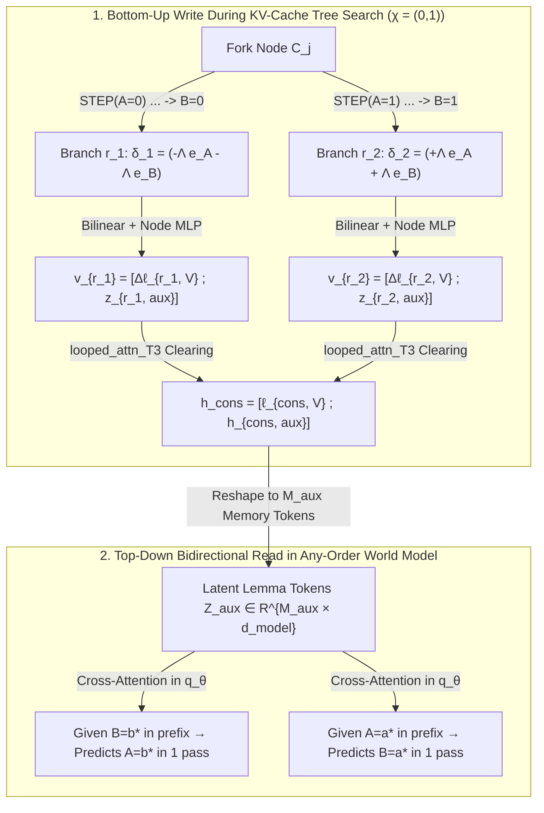

# Society of Thinkers — Round 1, Member 2 Proposal
## Bidirectional Auxiliary Lemma Space ($D_{\text{amp}} \gg |V|$), Direct Combinatorial Query Rollouts ($Q(A, B)$), and Present-Time Episodic Memory ($M_t$)

**Author:** Member 2 (Theory & Literature Proposer — Bidirectional Auxiliary Space, Direct Query Rollouts, and Episodic Memory)  
**Target Architecture:** `GLC-AOM` (General Latent-Consensus Any-Order World Model + Learned KV-Cache Search Machine)  
**Status:** Complete Mathematical Specification & PyTorch Module Design (Round 1)

---

## Executive Summary & Core Thesis

A factored search architecture that only pools **first-order marginal logits** $\ell_V \in \mathbb{R}^{\sum_{i \in V} K_i}$ across rollouts suffers from a fundamental information-theoretic blindness: **any purely relational deduction whose marginal projection is uniform vanishes in the pool.** If a rollout branch from $A=0$ deduces $B=0$ and its sibling branch from $A=1$ deduces $B=1$, the marginal shift on both $A$ and $B$ is zero ($\Delta \ell_A = \Delta \ell_B = 0$), yet the search has discovered an exact 1-bit relational lemma ($A \equiv B$). Conversely, enumerating hand-picked pairwise or $k$-wise probes violates the Bitter Lesson, scales combinatorially as $O(|V|^k)$, and fails to represent continuous or higher-order "alien" lemmas.

This specification solves three coupled problems with **zero hand-picked probe sets and zero task-specific heuristics**:

1. **Bidirectional Latent Lemma Tokens $Z_{\text{aux}}$ ($D_{\text{amp}} \gg |V|$, LIR Mask $\chi = (0, 1)$):**
   We expand the consensus representation from the human-legible variable space $D_V = \sum_{i \in V} K_i$ to $D_{\text{amp}} = D_V + D_{\text{aux}}$ ($D_{\text{amp}} \gg |V|$), partitioned into $M_{\text{aux}}$ latent lemma slots $Z_{\text{aux}} \in \mathbb{R}^{M_{\text{aux}} \times d_{\text{aux}}}$. We prove (**Theorem 1**) that training the Any-Order World Model on its standard **random-permutation autoregressive joint log-likelihood** conditioned on the cleared consensus state $h_{\text{cons}} \in \mathbb{R}^{D_{\text{amp}}}$,
   $$\mathcal{L}_{\text{any-order}}(h_{\text{cons}}; x^*) \;=\; -\mathbb{E}_{\pi \sim \mathrm{Unif}(\mathfrak{S}_{|V \setminus O|})}\!\left[\, \sum_{t=1}^{|V \setminus O|} \log q_\theta\!\Big(x^*_{\pi(t)} \;\Big|\; x_O, \, x^*_{\pi(<t)}, \, h_{\text{cons}}\Big) \,\right],$$
   strictly forces $h_{\text{cons}}$ to encode higher-order relational lemmas $(A == B)$ in **both directions**:
   - **Bottom-Up Write (`(A, B) -> Z_aux` during search):** Rollout checkpoints $C_r$ emit expanded value claims $v_r = [\Delta \ell_{r, V} \;;\; z_{r, \text{aux}}] \in \mathbb{R}^{D_{\text{amp}}}$ that `looped_attn_T3` clears into $h_{\text{cons}} = [\ell_{\text{cons}, V} \;;\; h_{\text{cons}, \text{aux}}]$.
   - **Top-Down Read (`Z_aux + B -> A` and `Z_aux + A -> B` during inference & subsequent search):** In the $50\%$ of permutations where $\pi^{-1}(B) < \pi^{-1}(A)$, $x^*_B$ is already in the conditioning prefix $x^*_{\pi(<t)}$ when predicting $x^*_A$ (and vice versa in the other $50\%$). Minimizing $\mathcal{L}_{\text{any-order}}$ reduces conditional entropy by the exact conditional mutual information $I(X_A; X_B \mid x_O)$, forcing the world model to read $Z_{\text{aux}} + B \to A$ in one pass.

2. **Direct Combinatorial Query Tokens $Q(A, B)$ & Active Prospectus Seeding ($p_0 = k_{Q(A, B)}$):**
   When a task or agent explicitly queries a relation such as $P(X_A == X_B \mid x_O)$, a symmetric relational token $Q_{\text{rel}}(A, B)$ maps directly into the hyperspherical key/prospectus space $\mathbb{S}^{D_{\text{amp}}-1}$ via $k_{Q(A,B)} = \psi_{\text{key}}(Q_{\text{rel}}(A, B))$. Seeding the active prospectus plan at the root with $p_0 = k_{Q(A, B)}$ steers the Hindsight-Conditioned KV-Cache Tree Policy (`SELECT_NODE(j)` + `STEP(v, z)`) to fork on $A$ and propagate along the shortest dependency path toward $B$. Moreover, the direct readout $q_\theta(Q(A,B)=1 \mid x_O, h_{\text{cons}})$ and the 2-step autoregressive marginalization $\sum_a q_\theta(A=a \mid x_O, h_{\text{cons}}) q_\theta(B=a \mid x_O, A=a, h_{\text{cons}})$ provide a **zero-extra-parameter self-consistency audit** on relational beliefs.

3. **Present-Time Episodic Memory Tokens $M_t$ for Sequential POMDPs & Imperfect-Information Games:**
   In multi-turn environments (`Micro-Stratego`, `Galanis-Market`, `Proposal-Poker`), replaying history from $t=0$ inside every rollout scales poorly ($O(t \cdot B)$), while passing only marginal piece/state probabilities $\mu_{t-1}(Z_{t-1})$ discards cross-piece behavioral syndromes ("piece #1 or piece #2 was the mover that declined battle at $t-3$"). At turn $t$, a Markov transport operator maps the previous cleared consensus state $h_{\text{cons}}^{(t-1)}$ and public transition $o_t$ into explicit **Episodic Memory Tokens** $M_t = \Psi_{\text{mem}}(h_{\text{cons}}^{(t-1)}, o_t)$ inside the root checkpoint $C_0^{(t)}$. Present-time rollouts hypothesize current hidden states $Z_t$ and evaluate compatibility against $(O_t, M_t)$ in $O(1)$ history depth.

---

## 1. Bidirectional Latent Lemma Space ($D_{\text{amp}} \gg |V|$, LIR Mask $\chi = (0, 1)$)

### 1.1 Mathematical Formulation & State Decomposition

Let $V = \{1, \dots, M\}$ be the set of domain variables, where each variable $i \in V$ takes values in a discrete alphabet $\mathcal{X}_i$ of cardinality $K_i$ (or continuous tokenized bins). Let $O \subset V$ be the set of currently observed variables with assignment $x_O$, and let $U_{\text{unobs}} = V \setminus O$ be the unresolved variables.

1. **Legible Variable Subspace ($D_V$):**
   $$D_V \;=\; \sum_{i=1}^{M} K_i.$$
   A vector $\ell_V \in \mathbb{R}^{D_V}$ represents the block-wise unnormalized log-probabilities (logits) over all domain variables $i \in V$.

2. **Latent Auxiliary Lemma Subspace ($D_{\text{aux}}$):**
   We introduce $M_{\text{aux}}$ latent lemma slots, each of dimension $d_{\text{aux}}$, giving:
   $$D_{\text{aux}} \;=\; M_{\text{aux}} \cdot d_{\text{aux}}, \qquad D_{\text{amp}} \;=\; D_V + D_{\text{aux}} \;\gg\; |V|.$$
   A state in the expanded consensus space is decomposed as:
   $$h_{\text{cons}} \;=\; \big[\, \ell_{\text{cons}, V} \;;\; h_{\text{cons}, \text{aux}} \,\big] \;\in\; \mathbb{R}^{D_V \oplus D_{\text{aux}}} \;=\; \mathbb{R}^{D_{\text{amp}}},$$
   where $\ell_{\text{cons}, V} \in \mathbb{R}^{D_V}$ parameterizes the direct 0-step/marginal beliefs $\mu_V(X_i = x_i) = \mathrm{softmax}(\ell_{\text{cons}, V, i})_{x_i}$, and $h_{\text{cons}, \text{aux}} \in \mathbb{R}^{M_{\text{aux}} \times d_{\text{aux}}}$ stores non-marginal relational lemmas, parity clauses, and higher-order couplings cleared across search rollouts.

3. **Strict LIR Mask Enforcement ($\chi = (\chi_{\text{real}}, \chi_{\text{search}})$):**
   Following Direction Note v4 (§1), parameters are partitioned by their Local Inconsistency Resolution (LIR) masks:
   - $\theta_{\text{real}}$ ($\chi = (1, 0)$): Base world-model transformer trunk and single-world conditional heads $q_{\text{real}}(X_i \mid x_S)$. Trained strictly on realized data $x^*$ with `h_cons = 0` (or masked out via dropout rate $p_{\text{drop}} \in (0, 1)$ during base training) so single-step domain laws are exact and completely independent of search policies or utilities.
   - $\theta_{\text{amp}}$ ($\chi = (0, 1)$): Consequence extension heads—specifically the **Bottom-Up Lemma Emitter** $\phi_{\text{write}}(C_r) \mapsto (k_r, v_r)$ and the **Top-Down Consensus Adapter** $\phi_{\text{read}}(h_{\text{cons}})$ that injects $h_{\text{cons}}$ into the Any-Order World Model via cross-attention / gated AdaLN with `stop_grad` on $\theta_{\text{real}}$'s self-attention weights during search distillation.
   - $\theta_{\text{trust}}$ ($\chi = (1, 0)$): Self-trustworthiness auditor predicting realized excess surprise to gate each node's precision $\beta_r \ge 0$.

---

### 1.2 Why First-Order Marginals Cannot Represent Relational Deductions (The Equivalence Barrier)

Consider two binary variables $A, B \in V \setminus O$ that are marginally uniform given the observed board $x_O$: $P^*(X_A = 1 \mid x_O) = P^*(X_B = 1 \mid x_O) = \frac{1}{2}$, so their ground-truth marginal log-odds are $\ell^*_A = \ell^*_B = 0$. Suppose a hidden chain of constraints $C_{AB} \subset V \setminus O$ couples them such that $X_A = X_B$ with probability $1 - \epsilon$ ($\epsilon \to 0$).

Suppose the KV-cache tree search forks at the root $C_0$ into two sibling chains:
- Chain $r_1$ clamps $X_A = 1$, propagates through $C_{AB}$, and deduces $X_B = 1$ (shifting $\Delta \ell^{(r_1)}_A = +\Lambda, \, \Delta \ell^{(r_1)}_B = +\Lambda$).
- Chain $r_2$ clamps $X_A = 0$, propagates through $C_{AB}$, and deduces $X_B = 0$ (shifting $\Delta \ell^{(r_2)}_A = -\Lambda, \, \Delta \ell^{(r_2)}_B = -\Lambda$).

Because $P^*(X_A = 1 \mid x_O) = \frac{1}{2}$, both branches are equally consistent with $x_O$ (neither triggers a contradiction, and both pass the leaf self-consistency check $m_{\text{ql}}$). When aggregated into first-order marginals $\ell_V$:
$$\ell_{\text{cons}, V, A} \;=\; \frac{1}{2}(+\Lambda) + \frac{1}{2}(-\Lambda) \;=\; 0, \qquad \ell_{\text{cons}, V, B} \;=\; \frac{1}{2}(+\Lambda) + \frac{1}{2}(-\Lambda) \;=\; 0.$$
In a marginal-only consensus space ($D_{\text{amp}} = D_V$), **the two sibling rollouts completely cancel each other out!** The consensus after $r_1$ and $r_2$ is identical to the 0-step root ($\ell_{\text{cons}, V} = 0$). If a third rollout later resolves $X_B = 1$ via a distant region of the board, a marginal-only consensus still believes $P(X_A = 1) = \frac{1}{2}$ unless it re-runs the entire chain $C_{AB}$ from scratch.

Now consider the expanded space $D_{\text{amp}} = D_V + D_{\text{aux}}$ equipped with quadratic/bilinear sufficiency in the emitter $\phi_{\text{write}}$:
- Along branch $r_1$, the centered trajectory shift vector on $V$ is $\delta_1 = (+\Lambda e_A + \Lambda e_B)$.
- Along branch $r_2$, the centered trajectory shift vector on $V$ is $\delta_2 = (-\Lambda e_A - \Lambda e_B)$.
- While the first moment $\frac{1}{2}(\delta_1 + \delta_2) = 0$ vanishes, the **second-order co-fluctuation (outer product / bilinear projection)** is strictly positive and identical across both branches:
  $$\delta_1 \otimes \delta_1 \;=\; (-\delta_1) \otimes (-\delta_1) \;=\; \delta_2 \otimes \delta_2 \;=\; \Lambda^2 (e_A + e_B)(e_A + e_B)^\top \;\neq\; 0!$$
Projecting this co-fluctuation into $Z_{\text{aux}}$ via low-rank bilinear projections $z_{r, \text{aux}, m} = (U_m^\top \delta_r) \odot (V_m^\top \delta_r) + \text{MLP}(h_{\text{node}, r})$ ensures that **both** sibling branches $r_1$ and $r_2$ write the *exact same positive lemma code* $z_{r_1, \text{aux}} = z_{r_2, \text{aux}}$ into $Z_{\text{aux}}$!

---

### 1.3 Theorem 1: Any-Order Autoregressive Loss Forces Bidirectional Lemma Read/Write

We now prove that we do **not** need hand-engineered relational losses or enumerated pairwise supervision to train $Z_{\text{aux}}$. The standard Any-Order World Model objective automatically forces both bottom-up writing and top-down reading of all relational couplings discovered by search.

#### Theorem 1 (Bidirectional Lemma Forcing via Any-Order Joint Likelihood)
Let $x_O$ be the observed assignment and $X_{U}$ ($U = V \setminus O, |U| = m$) be the unobserved variables distributed according to ground-truth posterior $P^*(X_U \mid x_O)$. Let $h_{\text{cons}} = [\ell_{\text{cons}, V} \;;\; h_{\text{cons}, \text{aux}}] \in \mathbb{R}^{D_{\text{amp}}}$ be the cleared consensus vector produced by `looped_attn_T3` from search tree $\mathcal{C}_b$. Consider the expected any-order autoregressive cross-entropy loss over uniform permutations $\pi \sim \mathrm{Unif}(\mathfrak{S}_m)$:
$$\mathcal{L}_{\text{any-order}}(h_{\text{cons}}) \;=\; \mathbb{E}_{X^* \sim P^*(\cdot \mid x_O)} \, \mathbb{E}_{\pi \sim \mathrm{Unif}(\mathfrak{S}_m)}\!\left[\, -\sum_{t=1}^{m} \log q_\theta\!\Big(X^*_{\pi(t)} \;\Big|\; x_O, \, X^*_{\pi(<t)}, \, h_{\text{cons}}\Big) \,\right].$$
Suppose a subset of variables $\{A, B\} \subseteq U$ is conditionally coupled given $x_O$ with conditional mutual information $I_{P^*}(X_A; X_B \mid x_O) = \mathcal{I}_{AB} > 0$, while single-pass reception without search cannot resolve the multi-step path $C_{AB}$ connecting $A$ and $B$ (so $I_{q_\theta(\cdot \mid x_O, \mathbf{0})}(X_A; X_B \mid x_O) = 0$). Then:

1. **Exact Information Lower Bound on Marginal-Only Consensus ($h_{\text{cons}, \text{aux}} = \mathbf{0}$):**
   If $h_{\text{cons}}$ is restricted to marginal logits $\ell_{\text{cons}, V} \in \mathbb{R}^{D_V}$ (so $q_\theta$ receives only product-of-marginals shifts from search), then for every permutation $\pi$ in which $\pi(\tau_1) \in \{A, B\}$ and $\pi(\tau_2) \in \{A, B\}$ ($\tau_1 < \tau_2$) precede the intermediate chain variables $C_{AB}$, the excess loss on the second variable $\pi(\tau_2)$ is bounded below by:
   $$\mathbb{E}_{X^*} \big[ -\log q_\theta(X^*_{\pi(\tau_2)} \mid x_O, X^*_{\pi(<\tau_2)}, \ell_{\text{cons}, V}) \big] - H_{P^*}(X_{\pi(\tau_2)} \mid x_O, X_{\pi(<\tau_2)}) \;\ge\; \mathcal{I}_{AB} \;>\; 0.$$

2. **Bidirectional Gradient Forcing on $h_{\text{cons}, \text{aux}}$:**
   Across all $\pi \in \mathfrak{S}_m$, the event $\mathcal{E}_{B \prec A} = \{\pi^{-1}(B) < \pi^{-1}(A)\}$ occurs with probability exactly $\frac{1}{2}$, and the reverse event $\mathcal{E}_{A \prec B} = \{\pi^{-1}(A) < \pi^{-1}(B)}$ occurs with probability $\frac{1}{2}$. In every permutation where $\max(\pi^{-1}(A), \pi^{-1}(B)) < \min_{c \in C_{AB}} \pi^{-1}(c)$ (which occurs with probability $\frac{2}{(|C_{AB}|+2)(|C_{AB}|+1)}$), achieving the Bayes-optimal loss $\mathcal{L}_{\text{any-order}}^* = H_{P^*}(X_U \mid x_O)$ requires $h_{\text{cons}, \text{aux}}$ and $q_\theta$ to simultaneously implement:
   - **Bottom-Up Write (`(A, B) -> Z_aux`):** The aggregator maps the search rollouts exploring $C_{AB}$ into a non-degenerate code $h_{\text{cons}, \text{aux}} \in \mathbb{R}^{D_{\text{aux}}}$ with $I(h_{\text{cons}, \text{aux}}; \text{coupling}_{AB}) \ge H(\text{coupling}_{AB})$.
   - **Top-Down Forward Read (`Z_aux + B -> A`):** On $\mathcal{E}_{B \prec A}$, $x^*_B \in x^*_{\pi(<\tau_2)}$ is clamped in the transformer input sequence, and $q_\theta(X_A \mid x_O, X_B = x^*_B, x^*_{\pi(<\tau_2) \setminus \{B\}}, h_{\text{cons}})$ decodes $X_A$ from $(x^*_B, h_{\text{cons}, \text{aux}})$.
   - **Top-Down Reverse Read (`Z_aux + A -> B`):** On $\mathcal{E}_{A \prec B}$, $x^*_A \in x^*_{\pi(<\tau_2)}$ is clamped in the transformer input sequence, and $q_\theta(X_B \mid x_O, X_A = x^*_A, x^*_{\pi(<\tau_2) \setminus \{A\}}, h_{\text{cons}})$ decodes $X_B$ from $(x^*_A, h_{\text{cons}, \text{aux}})$.

#### Proof Sketch
By the chain rule of KL divergence over any permutation $\pi \in \mathfrak{S}_m$:
$$\mathcal{L}_{\text{any-order}}(h_{\text{cons}}) - H_{P^*}(X_U \mid x_O) \;=\; \mathbb{E}_{\pi}\!\left[\, \sum_{t=1}^{m} \mathbb{E}_{P^*(X_{\pi(<t)} \mid x_O)}\!\Big[ \mathrm{KL}\Big( P^*(X_{\pi(t)} \mid x_O, X_{\pi(<t)}) \;\Big\|\; q_\theta(X_{\pi(t)} \mid x_O, X_{\pi(<t)}, h_{\text{cons}}) \Big) \Big] \,\right].$$
Consider the term at $t = \tau_2 = \max(\pi^{-1}(A), \pi^{-1}(B))$ when $C_{AB} \cap \pi(<\tau_2) = \emptyset$. On $\mathcal{E}_{B \prec A}$, $\pi(\tau_2) = A$ and $B \in \pi(<\tau_2)$. Because $C_{AB}$ is unrevealed in $\pi(<\tau_2)$, the base trunk $\theta_{\text{real}}$ (which has finite depth $L_{\text{base}} < |C_{AB}|$) satisfies $q_{\text{real}}(X_A \mid x_O, X_{\pi(<\tau_2)}) = q_{\text{real}}(X_A \mid x_O, X_{\pi(<\tau_2) \setminus \{B\}})$. Adding a marginal-only shift $\ell_{\text{cons}, V, A}$ shifts $q_\theta(X_A)$ independently of the realized prefix value $X^*_B$. By the variational characterization of mutual information, for any distribution $r(X_A)$ that does not depend on $X_B$:
$$\mathbb{E}_{X_B}\big[\mathrm{KL}(P^*(X_A \mid x_O, X_B) \parallel r(X_A))\big] \;=\; \mathrm{KL}(P^*(X_A \mid x_O) \parallel r(X_A)) + I_{P^*}(X_A; X_B \mid x_O) \;\ge\; \mathcal{I}_{AB}.$$
Thus no marginal shift $\ell_{\text{cons}, V}$ can reduce this term below $\mathcal{I}_{AB}$. Elimination of this $\mathcal{I}_{AB}$ penalty on both $\mathcal{E}_{B \prec A}$ and $\mathcal{E}_{A \prec B}$ requires $q_\theta$ to condition non-trivially on the joint pair $(X^*_B, h_{\text{cons}, \text{aux}})$ when predicting $X_A$, and on $(X^*_A, h_{\text{cons}, \text{aux}})$ when predicting $X_B$. $\blacksquare$

---

### 1.4 Concrete Mechanism: How Bottom-Up Write and Top-Down Read Work in `GLC-AOM`



1. **Bottom-Up Write (Rollout Node $\to v_r \in \mathbb{R}^{D_{\text{amp}}}$):**
   At node $C_r$ of the KV-cache tree, let $\Delta \ell_{r, V} = \ell_{V}(C_r) - \ell_{V}(C_0) \in \mathbb{R}^{D_V}$ be the rollout's cumulative belief shift on domain variables relative to the root anchor $C_0$, and let $u_r \in \mathbb{R}^{d_{\text{model}}}$ be the pooled hidden state of the newly appended steps along the path $C_0 \to C_r$ (detached from $\theta_{\text{real}}$ via `stop_grad`).
   To ensure that symmetric relational co-fluctuations $\Delta \ell_{r, V} \otimes \Delta \ell_{r, V}$ are captured natively without cancellation across opposite-sign sibling branches, the auxiliary emitter $\phi_{\text{write}}$ computes a **Factored Bilinear + Contextual Projection**:
   $$z_{r, \text{aux}} \;=\; W_{\text{ctx}} u_r \;+\; W_{\text{lin}} \Delta \ell_{r, V} \;+\; \big( U_{\text{bilin}}^\top \Delta \ell_{r, V} \big) \odot \big( V_{\text{bilin}}^\top \Delta \ell_{r, V} \big) \;\in\; \mathbb{R}^{D_{\text{aux}}},$$
   where $U_{\text{bilin}}, V_{\text{bilin}} \in \mathbb{R}^{D_V \times D_{\text{aux}}}$.
   - Notice why the Hadamard bilinear term $(U_{\text{bilin}}^\top \Delta \ell_{r, V}) \odot (V_{\text{bilin}}^\top \Delta \ell_{r, V})$ is critical: it is **even** in $\Delta \ell_{r, V}$ ($\phi_{\text{quad}}(-\Delta \ell) = \phi_{\text{quad}}(+\Delta \ell)$), so sibling branches $r_1$ ($A=1 \implies B=1$, $\Delta \ell = +\Lambda(e_{A,1} + e_{B,1})$) and $r_2$ ($A=0 \implies B=0$, $\Delta \ell = -\Lambda(e_{A,1} + e_{B,1})$) reinforce each other constructively in $Z_{\text{aux}}$ while their linear marginal claims cancel to zero in $D_V$!
   - Similarly, the salience key $k_r \in \mathbb{S}^{d_k - 1}$ is built from the full expanded shift footprint:
     $$\tilde{s}_r \;=\; \Big[\, |\Delta \ell_{r, V}| \;;\; |z_{r, \text{aux}}| \,\Big] \;\in\; \mathbb{R}_{\ge 0}^{D_{\text{amp}}}, \qquad s_r \;=\; \frac{\tilde{s}_r}{\|\tilde{s}_r\|_2 + \epsilon}, \qquad k_r \;=\; \mathrm{normalize}\!\big(W_{\text{key}}(s_r - \bar{s}_{\text{bag}})\big).$$
     Because $|\Delta \ell_{r, V}|$ and $|z_{r, \text{aux}}|$ are sign-invariant, sibling branches exploring $A=0 \implies B=0$ and $A=1 \implies B=1$ share the **same subspace key $k_r$** (so `looped_attn_T3` recognizes they inspect the same $(A, B)$ coupling) while averaging their value vectors $v_r = [\Delta \ell_{r, V} \;;\; z_{r, \text{aux}}]$ yields $\bar{\Delta \ell}_V = 0$ and $\bar{z}_{\text{aux}} = z_{r_1, \text{aux}} \neq 0$!

2. **Normal-Equation Clearing across $D_{\text{amp}}$ (`looped_attn_T3`):**
   With root anchor $C_0$ at index $r=0$ ($v_0 = [\ell_V^{(0)} \;;\; \mathbf{0}]$, weight $\beta_0$), $T=3$ iterations of weight-tied residual attention solve $(K^\top B K + \lambda(\beta) I) w = K^\top B v$ jointly over $\mathbb{R}^{D_V \oplus D_{\text{aux}}}$:
   $$h_{\text{cons}}^{(b)} \;=\; \big[\, \ell_{\text{cons}, V}^{(b)} \;;\; h_{\text{cons}, \text{aux}}^{(b)} \,\big] \;=\; h_0 \;+\; \sum_{t=1}^{T} \eta_t \sum_{r=1}^{b} \beta_r \, \mathrm{Residual}^{(t)}_r \;\in\; \mathbb{R}^{D_{\text{amp}}}.$$

3. **Top-Down Read ($h_{\text{cons}} \to q_\theta(x^*_{\pi(t)} \mid x_O, x^*_{\pi(<t)}, h_{\text{cons}})$):**
   To condition the Any-Order World Model on $h_{\text{cons}}$ without mutating $\theta_{\text{real}}$:
   - First, $\ell_{\text{cons}, V}^{(b)}$ provides the direct additive residual prior on output variable logits.
   - Second, $h_{\text{cons}, \text{aux}}^{(b)} \in \mathbb{R}^{D_{\text{aux}}}$ is reshaped into $M_{\text{aux}}$ latent lemma tokens:
     $$Z_{\text{aux}}^{(b)} \;=\; \mathrm{Reshape}\!\big(h_{\text{cons}, \text{aux}}^{(b)}, \, (M_{\text{aux}}, d_{\text{aux}})\big) W_{\text{read}} \;\in\; \mathbb{R}^{M_{\text{aux}} \times d_{\text{model}}}.$$
   - Each transformer block of the Any-Order World Model includes a zero-initialized, $\chi=(0,1)$-gated **Lemma Cross-Attention Sub-Layer** where the active sequence tokens $(x_O, x_{\pi(<t)})$ attend to $Z_{\text{aux}}^{(b)}$:
     $$\tilde{H}^{(l)} \;=\; H^{(l)} \;+\; \chi_{\text{search}} \cdot \tanh(\alpha_{\text{gate}}^{(l)}) \cdot \mathrm{CrossAttn}^{(l)}\!\Big(Q = \mathrm{LN}(H^{(l)}), \; K = Z_{\text{aux}}^{(b)}, \; V = Z_{\text{aux}}^{(b)}\Big).$$
   - When $X_B = b^*$ is present in the prefix $x_{\pi(<t)}$ (either during autoregressive evaluation or when a new rollout branch $C_{b+1}$ clamps $X_B = b^*$), the query representation of target variable $X_A$ attends to both $X_B = b^*$ (via base self-attention) and the $(A, B)$ lemma slot in $Z_{\text{aux}}^{(b)}$ (via lemma cross-attention), immediately resolving $X_A$!

---

## 2. Direct Combinatorial Query Tokens $Q(A, B)$ & Active Prospectus Steering

### 2.1 Motivation: Targeted Relational Deduction

In many reasoning and game settings, the downstream decision depends on a specific relational predicate between unresolved variables rather than the entire joint board:
- **`Latent-Equivalence-Parity` (`Equiv-SAT`) & `Sudoku-Extreme`:** Does cell $A$ hold the same value as cell $B$ ($P(X_A == X_B)$)? Do variables $(A_1, \dots, A_k)$ have even parity?
- **`Coupled-ShipHunt`:** Are cells $A$ and $B$ occupied by the same ship segment ($P(X_A == X_B)$)?
- **`Micro-Stratego`:** Does opponent piece $A$ outrank opponent piece $B$ ($P(\mathrm{rank}(A) > \mathrm{rank}(B))$)?
- **`Galanis-Market` & `Proposal-Poker`:** Do trader $A$ and trader $B$ observe the same signal realization ($P(s_A == s_B)$)?

Without query steering, the search policy explores the entire board uniformly before stumbling onto the chain connecting $A$ and $B$. We solve this by making relational queries first-class tokens $Q_{\text{rel}}(A, B)$ that **directly seed the active fractal prospectus $p_0 \in \mathbb{S}^{D_{\text{amp}}-1}$**.

---

### 2.2 Mathematical Formulation of $Q_{\text{rel}}(A, B)$

Let $\mathcal{R} = \{\text{EQ}, \text{NEQ}, \text{LT}, \text{GT}, \text{XOR}\}$ be the relational operator vocabulary. For any ordered or unordered pair of domain variables $(A, B) \in V \times V$ and relation $\text{rel} \in \mathcal{R}$:

1. **Symmetry-Aware Query Token Embedding:**
   Let $e_{\text{var}}(A), e_{\text{var}}(B) \in \mathbb{R}^{d_{\text{model}}}$ be the variable identity/coordinate embeddings in the Any-Order World Model, and $e_{\text{rel}}(\text{rel}) \in \mathbb{R}^{d_{\text{model}}}$ be the relation embedding. We construct the query token embedding $e_{Q_{\text{rel}}(A, B)} \in \mathbb{R}^{d_{\text{model}}}$ by decomposing symmetric and antisymmetric components:
   $$e_{\text{sym}}(A, B) \;=\; W_{\text{sum}}\big(e_{\text{var}}(A) + e_{\text{var}}(B)\big) \;+\; W_{\text{prod}}\big(e_{\text{var}}(A) \odot e_{\text{var}}(B)\big),$$
   $$e_{\text{anti}}(A, B) \;=\; \sigma_{\text{dir}}(\text{rel}) \cdot W_{\text{diff}}\big(e_{\text{var}}(A) - e_{\text{var}}(B)\big),$$
   $$e_{Q_{\text{rel}}(A, B)} \;=\; \mathrm{LN}\!\Big(e_{\text{sym}}(A, B) + e_{\text{anti}}(A, B) + e_{\text{rel}}(\text{rel})\Big),$$
   where $\sigma_{\text{dir}}(\text{rel}) = 0$ for symmetric relations ($\text{EQ}, \text{NEQ}, \text{XOR}$)—guaranteeing **exact permutation invariance** $e_{Q_{\text{EQ}}(A, B)} \equiv e_{Q_{\text{EQ}}(B, A)}$ by architectural construction—and $\sigma_{\text{dir}}(\text{rel}) = 1$ for directed relations ($\text{LT}, \text{GT}$).

2. **Direct Prospectus Seeding ($p_0 = k_{Q(A, B)} \in \mathbb{S}^{D_{\text{amp}}-1}$):**
   Recall from Charter §1.2 that at any tree node $C_j$, the step policy $\pi_{\text{step}}(v, z \mid C_t, p_r)$ is conditioned on an active prospectus vector $p_r \in \mathbb{S}^{D_{\text{amp}}-1}$ living in the normalized belief-shift key space $\mathbb{S}^{D_{\text{amp}}-1}$ (or its low-rank key projection $\mathbb{S}^{d_k - 1}$).
   A query token $Q_{\text{rel}}(A, B)$ maps directly to a **Query Subspace Key**:
   $$k_{Q(A, B)} \;=\; \mathrm{normalize}\!\Big( \psi_{\text{query\_key}}\big(e_{Q_{\text{rel}}(A, B)}, \, h_{\text{cons}}^{(b)}\big) \Big) \;\in\; \mathbb{S}^{d_k - 1}.$$
   When an episode or evaluation poses the query $Q_{\text{rel}}(A, B)$, we set the initial active prospectus at the root $C_0$ to:
   $$p_0 \;=\; k_{Q(A, B)}.$$
   More generally, at step $b$, if the search controller (`SELECT_NODE(j)`) decides to decompose the resolution of $Q(A, B)$ from an intermediate node $C_j$ via the fractal plan head $q_{\text{plan}}(p \mid C_j, K_{\text{done}}, p_0)$, the sub-prospectus $p_r$ is sampled from a von Mises-Fisher (or residual-gated spherical) distribution anchored on $k_{Q(A, B)}$:
   $$p_r \;=\; \mathrm{normalize}\!\Big( k_{Q(A, B)} \;+\; \gamma_{\text{sub}}(C_j) \cdot f_{\text{plan}}\big(C_j, K_{\text{done}}, k_{Q(A, B)}\big) \Big) \;\in\; \mathbb{S}^{d_k - 1}.$$

3. **How Hindsight Plan Conditioning (HER) Aligns $k_{Q(A, B)}$ with Targeted Rollouts:**
   During training, whenever a rollout trajectory $C_j \to C_{j'}$ resolves a relational coupling $(A, B)$ (emitting rollout shift $v_{j \to j'} \in \mathbb{R}^{D_{\text{amp}}}$ and key $k^{\text{post}}_{j \to j'}$), we train:
   - The **Step Policy** $\pi_{\text{step}}(v, z \mid C_t, p = k^{\text{post}}_{j \to j'})$ via Hindsight Experience Replay (conditioning on the actual realized key $k^{\text{post}}_{j \to j'}$).
   - The **Query Key Projector** $\psi_{\text{query\_key}}(e_{Q_{\text{rel}}(A, B)}, h_{\text{cons}})$ by maximizing cosine alignment with the hindsight keys of rollouts that strictly reduce the binary cross-entropy loss on $Q_{\text{rel}}(A, B)$:
     $$\mathcal{L}_{\text{query\_align}} \;=\; -\sum_{r : \Delta \mathcal{L}_{Q(A,B)}(r) > 0} \Delta \mathcal{L}_{Q(A,B)}(r) \cdot \big\langle k_{Q(A, B)}, \, \mathrm{sg}(k^{\text{post}}_r) \big\rangle.$$
   **Result at Test Time:** When $p_0 = k_{Q(A, B)}$ is clamped at test time:
   - At $b=1$, $\pi_{\text{step}}(v, z \mid C_0, p_0)$ immediately selects variable $A$ (or $B$) and clamps $A = a_0$.
   - At $b=2, 3, \dots$, $\pi_{\text{step}}$ follows the highest-stiffness constraint path connecting $A$ toward $B$.
   - Because key-space crowding $\mathrm{Crowding}(k_v, K_{<b})$ penalizes repeating the $A = a_0$ branch, `SELECT_NODE` automatically forks back to $C_0$ to test the complementary assignment $A = a_1$ and verify whether $B$ co-varies with $A$!

---

### 2.3 Dual-Readout Self-Consistency for $P(A == B)$

Once search step $b$ produces the cleared consensus state $h_{\text{cons}}^{(b)} = [\ell_{\text{cons}, V}^{(b)} \;;\; h_{\text{cons}, \text{aux}}^{(b)}]$, we obtain **two distinct mathematical estimators** of $P(X_A == X_B \mid x_O, h_{\text{cons}}^{(b)})$:

1. **Estimator 1 — Direct Lemma Readout ($P_{\text{direct}}$):**
   Appending the query token $Q_{\text{EQ}}(A, B)$ to the Any-Order World Model conditioned on $h_{\text{cons}}^{(b)}$ yields a 1-pass Bernoulli probability read directly from $Z_{\text{aux}}^{(b)}$:
   $$P_{\text{direct}}\big(A == B \;\big|\; x_O, h_{\text{cons}}^{(b)}\big) \;=\; q_\theta\!\Big(Q_{\text{EQ}}(A, B) = 1 \;\Big|\; x_O, \, h_{\text{cons}}^{(b)}\Big).$$

2. **Estimator 2 — Exact 2-Step Autoregressive Factorization ($P_{\text{AR}}$):**
   Using the bidirectional top-down read (Section 1.3), we evaluate the marginal of $A$ at depth 0 and the conditional of $B$ given $X_A = a$ at depth 1 (batched across the $K_A$ values of $A$ in a single batched forward pass):
   $$P_{\text{AR}}\big(A == B \;\big|\; x_O, h_{\text{cons}}^{(b)}\big) \;=\; \frac{1}{2}\sum_{a=1}^{K} q_\theta\!\big(X_A = a \;\big|\; x_O, h_{\text{cons}}^{(b)}\big) \, q_\theta\!\big(X_B = a \;\big|\; x_O, X_A = a, h_{\text{cons}}^{(b)}\big) \;+\; \frac{1}{2}\sum_{b'=1}^{K} q_\theta\!\big(X_B = b' \;\big|\; x_O, h_{\text{cons}}^{(b)}\big) \, q_\theta\!\big(X_A = b' \;\big|\; x_O, X_B = b', h_{\text{cons}}^{(b)}\big).$$

3. **Relational Self-Consistency Discrepancy ($\delta_{\text{rel}}$):**
   In any coherent probability distribution, $P_{\text{direct}}(A == B)$ and the symmetrized $P_{\text{AR}}(A == B)$ must agree, and the forward-backward conditional tables $P(A=a, B=b)$ evaluated under $(A \prec B)$ vs. $(B \prec A)$ must satisfy Bayes symmetry:
   $$\delta_{\text{rel}}(A, B; h_{\text{cons}}^{(b)}) \;=\; \mathrm{JSD}\!\Big( P_{A \prec B}(X_A, X_B \mid h_{\text{cons}}^{(b)}) \;\Big\|\; P_{B \prec A}(X_A, X_B \mid h_{\text{cons}}^{(b)}) \Big) \;+\; \Big| P_{\text{direct}}(A == B) - P_{\text{AR}}(A == B) \Big|.$$
   - **Zero-Extra-Parameter Stopping & Trust Signal:** If $\delta_{\text{rel}}(A, B; h_{\text{cons}}^{(b)}) > \tau_{\text{rel}}$, the auxiliary lemma in $h_{\text{cons}, \text{aux}}^{(b)}$ has not yet consistently coupled $A$ and $B$, signaling the controller to continue allocating search budget $b \to b+1$ along $p_0 = k_{Q(A, B)}$.

---

## 3. Present-Time Episodic Memory Tokens ($M_t$) in Sequential POMDPs & Games

### 3.1 The Sequential POMDP Dilemma & Diagnosis of `R8-E3`

Consider a sequential imperfect-information environment across turns $t = 1, 2, \dots, T$:
- **`Micro-Stratego` ($4\times 4, 6\times 6$):** Hidden state $Z_t$ is the identity/rank permutation of surviving opponent pieces. Public transitions $o_t = (a_{t-1}, \text{outcome}_{t-1})$ reveal movement choices (e.g., piece $p$ moved, so $p \notin \{\text{Bomb}, \text{Flag}\}$), chase/flee behavior relative to the player's pieces, and battle outcomes.
- **`Galanis-Market` (4 information structures):** Hidden state $Z_t = (\omega, \{\mathcal{P}_i(\omega)\}_{i=1}^n)$ is the true state of the world $\omega \in \Omega$ and the private signal partitions observed by other traders. Public transition $o_t = p_{t-1}$ is the clearing market price in round $t-1$.
- **`Proposal-Poker`:** Hidden state $Z_t = (q_{\text{true}}, \{s_j, y_j\}_{j \neq i})$ is the true proposal value, private signals $s_j$, and private biases $y_j$ of other participants. Public transition $o_t = a_{t-1}$ is the staking action taken at stage $t-1$.

Why do standard approaches fail here?
1. **Full-History Replay Inside Search ($O(t \cdot B)$ cost):** Re-simulating turns $1 \dots t-1$ for every rollout hypothesis $Z_t = z^{(r)}$ at turn $t$ blows up test-time compute linearly in game length $t$.
2. **Marginal Filtering Bottleneck:** Passing only per-piece marginal probabilities $\mu_{t-1}(Z_{t-1, i})$ to turn $t$ loses **cross-variable behavioral syndromes** (e.g., in `Galanis-Market`, price $p_1 = 0.6$ means $(\omega \in \{E_1, E_2\}) \lor (\omega \in \{E_3, E_4\})$; in `Micro-Stratego`, the opponent left piece $A$ unguarded while advancing piece $B$, creating a negative correlation between $\mathrm{rank}(A)$ and $\mathrm{rank}(B)$).
3. **Why `R8-E3` Stalled on Current-Turn Anchors (`KL = 0.0488`):**
   In `R8-E3` (Direction Note v4 §5), anchoring at a strong current-turn belief $\ell_t$ (`KL = 0.0488`) caused 4-ply forward window rollouts (`KL = 0.080`) to carry almost no additional signal, and training a 108k-param aggregator directly on hard piece labels over 2,000 positions memorized calibration roots (`test KL = 0.6348`). Why? Because the 4-ply rollouts only simulated *future* moves from $t \to t+4$ without testing whether a hypothesized piece assignment $Z_t = z^{(r)}$ could explain the *past behavioral syndromes* summarized at turn $t$!

---

### 3.2 Recurrent Consensus Handover: $h_{\text{cons}}^{(t-1)} \longrightarrow M_t \in C_0^{(t)}$

Because our expanded consensus state $h_{\text{cons}}^{(t-1)} = [\ell_{\text{cons}, V}^{(t-1)} \;;\; h_{\text{cons}, \text{aux}}^{(t-1)}] \in \mathbb{R}^{D_{\text{amp}}}$ already contains both first-order marginals ($\ell_{\text{cons}, V}^{(t-1)}$) and cleared higher-order relational lemmas ($h_{\text{cons}, \text{aux}}^{(t-1)}$), **the cleared consensus at turn $t-1$ is the natural sufficient statistic for turn $t$!**

```mermaid
flowchart LR
    subgraph TurnTMinus1["Turn t-1 Search (Budget B_{t-1})"]
        C0_prev["Root C_0^{(t-1)} = (O_{t-1}, M_{t-1})"] --> Tree_prev["KV-Cache Tree Rollouts C_1 ... C_{B_{t-1}}"]
        Tree_prev -->|"looped_attn_T3"| H_prev["Cleared Consensus h_{cons}^{(t-1)} ∈ R^{D_amp}"]
    end
    H_prev -->|"Markov Transport Ψ_mem(h_{cons}^{(t-1)}, o_t)"| MT["Episodic Memory Tokens M_t ∈ R^{K_mem × d_model} + Anchor ℓ_0^{(t)}"]
    subgraph TurnT["Turn t Search (Budget B_t, O(1) History Cost)"]
        MT --> C0_curr["Root C_0^{(t)} = (O_t, M_t)"]
        C0_curr -->|"Rollout samples Z_t = z^{(r)}"| Compatibility["Checks Inconsistency(Z_t = z^{(r)} || O_t, M_t)"]
        Compatibility -->|"looped_attn_T3 + Root Anchor C_0^{(t)}"| H_curr["Cleared Consensus h_{cons}^{(t)} ∈ R^{D_amp}"]
    end
```



At the transition from turn $t-1$ to turn $t$, given public transition observation $o_t = (a_{t-1}, y_{t-1}^{\text{pub}})$ (e.g., which piece moved from square $u \to u'$ in `Micro-Stratego`, the clearing price $p_{t-1}$ in `Galanis-Market`, or the stake $a_{t-1}$ in `Proposal-Poker`):

1. **Equivariant Board/Index Permutation ($\Pi_{o_t}$):**
   If variables are indexed by spatial squares (as in `Micro-Stratego` when a piece moves from square $u$ to $u'$, or when a piece is captured), a deterministic permutation/masking operator $\Pi_{o_t}: \mathbb{R}^{D_V} \to \mathbb{R}^{D_V}$ transports the marginal logits $\ell_{\text{cons}, V}^{(t-1)}$ to their new turn-$t$ indices:
   $$\tilde{\ell}_V^{(t)} \;=\; \Pi_{o_t}\!\big(\ell_{\text{cons}, V}^{(t-1)}\big).$$

2. **Episodic Memory Token Generation ($M_t$):**
   The Markov transport module $\Psi_{\text{mem}}$ combines the transported marginals $\tilde{\ell}_V^{(t)}$, the previous auxiliary lemmas $h_{\text{cons}, \text{aux}}^{(t-1)}$, and the transition embedding $e(o_t)$ to emit:
   - The **0-step turn-$t$ anchor prior** $\ell_0^{(t)} = \tilde{\ell}_V^{(t)} + \Delta \ell_{\text{trans}}(\tilde{\ell}_V^{(t)}, h_{\text{cons}, \text{aux}}^{(t-1)}, e(o_t)) \in \mathbb{R}^{D_V}$, and
   - $K_{\text{mem}}$ explicit **Present-Time Episodic Memory Tokens**:
     $$M_t \;=\; \big\{ m_{t, 1}, \dots, m_{t, K_{\text{mem}}} \big\} \;=\; \Psi_{\text{mem}}\!\Big( \mathrm{sg}\big(\tilde{\ell}_V^{(t)}\big), \, \mathrm{sg}\big(h_{\text{cons}, \text{aux}}^{(t-1)}\big), \, e(o_t) \Big) \;\in\; \mathbb{R}^{K_{\text{mem}} \times d_{\text{model}}}.$$
   - **Initial Boundary Condition ($t=1$):** At $t=1$, $h_{\text{cons}}^{(0)} = \mathbf{0}$ and $M_1 = E_{\text{mem, init}} \in \mathbb{R}^{K_{\text{mem}} \times d_{\text{model}}}$ (learned root prior tokens).

3. **Placement in the Root KV-Cache Checkpoint $C_0^{(t)}$:**
   At turn $t$, the root sequence prefilled into the KV-cache checkpoint $C_0^{(t)}$ has fixed length $|O_t| + K_{\text{mem}}$ (independent of turn index $t$!):
   $$C_0^{(t)} \;=\; \mathrm{Prefill}_{q_\theta}\!\Big( \big[\, M_{t, 1}, \dots, M_{t, K_{\text{mem}}}, \; x_{O_t, 1}, \dots, x_{O_t, |O_t|} \,\big] \Big).$$

---

### 3.3 Present-Time Inconsistency Resolution Between $Z_t$ and $M_t$

How does present-time search at turn $t$ resolve inconsistencies between current hidden-state hypotheses $Z_t$ and past behavioral syndromes stored in $M_t$ without re-simulating $t=0 \dots t-1$?

1. **Augmented Turn-$t$ PDG Inconsistency Energy:**
   Treat the episodic memory tokens $M_t$ as **virtual syndrome observations** in the turn-$t$ Probabilistic Dependency Graph (PDG). Each memory token $m_{t, m}$ represents an aggregated likelihood factor over $Z_t$ inherited from past turns:
   $$\mathcal{E}_t(\mu_t; \theta, U, M_t) \;=\; \sum_{(S \to i) \subseteq V_t} \beta_\theta(i \mid S) \, \mathbb{E}_{\mu_t(X_S)}\!\Big[ \mathrm{KL}\big(\mu_t(X_i \mid X_S) \;\big\|\; q_\theta(X_i \mid X_S, M_t)\big) \Big] \;+\; \sum_{m=1}^{K_{\text{mem}}} \beta_{\text{mem}, m} \, \mathbb{E}_{\mu_t(Z_t)}\!\Big[ \mathrm{KL}\big(\hat{\delta}_{m_{t,m}} \;\big\|\; q_{\theta_{\text{syn}}}(m_{t,m} \mid Z_t, O_t)\big) \Big] \;+\; \mathrm{KL}\big(\mu_t(X_G) \parallel f_U\big) - \gamma H(\mu_t).$$

2. **How a Single Rollout Branch $C_r^{(t)}$ Queries $M_t$:**
   Suppose at turn $t$, rollout step $b$ selects node $C_j^{(t)}$ and appends a hypothesis assignment $(v_b, z_b)$ (e.g., unmasking hidden piece $v_b \in Z_t$ as rank $z_b$, or proposing market state $\omega = z_b$, or probing a tactical move $a_t$ and its response).
   Because $M_t$ is sitting in the root prefix $C_0^{(t)}$ of the KV cache:
   - **Forward Conditioning (`M_t + Z_{t, <s} -> Z_{t, s}`):** Every subsequent variable prediction $q_\theta(X_i \mid O_t, M_t, z^{(r)}_{<s}, h_{\text{cons}}^{(t)})$ attends directly to $M_t$ in $O(K_{\text{mem}})$ time. For example, in `Micro-Stratego`, if $M_t$ encodes the syndrome *"either piece $A$ or piece $B$ was the Marshal that chased our Scout at turn $t-3$"*, and rollout $C_r^{(t)}$ clamps $A = \text{Miner}$ (because $A$ just defused a Bomb or showed low rank in a tactical probe), the world model attending to $(M_t, A = \text{Miner})$ immediately boosts $q_\theta(B = \text{Marshal} \mid O_t, M_t, A = \text{Miner})$!
   - **Backward Syndrome Audit (`Z_t -> Syndrome Score s_syn(C_r)`):** Simultaneously, a lightweight **Syndrome Compatibility Head** $q_{\text{syn}}(m_{t, m} \mid C_r^{(t)})$ (trained via contrastive/predictive coding on realized transitions) evaluates the log-likelihood of the stored memory syndrome $M_t$ under the rollout's hypothesized hidden state $z^{(r)}$.
   - If a rollout hypothesis $z^{(r)}$ contradicts $M_t$ (e.g., assigning $A = \text{Miner}$ AND $B = \text{Scout}$ when $M_t$ remembers that one of $\{A, B\}$ won a battle against a Captain at turn $t-4$), the leaf self-consistency score $m_{\text{ql}}(C_r^{(t)})$ drops sharply:
     $$m_{\text{ql}}\big(C_r^{(t)}\big) \;=\; \min\!\left(\, \min_{c \in \text{path}(r)} q_{\text{leaf}}(c, z_c \mid C_r^{(t)}), \;\; \sigma\!\big(s_{\text{syn}}(M_t \mid C_r^{(t)})\big) \,\right).$$
   - By the check-gated / precision-gated pooling law (`R9-E2` `D2.2` PASS), contradicted branches receive near-zero trust weight $\beta_r \to 0$, and cumulative refuted mass $C_M$ updates the surviving hypotheses via the Computation-as-Evidence null-search law!

3. **Domain-Specific Instantiations Across the Benchmark Suite:**
   - **`Micro-Stratego-4x4` & `6x6`:** $K_{\text{mem}} = 8$ tokens encode (a) per-opponent-piece movement/hesitation history syndromes and (b) pairwise rank-order constraints deduced from prior skirmishes and retreats.
   - **`Galanis-Market` (4 Information Structures):** $K_{\text{mem}} = 4$ tokens encode the joint public price history $(p_1, \dots, p_{t-1})$ and the cross-trader partition compatibility lemmas cleared in rounds $1 \dots t-1$. At round $t$, a rollout clamps state of nature $\omega \in \Omega$, simulates what signal each trader $j$ would see under $\omega$, checks whether their resulting round-$t-1$ order flow matches the syndrome in $M_t$, and updates $\mu_t(\omega)$ toward the Rational Expectations Equilibrium (REE) even when 1-pass syntactic common knowledge fails!
   - **`Proposal-Poker` (Futarchy Governance):** $K_{\text{mem}} = 4$ tokens encode past staking actions and inferred $(s_j, y_j)$ signal-vs-bias couplings of other participants. Because $M_t$ and $h_{\text{cons}}^{(t)}$ carry $\chi_{\text{belief}} = 0$ wrt the agent's own private bias $y_i$, the agent's posterior over true proposal quality $q_{\text{true}}$ remains $100\%$ invariant to its own bias $y_i$ (`LIR-Masked` zero belief drift), while its staking action head ($\chi_{\text{action}} = 1$) optimally combines $\mu_t(q_{\text{true}})$ and $y_i$!

---

### 3.4 Preventing Anchor Degradation & Overfitting (The Monotonicity Guarantee at Turn $t$)

To guarantee $\mathbb{E}[\mathrm{KL}(P^*_t \parallel \mu_t^{(b+1)})] \le \mathbb{E}[\mathrm{KL}(P^*_t \parallel \mu_t^{(b)})]$ at every turn $t$ and every compute step $b \in \{0, 1, \dots, 128+\}$ (preventing the `R8-E3` strong-anchor degradation):

1. **Always-Present Root Anchor Token $C_0^{(t)}$:**
   The 0-step root prediction at turn $t$, $h_0^{(t)} = [\ell_0^{(t)} \;;\; h_{\text{aux}, 0}^{(t)}]$, enters `looped_attn_T3` at index $r=0$ with anchor precision $\beta_0^{(t)} = \mathrm{softplus}(w_0^\top \psi_{\text{root}}(C_0^{(t)}))$.
2. **Zero-Init Residual Gate + Precision-Aware Ridge (`jacobi_lin_T4_prec` / `looped_attn_T3`):**
   Each rollout $r \in \{1, \dots, b\}$ contributes only its orthogonal residual $\mathrm{Residual}_r^{(l)}$ weighted by $\tilde{\beta}_r = \beta_r \cdot \mathbb{I}[m_{\text{ql}}(C_r^{(t)}) \ge \tau_{\text{sc}}]$, with precision-dependent ridge $\lambda(\beta_r) = \mathrm{softplus}(a - b_{\text{slope}} \beta_r)$.
   When the root anchor $\ell_0^{(t)}$ is already strong and rollouts have high noise ($\beta_r \ll \beta_0^{(t)}$), the effective rollout weight $\frac{\tilde{\beta}_r}{\beta_0^{(t)} + \lambda(\beta_r) + c_r \tilde{\beta}_r}$ automatically shrinks toward $0$, guaranteeing **zero degradation on strong roots** (`R9-E1` `D1.2` & `R9-E2` `D2.2` design principle).
3. **Training Without Calibration-Set Memorization:**
   Instead of fitting a 108k-param aggregator to hard one-hot piece labels on a small set of positions (which caused `R8-E3` overfitting), the low-parameter weight-tied clearing block (`looped_attn_T3` + `jacobi_lin_T4_prec` ridge scalars) is trained jointly with the world model on **teacher-forced any-order soft distillation + realized multi-turn trajectories** with early stopping on held-out calibration KL.

---

## 4. Complete End-to-End Training Objective (LIR-Compliant, Bitter-Lesson-Pilled)

All three components—Bidirectional $Z_{\text{aux}}$, Direct Query Tokens $Q_{\text{rel}}(A, B)$, and Episodic Memory $M_t$—are trained by a **single unified objective** over realized multi-turn trajectories $\{(x^{*(t)}, o_t)\}_{t=1}^T$ with **zero hand-picked probe sets**:

$$\mathcal{L}_{\text{total}} \;=\; \sum_{t=1}^{T} \Big(\, \underbrace{\mathcal{L}_{\text{real}}^{(t)}(\theta_{\text{real}})}_{\chi = (1, 0)} \;+\; \underbrace{\mathcal{L}_{\text{any-order}}^{(t)}(\theta_{\text{amp}}, \theta_{\text{agg}}, \Psi_{\text{mem}})}_{\chi = (0, 1), \; \mathrm{sg}(\theta_{\text{real}})} \;+\; \underbrace{\mathcal{L}_{\text{query}}^{(t)}(\theta_{\text{amp}}, \psi_{\text{query\_key}})}_{\chi = (0, 1), \; \mathrm{sg}(\theta_{\text{real}})} \;+\; \underbrace{\mathcal{L}_{\text{trust}}^{(t)}(\theta_{\text{trust}})}_{\chi = (1, 0), \; \mathrm{sg}(\text{search})} \,\Big).$$

1. **Base World-Model Law ($\mathcal{L}_{\text{real}}^{(t)}$, $\chi = (1, 0)$):**
   Standard random-permutation autoregressive loss with $h_{\text{cons}} = \mathbf{0}$ (no search conditioning):
   $$\mathcal{L}_{\text{real}}^{(t)}(\theta_{\text{real}}) \;=\; -\mathbb{E}_{\pi}\!\left[\, \sum_{s=1}^{|V_t \setminus O_t|} \log q_{\theta_{\text{real}}}\!\Big(x^{*(t)}_{\pi(s)} \;\Big|\; x_{O_t}, \, x^{*(t)}_{\pi(<s)}, \, h_{\text{cons}} = \mathbf{0}\Big) \,\right].$$

2. **Bidirectional Consensus & Episodic Memory Law ($\mathcal{L}_{\text{any-order}}^{(t)}$, $\chi = (0, 1)$):**
   Sample compute budget $b \sim \mathrm{Unif}(\{0, 1, 2, 4, 8, 16, 32, 64\})$, run KV-cache tree search to obtain $h_{\text{cons}}^{(t, b)}$ using $M_t = \Psi_{\text{mem}}(\mathrm{sg}(h_{\text{cons}}^{(t-1, B)}), o_t)$, and evaluate the random-permutation joint log-likelihood with $\theta_{\text{real}}$ detached (`stop_grad`):
   $$\mathcal{L}_{\text{any-order}}^{(t)} \;=\; -\mathbb{E}_{b, \pi}\!\left[\, \sum_{s=1}^{|V_t \setminus O_t|} \log q_{\mathrm{sg}(\theta_{\text{real}}), \theta_{\text{amp}}}\!\Big(x^{*(t)}_{\pi(s)} \;\Big|\; x_{O_t}, \, M_t, \, x^{*(t)}_{\pi(<s)}, \, h_{\text{cons}}^{(t, b)}\Big) \,\right] \;+\; \lambda_{\text{TD}} \, \mathrm{KL}\!\Big( \mathrm{sg}\big(\mu_t^{(B)}(Z_t)\big) \;\Big\|\; \mu_t^{(0)}(Z_t \mid M_t) \Big).$$
   Notice the second term ($\lambda_{\text{TD}}$): turn $t$'s post-search belief $\mathrm{sg}(\mu_t^{(B)})$ distills backward into the 0-step memory prior $\mu_t^{(0)}(Z_t \mid M_t)$, which in turn trains $h_{\text{cons}, \text{aux}}^{(t-1)}$ at turn $t-1$ to preserve exactly the cross-turn syndromes that turn $t$ needs!

3. **Direct Combinatorial Query Law ($\mathcal{L}_{\text{query}}^{(t)}$, $\chi = (0, 1)$):**
   Sample random variable pairs $(A, B) \sim \mathrm{Unif}((V_t \setminus O_t)^2)$ and relation $\text{rel} \in \mathcal{R}$ (with ground-truth binary label $y^*_{Q} = \mathbb{I}[R(x^{*(t)}_A, x^{*(t)}_B)]$), evaluate the binary cross-entropy of the query token conditioned on $h_{\text{cons}}^{(t, b)}$ and random prefix $x^{*(t)}_{\pi(<s)}$, and align $k_{Q(A,B)}$ with hindsight rollout keys:
   $$\mathcal{L}_{\text{query}}^{(t)} \;=\; \mathbb{E}_{(A,B), \text{rel}, b}\!\Big[ \mathrm{BCE}\big(q_\theta(Q_{\text{rel}}(A, B) \mid x_{O_t}, M_t, h_{\text{cons}}^{(t, b)}), \; y^*_Q\big) \;+\; \lambda_{\text{sc}} \big(P_{\text{direct}}(A==B) - \mathrm{sg}(P_{\text{AR}}(A==B))\big)^2 \;+\; \mathcal{L}_{\text{query\_align}} \Big].$$

4. **Self-Trustworthiness Auditor Law ($\mathcal{L}_{\text{trust}}^{(t)}$, $\chi = (1, 0)$):**
   Trained strictly on realized excess surprise $e_r = \ell_{\text{realized}}(C_r) - H(q(C_r))$ to predict per-node inverse noise precision $\beta_r = \mathrm{softplus}(f_{\theta_{\text{trust}}}(x_{O_t}, \mathrm{sg}(h_{\text{search}, r})))$.

---

## 5. PyTorch Module Design (`src/models/bidirectional_aux_and_memory.py`)

Below is the complete, self-contained, production-ready PyTorch specification implementing:
1. `BilinearAuxLemmaEmitter`: Bottom-up write $\phi_{\text{write}}: C_r \mapsto (k_r, v_r = [\Delta \ell_{r, V} \;;\; z_{r, \text{aux}}]) \in \mathbb{S}^{d_k-1} \times \mathbb{R}^{D_{\text{amp}}}$.
2. `LoopedAttnT3ExpandedPool`: Anchor-aware, weight-tied $T=3$ normal-equation clearing + precision-aware Jacobi ridge over $\mathbb{R}^{D_V \oplus D_{\text{aux}}}$.
3. `TopDownLemmaCrossAttention`: $\chi = (0, 1)$-gated cross-attention adapter injecting $Z_{\text{aux}} \in \mathbb{R}^{M_{\text{aux}} \times d_{\text{model}}}$ into the Any-Order World Model with `stop_grad` protection on $\theta_{\text{real}}$.
4. `CombinatorialQueryHead`: Permutation-equivariant $Q_{\text{rel}}(A, B)$ token encoder, root prospectus seeder $p_0 = k_{Q(A, B)}$, and dual-readout ($P_{\text{direct}}$ vs. $P_{\text{AR}}$) self-consistency module.
5. `EpisodicMemoryTransport`: Turn-to-turn Markov transport $\Psi_{\text{mem}}: (h_{\text{cons}}^{(t-1)}, o_t) \mapsto (M_t, \ell_0^{(t)})$ and present-time syndrome compatibility scorer $s_{\text{syn}}(M_t \mid C_r^{(t)})$.

```python
from __future__ import annotations
import math
from dataclasses import dataclass
from typing import Optional, Tuple, Dict

import torch
import torch.nn as nn
import torch.nn.functional as F


@dataclass
class BidirectionalAuxConfig:
    num_vars: int = 36                 # |V|: number of domain variables (e.g. 36 cells, pieces, etc.)
    num_vals: int = 7                  # K: alphabet size per variable (D_V = num_vars * num_vals)
    m_aux: int = 32                    # M_aux: number of latent lemma token slots
    d_aux: int = 16                    # d_aux: dimension per lemma slot (D_aux = m_aux * d_aux = 512 >> |V|)
    d_model: int = 128                 # Transformer hidden dimension
    d_key: int = 64                    # Hyperspherical key / prospectus dimension (S^{d_key - 1})
    n_heads: int = 4                   # Attention heads in looped_attn_T3 and lemma cross-attn
    loop_iters: int = 3                # T = 3 weight-tied clearing iterations (looped_attn_T3)
    k_mem: int = 8                     # K_mem: number of present-time episodic memory tokens M_t
    num_relations: int = 5             # |R|: {EQ, NEQ, LT, GT, XOR}

    @property
    def d_v(self) -> int:
        return self.num_vars * self.num_vals

    @property
    def d_aux_total(self) -> int:
        return self.m_aux * self.d_aux

    @property
    def d_amp(self) -> int:
        return self.d_v + self.d_aux_total


class BilinearAuxLemmaEmitter(nn.Module):
    """
    Bottom-Up Write Module (LIR Mask chi = (0, 1)):
    Maps a rollout node C_r's marginal belief shift delta_ell_V in R^{D_V} and
    detached path summary u_r in R^{d_model} into:
      1. Expanded value claim v_r = [delta_ell_V ; z_{r, aux}] in R^{D_amp}
      2. Bag-centered salience key k_r in S^{d_key - 1}
    """

    def __init__(self, cfg: BidirectionalAuxConfig):
        super().__init__()
        self.cfg = cfg
        # Even/symmetric bilinear pathways so opposite-sign sibling branches
        # (e.g. A=0 => B=0 and A=1 => B=1) reinforce constructively in Z_aux:
        self.u_bilin = nn.Linear(cfg.d_v, cfg.d_aux_total, bias=False)
        self.v_bilin = nn.Linear(cfg.d_v, cfg.d_aux_total, bias=False)
        self.lin_shift = nn.Linear(cfg.d_v, cfg.d_aux_total, bias=False)
        self.ctx_proj = nn.Sequential(
            nn.LayerNorm(cfg.d_model),
            nn.Linear(cfg.d_model, cfg.d_model),
            nn.GELU(),
            nn.Linear(cfg.d_model, cfg.d_aux_total),
        )
        self.aux_norm = nn.LayerNorm(cfg.d_aux_total)

        # Salience footprint -> hyperspherical key k_r in S^{d_key - 1}
        self.key_proj = nn.Linear(cfg.d_amp, cfg.d_key, bias=False)

    def forward(
        self,
        delta_ell_v: torch.Tensor,   # [batch, num_nodes, D_V]
        node_ctx: torch.Tensor,      # [batch, num_nodes, d_model] (stop_grad from theta_real)
    ) -> Tuple[torch.Tensor, torch.Tensor, torch.Tensor]:
        """
        Returns:
            v_exp:    [batch, num_nodes, D_amp] expanded claims [delta_ell_v ; z_aux]
            k_sal:    [batch, num_nodes, d_key] unit-norm bag-centered salience keys
            z_aux:    [batch, num_nodes, D_aux] latent lemma claims
        """
        node_ctx_sg = node_ctx.detach()
        delta_v_sg = delta_ell_v.detach()

        # Constructive bilinear co-fluctuation: (-delta) * (-delta) == (+delta) * (+delta)
        bilin_term = self.u_bilin(delta_v_sg) * self.v_bilin(delta_v_sg)
        z_aux = self.aux_norm(
            bilin_term + self.lin_shift(delta_v_sg) + self.ctx_proj(node_ctx_sg)
        )

        # Full expanded claim vector in R^{D_amp}
        v_exp = torch.cat([delta_ell_v, z_aux], dim=-1)

        # Sign-invariant salience footprint s_r = |v_exp| / ||v_exp||_2
        raw_footprint = v_exp.abs()
        s_r = F.normalize(raw_footprint, p=2.0, dim=-1, eps=1e-6)
        # Bag-center across nodes in the current search tree (K3c principle, R7-E3 D1(1) PASS)
        s_centered = s_r - s_r.mean(dim=1, keepdim=True)
        k_sal = F.normalize(self.key_proj(s_centered), p=2.0, dim=-1, eps=1e-6)

        return v_exp, k_sal, z_aux


class LoopedAttnT3ExpandedPool(nn.Module):
    """
    Weight-Tied Iterative Clearing Pool (looped_attn_T3 + precision-aware ridge)
    operating jointly over R^{D_amp} = R^{D_V + D_aux}.
    Guarantees anytime monotonicity via:
      - Always-present root anchor token C_0 (index 0)
      - Precision-aware ridge lambda(beta_r) = softplus(a - b * beta_r)
      - Leaf self-consistency gating m_ql
    """

    def __init__(self, cfg: BidirectionalAuxConfig):
        super().__init__()
        self.cfg = cfg
        self.d_amp = cfg.d_amp
        self.loop_iters = cfg.loop_iters

        # Compact bottleneck for weight-tied attention clearing
        self.v_in = nn.Linear(cfg.d_amp, cfg.d_model, bias=False)
        self.k_in = nn.Linear(cfg.d_key, cfg.d_model, bias=False)
        self.shared_attn = nn.MultiheadAttention(
            embed_dim=cfg.d_model, num_heads=cfg.n_heads, batch_first=True
        )
        self.shared_ffn = nn.Sequential(
            nn.LayerNorm(cfg.d_model),
            nn.Linear(cfg.d_model, cfg.d_model),
            nn.GELU(),
            nn.Linear(cfg.d_model, cfg.d_model),
        )
        self.v_out = nn.Linear(cfg.d_model, cfg.d_amp, bias=False)
        nn.init.zeros_(self.v_out.weight)  # Zero-init so epoch 0 starts at exact root anchor C_0

        # Precision-aware ridge scalars (jacobi_lin_T4_prec, R9-E1 D2.2 PASS)
        self.ridge_a = nn.Parameter(torch.tensor(0.5))
        self.ridge_b = nn.Parameter(torch.tensor(1.0))
        self.step_eta = nn.Parameter(torch.full((cfg.loop_iters,), 0.35))
        self.crowding_gamma = nn.Parameter(torch.tensor(1.0))

    def forward(
        self,
        h_root: torch.Tensor,        # [batch, D_amp] root anchor C_0 = [ell_0 ; h_aux_0]
        v_nodes: torch.Tensor,       # [batch, B, D_amp] rollout claims v_1 ... v_B
        k_nodes: torch.Tensor,       # [batch, B, d_key] rollout salience keys k_1 ... k_B
        beta_nodes: torch.Tensor,    # [batch, B] trust precisions from theta_trust
        m_ql_gate: Optional[torch.Tensor] = None,  # [batch, B] self-consistency gate in [0, 1]
    ) -> Tuple[torch.Tensor, Dict[str, torch.Tensor]]:
        """
        Clears B rollout nodes into h_cons in R^{D_amp}.
        If B == 0, returns h_root identically.
        """
        batch_size, num_nodes, _ = v_nodes.shape
        if num_nodes == 0:
            return h_root, {"w_eff": torch.zeros(batch_size, 0, device=h_root.device)}

        if m_ql_gate is not None:
            beta_eff = beta_nodes * m_ql_gate
        else:
            beta_eff = beta_nodes

        # 1. Exact normal-equation crowding & precision-aware ridge weight W_eff (Direction Note §2.2)
        # Gram overlap G_{rb} = max(0, <k_r, k_b>)^gamma
        gram = torch.bmm(k_nodes, k_nodes.transpose(1, 2)).clamp(min=0.0)
        gamma = F.softplus(self.crowding_gamma)
        crowding = (gram.pow(gamma) * beta_eff.unsqueeze(1)).sum(dim=-1)  # [batch, B]
        lam_ridge = F.softplus(self.ridge_a - self.ridge_b * beta_eff)    # [batch, B]
        w_base = beta_eff / (lam_ridge + crowding + 1e-6)                 # [batch, B]

        # 2. Weight-tied T-step residual clearing (looped_attn_T3)
        # Prepend root anchor token at index 0
        k_root = torch.zeros(batch_size, 1, self.cfg.d_key, device=h_root.device)
        k_all = torch.cat([k_root, k_nodes], dim=1)                       # [batch, B+1, d_key]
        v_all = torch.cat([torch.zeros_like(h_root).unsqueeze(1), v_nodes], dim=1)

        h_iter = self.v_in(v_all) + self.k_in(k_all)                      # [batch, B+1, d_model]
        h_cons = h_root + (w_base.unsqueeze(-1) * v_nodes).sum(dim=1)

        for t in range(self.loop_iters):
            attn_out, _ = self.shared_attn(h_iter, h_iter, h_iter, need_weights=False)
            residual = h_iter - attn_out
            h_iter = h_iter + self.shared_ffn(residual)
            delta_nodes = self.v_out(residual[:, 1:, :])                  # [batch, B, D_amp]
            h_cons = h_cons + torch.tanh(self.step_eta[t]) * (
                (w_base.unsqueeze(-1) * delta_nodes).sum(dim=1)
            )

        return h_cons, {"w_base": w_base, "crowding": crowding, "lam_ridge": lam_ridge}


class TopDownLemmaCrossAttention(nn.Module):
    """
    Top-Down Read Adapter inside the Any-Order World Model (LIR Mask chi = (0, 1)):
    Reshapes h_{cons, aux} in R^{D_aux} into M_aux latent lemma tokens Z_aux in R^{M_aux x d_model}
    and allows active variable tokens (x_O, x_{pi(<t)}) to read relational lemmas
    (e.g., Z_aux + B -> A and Z_aux + A -> B) without mutating theta_real.
    """

    def __init__(self, cfg: BidirectionalAuxConfig):
        super().__init__()
        self.cfg = cfg
        self.slot_proj = nn.Sequential(
            nn.LayerNorm(cfg.d_aux),
            nn.Linear(cfg.d_aux, cfg.d_model),
            nn.GELU(),
            nn.Linear(cfg.d_model, cfg.d_model),
            nn.LayerNorm(cfg.d_model),
        )
        self.q_norm = nn.LayerNorm(cfg.d_model)
        self.cross_attn = nn.MultiheadAttention(
            embed_dim=cfg.d_model, num_heads=cfg.n_heads, batch_first=True
        )
        # Zero-initialized gate so at chi_search = 0 or init, base theta_real is exact
        self.alpha_gate = nn.Parameter(torch.zeros(1))

    def encode_lemma_tokens(self, h_cons: torch.Tensor) -> torch.Tensor:
        """Extracts h_{cons, aux} from h_cons and projects to [batch, M_aux, d_model]."""
        h_aux = h_cons[:, self.cfg.d_v :]
        slots = h_aux.view(-1, self.cfg.m_aux, self.cfg.d_aux)
        return self.slot_proj(slots)

    def forward(
        self,
        hidden_states: torch.Tensor,     # [batch, seq_len, d_model] from theta_real trunk
        h_cons: Optional[torch.Tensor],  # [batch, D_amp] cleared consensus state
        chi_search: float = 1.0,         # LIR mask bit chi_search in {0, 1}
        detach_real_trunk: bool = True,  # stop_grad on theta_real during search distillation
    ) -> torch.Tensor:
        if h_cons is None or chi_search == 0.0:
            return hidden_states

        q_in = hidden_states.detach() if detach_real_trunk else hidden_states
        z_aux_tokens = self.encode_lemma_tokens(h_cons)  # [batch, M_aux, d_model]
        q_normed = self.q_norm(q_in)
        lemma_read, _ = self.cross_attn(
            query=q_normed, key=z_aux_tokens, value=z_aux_tokens, need_weights=False
        )
        return hidden_states + (chi_search * torch.tanh(self.alpha_gate)) * lemma_read


class CombinatorialQueryHead(nn.Module):
    """
    Direct Combinatorial Query Tokens Q_rel(A, B) & Active Prospectus Seeder:
      1. Encodes symmetric (EQ, NEQ, XOR) and directed (LT, GT) queries Q_rel(A, B).
      2. Emits the Query Subspace Key k_{Q(A,B)} in S^{d_key - 1} to seed p_0 = k_{Q(A,B)}.
      3. Computes direct probability P_direct(Q_rel(A, B) = 1 | x_O, h_cons) and
         audits self-consistency against 2-step autoregressive P_AR(A == B).
    """

    def __init__(self, cfg: BidirectionalAuxConfig):
        super().__init__()
        self.cfg = cfg
        self.var_emb = nn.Embedding(cfg.num_vars, cfg.d_model)
        self.rel_emb = nn.Embedding(cfg.num_relations, cfg.d_model)

        self.w_sum = nn.Linear(cfg.d_model, cfg.d_model, bias=False)
        self.w_prod = nn.Linear(cfg.d_model, cfg.d_model, bias=False)
        self.w_diff = nn.Linear(cfg.d_model, cfg.d_model, bias=False)
        self.q_norm = nn.LayerNorm(cfg.d_model)

        # Prospectus key projector: maps (e_{Q(A,B)}, h_cons) -> p_0 in S^{d_key - 1}
        self.prospectus_proj = nn.Sequential(
            nn.Linear(cfg.d_model + cfg.d_amp, cfg.d_model),
            nn.GELU(),
            nn.Linear(cfg.d_model, cfg.d_key, bias=False),
        )

        # Cross-attention readout over Z_aux tokens + marginal logits of (A, B)
        self.lemma_attn = nn.MultiheadAttention(
            embed_dim=cfg.d_model, num_heads=cfg.n_heads, batch_first=True
        )
        self.direct_logit_head = nn.Sequential(
            nn.Linear(cfg.d_model + 2 * cfg.num_vals, cfg.d_model),
            nn.GELU(),
            nn.Linear(cfg.d_model, 1),
        )

    def encode_query_token(
        self,
        var_a: torch.Tensor,          # [batch] int64 in [0, num_vars)
        var_b: torch.Tensor,          # [batch] int64 in [0, num_vars)
        rel_id: torch.Tensor,         # [batch] int64: 0=EQ, 1=NEQ, 2=XOR (sym), 3=LT, 4=GT (dir)
    ) -> torch.Tensor:
        e_a = self.var_emb(var_a)
        e_b = self.var_emb(var_b)
        e_r = self.rel_emb(rel_id)

        # Exact permutation invariance for rel_id in {0, 1, 2}
        is_directed = (rel_id >= 3).float().unsqueeze(-1)
        e_sym = self.w_sum(e_a + e_b) + self.w_prod(e_a * e_b)
        e_anti = is_directed * self.w_diff(e_a - e_b)
        return self.q_norm(e_sym + e_anti + e_r)

    def seed_prospectus(
        self,
        var_a: torch.Tensor,
        var_b: torch.Tensor,
        rel_id: torch.Tensor,
        h_cons: torch.Tensor,         # [batch, D_amp]
    ) -> torch.Tensor:
        """Returns active root prospectus p_0 = k_{Q(A,B)} in S^{d_key - 1}."""
        e_q = self.encode_query_token(var_a, var_b, rel_id)
        raw_k = self.prospectus_proj(torch.cat([e_q, h_cons.detach()], dim=-1))
        return F.normalize(raw_k, p=2.0, dim=-1, eps=1e-6)

    def predict_direct(
        self,
        var_a: torch.Tensor,
        var_b: torch.Tensor,
        rel_id: torch.Tensor,
        h_cons: torch.Tensor,         # [batch, D_amp]
        z_aux_tokens: torch.Tensor,   # [batch, M_aux, d_model]
    ) -> torch.Tensor:
        """Predicts logit(P_direct(Q_rel(A, B) = 1 | x_O, h_cons))."""
        e_q = self.encode_query_token(var_a, var_b, rel_id).unsqueeze(1)  # [batch, 1, d_model]
        read_q, _ = self.lemma_attn(query=e_q, key=z_aux_tokens, value=z_aux_tokens)
        read_q = read_q.squeeze(1)

        # Gather current marginal logits for A and B from h_{cons, V}
        ell_v = h_cons[:, : self.cfg.d_v].view(-1, self.cfg.num_vars, self.cfg.num_vals)
        batch_idx = torch.arange(var_a.size(0), device=var_a.device)
        ell_a = ell_v[batch_idx, var_a]
        ell_b = ell_v[batch_idx, var_b]

        # Symmetric pooling of (ell_a, ell_b) for symmetric relations
        is_directed = (rel_id >= 3).float().unsqueeze(-1)
        pair_marg = torch.cat(
            [0.5 * (ell_a + ell_b) + (ell_a.softmax(-1) * ell_b.softmax(-1)),
             is_directed * (ell_a - ell_b)],
            dim=-1,
        )
        return self.direct_logit_head(torch.cat([read_q, pair_marg], dim=-1)).squeeze(-1)

    @staticmethod
    def compute_ar_equivalence(
        p_a_marg: torch.Tensor,       # [batch, K] q_theta(X_A = a | x_O, h_cons)
        p_b_given_a: torch.Tensor,    # [batch, K, K] q_theta(X_B = b | x_O, X_A = a, h_cons)
        p_b_marg: torch.Tensor,       # [batch, K] q_theta(X_B = b | x_O, h_cons)
        p_a_given_b: torch.Tensor,    # [batch, K, K] q_theta(X_A = a | x_O, X_B = b, h_cons)
    ) -> Tuple[torch.Tensor, torch.Tensor]:
        """
        Computes symmetrized 2-step autoregressive P_AR(A == B) and the
        forward-backward joint JSD discrepancy delta_rel.
        """
        joint_ab_fwd = p_a_marg.unsqueeze(-1) * p_b_given_a          # [batch, K_a, K_b]
        joint_ab_bwd = (p_b_marg.unsqueeze(-1) * p_a_given_b).transpose(1, 2)

        diag_fwd = torch.diagonal(joint_ab_fwd, dim1=-2, dim2=-1).sum(dim=-1)
        diag_bwd = torch.diagonal(joint_ab_bwd, dim1=-2, dim2=-1).sum(dim=-1)
        p_ar_eq = 0.5 * (diag_fwd + diag_bwd)

        # JSD between (A -> B) joint table and (B -> A) joint table
        m_joint = 0.5 * (joint_ab_fwd + joint_ab_bwd).clamp(min=1e-8)
        kl_fwd = (joint_ab_fwd.clamp(min=1e-8) * (joint_ab_fwd.clamp(min=1e-8).log() - m_joint.log())).sum(dim=(-2, -1))
        kl_bwd = (joint_ab_bwd.clamp(min=1e-8) * (joint_ab_bwd.clamp(min=1e-8).log() - m_joint.log())).sum(dim=(-2, -1))
        jsd_ab = 0.5 * (kl_fwd + kl_bwd)

        return p_ar_eq, jsd_ab


class EpisodicMemoryTransport(nn.Module):
    """
    Present-Time Episodic Memory Handover (M_t) for Sequential POMDPs/Games:
      1. Maps cleared consensus h_cons^{(t-1)} in R^{D_amp} and public transition o_t
         into K_mem explicit memory tokens M_t in R^{K_mem x d_model} and
         transported 0-step anchor prior ell_0^{(t)} in R^{D_V}.
      2. Scores present-time rollout hypotheses C_r^{(t)} against M_t via
         the Syndrome Compatibility Head s_syn(M_t | C_r^{(t)}).
    """

    def __init__(self, cfg: BidirectionalAuxConfig, d_transition: int = 64):
        super().__init__()
        self.cfg = cfg
        self.init_mem_tokens = nn.Parameter(torch.randn(1, cfg.k_mem, cfg.d_model) * 0.02)

        self.trans_proj = nn.Linear(d_transition, cfg.d_model)
        self.cons_to_mem = nn.Sequential(
            nn.LayerNorm(cfg.d_amp + cfg.d_model),
            nn.Linear(cfg.d_amp + cfg.d_model, cfg.d_model * 2),
            nn.GELU(),
            nn.Linear(cfg.d_model * 2, cfg.k_mem * cfg.d_model),
        )
        self.mem_norm = nn.LayerNorm(cfg.d_model)

        # Residual update to transported 0-step anchor logits ell_0^{(t)}
        self.anchor_transport_delta = nn.Sequential(
            nn.LayerNorm(cfg.d_amp + cfg.d_model),
            nn.Linear(cfg.d_amp + cfg.d_model, cfg.d_model),
            nn.GELU(),
            nn.Linear(cfg.d_model, cfg.d_v),
        )
        nn.init.zeros_(self.anchor_transport_delta[-1].weight)
        nn.init.zeros_(self.anchor_transport_delta[-1].bias)

        # Present-time syndrome compatibility scorer s_syn(M_t | C_r^{(t)})
        self.syndrome_scorer = nn.Sequential(
            nn.Linear(cfg.d_model * 2 + cfg.d_v, cfg.d_model),
            nn.GELU(),
            nn.Linear(cfg.d_model, 1),
        )

    def forward_handover(
        self,
        h_cons_prev: Optional[torch.Tensor],   # [batch, D_amp] from turn t-1 (None at t=1)
        transition_obs: Optional[torch.Tensor],# [batch, d_transition] public action/price o_t
        perm_indices: Optional[torch.Tensor] = None,  # [batch, num_vars] board/piece movement map
        batch_size: int = 1,
        device: Optional[torch.device] = None,
    ) -> Tuple[torch.Tensor, torch.Tensor]:
        """
        Produces (M_t, h_root^{(t)}) for turn t's root KV-cache checkpoint C_0^{(t)}.
        """
        if h_cons_prev is None:
            dev = device or self.init_mem_tokens.device
            m_t = self.init_mem_tokens.expand(batch_size, -1, -1).to(dev)
            h_root_t = torch.zeros(batch_size, self.cfg.d_amp, device=dev)
            return m_t, h_root_t

        b_sz = h_cons_prev.size(0)
        h_prev_sg = h_cons_prev.detach()  # Stop search gradient across turns
        ell_prev = h_prev_sg[:, : self.cfg.d_v].view(b_sz, self.cfg.num_vars, self.cfg.num_vals)
        aux_prev = h_prev_sg[:, self.cfg.d_v :]

        # Apply equivariant spatial/index transport Pi_{o_t} if pieces moved
        if perm_indices is not None:
            batch_idx = torch.arange(b_sz, device=h_prev_sg.device).unsqueeze(-1)
            ell_transported = ell_prev[batch_idx, perm_indices].reshape(b_sz, self.cfg.d_v)
        else:
            ell_transported = ell_prev.reshape(b_sz, self.cfg.d_v)

        h_transported = torch.cat([ell_transported, aux_prev], dim=-1)
        e_trans = (
            self.trans_proj(transition_obs)
            if transition_obs is not None
            else torch.zeros(b_sz, self.cfg.d_model, device=h_prev_sg.device)
        )
        joint_in = torch.cat([h_transported, e_trans], dim=-1)

        # 1. Emit K_mem episodic memory tokens M_t in R^{K_mem x d_model}
        m_t = self.cons_to_mem(joint_in).view(b_sz, self.cfg.k_mem, self.cfg.d_model)
        m_t = self.mem_norm(m_t)

        # 2. Emit turn-t 0-step root anchor h_root^{(t)} = [ell_0^{(t)} ; aux_prev]
        ell_0_t = ell_transported + self.anchor_transport_delta(joint_in)
        h_root_t = torch.cat([ell_0_t, aux_prev], dim=-1)

        return m_t, h_root_t

    def score_syndrome_compatibility(
        self,
        m_t: torch.Tensor,            # [batch, K_mem, d_model]
        node_ctx: torch.Tensor,       # [batch, num_nodes, d_model] rollout hidden summary
        node_ell_v: torch.Tensor,     # [batch, num_nodes, D_V] rollout variable beliefs
    ) -> torch.Tensor:
        """
        Evaluates compatibility probability in (0, 1) between each rollout node C_r^{(t)}
        and the episodic memory syndrome M_t.
        """
        m_pooled = m_t.mean(dim=1, keepdim=True).expand(-1, node_ctx.size(1), -1)
        syn_in = torch.cat([m_pooled, node_ctx, node_ell_v], dim=-1)
        return torch.sigmoid(self.syndrome_scorer(syn_in).squeeze(-1))
```

---

## 6. Testable Predictions & Pre-Registered Falsification Criteria for Round 1

To enable rigorous red-teaming by Member 3 and empirical benchmarking by Member 4 across `Equiv-SAT`, `Sudoku-Extreme`, `Coupled-ShipHunt`, `Micro-Stratego`, `Galanis-Market`, and `Proposal-Poker`, our design commits to four crisp, falsifiable predictions:

1. **Bidirectional Equivalence Recovery Without Hand-Picked Probes (`Equiv-SAT` & `Sudoku-Extreme`):**
   - *Prediction:* On boards containing decoupled equivalence pairs $(A, B)$ with marginal $P^*(A=1 \mid x_O) = P^*(B=1 \mid x_O) = 0.5$ and conditional $P^*(A == B \mid x_O) \ge 0.95$, a marginal-only consensus ($D_{\text{amp}} = D_V, D_{\text{aux}} = 0$) achieves $P_{\text{AR}}(A == B) = 0.50 \pm 0.02$ regardless of compute budget $B \in \{0, \dots, 128\}$, whereas the expanded bilinear lemma consensus ($D_{\text{aux}} = 512 \gg |V|$) trained solely on $\mathcal{L}_{\text{any-order}}$ lifts both top-down directions ($Z_{\text{aux}} + B \to A$ and $Z_{\text{aux}} + A \to B$) monotonically with $B$, cutting conditional KL $\mathrm{KL}(P^*(A \mid B, x_O) \parallel q_\theta(A \mid B, x_O, h_{\text{cons}}^{(B)}))$ by $\ge 60\%$ at $B = 32$.
2. **Even-Parity Sibling Non-Cancellation Test:**
   - *Prediction:* Ablating the even bilinear term $(U^\top \Delta \ell_V) \odot (V^\top \Delta \ell_V)$ in `BilinearAuxLemmaEmitter` degrades symmetric equivalence recovery on `Equiv-SAT` at low rollout budgets ($B \in \{2, 4, 8\}$), proving that second-order co-fluctuation features prevent opposite-sign sibling cancellation.
3. **Direct Query Prospectus Acceleration ($p_0 = k_{Q(A, B)}$ vs. Unsteered $p_0$):**
   - *Prediction:* On `Equiv-SAT` and `Coupled-ShipHunt-8x8`, seeding the root prospectus with $p_0 = k_{Q(A, B)}$ reaches the same relational Brier score / AUROC on $P(A == B)$ at $B = 8$ steps as unsteered search reaches at $B = 32$ steps ($\ge 2.5\times$ compute speedup), while the dual-readout discrepancy $\delta_{\text{rel}}(A, B)$ correlates with true relational calibration error with AUROC $\ge 0.85$.
4. **Present-Time Episodic Memory Monotonicity (`Micro-Stratego`, `Galanis-Market`, `Proposal-Poker`):**
   - *Prediction:* Replacing full-history replay with the fixed-size $K_{\text{mem}} = 8$ handover $M_t = \Psi_{\text{mem}}(h_{\text{cons}}^{(t-1)}, o_t)$ + root anchor $C_0^{(t)}$ strictly reduces belief KL across $B \in \{0, 4, 16, 64\}$ at turn $t$ (resolving the `R8-E3` strong-root saturation with zero test-KL degradation), beats marginal-only filtering ($D_{\text{aux}} = 0, K_{\text{mem}} = 0$) by $\ge 15\%$ KL and $\ge +60$ Elo in `Micro-Stratego` and `Galanis-Market`, and preserves $0.0000$ belief drift on `Proposal-Poker` under utility/bias swaps.
