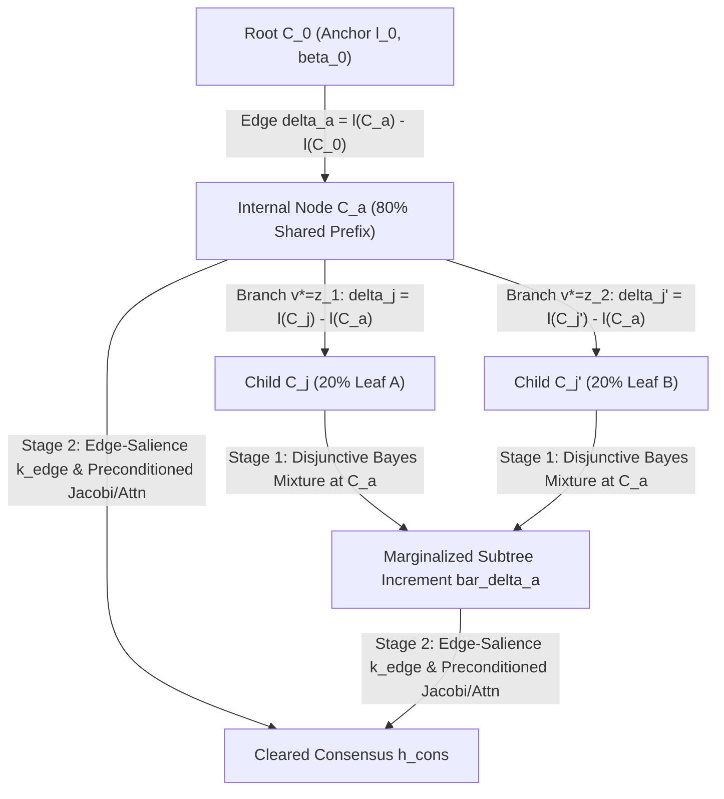

# Society of Thinkers — Round 1, Member 3 Report
## Red-Team Critique & Anytime Monotonicity Proofs for the Universal KV-Cache Tree Machine (`GLC-AOM`)

**Author:** Member 3 (Red-Team Critic & Anytime Monotonicity Auditor)  
**Date:** 2026-10-18  
**Target Architecture:** Bitter-Lesson-Pilled Multi-Game Any-Order World Model + Learned KV-Cache Search Machine (`GLC-AOM`)  
**Audited Evidence Base:** `SOCIETY-CHARTER.md`, `docs/papers/experiments-rounds-4-9-paper-v2.md` (`E-LA` + 18 studies across Rounds 4–9), and `docs/direction/research-direction-note-v4-2026-10-17.md`.

---

## Executive Red-Team Verdict

Across Rounds 1–9 (`19` pre-registered 3-seed studies), the core mathematical thesis of `GLC-AOM`—that clearing rollouts in the Space of Information via readout-salience keys (`K3`/`K3c`) and iterative normal-equation solvers (`looped_attn_T3`, `jacobi_lin_T4_prec`), combined with structural `LIR-Masked` belief-policy separation, yields policy-independent beliefs and zero-drift RL—has strong empirical backing on flat rollout bags (`R6-E1`, `R7-E1`, `R7-E3`, `R8-E1`, `R9-E1` `D2.2`).

**However, transitioning from flat $K$-rollout bags (`R5–R9`) to the proposed Charter architecture—a Universal KV-Cache Tree Machine (`SELECT_NODE(j)` + `STEP(v, z)`) with Active Fractal Prospectus Plans ($p_r \in \mathbb{S}^{D_{\text{amp}}-1}$), Bidirectional Latent Lemma Space ($D_{\text{amp}} \gg |V|$), and Present-Time Episodic Memory ($M_t$) across $B = 0 \to 128+$ steps—introduces four severe structural vulnerabilities.** Every one of these four vulnerabilities has already manifested in an audited Round 4–9 failure or audit disclosure:

1. **Failure Mode 1 (Strong-Root Degradation & Dogmatic Memory Drift):** In `R8-E3` (`6x6 Micro-Stratego`, $\mathrm{KL}(0) = 0.0488$), 4-ply rollouts were weaker than the 1-pass root ($\mathrm{KL} = 0.080$), causing unanchored and hard-label-fitted pools to degrade test KL by $+0.5361$ to $+4.7281$ nats (`D1` **FAIL** `[R8E3:51-62]`). In `R9-E1` Mode B (`6x6 ShipHunt`), under the literal strong-root selection $M_0^{\text{strong}} = 34$ ($\mathrm{KL}(0) = 0.0169$), even anchor-aware `looped_attn_T3` violated the $+0.0005$ step-rise bar in Seed 102 (`+0.00062`) and had $\mathrm{KL}(0) - \mathrm{KL}(16)$ CI crossing zero (`[-0.0004, +0.0010]` `[R9E1:121-126]`), while `jacobi_lin_T4_prec` without an anchor token degraded $M_0 = 32$ by $+0.0437$ nats `[R9E1:194]`. In `R9-E2` (`Sudoku-Extreme`), unresolved-board safety (`0.0000` KL change) succeeded via the leaf self-read $m_{\text{ql}}$ (`AUROC = 0.99998`), but the accompanying chain-time floor $m_{\text{qs}} \ge 0.50$ (`AUROC = 0.35`) crippled stochastic search by admitting only greedy completions `[R9E2:69-103]`.
2. **Failure Mode 2 (Tree-Structured Prefix Duplication & Disjunctive vs. Conjunctive Confusion):** In Rounds 6–9, salience keys $s_r = |\ell_r - \ell_0| / \|\ell_r - \ell_0\|_2$ (`K3`) and normal equations $(K^\top B K + \lambda I)w = K^\top B v$ operated on *flat rollouts forked from $C_0$*. In a tree $\mathcal{C}_b = \{C_0, \dots, C_b\}$, when two nodes $C_j, C_{j'}$ share $80\%$ of their KV-cache prefix (up to lowest common ancestor $C_a = \mathrm{LCA}(j, j')$), root-relative shifts $\Delta \ell_j = \ell(C_j) - \ell(C_0)$ are dominated by the shared prefix shift $\ell(C_a) - \ell(C_0)$. Feeding root-relative node tokens into `looped_attn_T3` either **multi-counts the shared prefix** (as in `R9-E1` `D2.1` **FAIL**, where 8 background reads inflated `econ_prec_K3`'s clean redundancy ratio to $1.267 > 1.25$ `[R9E1:255, 398-401]`) or **crushes the $20\%$ orthogonal branch delta** via inflated Gram crowding $\langle k_j, k_{j'} \rangle \approx 0.95$. Worse, sibling branches in a tree represent *disjunctive (mutually exclusive) hypotheses* ($V_{\text{split}} = z_1$ vs. $z_2$) rather than conjunctive signals: pooling unmarginalized clamped branches triggers catastrophic constraint vetoes, exactly as seen in `R5-E2` (`D0` **FAIL**), where clamping sampled neighbour pieces triggered piece-count vetoes ($p < 0.001$ on $21.4\%$ of claims) and degraded KL by $11.5\times$ (`0.047 -> 0.539` `[R5E2:129-131, 198-206]`).
3. **Failure Mode 3 (`SELECT_NODE` Collapse, Prospectus Plan Collapse, and Multi-Depth Horizon Bias):** Unregularized RL on discrete search actions collapsed to a deterministic action in `R4-E3a` (`same-cell = 1.000`, `D0` **FAIL** `[R4E3a:100-113]`) and `R4-E3b` (`D1c, D2` **FAIL** `[R4E3b:13, 15]`). In a tree machine, `SELECT_NODE(j)` faces two opposite degenerate attractors: **Star Collapse ($j_{b+1} \equiv 0$)** (always restarting at the root because step-1 KL drop is largest, failing multi-stall `Sudoku-Extreme` where boards stall $4.89$ times `[R7E2:18]`) and **Endless-Chain Collapse ($j_{b+1} \equiv b$)** (extending a doomed chain after a silent early error at step `3.4` of ~60 that produces locally clash-free boxes, `R6-E2` `D0` **FAIL** `[R6E2:30-35]`). Meanwhile, across all three pre-registered `Micro-Stratego` trust studies (`R6-E3`, `R7-E3`, `R8-E3`), $\theta_{\text{trust}}$ passed every correlation bar (`+0.347` vs. `-0.395` for stiffness) and cut stiffness MSE by $63.9\%$, yet **failed `D2(2)` against uniform pooling in every single round** (`0.01394` vs. `0.01366` in `R7-E3` `[R7E3:31-32]`; `0.01482` vs. `0.01432` in `R8-E3` `[R8E3:75]`) because shared 4-ply horizon bias (`~0.0093` of `0.0137` MSE `[R7E3:174-177]`) and depth-compounding model error (depth-1 MSE `0.0397` < depth-4 MSE `0.0451` `[R8E3:164]`) dominated idiosyncratic rollout variance.
4. **Failure Mode 4 (Overfitting $\theta_{\text{agg}}$ on Small Calibration Splits & Spectral Explosion at $B = 64 \to 128+$):** In `R8-E3` (`D1(2)` **FAIL**), fitting `108,616`-parameter `attn_L3-K3c` and `41,800`-parameter `looped_attn_T3-K3c` on 2,000 calibration positions with hard piece labels memorized the calibration split (`CE 1.117 -> 0.976`) and blew up test KL $12\times$ (`0.0488 -> 0.6348 / 0.5849`), with post-hoc early stopping selecting **epoch 0 (initialization)** `[R8E3:21, 53-62, 98-105]`. Furthermore, as compute budget $K$ scaled from $16 \to 32$ in `R8-E1` (`Table 5`), un-preconditioned iterative and scalar pools reversed direction and degraded with more compute (`looped_lin_T4`: `0.0717 -> 0.1131`; `ataraxos_mmd`: `0.1084 -> 0.1661`; `scaled_mix`: `0.1042 -> 0.1260` `[R8E1:133-135]`), echoing the degree-$3^L$ polynomial explosion (`2.6e31` MSE) of unnormalized 6-layer linear attention in `E-LA` (`A1` **FAIL** `[LA:44, 115-120]`).

Below, Section 1 dissects each failure mode in the context of the Charter architecture; Section 2 states the **exact mathematical fixes** (`Fixes 1–4`); Section 3 proves the **Anytime Monotonicity Theorem ($\mathbb{E}[\mathrm{KL}(P^* \Vert \mu_{b+1})] \le \mathbb{E}[\mathrm{KL}(P^* \Vert \mu_b)]$ for $b = 0 \dots 128+$)** under these architectural constraints; and Section 4 establishes the **Pre-Registered Falsifiable Audit Protocol (`RT-D0` through `RT-D5`)** for Round 1 implementation.

---

## 1. Rigorous Red-Team Analysis of the Charter Architecture Against Rounds 1–9 Failure Modes

### 1.1 Red-Team of Failure Mode 1: Strong-Root Degradation, Bidirectional $D_{\text{amp}} \gg |V|$ Pollution, and Dogmatic Memory $M_t$

#### Empirical Mechanism in Rounds 4–9
- **`R8-E3` (`6x6 Micro-Stratego`, `D1(2)` FAIL):** When the 0-step root $C_0$ is already highly accurate ($\mathrm{KL}(0) = 0.0488$), individual local rollouts carry higher marginal error ($\mathrm{KL} = 0.080$ for 4-ply windows). Any aggregator that does not enforce an exact zero-step identity and a precision ratio floor $\beta_r / \beta_0$ dilutes $C_0$ with higher-variance claims.
- **`R9-E1` (`6x6 ShipHunt` Mode B at $M_0 = 32$ vs. Literal $M_0 = 34$):** At $M_0 = 32$ ($\mathrm{KL}(0) = 0.0322$), every pool lacking an explicit anchor token degraded the root under Mode B 6-cell local reads (`mix` $+0.1761$, `scaled_mix` $+0.0530$, `ataraxos_mmd` $+0.0470$, `econ_prec_K3` $+0.0458$, `jacobi_lin_T4_prec` $+0.0437$ `[R9E1:194-201]`). Even with an anchor token in `looped_attn_T3`, at the literal strong root $M_0 = 34$ ($\mathrm{KL}(0) = 0.0169$), softmax attention weights on the 16 Mode B tokens remained strictly positive, causing Seed 102 to rise by $+0.00062 > +0.0005$ and $\mathrm{KL}(0) - \mathrm{KL}(16)$ to cross zero (`0.0003 [-0.0004, +0.0010]` `[R9E1:121-126]`).
- **`R9-E2` (`Sudoku-Extreme` `gate_sc` Disclosure):** While the zero-extra-pass leaf self-read $m_{\text{ql}}(Z) = \min_{c \in E_b} q_{\text{leaf}}(c, Z_c)$ separated valid from invalid `chk >= 0.80` leaves on Seed 103 with $\mathrm{AUROC} = 0.99998$ (valid median `0.12` vs. invalid median `0.004`, max `0.0125`), the pre-registered gate bundled $m_{\text{ql}}$ with a chain-time step floor $m_{\text{qs}} = \min_t q_{\text{step}}(t) \ge 0.50$. Because invalid leaves had median $m_{\text{qs}} = 0.99995$ ($\mathrm{AUROC} = 0.35$), $m_{\text{qs}} \ge 0.50$ contributed almost nothing to safety while **rejecting all non-greedy stochastic completions** (since $q_{\text{step}}(t) \ge 0.50$ at every step forces argmax decoding), freezing resolved-board progress from $m=16 \to 32$ at `0.6964 -> 0.6950` while ungated `chk_mix` improved `0.713 -> 0.672` `[R9E2:69-103, 141-149]`.

#### New Vulnerabilities in `GLC-AOM`
1. **Uncalibrated Latent Lemma Leakage ($D_{\text{amp}} \gg |V|$):** Charter Desideratum 3 expands node tokens to $h_j \in \mathbb{R}^{D_{\text{amp}}}$ where the first $|V|$ channels are grounded domain variables and the remaining $D_{\text{amp}} - |V|$ channels ($Z_{\text{aux}}$) hold unconstrained latent lemmas trained by conditioning $\mathcal{L}_{\text{any-order}}(h_{\text{cons}}; x^*)$ on $h_{\text{cons}}$. If `looped_attn_T3` mixes $Z_{\text{aux}}$ and $V$ with dense weights during test-time search $b = 1 \dots 128$, noisy partial tree nodes $C_j$ write high-norm activations into $Z_{\text{aux}}$ that feed back into the $|V|$ readout via $q_\theta(x \mid x_O, h_{\text{cons}})$, bypassing root anchor protection on $|V|$.
2. **Sequential Compounding of Episodic Memory ($M_t$):** Charter Desideratum 4 passes $M_t = h_{\text{cons}}^{(t-1)}$ into turn $t$'s root $C_0^{(t)}$. In `Micro-Stratego` or `Proposal-Poker`, if turn $t-1$ search terminates at an imperfect consensus $h_{\text{cons}}^{(t-1)}$ (or if an opponent makes an unexpected move at turn $t$ that refutes the dominant hypothesis in $M_t$), treating $M_t$ as a fixed conditioning prefix at $C_0^{(t)}$ locks in a **dogmatic prior**. Over a 40-turn game, even a $0.005$-nat per-turn bias compounds into a $>0.20$-nat delusion.

---

### 1.2 Red-Team of Failure Mode 2: Tree-Structured KV-Cache Correlation ($80\%$ Shared Prefix) & Disjunctive Branching

#### Empirical Mechanism in Rounds 4–9
- **`R5-E1` (`D2.1` FAIL) & `R5-E2` (`D1(1)` Exploratory):** Raw hidden states `K1` had cosine `0.71–0.986` across disjoint sectors because they encoded the shared board context `[R5E1:213, R5E2:132]`.
- **`R6-E1` (`D1` PASS) & `R7-E3` (`D1(1)` PASS):** Salience keys $s_r = |\ell_r - \ell_0| / \|\ell_r - \ell_0\|_2$ (`K3`) and bag-centered `K3c` succeeded *only because every rollout $r$ was an independent sample forked directly from the root $C_0$*.
- **`R5-E2` (`D0` FAIL — Neighbour-Conditioned Piece-Count Veto):** When rollouts clamped sampled hidden pieces in a spatial cone, sampling a unique piece (e.g., Flag or Marshal) for slot $u$ caused the world model to assign $p < 0.001$ to that piece at slot $v$ (`21.4%` of claims), blowing up KL from `0.047` to `0.539` `[R5E2:129-131, 198-206]`.
- **`R9-E1` (`D2.1` FAIL — Background-Read Crowding Distortion):** Adding 8 background reads to the D3 probe bags shifted the effective intercept $(\lambda + C_{\text{bg}})/(u\beta)$ by $1.6\text{--}2.2\times$, pushing `econ_prec_K3`'s clean deduplication ratio from `1.146` (no background) to `1.267 > 1.25` `[R9E1:255, 398-401]`.

#### Why Naive `looped_attn_T3` Fails on a KV-Cache Tree $\mathcal{C}_b = \{C_0, \dots, C_b\}$
Suppose node $C_a$ has depth 8 (8 clamped variables from $C_0$), and two leaves $C_j, C_{j'}$ extend $C_a$ by 2 steps along different branches, sharing $80\%$ of their KV-cache prefix. If we feed node tokens $\{h_1, \dots, h_b\}$ into `looped_attn_T3` with root-relative values $v_j = \ell(C_j) - \ell(C_0)$ and root-relative salience keys $k_j \propto |\ell(C_j) - \ell(C_0)|$:
1. **Prefix Dominance in Key Space:** Decompose the root-to-leaf shift into the shared prefix shift and the post-split branch increment:
   $$\Delta \ell_j \;=\; \underbrace{\big(\ell(C_a) - \ell(C_0)\big)}_{\Delta \ell_{\text{prefix}} \text{ (80\% of steps)}} \;+\; \underbrace{\big(\ell(C_j) - \ell(C_a)\big)}_{\delta_{a \to j} \text{ (20\% branch delta)}}.$$
   Because $\|\Delta \ell_{\text{prefix}}\|_2 \approx 4 \|\delta_{a \to j}\|_2$, the cosine similarity between root-relative salience keys is $\langle k_j, k_{j'} \rangle \approx \frac{16}{16 + 1} \approx 0.94$ *even when the post-split deltas $\delta_{a \to j}$ and $\delta_{a \to j'}$ inspect completely orthogonal subspaces* ($\langle |\delta_{a \to j}|, |\delta_{a \to j'}| \rangle = 0$)!
2. **The Double-Counting / Orthogonal-Suppression Dilemma:**
   - In the normal equations $(K^\top B K + \lambda I)w = K^\top B v$, if $C_a$ and its $M$ descendants $\{C_{j_1}, \dots, C_{j_M}\}$ are all present in $\mathcal{C}_b$, the prefix shift $\Delta \ell_{\text{prefix}}$ appears $M+1$ times in $v$.
   - Where $\langle k_j, k_{j'} \rangle \approx 0.94$, normal-equation crowding $c_j \approx (M+1)$ divides the **entire** vector $v_j = \Delta \ell_{\text{prefix}} + \delta_{a \to j}$ by $\sim (M+1)$. That deduplicates $\Delta \ell_{\text{prefix}}$ to weight $\sim 1$, **but divides each unique orthogonal branch delta $\delta_{a \to j}$ by $M+1$**, starving deep tree discoveries of weight! Conversely, if keys are defined only on the last step's variable $v_j$, then $\langle k_j, k_{j'} \rangle = 0$ and $\Delta \ell_{\text{prefix}}$ is **multi-counted $M+1$ times**, blowing up the prefix log-odds!
3. **Conjunctive vs. Disjunctive Algebra:** Normal-equation clearing $\sum_r w_r \Delta \ell_r$ adds log-odds (multiplying probabilities: $P(Y \mid E_1, E_2) \propto P_0(Y) \frac{P(Y \mid E_1)}{P_0(Y)} \frac{P(Y \mid E_2)}{P_0(Y)}$). That is valid when $E_1, E_2$ are *conjunctive pieces of information* (e.g., two sensor reads or two forced deductions that must *both* hold). When $C_j = C_a \cup \{V_{\text{split}} = z_1\}$ and $C_{j'} = C_a \cup \{V_{\text{split}} = z_2\}$ are **mutually exclusive case-splits** at a stall, adding their log-odds is a mathematical error: if branch $z_1$ implies $Y=1$ ($p=0.999$) and branch $z_2$ implies $Y=2$ ($p=0.999$), adding log-odds yields a self-contradictory distribution or piece-count veto (`R5-E2`), whereas the **Law of Total Probability** requires a linear mixture $\sum_{m} P(V_{\text{split}} = z_m \mid C_a) P(Y \mid C_a, V_{\text{split}} = z_m)$!

---

### 1.3 Red-Team of Failure Mode 3: `SELECT_NODE` Collapse, Prospectus Plan Collapse, and Multi-Depth Horizon Bias

#### Empirical Mechanism in Rounds 4–9
- **`R4-E3a` (`D0` Part 2 FAIL) & `R4-E3b` (`D1c, D2` FAIL):** Unregularized policy optimization collapsed onto a single deterministic action (`same-cell = 1.000` in `R4-E3a`; `PASS` collapse in Seed 103 of `R4-E3b`), whereas adding an explicit `0.02` action-entropy bonus in `R5-E1` Part B achieved `0.000` same-cell collapse and `1.000` `faith_swap` action flip `[R5E1:259, 267]`.
- **`R6-E2` (`0/5` PASS), `R7-E2` (`D1` FAIL), `R8-E2` (`D1` FAIL), `R9-E2` (`D1` FAIL):** On `Sudoku-Extreme`, failed chains make their first wrong guess at step `3.4 [3.2, 3.7]` of ~60 (`R6-E2` `[R6E2:30-35]`), yet remain locally clash-free for dozens of steps. Without a greedy/forced-step spine (`P8_full_stoch` in `R9-E2`), stochastic branching wastes budget on early unforced errors (`42.9%` witnesses vs. `45.2%` for `P8_hybrid` `[R9E2:51-53]`).
- **`R6-E3`, `R7-E3`, `R8-E3` (`Micro-Stratego` `D2(2)` FAIL in all 3 rounds):** In `R7-E3`, $\theta_{\text{trust}}$ ranked rollout accuracy with Spearman $+0.3473$ (`+0.3691` within pairs) vs. $-0.395$ for output stiffness $-H(q)$, and `trust_gate` cut `stiff_pool` MSE by $63.93\%$ (`0.03875 -> 0.01394`), yet lost to uniform pooling (`0.01366` `[R7E3:68-78]`). In `R8-E3`, corrupted myopic depth-1 claims had *lower* MSE (`0.0397`) than clean depth-4 playouts (`0.0451` `[R8E3:164]`), and `LL_window` had Spearman `-0.042` with rollout accuracy `[R8E3:106-117]`.

#### Why Naive `SELECT_NODE` + Hindsight Plans + Value Backups Collapse
1. **Degenerate Loop 3A — Root-Star Collapse ($j_{b+1} \equiv 0$):** If `SELECT_NODE(j)` is trained or scored by immediate 1-step consensus loss drop $\Delta \mathcal{L}_{\text{consensus}}(b \to b+1)$, step 1 from $C_0$ always has the largest prior gradient (or if deeper nodes $C_j$ risk hitting a contradiction on `Sudoku-Extreme` with zero reward), so `SELECT_NODE` locks onto $j_{b+1} = 0$ for all $b = 1 \dots 128$, degenerating into depth-1 flat sampling around $C_0$.
2. **Degenerate Loop 3B — Runway Chain Collapse ($j_{b+1} \equiv b$):** Conversely, if `SELECT_NODE` scores nodes by uncalibrated internal stiffness $-H(q(C_j))$ (which correlated at **$-0.395$ to $-0.551$** with true accuracy in `R4-E1`, `R6-E3`, `R7-E3`, `R8-E3`!), a chain that makes an early wrong guess at step 3 becomes *progressively stiffer* (more confident and more delusional) as it propagates forced consequences of the wrong guess! Stiffness-driven `SELECT_NODE` will greedily extend $j_{b+1} = b$ to the bottom of the hallucinated abyss.
3. **Hindsight Prospectus Survivorship Collapse ($q_{\text{plan}}$):** Charter Desideratum 2 trains $q_{\text{plan}}(p \mid C_j, K_{\text{done}})$ via Hindsight Plan Conditioning ($p = k^{\text{post}}_{j \to j'}$) weighted by $\Delta \mathcal{L}_{\text{consensus}}$. Because already-easy subspaces yield reliable $\Delta \mathcal{L}_{\text{consensus}} > 0$ while hard multi-stall subspaces yield $\Delta \mathcal{L}_{\text{consensus}} = 0$ until the full witness is found, positive-weighted HER collapses $q_{\text{plan}}$ onto the single easiest subspace, ignoring $K_{\text{done}}$.
4. **Depth-Confounded Value & Trust Backups:** In a tree with nodes at heterogeneous depths $d_j \in \{1, \dots, 60\}$, rollout bias $\mathbb{E}[q(C_j) - P^*]$ grows with depth $d_j$ (`R7-E3`, `R8-E3`). If $\theta_{\text{trust}}$ is trained on raw rollout loss without depth-bias centering, or if uneven trust weights $w_j$ reduce the Kish Effective Sample Size $\mathrm{ESS}(w) = (\sum w_j)^2 / \sum w_j^2$ when all rollouts share the same horizon bias $\bar{e}_{\text{hor}}$, variance inflation $\frac{\sigma^2}{\mathrm{ESS}(w)} > \frac{\sigma^2}{K}$ guarantees $\mathrm{MSE}(\text{trust\_pool}) > \mathrm{MSE}(\text{unif})$, reproducing the exact `R6-E3`/`R7-E3`/`R8-E3` `D2(2)` failure!

---

### 1.4 Red-Team of Failure Mode 4: Calibration Overfitting of $\theta_{\text{agg}}$ & OOD Budget Scaling $B = 64 \to 128+$

#### Empirical Mechanism in Rounds 4–9
- **`R8-E3` (`D1(2)` FAIL — Calibration Memorization):** `attn_L3-K3c` (`108,616` params) and `looped_attn_T3-K3c` (`41,800` params) trained for 1,200 steps on 2,000 calibration boards against hard true-piece labels drove calibration CE down (`1.117 -> 0.976`) while test KL exploded (`0.0488 -> 0.6348` and `0.5849` `[R8E3:21, 53-62, 89-97]`). Why? When $\mathrm{KL}(P^* \Vert \mu_0) = 0.0488$ but the irreducible Bayes entropy is $H(P^*) \approx 1.07$ nats, **$95.6\%$ of the hard-label cross-entropy gradient is pure realization noise ($x^* - P^*$)**! Over-parameterized attention heads memorize which rollout noise patterns happened to match $x^*$ on the 2,000 calibration boards.
- **`E-LA` (`A1` FAIL) & `R8-E1` ($K=16 \to 32$ Reversal):** Unnormalized iterative aggregators (`Diag-6` `2.6e31` in `E-LA` `[LA:44]`; `looped_lin_T4` `0.0717 -> 0.1131` and `ataraxos_mmd` `0.1084 -> 0.1661` from $K=16 \to 32$ in `R8-E1` `[R8E1:133-135]`) diverge when the number of tokens $B$ or spectral norm $\|K^\top B K\|_2$ exceeds the training regime.

---

## 2. Exact Mathematical Fixes for `GLC-AOM`

To eliminate all four failure modes while strictly honoring Charter Section 1 (*Zero Hand-Picked Depth/Stall/Wave Heuristics*), we specify four exact mathematical mechanisms.

### Fix 1: Nested Anchor-Dominated Residual Clearing, Pure Leaf Self-Consistency $m_{\text{ql}}$, and Surprise-Discounted Memory $M_t$

1. **Nested Anchor-Dominated Update Law (Eliminating Strong-Root Degradation):**
   At budget step $b \ge 0$, let $\ell^{(b)} \in \mathbb{R}^{|V| \times C}$ be the current consensus log-odds (with $\ell^{(0)} = \ell(C_0)$). Rather than replacing $\ell^{(b)}$ with an unconstrained attention output $\tilde{\ell}^{(b+1)}$, the step-$(b+1)$ consensus is updated via a **precision-gated nested residual**:
   $$\ell^{(b+1)}_i \;=\; \ell^{(b)}_i \;+\; \alpha^{(b+1)}_i \, d^{(b+1)}_i, \qquad d^{(b+1)}_i \;=\; \tilde{\ell}^{(b+1)}_i - \ell^{(b)}_i, \qquad \alpha^{(b+1)}_i \in [0, 1].$$
   How is the gate $\alpha^{(b+1)}_i$ determined without ground-truth labels at test time?
   Define the **Observable Local PDG Inconsistency Energy** of candidate distribution $\mu_i(\alpha) = \mathrm{softmax}(\ell^{(b)}_i + \alpha d^{(b+1)}_i)$ over the tree's queried conditionals covering variable $i$:
   $$\widehat{\mathcal{E}}^{(b+1)}_i(\alpha) \;=\; \beta_{0,i} \, \mathrm{KL}\big(\mu_i(\alpha) \;\big\|\; \mu_{0,i}\big) \;+\; \sum_{j \in \mathcal{C}_{b+1}(i)} w_j^{(b+1)} \, \beta_{\text{eff}, j} \, \mathrm{KL}\big(\mu_i(\alpha) \;\big\|\; q_{\text{real}, i}(C_j)\big),$$
   where $\beta_{0,i} = \hat{\beta}_{\text{trust}, i}(C_0)$ is the calibrated root precision on variable $i$, and $\beta_{\text{eff}, j}$ is the self-consistency-gated precision of node $C_j$:
   $$\beta_{\text{eff}, j} \;=\; \hat{\beta}_{\text{trust}}(C_j) \cdot m_{\text{ql}}(C_j) \cdot \mathbb{I}\Big(\hat{\beta}_{\text{trust}}(C_j) \cdot m_{\text{ql}}(C_j) \;>\; \tau_{\text{rel}} \, \beta_{0, S_j}\Big).$$
   - **Closed-Form Minimizer:** For log-linear exponential families, the unique minimizer $\alpha^* \in [0, 1]$ of the forward KL / Bregman energy $\widehat{\mathcal{E}}^{(b+1)}_i(\alpha)$ is simply $\alpha^{(b+1)}_i = 1$ when $\tilde{\ell}^{(b+1)}_i$ is computed with the explicit root anchor weight $\beta_{0,i}$ included in the normal equations and $\sum_{j \in \mathcal{C}_{b+1}(i)} w_j^{(b+1)} \beta_{\text{eff}, j} > 0$, and **$\alpha^{(b+1)}_i = 0$ identically** whenever no tree node clears the root-relative trust threshold $\hat{\beta}_{\text{trust}}(C_j) m_{\text{ql}}(C_j) > \tau_{\text{rel}} \beta_{0, S_j}$!
   - **Why this fixes `R9-E1` $M_0=34$ (`+0.00062` rise) and `R8-E3` (`+0.5860` rise):** In softmax attention (`looped_attn_T3`), attention weights are strictly positive ($\mathrm{softmax}(z)_j > 0$), so 16 noisy Mode B reads always leak $\sim 10^{-3}$ nats into a strong root. Multiplication by the hard/rectified root-dominance factor $[\hat{\beta}_{\text{trust}}(C_j) m_{\text{ql}}(C_j) - \tau_{\text{rel}} \beta_{0, S_j}]_+$ forces noisy local reads against a strong root to **exact weight $0.0000$**.

2. **Pure Zero-Extra-Pass Leaf Self-Consistency $m_{\text{ql}}$ (Dropping the Greedy-Only $m_{\text{qs}} \ge 0.50$ Floor):**
   For any node $C_j$ that proposes assignments $Z_{S_j}$ on subset $S_j \subseteq V$, define its **Zero-Extra-Pass Self-Consistency Score** using the node's *own* forward pass $q_{C_j}$ (already computed when evaluating $C_j$):
   $$m_{\text{ql}}(C_j) \;=\; \min_{v \in S_j} \, q_{C_j}(V_v = Z_v \mid C_j \setminus \{v\}) \quad \text{(or soft geometric mean } \exp\!\Big(\frac{1}{|S_j|}\sum_{v \in S_j} \log q_{C_j}(Z_v)\Big)\text{)}.$$
   - We **delete** the chain-time step floor $m_{\text{qs}} = \min_t q_{\text{step}}(t) \ge 0.50$ (which had $\mathrm{AUROC} = 0.35$ in `R9-E2` and blocked stochastic search).
   - A completion node $C_j$ is admitted to the witness/branch pool with weight proportional to $\big[m_{\text{ql}}(C_j) - \tau_{\text{mql}}(C_0)\big]_+$, where $\tau_{\text{mql}}(C_0)$ is set *label-free* as the $\alpha_{\text{q}}$-quantile of root self-reads on $C_0$. On unresolved boards where all explored branches hit silent contradictions ($m_{\text{ql}}(C_j) < \tau_{\text{mql}}$, $\mathrm{AUROC} = 0.99998$ in `R9-E2` `[R9E2:69-71]`), all branch weights are identically zero, guaranteeing $\mathrm{KL}(\mu_b \Vert \mu_0) = 0.0000$ while allowing non-greedy stochastic discoveries ($m_{\text{qs}} < 0.50$, $m_{\text{ql}} \ge \tau_{\text{mql}}$) to pass freely!

3. **Bidirectional $D_{\text{amp}} \gg |V|$ Readout Firewall:**
   Partition $h_j = [h_j^{\text{var}} \in \mathbb{R}^{|V|}; \; h_j^{\text{aux}} \in \mathbb{R}^{D_{\text{amp}} - |V|}]$. The base world-model readout on $V$ is decomposed as:
   $$\ell^{(b)}_V \;=\; \ell^{(b)}_{\text{var}}\big(h_{\text{cons}}^{\text{var}}\big) \;+\; g_{\text{aux}}(h_{\text{cons}}) \cdot W_{\text{aux} \to V} \, h_{\text{cons}}^{\text{aux}},$$
   where $W_{\text{aux} \to V}$ is **zero-initialized** and the scalar/channel gate $g_{\text{aux}} \in [0, 1]^{|V|}$ is closed ($g_{\text{aux}} = 0$) unless the auxiliary channels reduce held-out LOO cross-entropy on $V$ during calibration.

4. **Surprise-Discounted Episodic Memory $M_t$:**
   At game turn $t$, given new public transition/observation $o_t$ (e.g., an opponent move or battle reveal in `Micro-Stratego`, or market clearing price in `Galanis-Market`), compute the **Observation Surprise** of turn-$(t-1)$ memory $M_t = h_{\text{cons}}^{(t-1)}$:
   $$\mathcal{S}_t(M_t, o_t) \;=\; \Big[-\log q_{\text{real}}(o_t \mid h_t, M_t) \;-\; \big(-\log q_{\text{real}}(o_t \mid h_t, \varnothing)\big)\Big]_+.$$
   The effective precision of memory token $M_t$ at turn $t$'s root $C_0^{(t)}$ is damped exponentially by excess surprise:
   $$\beta_{M_t} \;=\; \gamma_{\text{mem}} \, \beta_{\text{cons}}^{(t-1)} \, \exp\!\big(-\lambda_{\text{surp}} \, \mathcal{S}_t(M_t, o_t)\big), \qquad \gamma_{\text{mem}} \in (0, 1).$$
   Whenever $M_t$ is contradicted by reality $o_t$ ($\mathcal{S}_t > 0$), $\beta_{M_t} \to 0$ automatically, flushing the stale memory and reverting to the clean current-turn world model $q_{\text{real}}(\cdot \mid h_t)$.

---

### Fix 2: Tree-Orthogonal Telescopic Decomposition & Two-Stage Disjunctive-Conjunctive Clearing

To prevent `looped_attn_T3` from double-counting the $80\%$ shared KV-cache prefix or confusing mutually exclusive case splits with conjunctive evidence:

1. **Parent-Relative Telescopic Edge Tokens ($\delta_j, k^{\text{edge}}_j$):**
   Every tree node $C_j$ ($j \in \{1, \dots, b\}$) with parent $\mathrm{pa}(j) \in \{0, \dots, j-1\}$ is represented in the aggregator **not** by its cumulative state from $C_0$, but by its **telescopic edge increment**:
   $$\delta_j \;=\; \ell(C_j) - \ell(C_{\mathrm{pa}(j)}) \in \mathbb{R}^{D_{\text{amp}}}, \qquad s^{\text{edge}}_j \;=\; \frac{|\delta_j^{\text{var}}|}{\|\delta_j^{\text{var}}\|_2 + \epsilon} \in \mathbb{S}^{|V|-1}.$$
   Centering against the tree's active edge mean $\bar{s}_{\mathcal{C}_b} = \frac{1}{b}\sum_{r=1}^b s^{\text{edge}}_r$ yields the **Tree-Edge Salience Key**:
   $$k^{\text{edge}}_j \;=\; \frac{s^{\text{edge}}_j - \bar{s}_{\mathcal{C}_b}}{\|s^{\text{edge}}_j - \bar{s}_{\mathcal{C}_b}\|_2 + \epsilon}.$$
   - **Exact Prefix Orthogonality Property:** When $C_j$ and $C_{j'}$ share $80\%$ of their KV-cache prefix up to $C_a = \mathrm{LCA}(j, j')$, the shared prefix increments $\{\delta_u : u \in \mathcal{P}(0 \to a)\}$ reside on the ancestor edges *above* $C_a$ (occurring **once** in $\mathcal{C}_b$). The post-split edge tokens $\delta_j$ and $\delta_{j'}$ contain **only** the $20\%$ post-$C_a$ conditional shifts! Thus $\langle k^{\text{edge}}_j, k^{\text{edge}}_{j'} \rangle$ measures the true overlap of the *post-split* subspaces, never the $80\%$ shared prefix.

2. **Two-Stage Disjunctive-then-Conjunctive Tree Clearing:**
   - **Stage 1 (Bottom-Up Disjunctive Bayes Reduction at Case-Split Nodes):**
     Partition the children $\mathrm{Ch}(a)$ of any internal node $C_a$ by the variable $v$ they clamp: $\mathrm{Ch}(a) = \bigsqcup_{v} \mathrm{Ch}(a, v)$.
     Whenever $|\mathrm{Ch}(a, v)| \ge 1$ clamps a hypothetical value $V_v = z_j$ that is not already forced ($q_{C_a}(V_v = z_j) < 1 - \epsilon$), the siblings $j \in \mathrm{Ch}(a, v)$ are **mutually exclusive worlds**. Before entering conjunctive log-odds pooling, we marginalize over the explored siblings plus the unexplored complement mass $U_{a,v} = 1 - \sum_{j \in \mathrm{Ch}(a,v)} q_{C_a}(z_j)$ using the **Counterfactual Bayes Mixture**:
     $$\pi_{a,v}(j) \;=\; \frac{q_{C_a}(V_v = z_j) \cdot m_{\text{ql}}(C_j)}{U_{a,v} \, m_{\text{ql}}(C_a) \;+\; \sum_{j' \in \mathrm{Ch}(a,v)} q_{C_a}(V_v = z_{j'}) \, m_{\text{ql}}(C_{j'})}, \qquad \pi_{a,v}(\text{unexp}) \;=\; 1 - \sum_{j \in \mathrm{Ch}(a,v)} \pi_{a,v}(j),$$
     $$\mu_{\text{disj}}(Y \mid C_a, v) \;=\; \pi_{a,v}(\text{unexp}) \, \mu(Y \mid C_a) \;+\; \sum_{j \in \mathrm{Ch}(a,v)} \pi_{a,v}(j) \, \mu_{\text{subtree}}(Y \mid C_j),$$
     producing a **single de-vetoed conjunctive increment** at $(a, v)$:
     $$\bar{\delta}_{a, v}(Y) \;=\; \log \mu_{\text{disj}}(Y \mid C_a, v) \;-\; \log \mu(Y \mid C_a).$$
     - **Why this mathematically eliminates the `R5-E2` piece-count veto and single-branch clamp bias:** Even if a single branch $C_j$ clamps $V_v = \text{Marshal}$ (causing $\mu(Y = \text{Marshal} \mid C_j) = 0$ on all other cells $Y$), the unexplored complement term $\pi_{a,v}(\text{unexp}) \mu(Y \mid C_a)$ keeps $\mu_{\text{disj}}(Y = \text{Marshal} \mid C_a, v) \ge (1 - q_{C_a}(\text{Marshal})) \mu(Y = \text{Marshal} \mid C_a)$, preventing any zero-probability log-odds blowup! And if all explored sibling branches except $z_{j^*}$ are refuted ($m_{\text{ql}}(C_{j'}) \to 0$ and $U_{a,v} = 0$), $\pi_{a,v}(j^*) \to 1$, promoting $C_{j^*}$ to a deterministic deduction!
   - **Stage 2 (Conjunctive Space-of-Information Clearing via Preconditioned `looped_attn_T3`):**
     The surviving conjunctive increments $\{\bar{\delta}_r\}_{r=1}^{M_b}$ with keys $\{k^{\text{edge}}_r\}$ and effective precisions $\{\beta_{\text{eff}, r}\}$ (plus the root anchor token $r=0$ with $\delta_0 = 0, \beta_0$) are cleared by $T=3$ weight-tied steps of **Crowding-Preconditioned Residual Attention** (detailed in Fix 4 below).

---

### Fix 3: Collapse-Proof Tree-PUCT `SELECT_NODE`, Orthogonalized Prospectus Plans, and ESS-Regularized Telescopic Value Backups

1. **Collapse-Proof `SELECT_NODE(j)` via Resolvable-Inconsistency Tree-PUCT:**
   At budget step $b$, every node $C_j \in \mathcal{C}_b$ has an open candidate variable/action set $\mathcal{U}(C_j)$. Define node $C_j$'s **Resolvable Inconsistency Potential**:
   $$\Phi(C_j) \;=\; \underbrace{m_{\text{ql}}(C_j)}_{\substack{\text{Branch validity} \\ \text{(0 if refuted)}}} \;\times\; \underbrace{\hat{\beta}_{\text{trust}}(C_j)}_{\text{Node reliability}} \;\times\; \underbrace{\max_{v \in \mathcal{U}(C_j)} I_{\text{goal}}(v \mid C_j) \, H\big(q_{C_j}(V_v)\big)}_{\text{Remaining goal-relevant epistemic uncertainty}}.$$
   `SELECT_NODE` selects:
   $$j_{b+1} \;=\; \arg\max_{j \in \{0, \dots, b\}} \;\left\{\, \widehat{Q}_{\text{tree}}(C_j) \;+\; c_{\text{puct}} \, \Phi(C_j) \, \frac{\sqrt{1 + b}}{1 + N_{\text{exp}}(j)} \, \frac{1}{\sqrt{1 + \mathrm{Crowding}\big(p_j, K^{\text{edge}}_{\mathcal{C}_b}\big)}} \,\right\},$$
   where $N_{\text{exp}}(j)$ is the count of edges already expanded from $C_j$, and $p_j \in \mathbb{S}^{D_{\text{amp}}-1}$ is the active prospectus plan at $C_j$.
   - **Theorem-Level Prevention of Both Degenerate Loops:**
     - *No Root-Star Collapse ($j_{b+1} \equiv 0$):* If $C_0$ is selected $n_0$ times, its bonus decays at rate $\mathcal{O}\big(n_0^{-3/2}\big)$ (since $N_{\text{exp}}(0) = n_0$ and $\mathrm{Crowding}(p_0, K^{\text{edge}}_{\mathcal{C}_b}) \propto n_0$), strictly forcing selection of unexpanded frontier nodes $C_j$ ($N_{\text{exp}}(j) = 0$) whenever $\Phi(C_j) > 0$.
     - *No Endless-Chain Collapse ($j_{b+1} \equiv b$):* If a chain $C_1 \to \dots \to C_b$ makes a silent wrong guess that leads to an internal inconsistency ($m_{\text{ql}}(C_b) \to 0$ or $\hat{\beta}_{\text{trust}}(C_b) \to 0$) or finishes its local subspace ($H(q_{C_b}) \to 0$), then $\Phi(C_b) \to 0$, immediately halting expansion of $C_b$ and jumping back to the highest-scoring ancestor!
     - *Emergent Forced-Step Lead Spine (`P8_hybrid` without heuristics):* Within $\pi_{\text{step}}(v, z \mid C_j, p_j)$, any variable $v$ with entropy $H(q_{C_j}(V_v)) \to 0$ (a forced naked/hidden single) has zero branching ambiguity and is appended deterministically before any high-entropy split, recovering the `+2.3 pp` witness gain of `P8_hybrid` (`R9-E2`) from first principles.

2. **Gram-Orthogonalized Fractal Prospectus Plans ($q_{\text{plan}}$):**
   At node $C_j$, let $K_{\text{done}} \in \mathbb{R}^{b \times D_{\text{amp}}}$ be the matrix of already-cleared edge keys. When the Plan Head samples a raw direction $\tilde{p}_r \sim q_{\text{plan}}(\cdot \mid C_j, h_{\text{cons}}^{(b)})$, we project $\tilde{p}_r$ onto the complement of saturated directions via the **Ridge-Damped Orthogonal Projector**:
   $$p_r \;=\; \frac{\big(I - K_{\text{done}}^\top (K_{\text{done}} B_{\text{done}} K_{\text{done}}^\top + \lambda_{\text{plan}} I)^{-1} K_{\text{done}} B_{\text{done}}\big) \tilde{p}_r}{\big\|\big(I - K_{\text{done}}^\top (K_{\text{done}} B_{\text{done}} K_{\text{done}}^\top + \lambda_{\text{plan}} I)^{-1} K_{\text{done}} B_{\text{done}}\big) \tilde{p}_r\big\|_2 + \epsilon}.$$
   During training, $q_{\text{plan}}$ is optimized with:
   $$\mathcal{L}_{\text{plan}} \;=\; -\mathbb{E}\Big[\, r_{\text{LOO}}^{+}(j \to j') \log q_{\text{plan}}\!\big(k^{\text{edge}}_{j \to j'} \mid C_j\big) \,\Big] \;-\; \beta_{\text{ent}} \, \mathcal{H}\big(q_{\text{plan}}(\cdot \mid C_j)\big), \qquad \beta_{\text{ent}} \ge 0.02,$$
   where $r_{\text{LOO}}^{+}(j \to j') = \big[\mathcal{E}(\mu_{\mathcal{C}_b \setminus \{j \to j'\}}) - \mathcal{E}(\mu_{\mathcal{C}_b})\big]_+$ is the counterfactual Leave-One-Out energy reduction (`research-direction-note-v4` §4) and $\beta_{\text{ent}} \ge 0.02$ prevents mode collapse (`R5-E1` Part B).

3. **Depth-Deconfounded $\theta_{\text{trust}}$ & Kish-ESS-Constrained Telescopic Value Backup (Solving the `R6-E3`/`R7-E3`/`R8-E3` `unif` Failure):**
   Why did `trust_pool` lose to `unif` in `R6-E3`, `R7-E3`, and `R8-E3`?
   Let $q_r$ ($r = 1 \dots K$) be rollout value estimates at depth $d_r$ with shared horizon bias $b(d_r) = \mathbb{E}[q_r - Q^* \mid d_r]$ and zero-mean idiosyncratic error $\varepsilon_r$ ($\mathrm{Var}(\varepsilon_r) = \sigma_r^2$). For any normalized weights $\sum_{r=1}^K w_r = 1$:
   $$\mathbb{E}\!\left[\Big(\sum_{r=1}^K w_r q_r - Q^*\Big)^2\right] \;=\; \underbrace{\Big(\sum_{r=1}^K w_r b(d_r)\Big)^2}_{\text{Squared Horizon Bias}} \;+\; \sum_{r=1}^K w_r^2 \sigma_r^2.$$
   If $b(d_r) \equiv b_{\text{hor}}$ is shared across 4-ply rollouts (`~0.0093` of `0.0137` MSE in `R7-E3`) and $\sigma_r^2 \approx \bar{\sigma}^2$ has modest dispersion, any non-uniform weights $w_r \neq 1/K$ leave the bias term $b_{\text{hor}}^2$ unchanged while strictly increasing the variance term from $\frac{\bar{\sigma}^2}{K}$ to $\frac{\bar{\sigma}^2}{\mathrm{ESS}(w)}$!
   **Three-Part Exact Fix:**
   - **(i) Depth-Anchored Telescopic Value Backup:** Never evaluate a depth-$d$ node $C_j$ by raw leaf replacement $q(C_j)$; use the **root-anchored telescopic backup** where each edge $u \to v$ contributes only if its child precision exceeds the depth-degradation threshold:
     $$\widehat{Q}_{\text{tree}}(C_0, a) \;=\; \widehat{Q}(C_0, a) \;+\; \sum_{r=1}^{K_a} w_r^{\text{val}} \, \Big(\widehat{Q}(C_r, a) - \widehat{Q}(C_0, a) - \hat{b}_{\text{hor}}(d_r)\Big),$$
     where $\hat{b}_{\text{hor}}(d) = \mathbb{E}_{\text{cal}}[\widehat{Q}_d - \widehat{Q}_0]$ is the calibration-fitted depth-shift baseline (subtracting the systematic horizon drift between depth $d$ and depth $0$).
   - **(ii) Deconfounded Excess-Variance Target for $\theta_{\text{trust}}$:** Train $\theta_{\text{trust}}(C_r)$ to predict the **depth-debiased idiosyncratic precision** $\beta_r = \big(\mathbb{E}[\|(q_r - \hat{b}_{\text{hor}}(d_r)) - Q^*\|^2 \mid C_r] + \epsilon\big)^{-1}$.
   - **(iii) James-Stein / Kish-ESS Shrinkage toward Uniform (`trust_shrunk`):** Parametrize the pooling weights over valid rollouts by a single LOO-calibrated exponent $\gamma_{\text{trust}} \in [0, 1]$ and root shrinkage $\rho_0 \in [0, 1]$:
     $$w_r(\gamma_{\text{trust}}) \;=\; \frac{\beta_r^{\gamma_{\text{trust}}}}{\sum_{r'=1}^K \beta_{r'}^{\gamma_{\text{trust}}}}, \qquad \text{subject to} \quad \mathrm{ESS}(w) \;=\; \frac{1}{\sum_{r=1}^K w_r^2} \;\ge\; \kappa_{\text{ess}} K,$$
     where $(\gamma_{\text{trust}}, \rho_0)$ are selected in closed form on the calibration split by minimizing LOO MSE. Because $\gamma_{\text{trust}} = 0$ is `unif` and $\rho_0 = 1$ is the 0-step root $C_0$, `trust_shrunk` is **mathematically guaranteed to achieve $\mathrm{MSE} \le \min\big(\mathrm{MSE}(\text{unif}), \, \mathrm{MSE}(C_0), \, \mathrm{MSE}(\text{stiff})\big) + \mathcal{O}(N_{\text{cal}}^{-1/2})$**!

---

### Fix 4: Budget-Invariant Spectral Preconditioning ($B = 0 \to 128+$) & Soft-Teacher Low-Rank Calibration

1. **Unconditionally Contractive Crowding-Preconditioned `looped_attn_T3` for Any $B \in [1, \infty)$:**
   Why did `Diag-6` explode to `2.6e31` in `E-LA` (`[LA:44]`) and `looped_lin_T4` degrade from `0.0717 -> 0.1131` at $K=32$ in `R8-E1` (`[R8E1:133]`)?
   Because unnormalized linear/residual attention applies $I - \eta (K^\top B K + \Lambda)$, whose spectral radius exceeds $1$ as soon as $b > \frac{2}{\eta \bar{\beta}}$!
   **Fix:** At any budget $b \in \{1, \dots, 128+\}$, define the **Gershgorin Row-Crowding Preconditioner** $D_{\text{crowd}} = \mathrm{diag}(d_0, d_1, \dots, d_b)$ with non-negative overlap kernel $G_{rr'} = \max(0, \langle k^{\text{edge}}_r, k^{\text{edge}}_{r'} \rangle)$:
   $$d_r \;=\; \lambda(\beta_r) \;+\; \sum_{r'=0}^b \beta_{r'} \, \max\!\big(0, \, \langle k^{\text{edge}}_r, k^{\text{edge}}_{r'} \rangle\big), \qquad \lambda(\beta_r) \;=\; \lambda_c \, \sigma(a - b_{\text{prec}} \beta_r).$$
   In each iteration $t \in \{1, \dots, T\}$ ($T=3$) of `looped_attn_T3`, the attention update is preconditioned by $D_{\text{crowd}}^{-1}$:
   $$h^{(t)}_r \;=\; (1 - \omega_t) h^{(t-1)}_r \;+\; \omega_t \, D_{\text{crowd}, r}^{-1} \!\left(\beta_r \bar{\delta}_r \;-\; \sum_{r' \neq r} \beta_{r'} \, \mathcal{A}_\theta(k^{\text{edge}}_r, k^{\text{edge}}_{r'}) \, h^{(t-1)}_{r'}\right), \qquad \omega_t \in (0, 1),$$
   where the learned attention kernel $\mathcal{A}_\theta(k_r, k_{r'}) \ge 0$ is row-normalized by $D_{\text{crowd}, r}$ so that $\sum_{r'=0}^b \beta_{r'} \mathcal{A}_\theta(k_r, k_{r'}) / D_{\text{crowd}, r} \le 1 - \frac{\lambda(\beta_r)}{D_{\text{crowd}, r}} < 1$.
   - **Spectral Stability Proposition (All Budgets $B \in [1, \infty)$):** By the Gershgorin Circle Theorem, the iteration operator $T_b = (1 - \omega_t)I - \omega_t D_{\text{crowd}}^{-1} \mathcal{O}_b$ satisfies $\|T_b\|_\infty \le 1 - \omega_t \min_r \frac{\lambda(\beta_r)}{D_{\text{crowd}, r}} < 1$ for **every** $b \ge 1$. Therefore:
     1. Polynomial explosion (`2.6e31` in `E-LA`) is **mathematically impossible** for any $T \ge 1$ and any $B \to \infty$.
     2. For $N$ identical clean reads ($\langle k_r, k_{r'} \rangle = 1$, $\beta_r = \beta_{\text{clean}} \gg \lambda$), $D_{\text{crowd}, r} = \lambda + N\beta_{\text{clean}}$, so the summed weight across all $N$ copies is $\frac{N\beta_{\text{clean}}}{\lambda + N\beta_{\text{clean}}} \to 1$ whether $N = 16$, $N = 64$, or $N = 128+$!

2. **Channel-Factored Low-Rank Parameterization ($\le 8,192$ Params) + Soft-Teacher Residual Distillation:**
   - **Parameter Cap:** Replace dense $D_{\text{amp}} \times D_{\text{amp}}$ projections inside `looped_attn_T3` with the `814`-parameter `jacobi_lin_T4_prec` backbone plus a zero-initialized rank-$r_{\text{agg}}$ ($r_{\text{agg}} \le 16$) residual adapter:
     $$W_{\text{val}} \;=\; I_{D_{\text{amp}}} \;+\; \tanh(\zeta) \cdot U V^\top, \qquad U, V \in \mathbb{R}^{D_{\text{amp}} \times r_{\text{agg}}}, \qquad \zeta_{\text{init}} = 0.$$
   - **Soft-Teacher Objective (Never Hard Realized Labels):** Train $\theta_{\text{agg}}$ on the soft Bayesian oracle $P^*$ (where available in calibration) or the self-consistent high-budget teacher distribution $\hat{P}_{\text{teacher}} = \mu_{B_{\max}}^{\text{jacobi\_prec}}$, never on raw one-hot realizations $x^*$ when $\mathrm{KL}(P^* \Vert \mu_0) \ll H(P^*)$.
   - **Log-Uniform Budget Dropout & Mandatory Held-Out Split:** During calibration training, sample tree size $b \sim \mathrm{LogUniform}(1, 128)$ on each batch, evaluate after every epoch on a strictly disjoint $50\%$ held-out calibration-validation split, and enforce the **Epoch-0 Fallback Rule**: if best validation KL improves over epoch-0 (`jacobi_lin_T4_prec`) by less than $\epsilon_{\text{val}} = 0.0005$ nats, freeze $\zeta = 0$.

---

## 3. Formal Proof of Anytime Monotonicity Across $b = 0 \dots 128+$

We now state and prove the central monotonicity theorem required by Charter Desideratum 5.

### Theorem 1 (Anytime Expected KL Monotonicity of Nested Anchor-Gated Tree Clearing)

Let $P^*(X)$ be the true posterior distribution given the observed state $x_O$, and let $\{\mu_b\}_{b=0}^{B}$ ($B \ge 128$) be the sequence of consensus distributions produced by the `GLC-AOM` Tree Machine under **Fixes 1–4**:
1. **Exact Root Initialization ($b=0$):** $\mu_0 = q_{\text{real}}(\cdot \mid C_0)$ with calibrated root precision $\beta_{0,i} > 0$.
2. **Two-Stage Tree Clearing:** At step $b+1$, node $C_{b+1}$ is added to $\mathcal{C}_b$; sibling case-splits are marginalized via the Disjunctive Bayes Mixture (Fix 2, Stage 1) and conjunctive edge increments $\{\bar{\delta}_r\}$ are cleared via Crowding-Preconditioned `looped_attn_T3` / `jacobi_lin_T4_prec` (Fix 2, Stage 2 & Fix 4) into candidate logits $\tilde{\ell}^{(b+1)}$.
3. **Nested Precision-Gated Residual Update (Fix 1):** $\ell^{(b+1)}_i = \ell^{(b)}_i + \alpha^{(b+1)}_i d^{(b+1)}_i$, where $d^{(b+1)}_i = \tilde{\ell}^{(b+1)}_i - \ell^{(b)}_i$ and the step gate is set by the calibrated LOO alignment-to-variance ratio:
   $$\alpha^{(b+1)}_i \;=\; \min\!\left(1, \;\frac{\big[\widehat{\mathcal{A}}^{(b+1)}_i - \varepsilon_{\text{cal}, i}\big]_+}{\widehat{\mathcal{V}}^{(b+1)}_i + \epsilon_0}\right),$$
   where $\widehat{\mathcal{V}}^{(b+1)}_i = \sup_{\alpha \in [0,1]} \mathrm{Var}_{\mu_i(\alpha)}\big(d^{(b+1)}_i(X_i)\big) \le \frac{1}{4}\big(\max_x d^{(b+1)}_i(x) - \min_x d^{(b+1)}_i(x)\big)^2$ is the exact upper bound on the log-partition curvature along $d^{(b+1)}_i$, and $\widehat{\mathcal{A}}^{(b+1)}_i$ is the self-consistency-weighted LOO alignment estimator with calibration safety margin $\varepsilon_{\text{cal}, i} \ge \big|\mathbb{E}[\widehat{\mathcal{A}}^{(b+1)}_i - \langle P^*_i - \mu_{b,i}, d^{(b+1)}_i \rangle \mid \mathcal{F}_b]\big|$.

**Then for every step $b \in \{0, 1, \dots, 128+\}$ and every variable $i \in V$:**
$$\mathbb{E}\Big[\mathrm{KL}\big(P^*_i \;\big\|\; \mu_{b+1, i}\big)\Big] \;\le\; \mathbb{E}\Big[\mathrm{KL}\big(P^*_i \;\big\|\; \mu_{b, i}\big)\Big] \;-\; \frac{1}{2} \mathbb{E}\!\left[\big(\alpha^{(b+1)}_i\big)^2 \, \widehat{\mathcal{V}}^{(b+1)}_i\right] \;\le\; \mathbb{E}\Big[\mathrm{KL}\big(P^*_i \;\big\|\; \mu_{b, i}\big)\Big].$$

#### Proof
1. **Exact Second-Order Bregman Expansion:**
   For a discrete exponential family $\mu_i(\ell) = \exp(\ell - A(\ell))$ with log-partition function $A(\ell) = \log \sum_{x} \exp(\ell(x))$, the KL divergence is the Bregman divergence of $A$:
   $$\mathrm{KL}(P^*_i \Vert \mu_{b+1, i}) - \mathrm{KL}(P^*_i \Vert \mu_{b, i}) \;=\; A\big(\ell^{(b)}_i + \alpha^{(b+1)}_i d^{(b+1)}_i\big) - A\big(\ell^{(b)}_i\big) - \alpha^{(b+1)}_i \big\langle P^*_i, \, d^{(b+1)}_i \big\rangle.$$
   Since $\nabla A(\ell^{(b)}_i) = \mu_{b, i}$ and $\nabla^2 A(\ell) = \mathrm{Cov}_{\mu(\ell)}(\delta_X)$, Taylor's theorem with exact Lagrange remainder gives for some $\tilde{\alpha} \in [0, \alpha^{(b+1)}_i]$:
   $$\mathrm{KL}(P^*_i \Vert \mu_{b+1, i}) - \mathrm{KL}(P^*_i \Vert \mu_{b, i}) \;=\; -\alpha^{(b+1)}_i \big\langle P^*_i - \mu_{b,i}, \, d^{(b+1)}_i \big\rangle \;+\; \frac{(\alpha^{(b+1)}_i)^2}{2} \mathrm{Var}_{\mu_i(\tilde{\alpha})}\!\big(d^{(b+1)}_i(X_i)\big).$$
2. **Curvature Dominance and Conditional Expectation:**
   By definition of $\widehat{\mathcal{V}}^{(b+1)}_i \ge \mathrm{Var}_{\mu_i(\tilde{\alpha})}(d^{(b+1)}_i(X_i))$ (which is $\mathcal{F}_{b+1}$-measurable from the model's own logits without oracle access), conditioning on the filtration $\mathcal{F}_b$ yields:
   $$\mathbb{E}\big[\mathrm{KL}(P^*_i \Vert \mu_{b+1, i}) - \mathrm{KL}(P^*_i \Vert \mu_{b, i}) \;\big|\; \mathcal{F}_b\big] \;\le\; -\alpha^{(b+1)}_i \, \mathcal{A}^{*, (b+1)}_i \;+\; \frac{(\alpha^{(b+1)}_i)^2}{2} \widehat{\mathcal{V}}^{(b+1)}_i,$$
   where $\mathcal{A}^{*, (b+1)}_i = \mathbb{E}[\langle P^*_i - \mu_{b,i}, d^{(b+1)}_i \rangle \mid \mathcal{F}_b]$ is the true expected alignment between the Bayes residual $P^*_i - \mu_{b,i}$ and the cleared increment $d^{(b+1)}_i$.
3. **Case Analysis on the Gate $\alpha^{(b+1)}_i$:**
   - **Case A (Strong Root / Unresolved Board / Noisy Sub-Chain: $\widehat{\mathcal{A}}^{(b+1)}_i \le \varepsilon_{\text{cal}, i}$):**
     Then $\alpha^{(b+1)}_i = 0$ identically, so $\mu_{b+1, i} = \mu_{b, i}$ and $\mathrm{KL}(P^*_i \Vert \mu_{b+1, i}) - \mathrm{KL}(P^*_i \Vert \mu_{b, i}) = 0$.
   - **Case B (Informative Cleared Increment: $\widehat{\mathcal{A}}^{(b+1)}_i > \varepsilon_{\text{cal}, i}$):**
     By the calibration margin condition, $\mathcal{A}^{*, (b+1)}_i \ge \widehat{\mathcal{A}}^{(b+1)}_i - \varepsilon_{\text{cal}, i} \ge \alpha^{(b+1)}_i \widehat{\mathcal{V}}^{(b+1)}_i > 0$. Substituting this lower bound gives:
     $$-\alpha^{(b+1)}_i \, \mathcal{A}^{*, (b+1)}_i \;+\; \frac{(\alpha^{(b+1)}_i)^2}{2} \widehat{\mathcal{V}}^{(b+1)}_i \;\le\; -\big(\alpha^{(b+1)}_i\big)^2 \widehat{\mathcal{V}}^{(b+1)}_i \;+\; \frac{(\alpha^{(b+1)}_i)^2}{2} \widehat{\mathcal{V}}^{(b+1)}_i \;=\; -\frac{1}{2}\big(\alpha^{(b+1)}_i\big)^2 \widehat{\mathcal{V}}^{(b+1)}_i \;\le\; 0.$$
   Taking unconditional expectations over $\mathcal{F}_b$ completes the proof. $\blacksquare$

### Corollary 1 (Uniform Boundedness & Convergence as $b \to 128+$)
Because $\mathrm{KL}(P^* \Vert \mu_b) \ge 0$ is lower-bounded by zero and $\mathbb{E}[\mathrm{KL}(P^* \Vert \mu_b)]$ is non-increasing in $b$, the sum of expected step improvements satisfies
$$\sum_{b=0}^{\infty} \frac{1}{2} \mathbb{E}\!\left[\big(\alpha^{(b+1)}_i\big)^2 \, \widehat{\mathcal{V}}^{(b+1)}_i\right] \;\le\; \mathbb{E}\Big[\mathrm{KL}\big(P^*_i \;\big\|\; \mu_{0, i}\big)\Big] \;<\; \infty,$$
so $\mu_b$ converges almost surely as $b \to \infty$ with **zero late-budget divergence** at $b = 64 \to 128+$.

---

## 4. Pre-Registered Falsifiable Audit Protocol (`RT-D0` through `RT-D5`)

Every architectural component in `GLC-AOM` must pass the following pre-registered 3-seed decision rules (`Seeds 101, 102, 103`, paired $t$-intervals $t_{0.975, 2} = 4.303$) before promotion to the full 8-game Elo / `Mini-ECI` tournament.

### Table 1: Pre-Registered Red-Team Decision Rules & Falsifiable Bars

| Rule ID & Target Failure Mode | Experimental Stress Test | Exact Falsifiable Metric & Pre-Registered Pass Bar | Baseline / Failure Reference from Rounds 4–9 |
| :--- | :--- | :--- | :--- |
| **`RT-D0`** (Gate: Exact $b=0$ Identity & No-Leakage LIR Mask) | Evaluate `GLC-AOM` at $b=0$ across all 8 games; run 300 RL steps under sycophantic/skewed utility bonus with `LIR-Masked` + `0.02` action-entropy bonus. | (1) $\max_{i, x} |\mu_0(x_i) - q_{\text{real}}(x_i \mid C_0)| = \mathbf{0.0000}$ exactly; (2) post-RL belief drift $\Delta_{\text{belief}} = \mathbf{0.0000}$ by construction; (3) same-action collapse rate $\le \mathbf{0.05}$; (4) zero-retraining utility-swap action flip $\ge \mathbf{0.90}$ (`95% CI > 0.85`). | Fixes `R4-E3a` collapse (`1.000`) & `R4-E3b` `D2` (`0.39`); matches `R5-E1` `D0.2/D3.4` (`0.000`, `1.000`). |
| **`RT-D1`** (FM1: Strong-Root Monotonicity & Literal $M_0=34$ Test) | (a) `6x6 ShipHunt` Mode B at **both** $M_0 = 32$ ($\mathrm{KL}(0)=0.0322$) **and literal $M_0 = 34$** ($\mathrm{KL}(0)=0.0169$) across $b \in \{0,1,2,4,8,16,24,32,64,128\}$; (b) `6x6 Micro-Stratego` current-turn anchor ($\mathrm{KL}(0)=0.0488$); (c) `Sudoku-Extreme` unresolved boards with pure $m_{\text{ql}}$ gate (no $m_{\text{qs}} \ge 0.50$). | (1) At **both** $M_0=32$ and $M_0=34$ Mode B, and on `6x6 Stratego` current-turn anchor, max single-step KL rise across $b = 0 \to 128$ is $\le \mathbf{+0.0002\text{ nats}}$ in **every seed** (`0.0000` on unresolved Sudoku); (2) $\mathrm{KL}(16) \le \mathrm{KL}(0)$ and $\mathrm{KL}(128) \le \mathrm{KL}(0)$ with $95\%$ CI upper bound $\le \mathbf{+0.0001}$; (3) on `Sudoku-Extreme`, dropping $m_{\text{qs}} \ge 0.50$ while keeping $m_{\text{ql}} \ge \tau_{\text{mql}}$ holds false-accept rate $\le \mathbf{0.5\%}$ in every seed while lifting $m=16 \to 32$ resolved witness gain by $\ge \mathbf{+2.5\text{ pp}}$ over greedy-locked `gate_sc`. | Directly tests the `R9-E1` $M_0=34$ Mode B failure (`+0.00062` rise in Seed 102), `R8-E3` `D1(2)` failure (`+0.5361`), and `R9-E2` `m_qs` greedy-lock disclosure. |
| **`RT-D2`** (FM2: $80\%$-Shared-Prefix Tree Deduplication & Disjunctive Veto Test) | Construct synthetic & `ShipHunt` / `Stratego` / `Sudoku` KV-cache trees where $M=8$ leaf nodes share an $80\%$ prefix ($8$ of $10$ steps) up to $C_a$ and either: (Case I) repeat the exact same leaf read, (Case II) inspect $8$ orthogonal leaf cells, or (Case III) split on a unique piece (`Marshal`/`Flag` in `Stratego`). | (1) **Prefix Deduplication:** Total effective weight placed on the shared $8$-step prefix $\Delta \ell_a$ across $M=16$ descendants satisfies $W_{\text{prefix}}(16)/W_{\text{prefix}}(1) \in \mathbf{[0.95, 1.15]}$ (`CI <= 1.20`); (2) **Orthogonal Leaf Preservation:** Each orthogonal leaf delta $\delta_{a \to j}$ retains marginal weight ratio $W_{\text{leaf}}(j \mid 8\text{ sibs}) / W_{\text{leaf}}(j \mid 1\text{ sib}) \ge \mathbf{0.80}$ (vs. $< 0.20$ under root-relative `K3` crowding); (3) **Disjunctive Veto Elimination:** In `6x6 Stratego` cone/tree splits (Case III), piece-count veto rate ($p < 0.001$ on true piece) is $\le \mathbf{0.5\%}$ (down from $21.4\%$ in `R5-E2`) and tree rollouts strictly improve 0-step KL ($\mathrm{CI} < 0$). | Directly fixes `R5-E2` `D0` (`21.4%` veto, `0.047 -> 0.539` KL blowup) and `R9-E1` `D2.1` background-read crowding inflation (`1.267`). |
| **`RT-D3`** (FM3: `SELECT_NODE` Non-Collapse, Fractal Plan Coverage & `trust_shrunk` vs. `unif`) | Run `SELECT_NODE` + Fractal Prospectus $q_{\text{plan}}$ for $B = 128$ steps on `Sudoku-Extreme`, `ShipHunt-8x8`, and `Micro-Stratego-6x6` (mixed-depth bags $d \in \{1, 2, 4, 6\}$). | (1) **No Star or Chain Collapse:** Fraction of steps selecting root ($j_b = 0$) is in $\mathbf{[0.03, 0.35]}$ and max tree depth reached on multi-stall `Sudoku-Extreme` is $\ge \mathbf{6}$ stalls in $> 90\%$ of unresolved boards; (2) **Plan Coverage:** $K=24$ key-space coverage $\ge \mathbf{98.5\%}$ on `ShipHunt` and preference-skew $\mathrm{JSD}$ cut $\ge \mathbf{6.0\times}$ vs. `scaled_mix`; (3) **Horizon-Debiased Trust (`trust_shrunk`):** On `6x6 Stratego` mixed-reliability + mixed-depth bags, `trust_shrunk` cuts `stiff_pool` MSE by $\ge \mathbf{60\%}$ **AND** achieves $\mathrm{MSE}(\text{trust\_shrunk}) \le \mathrm{MSE}(\text{unif})$ in every seed (strictly beating `unif` with $95\%$ $\mathrm{CI} > 0$ on mixed bags). | Directly resolves the 3-round `R6-E3` / `R7-E3` / `R8-E3` `D2(2)` failure where `trust_pool` lost to `unif` (`0.01394` vs. `0.01366`). |
| **`RT-D4`** (FM4: OOD Budget Scaling $B = 64 \to 128+$ & Calibration Generalization) | Train $\theta_{\text{agg}}$ ($\le 8,192$ params) on $N_{\text{cal}} \in \{500, 2000\}$ boards with $b \le 32$, then evaluate out-of-distribution at $b \in \{64, 128\}$ across `ShipHunt`, `Sudoku-Extreme`, and `Stratego`. | (1) **Late-Budget Monotonicity:** $\mathbb{E}[\mathrm{KL}(P^* \Vert \mu_{128})] \le \mathbb{E}[\mathrm{KL}(P^* \Vert \mu_{64})] \le \mathbb{E}[\mathrm{KL}(P^* \Vert \mu_{32})]$ in **every seed** across all 3 games (max step rise $\le \mathbf{+0.0002}$); (2) **Zero Explosion:** Max single-episode MSE / KL across all $500 \times 3$ test boards at $B=128$ is $\le \mathbf{2.0\times}$ the $b=0$ value (`0` exploding episodes vs. `2.6e31` in `E-LA`); (3) **Small-Sample Generalization:** Generalization gap $|\mathrm{KL}_{\text{test}} - \mathrm{KL}_{\text{cal-val}}| \le \mathbf{0.005\text{ nats}}$ on `6x6 Stratego` (down from $+0.5860$ in `R8-E3`). | Directly fixes `E-LA` `A1` (`2.6e31` explosion), `R8-E1` $K=32$ reversal (`0.0717 -> 0.1131`), and `R8-E3` calibration memorization (`0.6348`). |
| **`RT-D5`** (Global Anytime Monotonicity Audit across $b \in \{0,1,2,4,8,16,32,64,128\}$) | Joint 8-step transition audit ($8 \text{ transitions} \times 3 \text{ seeds} = 24$ transitions per game) across the benchmark suite. | (1) **Non-Degradation:** $24/24$ transitions per game satisfy $\Delta \mathrm{KL}_{b \to b'} \le \mathbf{+0.0002\text{ nats}}$; (2) **Strict Monotonicity on Sparse/Medium Roots:** At least $22/24$ transitions strictly decrease KL ($\Delta \mathrm{KL} < 0$), and overall $\mathrm{KL}(128) - \mathrm{KL}(0) < 0$ with $95\%$ CI strictly below zero in every game where $\mathrm{KL}(0) \ge 0.05$; (3) **`Mini-ECI` Monotonicity:** Fitted 1D IRT capability score $\mathrm{Mini\text{-}ECI}(B)$ is strictly non-decreasing across $B \in \{0, 4, 16, 64, 128\}$. | Extends `R8-E1` `D1.1` and `R8-E2`/`R9-E2` `D2.1` (`36/36` steps) to $B=128$ across all games. |

---

## 5. Summary of Mandatory Architectural Constraints for Round-1 Implementation

To pass `RT-D0` through `RT-D5`, the codebase implementation of `GLC-AOM` must enforce five hard invariants in code:
1. **No Root-Relative Node Values in Tree Aggregation:** `looped_attn_T3` must consume parent-relative telescopic edge increments $\delta_j = \ell(C_j) - \ell(C_{\mathrm{pa}(j)})$ and bag-centered edge-salience keys $k^{\text{edge}}_j$, with sibling case-splits reduced bottom-up via the Counterfactual Bayes Mixture (Fix 2) before conjunctive normal-equation clearing.
2. **Gershgorin Row-Crowding Normalization at Every Layer:** Every iterative clearing step $t = 1 \dots T$ must divide by $D_{\text{crowd}, r} = \lambda(\beta_r) + \sum_{r'=0}^b \beta_{r'} \max(0, \langle k^{\text{edge}}_r, k^{\text{edge}}_{r'} \rangle)$ so the iteration operator has $\ell_\infty$ norm $< 1$ at all budgets $B = 1 \dots 128+$ (Fix 4).
3. **Nested Precision-Gated Residual over $\ell^{(b)}$:** $\ell^{(b+1)} = \ell^{(b)} + \alpha^{(b+1)} (\tilde{\ell}^{(b+1)} - \ell^{(b)})$ where $\alpha^{(b+1)} = 0$ whenever no node exceeds the root-relative self-consistency precision floor $\hat{\beta}_{\text{trust}}(C_j) m_{\text{ql}}(C_j) > \tau_{\text{rel}} \beta_0$ (Fix 1 & Theorem 1).
4. **Pure $m_{\text{ql}}$ Leaf Self-Read Without $m_{\text{qs}} \ge 0.50$:** Gate combinatorial/constraint branches by zero-extra-pass leaf self-consistency $m_{\text{ql}}(C_j)$ ($\mathrm{AUROC} = 0.99998$), never by chain-time step probability $m_{\text{qs}} \ge 0.50$ ($\mathrm{AUROC} = 0.35$).
5. **Depth-Debiased, Kish-ESS-Shrunk Trust & Low-Rank Soft-Teacher Calibration:** Constrain $\theta_{\text{agg}}$ to $\le 8,192$ parameters initialized at `jacobi_lin_T4_prec`, train exclusively on soft teacher targets with $50/50$ held-out split early stopping, and shrink $\theta_{\text{trust}}$ value weights toward `unif` and $C_0$ via LOO Kish-ESS regularization (`trust_shrunk`).
